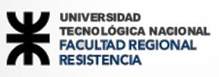
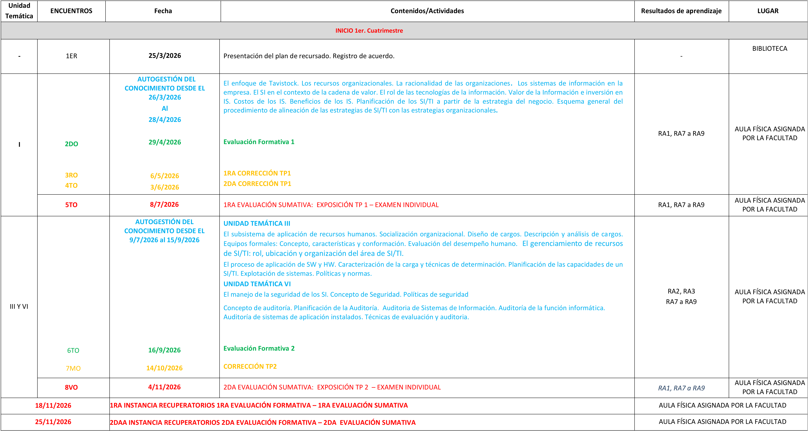

\newpage

{width=45%}

# Datos Descriptivos

| Campo | Detalle |
| :--- | :--- |
| **Institución** | UNIVERSIDAD TECNOLÓGICA NACIONAL – FACULTAD REGIONAL RESISTENCIA |
| **Carrera** | INGENIERÍA EN SISTEMAS DE INFORMACIÓN |
| **Departamento** | INGENIERÍA EN SISTEMAS DE INFORMACIÓN |
| **Área/Bloque** | SISTEMAS DE INFORMACIÓN/TECNOLOGÍAS APLICADAS/INTEGRADORA |
| **Asignatura** | ADMINISTRACIÓN DE SISTEMAS DE INFORMACIÓN |
| **Nivel** | 4TO |
| **Ciclo Lectivo** | 2026 |
| **Carga Horaria Total** | 192 HS C / 144 HS R |
| **Carga Horaria Semanal** | 6 HS C / 4,5 HS R |
| **Cursado** | Anual ☒ · 1º Cuatrimestre ☐ · 2º Cuatrimestre ☐ |

---

# Estructura de la cátedra:

| Nombre y Apellido del Profesor | Categoría | Situación de Revista y/o Condición (Concursado - Interino - Regular) | Dedicación | Tareas/funciones a desarrollar |
| :--- | :--- | :--- | :--- | :--- |
| **Claudia Alejandra Soria Ojeda** | Titular | Regular | 1,5 dedicación simple | Según lo establecido en el artículo 19° del Estatuto de la UTN |
| **Rosina Analía Ramírez** | Jefe de Trabajos Prácticos | Regular | 1 dedicación simple | Según lo establecido en el inciso 2 de Anexo II de la Ordenanza N° 1181 UTN Reglamento Concurso Auxiliares de Docencia |
| **Raúl Alejandro Montiel** | Auxiliar de 1ra interino | Interino | 1 dedicación simple | Según lo establecido en el inciso 4 de Anexo II de la Ordenanza N° 1181 UTN Reglamento Concurso Auxiliares de Docencia |

---

# Fundamentación:

La asignatura Administración de Sistemas de Información, es la materia del tronco integrador de 4° nivel de la ordenanza 1877 C.S.U,

De acuerdo con su finalidad curricular, se proponen contenidos y prácticas que formen al alumno en la comprensión del enfoque estratégico corporativo de la administración de recursos de Sistemas de Información y Tecnologías de la Información (a partir de aquí, SI/TI), adquiriendo una visión holística de la gestión, aplicando los conocimientos de las restantes áreas curriculares adquiridos por los alumnos en los niveles anteriores y asignaturas horizontales.

---

# Resultados de Aprendizajes previos requeridos para iniciar/ continuar el desarrollo de los Resultados de Aprendizaje de la asignatura en relación al nivel de aporte a las Sub-Competencias y Competencias.

| Asignaturas Aprobadas y/o Regularizadas | Resultados de Aprendizaje Alcanzados |
| :--- | :--- |
| **Integradora 1º Nivel - Sistemas y Procesos de Negocio**  Todos los conocimientos sobre Sistemas de Información y su aplicación a la gestión de las Organizaciones. | Identifica la estructura organizativa del escenario en estudio, describiendo en forma correcta y precisa los elementos claves de dicha estructura.  Identifica y diferencia las planificaciones estratégica, táctica y operativa, proponiendo objetivos, actividades y recursos respectivos cada tipo de planificación para una situación en estudio.  Identifica y diferencia las funciones y los procesos de negocios para determinar la matriz de necesidades de información.  Identifica y diferencia los procesos administrativos de los procesos operativos, en base a las características organizacionales de un escenario en estudio.  Identifica los tipos de sistemas de información existentes en una organización. |
| **Análisis Numérico – 3er nivel** | Distingue variables y magnitudes, construyendo modelos numéricos y estadísticos básicos para la determinación de la carga de trabajo de la organización y del análisis del uso de los recursos de un sistema. |
| **Integradora 2º Nivel - Análisis de Sistemas** | Determina las técnicas y metodologías de análisis de requerimientos para la especificación de la cartera de aplicaciones de una situación en estudio. |
| **Integradora 3º Nivel - Diseño de Sistemas** | Determina las técnicas y metodologías de análisis de sistemas adecuadas para definir la carga de trabajo representativa en la situación en estudio. |
| **Economía** | Clasifica a nivel conceptual el impacto de las aplicaciones en la organización en estudio en base a los tipos de beneficios, costos y valor de la inversión |

| Asignaturas Aprobadas y/o Regularizadas | Resultados de Aprendizaje en desarrollo simultáneo |
| :--- | :--- |
| **Investigación Operativa - 4to nivel** | Determina las técnicas de programación lineal para la determinación de carga de trabajo representativa, minimizando costos y corridas de programas de acuerdo con el tipo de carga en estudio y en el contexto de la cartera de aplicaciones desarrolladas para el caso en análisis. |
| **Ingeniería y Calidad de Software – 4to nivel** | Determina las técnicas y metodologías de análisis de requerimientos para la especificación de la cartera de aplicaciones de una situación en estudio.  Comprende a los sistemas de información en desarrollo o en uso como objetos de audito, elaborando un programa de auditoría para los mismos de acuerdo con un objetivo y alcances definidos. |
| **Simulación - 4to nivel** | Conoce las características de los sistemas Discretos, continuos, de las técnicas de modelado, para la determinación de la carga de trabajo futura, de cuellos de botella y los aplica en el estudio del comportamiento de la carga de los sistemas de información involucrados en la situación en análisis.  Identifica técnicas de simulación aplicables a evaluación del rendimiento y monitoreo de los sistemas, y las aplica para el estudio del comportamiento de la carga de los sistemas de información involucrados en la situación en análisis. |
| **Redes de datos – 4to nivel** | Determina la índole de la plataforma tecnológica en la elaboración de la ubicación y gestión de los SI/TI para un caso de estudio.  Conoce los parámetros de rendimiento y control de una red, para modelizar la carga de trabajo en una situación en estudios.  Conoce los parámetros de rendimiento y control de una red, y los aplica en el estudio de herramientas de monitoreo de redes y en el seguimiento de un caso de estudio. |
| **Legislación – 4to año – 1er cuatrimestre** | Interpreta la legislación positiva laboral, de acuerdo al código laboral y normativa específica vigente.  Identifica las características de las diferentes situaciones laborales y las aplica para proponer esquemas de provisión y de aplicación de recursos humanos en un área de SI/TI hipotética. |
| **Técnicas de Desarrollo de Software Ágil – 4 Nivel – 2do cuatrimestre** | Determina un equipo efectivo de trabajo, en base a roles y actividades a asignar, determinando además pautas de trabajo y método de evaluación de desempeño que requiere un proyecto de SI/TI. |

| Asignaturas Aprobadas y/o Regularizadas | Resultados de Aprendizaje aportados |
| :--- | :--- |
| **Integradora de 5° Nivel: Proyecto: Gestión Gerencial – 5to año** | Comprende la gestión tecnológica de los recursos en función a estrategias de SI/TI alineadas con la estrategia empresarial para determinar un proyecto de SI/TI.  Propone equipos de trabajo para el desarrollo de un proyecto de SI/TI.  Asume como propios los objetivos del grupo y actúa para alcanzarlos.  Trabaja de forma cooperativa en cada actividad curricular grupal, respeta los compromisos (tareas y plazos) contraídos con sus pares y asume los resultados y errores en forma compartida. |

---

# Programa Analítico - Unidades Temáticas:

## UNIDAD I: Planificación estratégica de SI/TI.

**Contenidos:**

El enfoque de TAVISTOCK. Los recursos organizacionales. La racionalidad de las organizaciones. Los sistemas de información en la empresa. El SI en el contexto de la cadena de valor. El rol de las tecnologías de la información. Valor de la Información e inversión en IS. Costos de los IS. Beneficios de los IS. Planificación de los SI/TI a partir de la estrategia del negocio. Esquema general del procedimiento de alineación de las estrategias de SI/TI con las estrategias organizacionales. Análisis de la cartera de aplicaciones. Las estrategias genéricas de gestión de SI/TI.

## UNIDAD II: La Administración de Recursos de SI/TI – Subsistema de Provisión.

**Contenidos:**

La ARH como proceso. Los objetivos de la ARH. Políticas de recursos humanos. La responsabilidad del gerente de SI/TI sobre los recursos humanos.

El subsistema de provisión de recursos humanos. El mercado de recursos humanos y el mercado laboral. Los procesos de provisión de personas. Reclutamiento. Técnicas, métodos, medios. Selección. Técnicas, métodos.

El subsistema de provisión de SW y HW. Características. Normas. La provisión de SW. Aspectos críticos. Técnicas de selección y evaluación. La provisión de HW. Aspectos críticos. Técnicas de selección y evaluación. La tercerización de los servicios de SI. Los procesos y aspectos contractuales.

## UNIDAD III: La Administración de Recursos de SI/TI – Subsistema de Aplicación.

**Contenidos:**

El subsistema de aplicación de recursos humanos. Socialización organizacional. Diseño de cargos. Descripción y análisis de cargos. Equipos formales: Concepto, características y conformación. Evaluación del desempeño humano. El gerenciamiento de recursos de SI/TI: rol, ubicación y organización del área de SI/TI.

El proceso de aplicación de SW y HW. Evaluación del Rendimiento de un sistema informático. La evaluación de las prestaciones. Planificación de las capacidades de un SI/TI. Herramientas de medida. Caracterización de la carga. Modelo de administración de recursos: Políticas y normas.

## UNIDAD IV: La Administración de Recursos de SI/TI – Subsistema de Desarrollo y Mantenimiento de los recursos humanos.

**Contenidos:**

El subsistema de desarrollo de recursos humanos. Entrenamiento y desarrollo de personal. Inventario de necesidades. Medios. El ciclo de entrenamiento. Desarrollo organizacional. Concepto. Objetivos. Características.

El subsistema de mantenimiento de recursos humanos. Recompensas. Castigos. La Administración de Salarios. El sistema de compensaciones. Beneficios sociales. Higiene y seguridad en el ámbito de los SI/TI. Las relaciones laborales.

### b) Emprendedorismo: contenidos generales.

De acuerdo con la cantidad real de clases y de alumnos previstos para el presente ciclo 2026, este contenido mínimo se implementará mediante en una actividad de aula invertida, en la fecha indicada en el cronograma.

## UNIDAD V: La Administración de Recursos de SI/TI – Subsistema de Seguimiento.

**Contenidos:**

El subsistema de seguimiento de recursos humanos. El proceso de control. Auditoría de Recursos Humanos.

El proceso de monitorización de SW y HW. Evaluación del Rendimiento de un sistema informático. La evaluación de las prestaciones. Herramientas.

Laboratorio asociado: Introducción al Benchmarking. Aplicaciones de benchmarking sencillas. Herramientas abiertas de Benchmarking. Monitoreo de redes. Introducción al análisis de performance de redes. Investigación sobre otras herramientas de benchmarking y monitoreo asignadas por la cátedra sobre plataformas Linux y Windows.

## UNIDAD VI: La Administración de Recursos de SI/TI – Seguridad y Auditoría de Sistemas de Información.

El manejo de la seguridad de los SI. Concepto de Seguridad. Políticas de seguridad. Concepto de auditoría. Planificación de la Auditoría.

Laboratorio asociado: Diseño e implementación de esquemas de líneas preventivas, de detección y recuperación de accesos a recursos sobre la base de un análisis de riesgo para un caso de estudio.

Auditoria de Sistemas de Información Auditoría de la función informática. Auditoría de sistemas de aplicación instalados. Técnicas de evaluación y auditoria. (Este tema se dictará en forma coordinada con la asignatura Ingeniería de Software)

---

# PLAN DE CURSADO PARA RECURSANTES 2026:

## I. Contenido analítico.

Los recursantes 2026 tendrán un plan de cursado basado en la UNIDAD I: Planificación estratégica de SI/TI; UNIDAD III: La Administración de Recursos de SI/TI – Subsistema de Aplicación, y UNIDAD VI La Administración de Recursos de SI/TI – Seguridad y Auditoría de Sistemas de Información, del programa analítico de la asignatura obrante ut supra.

Consistirá:

- Autogestión de estudios de las tres unidades. La Bibliografía y los cuestionarios de estudio estarán disponibles en el aula virtual

- Dos (2) evaluaciones formativas (*): la primera sobre la Unidad temática I, y la segunda sobre las Unidades Temáticas III y VI.

- Dos (2) trabajos prácticos – Desarrollo Grupal : el primero sobre la Unidad Temática I. El segundo integrando las unidades I, III y VI. El escenario o caso de estudio deberá ser propuesto por los grupos.

- Dos (2) Evaluaciones sumativas: consistentes en un examen individual – oral o escrito, modalidad a definir – sobre los contenidos teóricos prácticos de cada trabajo práctico desarrollado.

## II. Sistema de Acreditación

Según Resolución 785/2025, y atendiendo al plan particular:

- Dos (2) evaluaciones formativas (*): la primera sobre la Unidad temática I, y la segunda sobre las Unidades Temáticas III y VI. Individuales.

- Dos (2) trabajos prácticos: el primero sobre la Unidad Temática I. El segundo integrando las unidades I, III y VI.

- Dos (2) Evaluaciones sumativas: consistente en la exposición grupal sobre los TP's y en un examen individual – oral o escrito, modalidad a definir – sobre los contenidos teóricos prácticos de cada trabajo práctico desarrollado.

### a. Condiciones para la Aprobación directa.

- Cumplir con 6 de los 8 encuentros presenciales

- Participar proactivamente en el desarrollo de los trabajos prácticos

- Asistir a la instancia oficial de cada evaluación, sea formativa o sumativa

- Aprobar la evaluación sumativa E1

- Aprobar la evaluación sumativa E2

- Aprobar las 2 evaluaciones formativas. la primera sobre la Unidad temática I, y la segunda sobre las Unidades Temáticas III y VI. Individuales.

> [!IMPORTANT]
> **IMPORTANTE:** Para mantenerse en este régimen, el alumno sólo podrá recuperar UNA única instancia de evaluación. El recuperatorio de una evaluación sumativa es sólo individual.

### b. Condiciones para la Aprobación de la cursada.

- Cumplir con el 6 de los 8 encuentros presenciales

- Participar proactivamente en el desarrollo de los trabajos prácticos

- Asistir a la instancia oficial de cada evaluación, sea formativa o sumativa

- Aprobar una de las dos evaluaciones sumativas (1 de 2: E1 o E2)

- Aprobar las 2 evaluaciones formativas

### c. Evaluaciones formativas:

En el marco de la asignatura Administración de Sistemas de Información, se implementa una modalidad de evaluación formativa individual.

La evaluación individual permite verificar que se han estudiado los contenidos conceptuales y metodológicos de cada unidad para el plan de recursado, la apropiación práctica y la comprensión integral de los contenidos por parte de cada estudiante. Asimismo, promueve la responsabilidad individual.

La finalidad de estas evaluaciones es implementar un enfoque de evaluación centrado en el proceso, orientado no solo a certificar aprendizajes sino a fortalecer la construcción significativa del conocimiento y la integración teórico-práctica.

Dado que son evaluaciones obligatorias a aprobar de acuerdo a lo establecido por la Resolución N° 785/2025 C.D FRRe, tienen sus respectivos recuperatorios de acuerdo con las instancias previstas en el cronograma de encuentros para recursantes del Ciclo 2026, detallado en el punto III siguiente.

### d. Organización áulica

La distribución de los encuentros será:

* 30/40 minutos de consultas teóricas y luego la evaluación sumativa

* 50/60 minutos de revisión de la consigna práctica de cada módulo.

* 60 minutos por grupo para la exposición del TP de cada módulo (evaluación grupal) y la evaluación sumativa (evaluación individual oral o escrita sobre contenidos teóricos y prácticos relacionados con el TP correspondiente)

---

## III. Cronograma. Cronograma (según Calendario Académico Resolución 832/2025 CD).

{width=100%}

---

# Bibliografía

## Bibliografía. Obligatoria.

- **ANDREU, Rafael, RICART, Joan y VALOR Josep.** (1996). *Estrategia y Sistemas de Información* (Ed. 2da). Capítulos 2,3 y 5. España McGraw Hill. 2 ejemplares en Biblioteca de la FRRe y disponible en formato digital en la Web.

- **CHIAVENATO, Idalberto.** (1999). *Administración de Recursos Humanos.* (ed 5ta). Colombia. McGraw Hill. 4 ejemplares en Biblioteca de la FRRe y disponible en formato digital en la Web.

- **EDWARDS, Chris; WARD, John y BYTHEWAY, Andy.** (1998) *Fundamentos de los Sistemas de Información.* (ed. 2da). Capítulos 4,5 y 6. España. Prentice Hall. 1 ejemplar en Biblioteca de la FRRe y disponible en formato digital en la Web.

- **LARDENT, Alberto R.** (2001) *Sistemas de Información para la Gestión Empresaria - Procedimientos, Seguridad y Auditoría.* Brasil. Prentice Hall Pearson Educación. 1 ejemplar en Biblioteca de la FRRe y disponible en formato digital en la Web.

- **MOLERO, Xavier; JUIZ, Carlos y RODEÑO, Miguel.** (2004). *Evaluación y Modelado del Rendimiento de los Sistemas Informáticos.* Madrid, España Pearson Prentice Hall. 1 ejemplar en Biblioteca de la FRRe y disponible en formato digital en la Web.

- **PIATTINI, Mario y DEL PESO, Emilio.** (2006) *Auditoría Informática- Un enfoque práctico - edición ampliada y revisada.* (Ed 2º). México, Alfaomega- RA-MA. 1 ejemplar en Biblioteca de la FRRe y disponible en formato digital en la Web.

- **ROBSON, Wendy.** (1999) *Planteo de Estrategias Efectivas de Sistemas de Información.* (ed. 2da). - Tomo 3. "Decisiones Estratégicas en Sistemas de Información I" - Tomo 4. "Decisiones Estratégicas en Sistemas de Información II" - Tomo 5. Colección Management Estratégico de Sistemas de Información. Capítulos 7, 9, 12 y 13. Argentina. MP Ediciones. Disponible en formato digital en el aula virtual asignada a la materia.

## Complementaria.

- **RODRÍGUEZ BERMÚDEZ, J. R.** (2015). *Planificación y dirección estratégica de sistemas de información.* Editorial UOC. Barcelona. España. Disponible en Elibro: <https://elibro.net/es/lc/utnfrre/titulos/57875>

- **LAPIEDRA Alcamí, R. DEVECE CARAÑANA, C. & GUIRAL HERRANDO, J.** (2016). *Introducción a la gestión de sistemas de información en la empresa.* Universitat Jaume I. Servei de Comunicació i Publicacions. Castellón de la Plana. España. Disponible en Elibro: <https://elibro.net/es/lc/utnfrre/titulos/51689>

## Webgrafía.

- (2018-03-21). *7 Consejos Para Gestionar Equipos Efectivos.* <https://www.youtube.com/watch?v=-aWNO-kMh>

- (2017-06-16) *Equipos Efectivos en la Organización.* <https://www.youtube.com/watch?v=Ei2-cEHP52M>

- (2015-09-16) *ADN de la Gestión de Equipos - Fernando Saenz Ford - HIGH POTENTIAL FORUM 2014.* <https://www.youtube.com/watch?v=d9MVLvsg8ik>

- (2020-02-01) *Perfiles ocupacionales Industria TI.* Argentina. Cámara de la Industria Argentina del Software. <https://www.cessi.org.ar/perfilesit/>

- **(2026)** *Tabla de Honorarios (tabla referencial orientativa).* Consejo Profesional de Ciencias Informáticas de la Provincia de Córdoba. Enlace a indicar cuando esté la actualización en el año 2026.

- Herramientas virtuales y material digital para formulación y evaluación de modelos de negocios recomendados por la cátedra Formación de emprendedores para el presente ciclo lectivo.
