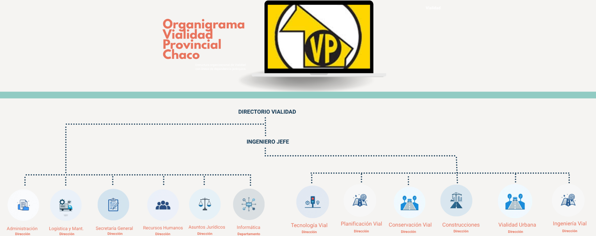

# Escenario: Dirección de Vialidad Provincial del Chaco

La **DVP** es el organismo público responsable de planificar, construir y mantener la red vial de la provincia. Su gestión es clave para la conectividad y el desarrollo económico regional. Bajo la conducción del Administrador General, Ing. Omar Canela, la organización busca modernizar su capacidad de respuesta ante un entorno que exige mayor eficiencia y transparencia.

La estrategia general es **garantizar una red vial óptima mediante el uso eficiente de recursos y tecnología**, coordinando acciones con municipios y organismos nacionales para integrar social y productivamente a la provincia.

Surge de la necesidad de fortalecer los procesos de gestión interna, dotándolos de mayor **capacidad de análisis, control y eficiencia**, mediante el aprovechamiento de la información generada por los sistemas existentes. Actualmente, la organización dispone de múltiples sistemas que permiten registrar y gestionar operaciones clave, como viáticos, provisión de insumos, stock, órdenes de compra y mantenimiento de equipos.

En el marco del proceso de modernización institucional, se llevó a cabo una reunión de directorio en la Dirección de Vialidad Provincial del Chaco, con el objetivo de relevar necesidades estratégicas de las distintas áreas y definir lineamientos para la evolución de los Sistemas de Información.

En primer lugar, el Ingeniero Viola, a cargo de la Dirección de Conservación, planteó la necesidad de contar con un **mapa vial interactivo**, que permita a los habitantes de la provincia reportar el estado de rutas y puentes. La propuesta incluye la posibilidad de realizar denuncias georreferenciadas, adjuntando ubicación, imágenes o videos, con el fin de facilitar el relevamiento técnico posterior y mejorar la planificación de tareas de mantenimiento.

Por su parte, el Ingeniero Derka manifestó la necesidad de avanzar en la generación de **reportes estadísticos** a partir de los sistemas actualmente en funcionamiento. En este sentido, destacó la importancia de disponer de información consolidada que permita analizar indicadores tales como los vehículos con mayor frecuencia de reparación, el consumo de insumos críticos (como aceite o combustible) y el comportamiento general de los recursos a lo largo del tiempo con respecto a los vehículos pertenecientes a la vialidad provincial para evitar el consumo de recursos innecesarios.

Desde el área de Planificación Vial, se expuso la necesidad de implementar un **sistema específico para la gestión de infracciones**, particularmente aquellas registradas por el sector de balanza. Se remarcó la importancia de contar con una herramienta que permita registrar, georreferenciar, analizar y dar seguimiento a dichas infracciones, facilitando la toma de decisiones y el control operativo.

Finalmente, desde el Departamento de Informática se presentó una propuesta integral de **modernización tecnológica** a largo plazo, orientada a transformar el área en un pilar estratégico de la organización. Entre los principales ejes expuestos se destacan:

- La implementación de un sistema de gestión de tickets para centralizar incidencias y generar trazabilidad.

- La integración de sistemas con inventario para el control de recursos.

- La centralización y control de impresiones físicas, para evitar y/o disminuir el uso incorrecto de los recursos administrativos como ser: impresora, toner, tinta.

- El monitoreo de red y auditoría de licencias de software.

- La digitalización de trámites y automatización de procesos.

- El desarrollo de plataformas basadas en datos, incluyendo dashboards e indicadores clave (KPI).

- La incorporación de herramientas innovadoras, como sistemas georreferenciados, chatbots y asistentes basados en inteligencia artificial.

Como resultado de la reunión, se evidenció una necesidad común de generación, integración y análisis de información confiable y oportuna entre las distintas áreas, que permita mejorar la toma de decisiones y optimizar la gestión de los recursos institucionales.

Estas iniciativas no solo buscan mejorar la eficiencia operativa, sino también **promover una gestión basada en datos**, reducir costos, aumentar la transparencia y optimizar la calidad de los servicios brindados tanto al personal interno como a la ciudadanía.

A partir de esta premisa, el trabajo se orienta a analizar las limitaciones de los sistemas actuales (Viaticar, RopasDVP, TallerDLM, StockDVP y OrdenesDVP) y proponer soluciones tecnológicas alineadas con el plan de modernización, que permitan evolucionar hacia un modelo de gestión inteligente.

Basándonos en el relevamiento de los sistemas existentes y al plan de modernización propuesto, se busca construir una visión integral que permita alinear los objetivos de las diferentes áreas con las necesidades reales de la organización, promoviendo una gestión más eficiente, transparente y orientada a resultados.

{width=100%}

📥 [Estructura Orgánica de la Jurisdicción](https://mapadelestado.chaco.gob.ar/files/estructurasPDF/Jur%2013%20Direccion%20de%20Vialidad%20Provincial.pdf)

---

**Dirección de Vialidad Provincial del Chaco**

Es un organismo público encargado de la **planificación, construcción, mantenimiento y administración de la red vial provincial**, con impacto directo en la conectividad, producción y desarrollo social.

A nivel operativo, trabaja en:

- Construcción de rutas y pavimento urbano

- Mantenimiento y conservación de caminos

- Coordinación con municipios

- Ejecución de obras por administración o licitación

**Objetivos:**

1. Asegurar la existencia y buen estado de todos los caminos que conformarán la red nacional, provincial y urbana para satisfacer las necesidades de circulación originadas por la especialidad económica de las distintas regiones de la provincia, los factores sociales y políticos que hacen a la integración de la misma y los compromisos de vinculación interprovincial.

2. Garantizar el uso eficiente del fondo provincial de vialidad y los bienes instalaciones pertenecientes a la repartición. e

3. Proyectar el sistema de caminos integrantes de la red provincial de vialidad, como así también los planes periódicos de obras e inversiones, los que serán elevados al Poder Ejecutivo para su aprobación.

4. Lograr el funcionamiento coordinado con la Dirección Nacional de Vialidad y demás organismos provinciales, a través de la celebración de convenios que tiendan al mejor desenvolvimiento, de las actividades en las que estos tengan injerencia.

**ADMINISTRADOR Y SUBADMINISTRADOR GENERAL**

La administración de la Dirección de Vialidad Provincial estará a cargo de un Administrador

y un Subadministrador General, quienes tendrán además, la representación legal del

Organismo. El Administrador y Subadministrador General serán designados por el Poder

Ejecutivo y durarán cuatro años en sus funciones.

El Subadministrador General reemplazará al Administrador General en los casos de

ausencia, impedimento o enfermedad, y asesorará y asistirá al mismo de conformidad con

lo que determine la reglamentación.

**INGENIERO JEFE**

Su responsabilidad primaria es asistir al Administrador General y al Sub-Administrador

General en todas las acciones y aspectos técnicos que hacen al cumplimiento del objetivo

de la Dirección de Vialidad Provincial.

**Acciones**:

1. Proyectar la organización de los servicios correspondientes a la faz técnica de la

   repartición.

2. Preparar y someter a resolución del Administrador General los estudios económicos

   y técnicos que sirvan de base para proyectar los planes periódicos de construcción

   de caminos y sus ampliaciones sucesivas.

3. Propender el orden de preferencias de obras a ejecutar, fundado en los estudios

   mencionados anteriormente.

4. Ejecutar las disposiciones del Administrador General, siendo responsable ante este

   de la marcha y de la dirección técnica de los trabajos que se efectúen directa o

   indirectamente en cumplimiento del plan de obras.

5. Formar parte del Consejo Técnico y presidirlo en caso de ausencia del Administrador

   General.

6. Colaborar y asesorar técnicamente al Administrador General en todos los casos que

   sean necesarios.

7. Ejercer la administración de la repartición, con todos los derechos y deberes del

   Administrador General, en caso de ausencia de éste, renuncia y/o acefalía.

8. Presidir la Comisión Paritaria Provincial.

### Dirección de Ingeniería Vial

La misión principal de esta Dirección, es la realización de los estudios previos de campaña

con apoyo de antecedentes propios y cartografías en base a fotos aéreas, planchetas del

Instituto Geográfico Militar e imágenes satelitales, el relevamiento de hechos existentes y la

topografía planialtimétrica de la zona de implantación de las obras viales. Además, elabora

propuestas de alternativas de trazado de obras viales, y realiza diseños, cálculos y proyectos

integrales de obras viales rurales y urbanas, incluyendo informes de ingeniería y

documentación gráfica. También se ocupa de los cómputos métricos, el análisis de precios

y presupuestos; confecciona pliegos de condiciones y especificaciones técnicas de todas

las obras viales a ejecutar por licitación y modificaciones de obras viales en ejecución. Por

otra parte, se encarga de la liberación de traza de las rutas y la aplicación del Régimen de

Contribución de Mejoras; y la supervisión y corrección de los estudios y proyectos de obras

viales contratadas a terceros.

En general, todas estas tareas se realizan por Administración con profesionales y técnicos

pertenecientes a la planta del personal propio de la Repartición, y en los casos en que haya

exceso de tareas, urgencia o proyectos especiales, se recurre algunas veces a la

contratación de servicios profesionales externos.

La Dirección está compuesta por el Departamento de Estudios y Proyectos; el Departamento

de Obras Hidráulicas, y el Departamento de Tierra y Contribución de Mejoras.

**Direccion de Planificacion Vial**

Esta Dirección se encarga, principalmente, de la planificación y coordinación del desarrollo del sistema vial provincial, de acuerdo con las necesidades sociales y económicas de los 25 departamentos que conforman la provincia y de la región. Además, promueve el desarrollo tecnológico para mejorar la calidad de las obras y servicios viales. Por otra parte, tiene a su cargo la supervisión de las tareas que se realizan en su ámbito, como planeamiento y evaluación de resultados, evaluación ambiental, inventario vial, censos de tránsito, control de cargas (pesos y dimensiones), educación y seguridad vial, accidentología, entre otras.
La Dirección está dividida en dos departamentos: el de Planeamiento, Evaluación de Resultados y Unidad Ambiental; y el de Educación y Seguridad Vial. Además, la División de Control de Peso y Dimensiones.

**Dirección de Asuntos Jurídicos**

Esta Dirección se encarga de sistematizar toda la información jurídica y legal de la repartición. Es decir, tanto la información judicial, en los referente a las contiendas jurisdiccionales de las cinco delegaciones zonales, como así también lo atinente a consultas, asesorando a través de dictámenes emitidos por el Director.

**Dirección de Administración**

La Dirección de Administración de la DVP ejerce las funciones administrativas-contables del organismo, en el marco de la ley 4.787 de Administración Financiera y otras normas específicas. Se ocupa de todos los aspectos presupuestarios, financieros, patrimoniales y de rendiciones de cuentas, teniendo en cuenta los proyectos y actividades establecidas para la jurisdicción. Todas las tareas desarrolladas por la Dirección de Vialidad Provincial necesitan su financiación, por eso esta Dirección se encarga de preparar el Proyecto de Presupuesto (de acuerdo a las políticas viales a aplicar anualmente), recopilando toda la información al respecto, tanto de Recursos como de gastos. Posteriormente, se ejecutan todas las operaciones necesarias para la aplicación del Presupuesto ya asignado: contrataciones, pagos, la rendición de los mismos, liquidaciones de sueldos, distintos informes y gestiones para registrar y comunicar a distintos organismos la situación patrimonial, económica y financiera de la Repartición.

Según su organigrama, está dividida en dos grandes áreas: Finanzas y Presupuesto, y Coordinación Administrativa. La primera de ellas, a su vez, comprende los departamentos y divisiones de Tesorería; Finanzas, Subresponsables; Inciso II; Inciso III; y Rendiciones de Cuenta. La segunda gran área se compone de Licitaciones y Compra; Remuneraciones; y Patrimonio.

Además, esta dirección cuenta con una Mesa de Entradas y Salidas y la Asesoría Contable, Administrativa y Presupuestaria.

**Dirección de Tecnología Vial**

El objetivo principal de esta Dirección es supervisar las tareas específicas sobre los materiales y las combinaciones que son utilizadas en las obras viales de la repartición mediante la realización o verificación de ensayos físicos, químicos y mecánicos, para asegurar el cumplimiento de las especificaciones técnicas, efectuar estudios de investigación para su perfeccionamiento y estudios de evaluación de pavimentos y otras calzadas.

Está compuesta por el Departamento de Materiales Elaborados, y el Departamento de Estudios Físico Mecánicos. En el primero de ellos se organizan y supervisan la ejecución de ensayos químicos, físicos y mecánicos de los materiales y sus mezclas para el uso vial (agregados, asfaltos, hormigones, etc.). El segundo se encarga principalmente de la ejecución de ensayos de suelos y sus mezclas, con el fin de diseñar pavimentos y realizar controles de obra. También realiza la evaluación de los caminos existentes para establecer el comportamiento de los mismos para diagramar futuras tareas de conservación y/o reparación.

**Dirección de Construcciones**

Esta Dirección se encarga de llevar adelante el vasto plan de obras viales por contrato diseñado por el Gobierno Provincial, gestionado y ejecutado a través de la DVP. Su misión primordial es la de hacer cumplir fielmente los Contratos de Obra. Entre sus funciones principales está el análisis de las ofertas para la licitación y la inspección de obras con un equipo de Inspección Permanente. De ser necesario, realizan un replanteo de la obra, inspeccionando cada etapa y confeccionando un certificado mensual y final de los trabajos ejecutados. También verifican el cumplimiento de los plazos previstos y del plan de trabajos y curva de inversiones.

Además, recopilan y suministran toda la información referida a la marcha de los distintos contratos en ejecución, proponen modificaciones y/o ampliaciones de obras, y elaboran la documentación respectiva cuando son aprobadas. Por otra parte, atienden los reclamos y/o necesidades de las empresas contratistas e informan, sugieren y/o disponen soluciones. Al finalizar cada obra, elaboran informes finales sobre el cumplimiento de los contratistas de las condiciones contractuales, calificando a los mismos. Teniendo esto en cuenta, sugieren modificaciones en la confección de los pliegos de condiciones tendientes a la actualización de los mismos.

La Dirección está compuesta por dos departamentos más importantes: el de Certificaciones, y el de Supervisión de Obras.

**Dirección de Secretaría General**

Esta Dirección tiene entre sus diversas funciones asistir en la orientación, ejecución y control de programas relativos a la actividad de Administración. También está encargada de coordinar y establecer directivas precisas en todo lo vinculado a la recepción, registro, diligenciamiento, despacho y archivo de las tramitaciones y/o actuaciones administrativas que se originen, procurando una gestión ágil y eficiente. Además, ejerce el control y fiscalización de las tramitaciones de orden administrativo y funcionamiento que tenga lugar en todo el ámbito de la Repartición; controla el cumplimiento de las normas administrativas en lo atinente a procedimientos y concentra toda la información del personal de la Repartición. Por otra parte, debe llevar el control de las resoluciones, memorandos y disposiciones de la Repartición, como así también la protocolización de los Convenios que se realizan con otros Organismos.

Está dirección está compuesta por las siguientes áreas:

- Departamento de Gestión Administrativa que se encarga de todas las resoluciones y memorándums de la repartición, y del cual depende Despacho.

- Departamento de Reglamentaciones y Concursos.

- Departamento de Recursos Humanos, del cual depende la Sección de Personal; la Sección de Jubilaciones; y la Sección de Capacitación

- Departamento de Higiene y Seguridad Laboral, del cual dependen las áreas de Prevención y Accidentes.

- Departamento de Asesoría Médica

- Sección de Mesa General de Entradas y Salidas

- División de Archivo General

- División de Mayordomía

- Sección de Secretaría Privada

- División Relaciones Institucionales

- División de Comisión Paritaria Provincial (parte administrativa)

- Hay que destacar también que el Departamento de Informática, depende directamente del Ing. Omar Canela, Administrador General.

**Dirección de Logística y Mantenimiento**

Esta Dirección se encarga de la reparación de todo tipo de vehículos pertenecientes a la Dirección de Vialidad Provincial, salvo los casos que por su complejidad requieran la contratación de servicios externos. Desempeña una tarea de vital importancia cuidando el buen estado de los equipos de la repartición. Para estas funciones cuenta con un taller central en la ciudad de Resistencia, y talleres menores en cada delegación zonal.

La Dirección está dividida en dos departamentos:

- Departamento Técnico y Reparaciones Generales

- Departamento administrativo Gestión y Control

**Dirección de Conservación**

La Dirección de Conservación es la encargada de los trabajos de conservación de las redes primaria, secundaria y terciaria provincial. Esto lo hace por administración, a través de los Consorcios Camineros y por contratos con terceros. Por administración son obras realizadas con equipos propios, las que se encuentran asentadas en las distintas jurisdicciones zonales y ejecutan tareas de construcción de caminos, movimiento de suelo, mejorado de caminos, construcción de obras de arte menor, reconstrucción y conservación de caminos. Las obras de los consorcios camineros son realizadas con equipos propios, e involucran distintas tareas, como la construcción de caminos, movimiento de suelo, mejorado de caminos, construcción de obras de arte menor, reconstrucción y conservación de caminos. Y por contrato con terceros son obras que involucran construcción de alcantarillas, reconstrucción de puentes de hormigón, reconstrucción de puentes de madera dura aserrada, construcción de puente de madera dura.

En general, la Dirección se ocupa de la conservación, reparación, mantenimiento de rutas, caminos, puentes y alcantarillas, labor que se ve estimulada por el apoyo de municipalidades y otros Organismos Provinciales. También se atiende la construcción de rutas de tierra en áreas localizadas.
Esta Dirección se compone de una Oficina Central, el Área Metropolitana y 5 delegaciones zonales:

**Dirección de Vialidad Urbana**

La Dirección de Vialidad Urbana se encarga del diseño, adecuación hidráulica y elaboración de pliegos de los pavimentos comprendidos dentro de los ejidos urbanos. Así también, tiene a su cargo la ejecución de pavimentos bajo la modalidad de administración, control y certificación de los mismos.

Se compone de dos departamentos principales, el de Proyectista de Obra y Adecuación Hídrica; y el de Ejecución de Obra. Además, de esta Dirección depende el Departamento de Mantenimiento Edilicio.
