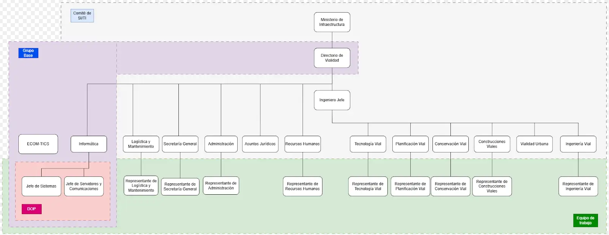
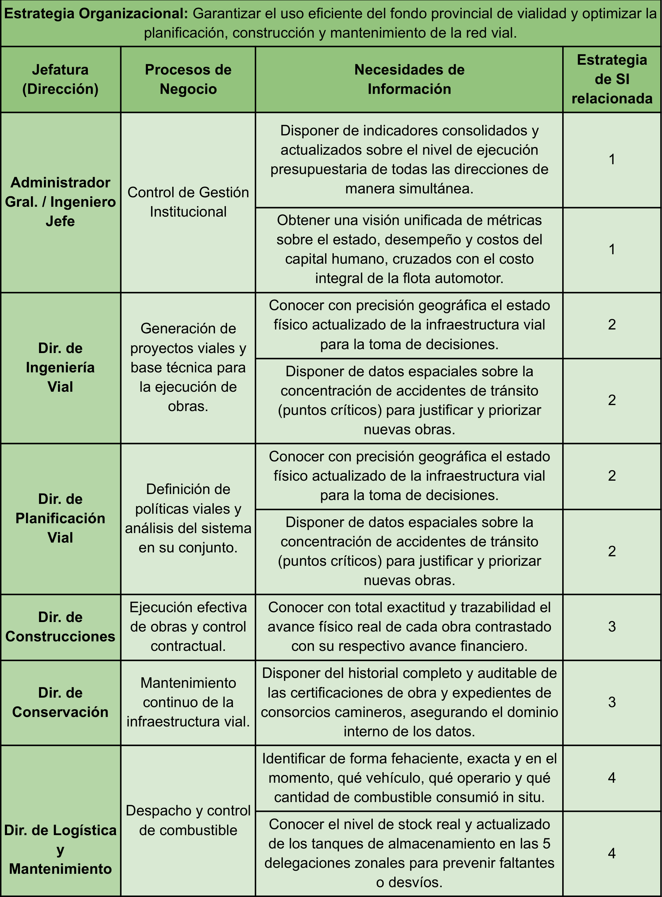
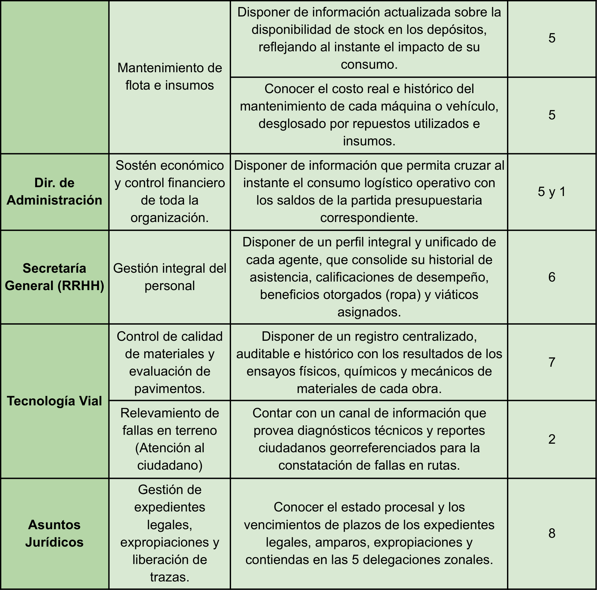

\begin{center}
{\huge\bfseries Universidad Tecnológica Nacional\par}
\end{center}

\begin{center}
{\huge\bfseries Facultad Regional Resistencia\par}
\end{center}

{width=28%}

\begin{center}
{\LARGE\bfseries Trabajo Práctico Nº1 “Alineación del Plan Estratégico de SI/TI”\par}
\end{center}

**Profesores:**

- Montiel, Raul Alejandro.

- Ramirez, Rosina.

- Soria Ojeda, Claudia.

**Integrantes del grupo:**

- Esquivel, Emilio.

- Fernández, Facundo Nahuel.

- Gomez, Christian.

- Medina, Mariano

- Retamozo Enrique, Agustin Ruben.

- Robales, Lautaro.

- Orgoñ, Nahiara.

- Velazco Gez Schegtel, Juan Ignacio.

\newpage

# Fase 1: Presentación y Compromiso del Equipo

# Dirección de Vialidad Provincial del Chaco

Es un organismo público encargado de la planificación, construcción, mantenimiento y administración de la red vial provincial, con impacto directo en la conectividad, producción y desarrollo social.

A nivel operativo, trabaja en:

- Construcción de rutas y pavimento urbano.

- Mantenimiento y conservación de caminos.

- Coordinación con municipios.

- Ejecución de obras por administración o licitación.

**Objetivos:**

- Asegurar la existencia y buen estado de todos los caminos que conformarán la red nacional, provincial y urbana para satisfacer las necesidades de circulación originadas por la especialidad económica de las distintas regiones de la provincia, los factores sociales y políticos que hacen a la integración de la misma y los compromisos de vinculación interprovincial.

- Asegurar que los recursos del fondo vial de la provincia, así como el patrimonio e infraestructura de la entidad, se utilicen de manera óptima.

- Proyectar el sistema de caminos integrantes de la red provincial de vialidad, como así también los planes periódicos de obras e inversiones, los que serán elevados al Poder Ejecutivo para su aprobación.

- Lograr el funcionamiento coordinado con la Dirección Nacional de Vialidad y demás organismos provinciales, a través de la celebración de convenios que tiendan al mejor desenvolvimiento, de las actividades en las que estos tengan injerencia.

## Estructura Organizativa y Funciones

📥 [Estructura Orgánica de la Jurisdicción](https://mapadelestado.chaco.gob.ar/files/estructurasPDF/Jur%2013%20Direccion%20de%20Vialidad%20Provincial.pdf)

---

### ADMINISTRADOR Y SUBADMINISTRADOR GENERAL

La administración de la Dirección de Vialidad Provincial estará a cargo de un Administrador y un Subadministrador General, quienes tendrán además, la representación legal del Organismo. El Administrador y Subadministrador General serán designados por el Poder Ejecutivo y durarán cuatro años en sus funciones.

El Subadministrador General reemplazará al Administrador General en casos de ausencia, impedimento o enfermedad. Asimismo, lo asesorará y asistirá de conformidad con lo que determine la reglamentación.

### INGENIERO JEFE

Su responsabilidad primaria es asistir al Administrador General y al Sub-Administrador General en todas las acciones y aspectos técnicos que hacen al cumplimiento del objetivo de la Dirección de Vialidad Provincial.

**Acciones:**

- Proyectar la organización de los servicios correspondientes a la faz técnica de la repartición.

- Preparar y someter a resolución del Administrador General los estudios económicos y técnicos que sirvan de base para proyectar los planes periódicos de construcción de caminos y sus ampliaciones sucesivas.

- Propender el orden de preferencias de obras a ejecutar, fundado en los estudios mencionados anteriormente.

- Ejecutar las disposiciones del Administrador General, siendo responsable ante éste de la marcha y de la dirección técnica de los trabajos que se efectúen directa o indirectamente en cumplimiento del plan de obras.

- Formar parte del Consejo Técnico y presidirlo en caso de ausencia del Administrador General.

- Colaborar y asesorar técnicamente al Administrador General en todos los casos que sean necesarios.

- Ejercer la administración de la repartición, con todos los derechos y deberes del Administrador General, en caso de ausencia de éste, renuncia y/o acefalía.

- Presidir la Comisión Paritaria Provincial.

### Dirección de Ingeniería Vial

La misión principal de esta Dirección, es la realización de los estudios previos de campaña con apoyo de antecedentes propios y cartografías en base a fotos aéreas, planchetas del Instituto Geográfico Militar e imágenes satelitales, el relevamiento de hechos existentes y la topografía planialtimétrica de la zona de implantación de las obras viales. Además, elabora propuestas de alternativas de trazado de obras viales, y realiza diseños, cálculos y proyectos integrales de obras viales rurales y urbanas, incluyendo informes de ingeniería y documentación gráfica. También se ocupa de los cómputos métricos, el análisis de precios y presupuestos; confecciona pliegos de condiciones y especificaciones técnicas de todas las obras viales a ejecutar por licitación y modificaciones de obras viales en ejecución. Por otra parte, se encarga de la liberación de traza de las rutas y la aplicación del Régimen de Contribución de Mejoras; y la supervisión y corrección de los estudios y proyectos de obras viales contratadas a terceros.

En general, todas estas tareas se realizan por Administración con profesionales y técnicos pertenecientes a la planta del personal propio de la Repartición, y en los casos en que haya exceso de tareas, urgencia o proyectos especiales, se recurre algunas veces a la contratación de servicios profesionales externos.

La Dirección está compuesta por el Departamento de Estudios y Proyectos; el Departamento de Obras Hidráulicas, y el Departamento de Tierra y Contribución de Mejoras.

### Direccion de Planificacion Vial

Esta Dirección se encarga, principalmente, de la planificación y coordinación del desarrollo del sistema vial provincial, de acuerdo con las necesidades sociales y económicas de los 25 departamentos que conforman la provincia y de la región. Además, promueve el desarrollo tecnológico para mejorar la calidad de las obras y servicios viales. Por otra parte, tiene a su cargo la supervisión de las tareas que se realizan en su ámbito, como planeamiento y evaluación de resultados, evaluación ambiental, inventario vial, censos de tránsito, control de cargas (pesos y dimensiones), educación y seguridad vial, accidentología, entre otras.

La Dirección está dividida en dos departamentos: el de Planeamiento, Evaluación de Resultados y Unidad Ambiental; y el de Educación y Seguridad Vial. Además, la División de Control de Peso y Dimensiones.

### Dirección de Asuntos Jurídicos

Esta Dirección se encarga de sistematizar toda la información jurídica y legal de la repartición. Es decir, tanto la información judicial, en los referente a las contiendas jurisdiccionales de las cinco delegaciones zonales, como así también lo atinente a consultas, asesorando a través de dictámenes emitidos por el Director.

### Dirección de Administración

La Dirección de Administración de la DVP ejerce las funciones administrativas-contables del organismo, en el marco de la ley 4.787 de Administración Financiera y otras normas específicas. Se ocupa de todos los aspectos presupuestarios, financieros, patrimoniales y de rendiciones de cuentas, teniendo en cuenta los proyectos y actividades establecidas para la jurisdicción. Todas las tareas desarrolladas por la Dirección de Vialidad Provincial necesitan su financiación, por eso esta Dirección se encarga de preparar el Proyecto de Presupuesto (de acuerdo a las políticas viales a aplicar anualmente), recopilando toda la información al respecto, tanto de Recursos como de gastos. Posteriormente, se ejecutan todas las operaciones necesarias para la aplicación del Presupuesto ya asignado: contrataciones, pagos, la rendición de los mismos, liquidaciones de sueldos, distintos informes y gestiones para registrar y comunicar a distintos organismos la situación patrimonial, económica y financiera de la Repartición.

Según su organigrama, está dividida en dos grandes áreas: Finanzas y Presupuesto, y Coordinación Administrativa. La primera de ellas, a su vez, comprende los departamentos y divisiones de Tesorería; Finanzas, Subresponsables; Inciso II; Inciso III; y Rendiciones de Cuenta. La segunda gran área se compone de Licitaciones y Compra; Remuneraciones; y Patrimonio.

Además, esta dirección cuenta con una Mesa de Entradas y Salidas y la Asesoría Contable, Administrativa y Presupuestaria.

### Dirección de Tecnología Vial

El objetivo principal de esta Dirección es supervisar las tareas específicas sobre los materiales y las combinaciones que son utilizadas en las obras viales de la repartición mediante la realización o verificación de ensayos físicos, químicos y mecánicos, para asegurar el cumplimiento de las especificaciones técnicas, efectuar estudios de investigación para su perfeccionamiento y estudios de evaluación de pavimentos y otras calzadas.

Está compuesta por el Departamento de Materiales Elaborados, y el Departamento de Estudios Físico Mecánicos. En el primero de ellos se organizan y supervisan la ejecución de ensayos químicos, físicos y mecánicos de los materiales y sus mezclas para el uso vial (agregados, asfaltos, hormigones, etc.). El segundo se encarga principalmente de la ejecución de ensayos de suelos y sus mezclas, con el fin de diseñar pavimentos y realizar controles de obra. También realiza la evaluación de los caminos existentes para establecer el comportamiento de los mismos para diagramar futuras tareas de conservación y/o reparación.

### Dirección de Construcciones

Esta Dirección se encarga de llevar adelante el vasto plan de obras viales por contrato diseñado por el Gobierno Provincial, gestionado y ejecutado a través de la DVP. Su misión primordial es la de hacer cumplir fielmente los Contratos de Obra. Entre sus funciones principales está el análisis de las ofertas para la licitación y la inspección de obras con un equipo de Inspección Permanente. De ser necesario, realizan un replanteo de la obra, inspeccionando cada etapa y confeccionando un certificado mensual y final de los trabajos ejecutados. También verifican el cumplimiento de los plazos previstos y del plan de trabajos y curva de inversiones.

Además, recopilan y suministran toda la información referida a la marcha de los distintos contratos en ejecución, proponen modificaciones y/o ampliaciones de obras, y elaboran la documentación respectiva cuando son aprobadas. Por otra parte, atienden los reclamos y/o necesidades de las empresas contratistas e informan, sugieren y/o disponen soluciones. Al finalizar cada obra, elaboran informes finales sobre el cumplimiento de los contratistas de las condiciones contractuales, calificando a los mismos. Teniendo esto en cuenta, sugieren modificaciones en la confección de los pliegos de condiciones tendientes a la actualización de los mismos.

La Dirección está compuesta por dos departamentos más importantes: el de Certificaciones, y el de Supervisión de Obras.

### Dirección de Secretaría General

Esta Dirección tiene entre sus diversas funciones asistir en la orientación, ejecución y control de programas relativos a la actividad de Administración. También está encargada de coordinar y establecer directivas precisas en todo lo vinculado a la recepción, registro, diligenciamiento, despacho y archivo de las tramitaciones y/o actuaciones administrativas que se originen, procurando una gestión ágil y eficiente. Además, ejerce el control y fiscalización de las tramitaciones de orden administrativo y funcionamiento que tenga lugar en todo el ámbito de la Repartición; controla el cumplimiento de las normas administrativas en lo atinente a procedimientos y concentra toda la información del personal de la Repartición. Por otra parte, debe llevar el control de las resoluciones, memorandos y disposiciones de la Repartición, como así también la protocolización de los Convenios que se realizan con otros Organismos.

Está dirección está compuesta por las siguientes áreas:

- Departamento de Gestión Administrativa que se encarga de todas las resoluciones y memorándums de la repartición, y del cual depende Despacho.

- Departamento de Reglamentaciones y Concursos.

- Departamento de Recursos Humanos, del cual depende la Sección de Personal; la Sección de Jubilaciones; y la Sección de Capacitación

- Departamento de Higiene y Seguridad Laboral, del cual dependen las áreas de Prevención y Accidentes.

- Departamento de Asesoría Médica

- Sección de Mesa General de Entradas y Salidas

- División de Archivo General

- División de Mayordomía

- Sección de Secretaría Privada

- División Relaciones Institucionales

- División de Comisión Paritaria Provincial (parte administrativa)

Hay que destacar también que el Departamento de Informática, depende directamente del Ing. Omar Canela, Administrador General.

### Dirección de Logística y Mantenimiento

Esta Dirección se encarga de la reparación de todo tipo de vehículos pertenecientes a la Dirección de Vialidad Provincial, salvo los casos que por su complejidad requieran la contratación de servicios externos. Desempeña una tarea de vital importancia cuidando el buen estado de los equipos de la repartición. Para estas funciones cuenta con un taller central en la ciudad de Resistencia, y talleres menores en cada delegación zonal.

La Dirección está dividida en dos departamentos:

- Departamento Técnico y Reparaciones Generales

- Departamento administrativo Gestión y Control

### Dirección de Conservación

La Dirección de Conservación es la encargada de los trabajos de conservación de las redes primaria, secundaria y terciaria provincial. Esto lo hace por administración, a través de los Consorcios Camineros y por contratos con terceros. Por administración son obras realizadas con equipos propios, las que se encuentran asentadas en las distintas jurisdicciones zonales y ejecutan tareas de construcción de caminos, movimiento de suelo, mejorado de caminos, construcción de obras de arte menor, reconstrucción y conservación de caminos. Las obras de los consorcios camineros son realizadas con equipos propios, e involucran distintas tareas, como la construcción de caminos, movimiento de suelo, mejorado de caminos, construcción de obras de arte menor, reconstrucción y conservación de caminos. Y por contrato con terceros son obras que involucran construcción de alcantarillas, reconstrucción de puentes de hormigón, reconstrucción de puentes de madera dura aserrada, construcción de puente de madera dura.

En general, la Dirección se ocupa de la conservación, reparación, mantenimiento de rutas, caminos, puentes y alcantarillas, labor que se ve estimulada por el apoyo de municipalidades y otros Organismos Provinciales. También se atiende la construcción de rutas de tierra en áreas localizadas.

Esta Dirección se compone de una Oficina Central, el Área Metropolitana y 5 delegaciones zonales:

### Dirección de Vialidad Urbana

La Dirección de Vialidad Urbana se encarga del diseño, adecuación hidráulica y elaboración de pliegos de los pavimentos comprendidos dentro de los ejidos urbanos. Así también, tiene a su cargo la ejecución de pavimentos bajo la modalidad de administración, control y certificación de los mismos.

Se compone de dos departamentos principales, el de Proyectista de Obra y Adecuación Hídrica; y el de Ejecución de Obra. Además, de esta Dirección depende el Departamento de Mantenimiento Edilicio.

### Equipos de trabajo

Para llevar a cabo con éxito el procedimiento de alineamiento estratégico y asegurar que el Plan de TI/SI sea un proyecto respaldado por toda la organización, la metodología de Andreu, Ricart y Valor establece la necesidad de definir responsabilidades claras. Para ello, se exige la conformación de tres órganos fundamentales que asumen distintos niveles de compromiso: el **Comité de Tecnologías y Sistemas de Información (Comité de TI/SI)**, encargado de la dirección estratégica y la aprobación del plan; el **Grupo Base**, responsable de la supervisión táctica y consistencia del proyecto; y el **Equipo de Trabajo**, dedicado a la labor operativa y de análisis diario. A continuación, se presenta un esquema gráfico que ilustra la articulación y jerarquía de estos grupos de trabajo, adaptados específicamente a la estructura organizativa de la Dirección de Vialidad Provincial del Chaco:

\needspace{0.47\linewidth}

[Grupos de trabajo 🔗](https://drive.google.com/file/d/158iY-YVMi-9Gwwv3SG1Wju2OSj-isPqY/view?usp=sharing).

{width=100%}

# Fase 2: Situación actual de Vialidad Provincial Chaco.

Actualmente, la Dirección de Vialidad Provincial del Chaco cuenta con una serie de Sistemas de Información en funcionamiento que permiten sostener la operatoria diaria en áreas clave como mantenimiento, logística, administración, recursos humanos y gestión de obras. Sin embargo, se evidencia que los sistemas existentes resultan insuficientes e incluso, en algunos casos, obsoletos como soporte para la gestión integral del organismo. Esta situación se da en el marco de una estructura organizacional consolidada, con procesos tradicionales que deben adaptarse a un entorno cada vez más demandante, donde la disponibilidad de información oportuna, la capacidad de análisis y el uso de tecnologías digitales se vuelven factores críticos para una gestión eficiente, transparente y alineada con las necesidades actuales de la sociedad.

### Análisis FODA

**FORTALEZAS (Factores Internos Positivos)**

- **Sistemas de información y bases de datos preexistentes:** La DVP no parte desde cero. Ya dispone de múltiples sistemas en funcionamiento (como Viaticar, RopasDVP, TallerDLM, StockDVP y OrdenesDVP) que permiten registrar operaciones clave de viáticos, provisión de insumos, stock y mantenimiento de equipos.

- **Proactividad y visión de la alta dirección:** Existe un compromiso claro por parte del directorio y de los líderes de área (bajo la conducción del Administrador General, Ing. Omar Canela, y directores como los ingenieros Kutnich, Viola y Derka) para identificar las limitaciones actuales y proponer lineamientos estratégicos orientados a la eficiencia, la transparencia y el uso de la tecnología.

- **Aceptación del cambio:** Se ha demostrado éxito al digitalizar procesos históricamente manuales (ejemplo: el sistema de *Calificaciones o Viaticos* fue muy bien adoptado y reemplazó al papel).

- **Capacidad de alcance provincial:** El sistema *GesTaller* ya gestiona información no solo de la DVP, sino de vehículos de distintas reparticiones públicas, posicionando a la DVP como referente técnico en la provincia.

**DEBILIDADES (Factores Internos Negativos)**

- **Sistemas "Silos" (Aislamiento de la información):** Los sistemas actuales no se comunican entre sí. Logística, Stock, Presupuesto (Ordenes DVP) y Talleres funcionan como islas, obligando a cruces manuales.

- **Carencia de herramientas analíticas (BI):** Todos los sistemas sirven para cargar datos, pero casi ninguno para explotarlos. Faltan tableros de control (dashboards), alertas y reportes históricos para que los Directores puedan tomar decisiones.

- **Procesos críticos y manuales dependientes del papel que afectan eficiencia:** El control de combustible (*SiCC*), que es un gasto gigante para Vialidad, se sigue basando en planillas físicas completadas a mano, generando demoras y riesgo de errores humanos.

- **Falta de reportes de control de gestión financiero:** Existe una desconexión entre los sistemas informáticos y el control del inventario, lo que se suma a la falta de centralización en el área administrativa, permitiendo actualmente el uso incorrecto e ineficiente de recursos físicos.

- **Deficiencias tecnológicas para la interacción ciudadana y el control operativo:** La institución carece de canales digitales modernos, como un mapa vial interactivo para que los habitantes puedan denunciar y georreferenciar el estado de rutas y puentes, y tampoco cuenta con un sistema específico para registrar y hacer seguimiento de las infracciones en el sector de balanzas

**OPORTUNIDADES (Factores Externos o a Futuro Positivos)**

- **Implementación de Inteligencia de Negocios (BI):** Con herramientas modernas y accesibles, se puede extraer un valor inmenso de los datos que los sistemas actuales ya tienen guardados (ej. predecir cuándo fallará una máquina, optimizar rutas).

- **Disponibilidad de herramientas para trabajo en terreno (Mobile):** El contexto tecnológico actual permite aprovechar aplicaciones en dispositivos móviles para descentralizar y digitalizar el trabajo de las 5 Delegaciones Zonales y la carga de combustible *in situ*.

- **Integración Interinstitucional:** Almacenar de manera inteligente la información de *GesTaller* puede ofrecer a otros Ministerios estadísticas sobre el mantenimiento del parque automotor provincial.

- **Integración de sistemas actuales en una arquitectura unificada.**

- **Participación ciudadana como fuente de información:** El desarrollo de herramientas como un mapa vial interactivo representa una excelente oportunidad para involucrar a la ciudadanía en la gestión pública. Al permitir que los habitantes reporten y georreferencien el estado de rutas y puentes con imágenes o videos, la DVP puede nutrirse de información en tiempo real para mejorar sustancialmente su planificación de mantenimiento**.**

- **Digitalización de procesos manuales (ej. combustible).**

- **Incorporación de tecnologías emergentes:** El contexto tecnológico actual ofrece a la DVP la oportunidad de dar un salto cualitativo integrando herramientas innovadoras de vanguardia, como asistentes basados en inteligencia artificial, chatbots y sistemas avanzados de georreferenciación**.**

**AMENAZAS (Factores Externos Negativos)**

- **Dependencia de proveedores externos (Vendor Lock-in):** El sistema de *Consorcios* es cerrado y tercerizado. Al no tener acceso al código fuente, la DVP queda rehén de los costos, tiempos y la voluntad del proveedor para hacer mejoras o extraer datos vitales de las certificaciones de obras.

- **Inconsistencia y pérdida de datos (Riesgo de control):** Si no se moderniza rápido el sistema de combustible (*SiCC*) o el cruce Taller-Stock, existe un alto riesgo de fugas de recursos, robos o uso ineficiente de los fondos públicos provinciales.

- **Limitaciones presupuestarias:** Los proyectos de TI dentro del Estado pueden sufrir recortes o retrasos si no se demuestra rápidamente el Retorno de Inversión (ROI), por ejemplo, demostrando que un nuevo sistema ahorra "X" millones en repuestos y viáticos.

### Identificación de las principales funciones y procesos de negocio por área

- **Dirección de Ingeniería Vial**
  Se encarga de la **planificación técnica y diseño de obras viales**, incluyendo estudios previos, relevamientos topográficos, análisis de alternativas de trazado y elaboración de proyectos integrales. También gestiona presupuestos, cómputos métricos y pliegos licitatorios, además de supervisar proyectos desarrollados por terceros.
  **Función de negocio principal:** Generación de proyectos viales y base técnica para la ejecución de obras.

- **Dirección de Planificación Vial**
  Responsable de la **planificación estratégica del sistema vial provincial**, considerando aspectos sociales, económicos y territoriales. Realiza evaluación de resultados, estudios ambientales, censos de tránsito, control de cargas y acciones de seguridad vial.
  **Función de negocio principal:** Definición de políticas viales y análisis del sistema en su conjunto.

- **Dirección de Tecnología Vial**
  Supervisa la **calidad de los materiales y procesos constructivos**, mediante ensayos físicos, químicos y mecánicos. También realiza investigaciones y evaluaciones de pavimentos.
  **Función de negocio principal:** Control de calidad de materiales, evaluación de pavimentos y relevamiento técnico de fallas en terreno.

- **Dirección de Construcciones**
  Encargada de la **ejecución y control de obras viales por contrato**, incluyendo inspección, certificación de avances, control de plazos y relación con contratistas. **Función de negocio principal:** Ejecución efectiva de obras y control contractual.

- **Dirección de Conservación**
  Se ocupa de la **conservación y mantenimiento de la red vial**, tanto por administración directa como mediante consorcios camineros o terceros. Incluye trabajos sobre caminos, rutas, puentes y alcantarillas.
  **Función de negocio principal:** Mantenimiento continuo de la infraestructura vial.

- **Dirección de Logística y Mantenimiento** Responsable del **mantenimiento y reparación del parque automotor**, tanto en taller central como en delegaciones. Gestiona recursos técnicos y operativos para garantizar la disponibilidad de equipos.
  **Función de negocio principal:** Mantenimiento de flota e insumos, despacho y control de combustible.

- **Dirección de Administración**
  Gestiona los **recursos financieros, presupuestarios y contables** del organismo. Incluye la elaboración y ejecución del presupuesto, pagos, contrataciones, liquidación de sueldos y rendiciones de cuentas.
  **Función de negocio principal:** Sostén económico y control financiero de toda la organización.

- **Dirección de Vialidad Urbana**
  Se encarga del diseño, adecuación hidráulica y elaboración de pliegos para pavimentos urbanos, además de la ejecución, control y certificación de obras realizadas dentro de los ejidos urbanos. También tiene bajo su órbita tareas de mantenimiento edilicio.
  **Función de negocio principal:** Planificación, ejecución y mantenimiento de infraestructura vial urbana.

- **Dirección de Vialidad Urbana**
  Se encarga de planificar y construir el pavimento de las calles que están **dentro de las ciudades y pueblos**. Esto incluye hacer los planos, calcular los desagües (para que no se inunden las calles) y preparar todos los documentos técnicos. Además, construyen estas calles con personal y maquinaria propia, vigilan que el trabajo se haga bien y, como tarea extra, se ocupan de mantener y arreglar los edificios de Vialidad.
  **Función de negocio principal:** Diseñar, construir y controlar las obras de asfalto y desagües dentro de las ciudades.

- **Dirección de Secretaría General (RRHH)**
  Se encarga de coordinar las tramitaciones de orden administrativo, el registro de expedientes y el despacho general de la institución. Además, concentra y administra de manera centralizada toda la información relacionada con el capital humano de la repartición, abarcando el control de asistencia, liquidación de viáticos, entrega de indumentaria, calificaciones de desempeño, y programas de higiene y seguridad laboral.
  **Función de negocio principal:** Gestión integral del personal.

- **Dirección de Asuntos Jurídicos**
  Es responsable de sistematizar y gestionar toda la información jurídica y legal de la repartición. Asesora a la institución mediante la emisión de dictámenes, interviene en las contiendas jurisdiccionales de las delegaciones zonales y lleva el seguimiento procesal estricto de amparos, juicios, expropiaciones de terrenos y liberación de trazas necesarias para el desarrollo de las obras viales.
  **Función de negocio principal:** Gestión de expedientes legales, expropiaciones y liberación de trazas.

### Sistemas de Información Existentes

- Viaticar

Sistema destinado a la gestión de solicitudes de viáticos y sus respectivas rendiciones.

El sistema cumple adecuadamente su función operativa, pero presenta limitaciones en el análisis de la información.

- RopasDVP

Sistema encargado de gestionar los pedidos de indumentaria laboral para el personal.
No dispone de herramientas de análisis sobre los gastos realizados.

- TallerDLM

Sistema utilizado para la gestión de pedidos de insumos y órdenes de trabajo del área de mecánica.
Carece de reportes analíticos que permitan evaluar el rendimiento y costos asociados.

- StockDVP

Sistema que administra los movimientos de stock (cubiertas, repuestos, aceites, envíos a delegaciones, etc.).
El sistema se enfoca en la registración operativa, sin explotar la información disponible.

- OrdenesDVP

Sistema que gestiona las órdenes de provisión y órdenes de compra, generadas a partir de pedidos internos.
Permite administrar el uso de partidas presupuestarias por dirección, pero con escasa capacidad analítica.

- SiCC

Sistema encargado de la gestión de cargas de combustible de toda la repartición, incluyendo el control de los distintos tanques ubicados tanto en zonas operativas como en la sede central.
El proceso se basa en la generación de planillas que luego se completan manualmente a medida que se realizan los despachos de combustible. Si bien permite registrar las operaciones, presenta limitaciones en cuanto a la explotación de la información.

- GesTaller

Sistema destinado al registro de constataciones y servicios realizados sobre el parque automotor de la provincia, abarcando vehículos pertenecientes a distintas reparticiones públicas.
El sistema cumple una función clave en la registración de intervenciones mecánicas y controles, pero se encuentra limitado al plano operativo.

- RRHH

Sistema orientado a la gestión integral del personal de la repartición.
Permite administrar la información de los agentes, incluyendo sus cargos (planta permanente, subrogancias, contratos), así como el registro de inasistencias, licencias, certificados médicos, permisos y otras novedades relacionadas. Constituye una herramienta central para la administración del capital humano.

- Calificaciones

Sistema destinado a la evaluación del desempeño del personal, utilizado por los jefes de cada dirección y departamento para calificar a sus agentes.
El sistema digitaliza un proceso que anteriormente se realizaba de forma manual, permitiendo gestionar el circuito completo de calificación (pendiente, evaluado, validado por el área de personal), además de calcular automáticamente el puntaje obtenido por cada agente. Esta información se incorpora al legajo del empleado y constituye un insumo clave para la definición de ascensos de categoría.

- Consorcio

Sistema tercerizado utilizado para la gestión de los consorcios camineros.
Se trata de una solución externa, sin acceso al código fuente, lo que limita la capacidad de adaptación y evolución interna. El sistema gestiona las certificaciones de obras de los consorcios camineros, así como su administración contable, siendo una herramienta clave para la operatoria del área.

- LexDoctor

Sistema destinado a la gestión integral de procesos judiciales y extrajudiciales, utilizado por el departamento de asuntos jurídicos.

El sistema digitaliza un proceso que anteriormente se realizaba de forma manual en papel o mediante planillas dispersas, permitiendo gestionar el circuito completo de la procuración (seguimiento de expedientes, control de plazos y vencimientos, agenda de audiencias y redacción automatizada de escritos), además de calcular automáticamente tasas, intereses y honorarios. Esta información se incorpora al historial de cada caso y constituye un insumo clave para la toma de decisiones estratégicas, la optimización del tiempo de los profesionales y la auditoría del estado de los litigios.

### Síntesis de la situación actual

A partir del relevamiento realizado en la Dirección de Vialidad Provincial del Chaco, se observa que la organización dispone de múltiples sistemas informáticos que acompañan la operatoria diaria de distintas áreas. Sin embargo, estos sistemas funcionan de manera aislada, sin integración ni explotación de la información generada, lo que limita significativamente la capacidad de análisis y la toma de decisiones basada en datos.

El análisis de las distintas direcciones —como Logística y Mantenimiento, Conservación, Administración y Planificación Vial— evidencia una fuerte orientación a procesos operativos, con escaso soporte tecnológico orientado a la generación de información estratégica. En la mayoría de los casos, los sistemas se utilizan únicamente para registrar transacciones, sin contar con herramientas que permitan visualizar indicadores, analizar tendencias o evaluar el desempeño de los recursos.

Asimismo, se identificaron procesos críticos que aún presentan componentes manuales o informales, como el registro de consumo de combustible o la falta de mecanismos estructurados para el seguimiento de incidencias técnicas. Esta situación impacta directamente en la trazabilidad de las operaciones, el control de recursos y la eficiencia organizacional.

Por otra parte, la falta de integración entre sistemas genera fragmentación de la información, dificultando la construcción de una visión global de la organización. Esto se traduce en duplicación de esfuerzos, inconsistencias en los datos y limitaciones para responder de manera ágil a las necesidades de gestión.

En este contexto, se evidencia una brecha significativa entre la situación actual de los sistemas de información y el modelo de gestión requerido para mejorar la eficiencia, la transparencia y la calidad de los servicios brindados. Los sistemas existentes, si bien cumplen su función operativa, resultan insuficientes para acompañar un modelo de gestión moderno basado en información.

Por lo tanto, se hace necesaria una transformación tecnológica que permita integrar los sistemas actuales, incorporar herramientas de análisis y evolucionar hacia un esquema de gestión orientado a datos, alineado con las necesidades presentes y futuras de la Dirección de Vialidad Provincial del Chaco.

### Cartera de aplicaciones actuales:

+----------------------------------------------------+----------------------------------------------------+
| **Estrategia organizacional**                      | **Alto Potencial**                                 |
+====================================================+====================================================+
| - Mapa Vial Interactivo                            | - Asistentes de Inteligencia Artificial y Chatbots |
| - Inteligencia de Negocios (BI) y Dashboards       | - Herramientas Mobile (Trabajo en terreno)         |
| - GesTaller (Integración Interinstitucional)       |                                                    |
+----------------------------------------------------+----------------------------------------------------+
| **Clave para las operaciones**                     | **Apoyo**                                          |
+----------------------------------------------------+----------------------------------------------------+
| - StockDVP                                         | - Viaticar                                         |
| - TallerDLM                                        | - RopasDVP                                         |
| - OrdenesDVP                                       | - RRHH                                             |
| - Consorcio                                        | - Calificaciones                                   |
| - GesTaller                                        | - LexDoctor                                        |
| - SiCC                                             |                                                    |
+----------------------------------------------------+----------------------------------------------------+

En Clave para las operaciones, si bien poseen una buena estructura de sistemas, el siguiente paso para seguir creciendo, mirando hacia el futuro sería realizar la integración de sus sistemas como ser StockDVP, TallerDLM, OrdenesDVP, para evitar cruces manuales y duplicidad. A su vez en el SiCC eliminar el papel en el control de combustible para un mejor control sólido.

En Estrategia organizacional con el sistema actual de GesTaller se considera realizar una evolución del sistema actual para que pueda compartir información con otros ministerios, colocando al DVP como referente.

# Fase 3: Elaboración del plan SI/TI

### Matriz de Necesidades (Negocio vs. Sistemas de Información)

{width=100%}

\newpage

{width=100%}

### Listado de Necesidades y Alineación Estratégica (SI/TI)

## 1. Control de Gestión Institucional (Alta Dirección)

- **Necesidad de Información:**

  - Disponer de indicadores consolidados y actualizados sobre el nivel de ejecución presupuestaria de todas las direcciones de manera simultánea.

  - Obtener una visión unificada de métricas sobre el estado, desempeño y costos del capital humano, cruzados con el costo integral de la flota automotor.

  - Disponer de información que permita cruzar al instante el consumo logístico operativo con los saldos de la partida presupuestaria correspondiente.

- **Estrategia de SI (El Qué):** Facilitar la toma de decisiones estratégicas de la Alta Gerencia mediante el acceso a información consolidada y en tiempo real sobre la ejecución presupuestaria y costos operativos, garantizando el uso eficiente de los recursos provinciales.

- **Estrategia de TI (El Cómo):** Implementar una solución de Inteligencia de Negocios (**DVP-BI**) basada en un **Data Warehouse** que centralice la extracción de datos de todas las áreas para la generación de **Dashboards** y **KPIs** en tiempo real.

## 2. Planificación y Análisis Territorial (Ingeniería Vial)

- **Necesidad de Información:**

  - Conocer con precisión geográfica el estado físico actualizado de la infraestructura vial para la toma de decisiones.

  - Disponer de datos espaciales sobre la concentración de accidentes de tránsito (puntos críticos) para justificar y priorizar nuevas obras.

  - Contar con un canal de información que provea diagnósticos técnicos y reportes ciudadanos georreferenciados para la constatación de fallas en rutas.

- **Estrategia de SI (El Qué):** Disponer de una visión integral y georreferenciada del territorio provincial que permita analizar la relación entre el estado del inventario vial y los índices de accidentología, facilitando la planificación estratégica de intervenciones y la toma de decisiones basada en datos geográficos precisos y actualizados.

- **Estrategia de TI (El Cómo):** Implementar el sistema **GeoVial (GIS)** como un entorno geográfico avanzado que centralice la visualización y el análisis espacial de la red vial. El sistema debe permitir la integración de capas de datos estadísticos dinámicas, herramientas de mapeo del inventario físico y módulos de análisis de accidentología, proporcionando a las áreas técnicas una plataforma interactiva para la planificación territorial.

## 3. Gestión Misional y Soberanía Tecnológica (Ingeniería y Construcciones)

- **Necesidad de Información:**

  - Conocer con total exactitud y trazabilidad el avance físico real de cada obra contrastado con su respectivo avance financiero.

  - Disponer del historial completo y auditable de las certificaciones de obra y expedientes de consorcios camineros, asegurando el dominio interno de los datos.

- **Estrategia de SI (El Qué):** Disponer de una plataforma de gestión unificada y soberanía tecnológica que permita informatizar, estandarizar y auditar los procesos misionales de ingeniería, obras y conservación, garantizando la trazabilidad financiera de las certificaciones de obra.

- **Estrategia de TI (El Cómo):** Desarrollar de forma evolutiva un **ERP Vial Integral propio (In-House)** para eliminar la dependencia tecnológica de terceros y centralizar la operación de las Direcciones en módulos específicos para la gestión de licitaciones, certificación de obras y administración de Consorcios.

## 4. Control de Recursos en Terreno (Combustible)

- **Necesidad de Información:**

  - Identificar de forma fehaciente, exacta y en el momento, qué vehículo, qué operario y qué cantidad de combustible consumió in situ.

  - Conocer el nivel de stock real y actualizado de los tanques de almacenamiento en las 5 delegaciones zonales para prevenir faltantes o desvíos.

- **Estrategia de SI (El Qué):** Optimizar el control operativo en terreno y la transparencia en el uso de insumos críticos, eliminando la incertidumbre de los registros manuales para garantizar un seguimiento estricto de los despachos de combustible.

- **Estrategia de TI (El Cómo):** Implementar la aplicación móvil **"SiCC Móvil"** para reemplazar el circuito de papel. La herramienta debe permitir el registro digital y la validación *in situ* de cada carga, integrando un motor de alertas que detecte consumos atípicos en tiempo real.

## 5. Trazabilidad del Gasto Operativo (Logística y Administración)

- **Necesidad de Información:**

  - Disponer de información actualizada sobre la disponibilidad de stock en los depósitos, reflejando al instante el impacto de su consumo.

  - Conocer el costo real e histórico del mantenimiento de cada máquina o vehículo, desglosado por repuestos utilizados e insumos.

  - Disponer de información que permita cruzar al instante el consumo logístico operativo con los saldos de la partida presupuestaria correspondiente.

- **Estrategia de SI (El Qué):** Disponer de una visión integral y unificada de la cadena de suministros y los costos operativos, permitiendo la trazabilidad automática de los gastos institucionales para asegurar un control financiero preciso.

- **Estrategia de TI (El Cómo):** Implementar una arquitectura de interoperabilidad basada en **APIs** que integre los sistemas **TallerDLM, StockDVP** y **OrdenesDVP**, erradicando los silos de datos para automatizar el flujo de información desde el consumo hasta el presupuesto.

## 6. Visión Integral del Capital Humano (Secretaría General / RRHH)

- **Necesidad de Información:**

  - Disponer de un perfil integral y unificado de cada agente, que consolide su historial de asistencia, calificaciones de desempeño, beneficios otorgados (ropa) y viáticos asignados.

- **Estrategia de SI (El Qué):** Contar con una perspectiva integral y centralizada del desempeño e historial de cada agente, facilitando la gestión del talento mediante un acceso rápido a la información consolidada del personal.

- **Estrategia de TI (El Cómo):** Desarrollar un ecosistema de integración mediante **APIs** que unifique los sistemas de **RRHH, Calificaciones, Viaticar** y **RopasDVP** para conformar un **Legajo Digital Único** con visión 360° del empleado.

## 7. Control de Calidad (Dirección de Tecnología Vial)

- **Necesidad de Información:**

  - Disponer de un registro centralizado, auditable e histórico con los resultados de los ensayos físicos, químicos y mecánicos de materiales de cada obra.

- **Estrategia de SI (El Qué):** Disponer de una base de conocimiento técnico auditable que garantice el aseguramiento de la calidad de los materiales y procesos constructivos, permitiendo a la institución respaldar técnica y legalmente el cumplimiento de las garantías de obra frente a las empresas contratistas.

- **Estrategia de TI (El Cómo):** Desarrollar e implementar el sistema "LabVial" como una base de datos centralizada para el registro, consulta y resguardo digital de todos los resultados de laboratorios de suelos y materiales, eliminando la dependencia de registros informales en cuadernos o archivos PDF aislados.

## 8. Retención Legal (Dirección de Asuntos Jurídicos)

- **Necesidad de Información:**

  - Conocer el estado procesal y los vencimientos de plazos de los expedientes legales, amparos, expropiaciones y contiendas en las 5 delegaciones zonales.

- **Estrategia de SI (El Qué):** Asegurar el seguimiento y control estricto de la situación jurídica y procesal del organismo, garantizando el cumplimiento ineludible de los plazos legales para mitigar el riesgo de sanciones, juicios o pérdidas patrimoniales para el Estado provincial.

- **Estrategia de TI (El Cómo):** Aplicar una estrategia de "Retención y Mantenimiento" renovando y manteniendo las licencias del software LexDoctor (estándar nacional en el ámbito legal). Esta decisión evita el desgaste de desarrollar un sistema a medida, optimizando la eficiencia del presupuesto de TI para enfocar los recursos de programación exclusivamente en el Core del negocio (el ERP).

**Tipos de sistemas según la ubicación de acuerdo a la cadena de valor (Modelo de Andreu, Ricart y Valor):** Analizar la taxonomía de los sistemas de información institucionales en función de su impacto y cobertura dentro de la estructura de Vialidad.

- **Subsistemas circunscritos a actividades concretas (Sistemas de Nicho):** Se trata de soluciones tecnológicas que gestionan información específica y transaccional, operando con independencia de otras áreas para resolver tareas particulares de la repartición. Ejemplos destacados incluyen el **SiCC Móvil** para control de combustible, el entorno **GeoVial (GIS)**, y herramientas operativas como **GesTaller, LexDoctor, Viaticar LabVial** y **RopasDVP**.

- **Sistema de Información Básico (Sistemas Transversales e Infraestructura):** Constituyen el cimiento tecnológico y la arquitectura de soporte que coordina a múltiples direcciones mediante bases de datos integradas. En esta categoría se ubican el **ERP Vial Integral (In-House)**, el ecosistema de inteligencia de negocios **DVP-BI**, y los sistemas de gestión administrativa centralizada como **OrdenesDVP** y el módulo de **RRHH**.

**Valor de la Inversión:** Identificar los tipos de beneficios y los tipos de inversiones implicados en las estrategias de SI/TI.

### Tipos de beneficios

## 1. Beneficios de Eficiencia (Nivel Operacional)

*Estos beneficios corresponden a la **Primera Era de la Información (E1 - Automatizar)**. Son de carácter estrictamente **tangible** y se justifican mediante técnicas "duras" enfocadas en el **desplazamiento de costos** (eliminar un gasto actual sustituyendo recursos por tecnología) y en la **evitación de costos** futuros.*

- **Desplazamiento de costos directos de insumos y optimización del tiempo de registro (SiCC Móvil):** Sustitución del registro analógico en papel por captura digital en terreno, logrando un ahorro neto estimado de **USD 18.000 anuales** en insumos de papelería, impresión y distribución física (desplazamiento de costos). Asimismo, se parametriza una **reducción del 45% en el tiempo de procesamiento y carga de datos**, liberando un equivalente a **120 horas-hombre mensuales** del personal técnico en terreno (eficiencia de recursos con respecto al tiempo).

- **Reducción del tiempo de ciclo logístico y optimización de inventarios (Sistemas logísticos integrados):** Reducción del **40% en el tiempo de ciclo (time-to-repair)** desde la solicitud de repuestos o herramientas en el taller hasta su entrega efectiva desde el depósito central (rendimiento temporal). Esto permite disminuir la redundancia de stock ocioso de repuestos viales en un **15%**, traduciéndose en una evitación de costos de almacenamiento e inmovilización de capital de **USD 25.000** en el primer año.

- **Aceleración del valor financiero en certificaciones de obra (ERP Vial Integral):** Automatización de la verificación físico-financiera, reduciendo el circuito administrativo de aprobación de certificaciones de contratistas de **45 días a solo 12 días** (aceleración del valor). Este control estricto de auditoría elimina errores de liquidación manual y **evita al organismo el pago de un estimado de USD 35.000 anuales** en concepto de intereses por mora acumulados con las empresas constructoras (evitación de costos).

- **Evitación de costos de reconstrucción vial mediante control de calidad auditable (LabVial):** Centralización y disponibilidad inmediata de la trazabilidad de los ensayos de asfalto y hormigón, permitiendo una **evitación de costos del 8%** en presupuestos de bacheo y reparación vial prematura. Al contar con un respaldo técnico rápido e indiscutible, el organismo puede exigir el cumplimiento de las garantías de obra a las contratistas antes del vencimiento de los plazos legales, evitando que el Estado asuma el costo financiero de reconstruir calzadas defectuosas.

## 2. Beneficios de Efectividad (Nivel Táctico)

*Estos beneficios se perciben en el **nivel táctico (mandos medios y gerencias de departamento)**, corresponden a la **Segunda Era de la Información (E2 - Informar)** y su foco es cualitativo, orientado a optimizar el **Rendimiento sobre los Activos (RoA)** del organismo. Su técnica de justificación es "blanda" y se asocia a la mejora en la toma de decisiones.*

- **Optimización del rendimiento de activos físicos y control de mantenimiento (Sistemas logísticos y financieros integrados):** A través de la integración de *TallerDLM*, *StockDVP* y *OrdenesDVP*, los jefes de departamento obtienen soporte a intervalos de decisión clave para el mantenimiento de la flota. Esto mejora de forma blanda el control presupuestario y la auditoría de repuestos, garantizando un aumento real en la disponibilidad operativa de las máquinas de Vialidad (mayor rendimiento sobre el activo físico).

- **Soporte inteligente para la toma de decisiones financieras (DVP-BI: Tableros de Control y Data Warehouse):** La implementación de este entorno de Inteligencia de Negocios (BI) actúa como un Sistema de Soporte a las Decisiones (DSS). Facilita a los directores un flujo de información gerencial oportuna, precisa y concisa, permitiendo monitorear el desvío de los recursos del Fondo Provincial de Vialidad en tiempo real y corregir las partidas presupuestarias de forma proactiva.

- **Alineamiento y desarrollo del capital intelectual (Legajo Digital Único):** El sistema unifica de manera integral la evaluación del desempeño, los antecedentes y las capacidades de los agentes de las distintas delegaciones zonales. Esto dota a las direcciones de una herramienta analítica confiable para tomar decisiones efectivas de promoción y ascensos basadas en el mérito real, incrementando la motivación, reduciendo el favoritismo subjetivo y fomentando el "sentido de propiedad" de los empleados públicos hacia la organización.

## 3. Beneficios de Avance Estratégico (Nivel Estratégico)

*Estos beneficios impactan directamente en la **alta dirección (nivel institucional)**, corresponden a la **Tercera Era de la Información (E3 - Transformar)** y están orientados al crecimiento y a la competitividad del organismo. Son, por definición, intangibles y de largo plazo, justificándose mediante lo que la teoría define como un **"acto de fe"**.*

- **Reconfiguración de la cadena de valor y del poder de negociación con contratistas (ERP Vial Integral In-House):** El desarrollo de un sistema *core* propio para Ingeniería y Construcciones permite al organismo recuperar el control total del ciclo de obra pública. Esto redefine las relaciones de poder y las reglas de juego con las empresas contratistas externas, rompiendo asimetrías de información en las certificaciones de obra y permitiendo auditar con base científica los costos y plazos de los proyectos viales, lo que representa un avance estratégico directo en la defensa de los recursos del Estado.

- **Transformación de la planificación territorial basada en datos (GeoVial GIS DVP):** El sistema transforma el rol del organismo de un ente meramente reactivo (reparador de baches) a un actor estratégico de planificación territorial. Al cruzar de forma georreferenciada el inventario de las calzadas con los índices de accidentología, se introduce una innovación disruptiva en el sector público que permite predecir el impacto social de las intervenciones antes de pavimentar, alineando la tecnología de forma directa con el Factor Crítico de Éxito (FCE) de reducción de la mortalidad vial.

### Cartera de Aplicaciones y Estilos de Gestión de TI

**ESTRATÉGICOS** *(Aseguran el cumplimiento de la misión institucional a futuro)*

- **Estrategia de Gestión (Andreu, Ricart y Valor): PLANIFICACIÓN CENTRALIZADA.** Informática trabaja codo a codo con la Alta Dirección, controlando estrictamente las inversiones para asegurar que los sistemas cumplan con los objetivos institucionales.

  - **ERP Vial Integral (In-House):** Desarrollo de una plataforma propia para la centralización operativa y soberanía tecnológica en la gestión de certificaciones, administración de consorcios y procesos licitatorios de obra.

  - **DVP-BI (Data Warehouse y Tableros de Control):** Implementación de un ecosistema analítico basado en un almacén de datos centralizado para el monitoreo en tiempo real del Fondo Vial y el soporte a la toma de decisiones estratégicas.

**DE ALTO POTENCIAL** *(Innovaciones tecnológicas que pueden transformar la operación)*

- **Estrategia de Gestión (Andreu, Ricart y Valor): HILO CONDUCTOR.** El departamento de Sistemas actúa como guía y facilitador, dando cierta libertad descentralizada a los ingenieros para que innoven sin asfixiarlos con burocracia.

  - **GeoVial (GIS DVP):** Adopción de un entorno geográfico avanzado para la planificación estratégica del territorio mediante la integración del inventario vial y el análisis geoespacial de índices de accidentología.

**CLAVE PARA LAS OPERACIONES** *(De ellos depende el funcionamiento diario de Vialidad)*

- **Estrategia de Gestión (Andreu, Ricart y Valor): MONOPOLIO.** Informática ejerce un control absoluto y centralizado sobre estos sistemas para garantizar su estabilidad, seguridad y evitar que la operatoria diaria se paralice.

  - **Sistemas Logísticos Integrados:** Interoperabilidad mediante APIs entre TallerDLM y StockDVP para garantizar la trazabilidad automática del gasto operativo y la optimización de suministros.

  - **OrdenesDVP:** Integración financiera para la administración de partidas presupuestarias y el control de flujos en las órdenes de compra institucionales.

  - **GesTaller:** Consolidación de la gestión interinstitucional para el mantenimiento y control técnico de la flota del parque automotor provincial.

  - **SiCC Móvil:** Digitalización del control de combustible in situ, eliminando registros manuales para asegurar la integridad y transparencia de los despachos en delegaciones zonales.

  - **LabVial:** Base de datos centralizada para el registro auditable e histórico de ensayos de materiales, garantizando el respaldo técnico para exigir el cumplimiento de garantías a empresas contratistas.

**DE APOYO** *(Mejoran la eficiencia administrativa, pero no son el Core del negocio)*

- **Estrategia de Gestión (Andreu, Ricart y Valor): RECURSO ESCASO.** Se invierte lo mínimo e indispensable para mantener la eficiencia administrativa de estas áreas operando correctamente, priorizando el flujo de dinero hacia el Core del negocio.

  - **Legajo Digital Único (Sistemas Integrados RRHH):** Ecosistema de integración entre RRHH, Calificaciones, Viaticar y RopasDVP para obtener una visión 360° del capital humano.

  - **LexDoctor:** Solución de umbral para la gestión procesal obligatoria y el seguimiento de expedientes jurídicos, amparos y expropiaciones bajo estándares legales vigentes.

+-----------------------------------------------------------------------------------------+------------------------------------------------------------------------------------------+
| **Estratégicos** *Aseguran el cumplimiento de la misión institucional a futuro.*        | **De Alto Potencial** *Innovaciones tecnológicas que pueden transformar la operación.*   |
+=========================================================================================+==========================================================================================+
| - **ERP Vial Integral** (In-House)                                                      | - **GeoVial** (GIS DVP)                                                                  |
| - **DVP-BI** (Data Warehouse y Tableros de Control)                                     |                                                                                          |
+-----------------------------------------------------------------------------------------+------------------------------------------------------------------------------------------+
| **Clave Para las Operaciones** *De ellos depende el funcionamiento diario de Vialidad.* | **De Apoyo** *Mejoran la eficiencia administrativa, pero no son el "core" del negocio.*  |
+-----------------------------------------------------------------------------------------+------------------------------------------------------------------------------------------+
| - **Sistemas logísticos integrados**                                                    | - **Legajo Digital Único** (Sistemas integrados RRHH)                                    |
| - **Órdenes DVP**                                                                       | - **LexDoctor**                                                                          |
| - **GesTaller**                                                                         |                                                                                          |
| - **SiCC Móvil**                                                                        |                                                                                          |
| - **LabVial**                                                                           |                                                                                          |
+-----------------------------------------------------------------------------------------+------------------------------------------------------------------------------------------+

**Tipos de inversiones (Según las categorías puras de Robson):** Analizar la naturaleza de los desembolsos financieros en SI/TI bajo el marco conceptual de Robson.

1. **Inversiones de Valor Operacional (Eficiencia Transaccional):**

    - **Fundamentación teórica:** Proyectos orientados a la productividad operativa con retornos a corto plazo, enfocados en la reducción de costos y optimización de tareas administrativas recurrentes.

    - **SiCC Móvil:** Mejora inmediata en el control de combustible in situ, erradicando errores de carga manual y previniendo desvíos de fondos mediante la digitalización del registro.

    - **Sistemas logísticos integrados (TallerDLM, StockDVP, OrdenesDVP):** Eliminación de silos y redundancia de datos mediante APIs, automatizando la trazabilidad del gasto operativo y resolviendo cuellos de botella administrativos.

    - **Legajo Digital Único:** Consolidación de información del capital humano para agilizar la gestión diaria de RRHH, permitiendo una visualización rápida y centralizada del perfil del agente.

    - **LabVial:** Centralización de ensayos técnicos para asegurar la calidad de las obras, proporcionando evidencia auditable para el cumplimiento de garantías contractuales.

2. **Inversiones de Valor Estratégico (Misión e Innovación):**

    - **Fundamentación teórica:** Iniciativas destinadas a fortalecer el cumplimiento de la misión institucional a largo plazo, con beneficios directos pero complejos de cuantificar económicamente en etapas iniciales.

    - **ERP Vial Integral (In-House):** Garantiza la soberanía tecnológica del organismo sobre sus procesos misionales, transformando la administración de certificaciones de obra y licitaciones.

    - **GeoVial (GIS DVP):** Herramienta de planificación territorial avanzada que permite priorizar obras de infraestructura mediante el análisis geoespacial del inventario y la accidentología.

    - **DVP-BI (Analítica Gerencial):** Ecosistema analítico para la transición hacia una gestión proactiva, facilitando el monitoreo en tiempo real de la ejecución presupuestaria del Fondo Vial.

3. **Inversiones de Umbral (Operatividad Obligatoria):**

    - **Fundamentación teórica:** Desembolsos ineludibles para la supervivencia operativa del organismo y el cumplimiento de marcos normativos, mitigando riesgos legales y patrimoniales.

    - **LexDoctor:** Adopción del estándar legal nacional para asegurar el seguimiento de plazos procesales y expropiaciones, manteniendo la operatividad básica del área jurídica.

4. **Inversiones de Infraestructura (Cimiento Tecnológico):**

    - **Fundamentación teórica:** Inversiones a mediano plazo que habilitan el desarrollo de sistemas futuros mediante la creación de una arquitectura base robusta e integrada.

    - **Arquitectura de Interoperabilidad (APIs):** Constituye el "cableado" lógico institucional que permite la comunicación fluida entre el ERP y los sistemas periféricos, sustentando la expansión tecnológica de la DVP.

# Fase 4: Programación de Actividades

Habiendo culminado la Fase III con la evaluación de los escenarios propuestos y tras obtener la validación oficial por parte de la Dirección de Construcciones y la Dirección de Conservación, el Comité de TI/SI aprueba como plan definitivo la implementación del **Sistema Integrado Misional (ERP Vial In-House + SIG GeoVial)**.

El presente apartado tiene carácter operativo y vinculante. Su objetivo es descender la estrategia aprobada a un marco de ejecución real, definiendo la asignación de recursos, el cronograma detallado y los mecanismos de control que guiarán a la Dirección Operativa del Proyecto (DOP).

### Paso IV.1: Descripción detallada del Plan acordado y Calendario del primer año

El plan estratégico se ha estructurado en una cartera de proyectos informáticos concretos y ejecutables. Se prioriza esta solución integral debido a su impacto directo en el *Core Business* de la DVP, cuyos objetivos centrales son: garantizar la **soberanía tecnológica** (eliminando la dependencia de sistemas tercerizados), establecer un **dato único y auditable** (automatizando la Curva de Inversión) y habilitar una **planificación territorial basada en datos**.

Para mitigar los riesgos asociados a implementaciones de gran escala, se adopta un enfoque incremental. A continuación, se establece el calendario detallado y estricto para el primer año de vigencia del Plan, dejando la expansión operativa como una proyección a mediano plazo:

**Calendario Estricto del Primer Año (Mes 1 al 12):**

- **Hito 1 (Mes 1 al 4) - Mapa Base e Inventario Vial:** Relevamiento y consolidación de la cartografía institucional. Desarrollo y lanzamiento operativo del *Mapa Interactivo GeoVial* para la visualización centralizada de la red vial provincial.

- **Hito 2 (Mes 5 al 10) - Gestión de Obras y Certificaciones:** Digitalización del ciclo de vida de la obra pública. Despliegue del *Módulo de Construcciones (ERP)* para el cálculo automatizado del Avance Físico-Financiero y la generación de certificaciones.

- **Hito 3 (Mes 11 al 12) - Integración Espacial y Tablero Gerencial:** Vinculación de la base de datos transaccional (ERP) con el entorno geográfico (GeoVial). Procesamiento de datos y estructuración del *DVP-BI* (Tableros de Control) para la Alta Dirección.

**Cronograma General a Mediano Plazo (Mes 13 al 18):**

- **Hito 4 - Consorcios Camineros y Despliegue en Terreno:** Desarrollo del circuito administrativo para los Consorcios Camineros y ejecución de capacitaciones presenciales en las 5 Delegaciones Zonales, consolidando la adopción del sistema a nivel provincial.

### Paso IV.2: Inclusión de proyectos en el presupuesto (Asignación de Recursos)

Para asegurar la viabilidad de la ejecución durante el primer año, se determinan y asignan los recursos exactos que deberán ser contemplados en el presupuesto anual de la institución:

### A. Recursos Humanos (Horas-Hombre):

- **1 Intermediario Técnico (Analista Funcional / DOP):** Asignación de 1.920 horas-hombre anuales (100% de dedicación). Responsable de relevar requerimientos, depurar bases de datos, diseñar prototipos visuales y gestionar la interacción con los usuarios de negocio.

- **1 Programador Senior (Full-Stack Developer):** Asignación de 1.920 horas-hombre anuales (100% de dedicación). Destinado exclusivamente a la arquitectura de bases de datos, programación backend/frontend y configuración del servidor GIS.

- **Usuarios Clave (Key Users):** Asignación de 240 horas-hombre anuales (5 hs/semanales) para los ingenieros designados por las direcciones operativas, destinadas a reuniones de relevamiento y validación.

### B. Recursos Tecnológicos (Hardware y Software):

En coherencia con la directriz de soberanía tecnológica, se utilizará Software Base *Open Source* (PostgreSQL/PostGIS, Node.js), suprimiendo costos de licenciamiento comercial. El requerimiento de infraestructura física consta de:

- Adquisición o asignación de **dos (2) servidores** de alto rendimiento: un servidor de aplicaciones/base de datos y un Servidor de Mapas (GIS Server).

- Adquisición de **dos (2) estaciones de trabajo (*Workstations*)** configuradas para desarrollo informático avanzado.

### C. Recursos Financieros:

El presupuesto asignado al primer año consolidará:

1. El costo salarial y/u honorarios de la célula de desarrollo (Analista y Programador) por 12 meses.

2. La erogación de capital para la compra de la infraestructura de servidores y estaciones de trabajo.

3. Un fondo de contingencia del 15% para absorber posibles desviaciones operativas o técnicas.

### Paso IV.3: Plan de evaluación y revisión

Atendiendo a la naturaleza dinámica de los proyectos tecnológicos y a la necesidad de realizar iteraciones metodológicas para ajustar el sistema a las realidades del negocio, se establecen los siguientes mecanismos de control:

1. **Validación iterativa de Prototipos (*Mockups*):** Previo a la etapa de programación, el Analista Funcional validará el diseño de las interfaces con los directores de cada área. Se realizarán las iteraciones necesarias hasta lograr la aprobación del usuario clave, optimizando así las horas de desarrollo.

2. **Revisiones de Hito y Control de Desviaciones:** Al concluir cada uno de los hitos establecidos en el cronograma, la Dirección Operativa del Proyecto presentará un informe de estado ante el Comité de TI/SI. Se evaluarán dos métricas de control: cumplimiento del plazo estipulado y ejecución del presupuesto asignado, permitiendo la aplicación de acciones correctivas inmediatas.

### Entregables Finales del Procedimiento de Alineamiento

Con la formalización de esta fase, la Dirección de Vialidad Provincial consolida el procedimiento de alineamiento estratégico, obteniendo los siguientes resultados concretos:

1. **Una cartera de proyectos informáticos documentada y aprobada**, encabezada por el desarrollo del ERP Vial In-House y el sistema GeoVial.

2. **Un calendario de ejecución estricto** que marca el inicio de las operaciones de desarrollo para los próximos 12 meses, junto a una proyección a 18 meses.

3. **Una asignación de recursos transparente**, detallando las horas-hombre requeridas, la infraestructura tecnológica a implementar y el presupuesto económico necesario para ejecutar la transformación digital de la institución.
