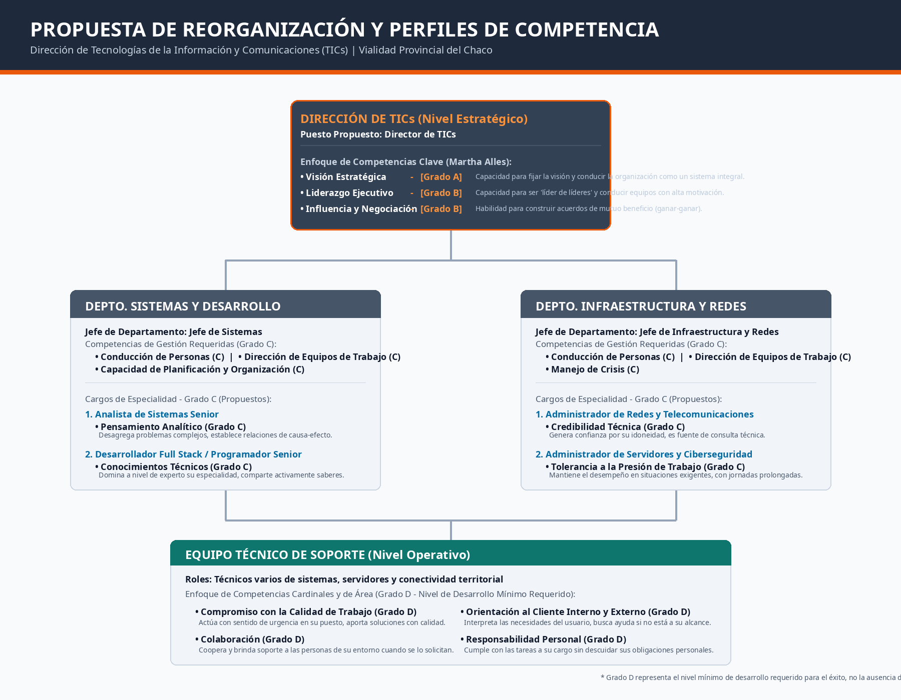
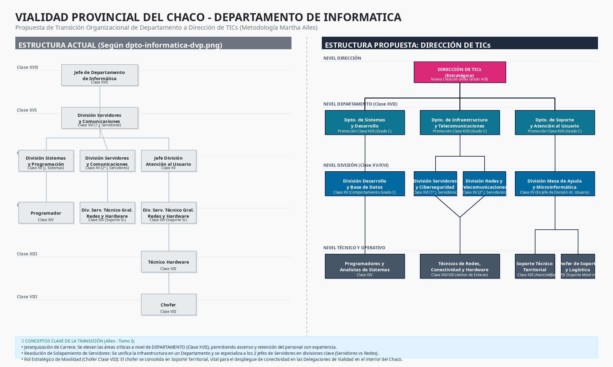

Dar el salto de Departamento a Dirección en un organismo público como Vialidad Provincial del Chaco es una decisión estratégica fundamental. En la administración pública moderna, el área de tecnología ya no puede ser un simple soporte técnico reactivo; debe convertirse en un socio estratégico que impulse la digitalización, la despapelización (sistemas como GDE), la cartografía digital (GIS) y la conectividad de las delegaciones de vialidad en toda la provincia.
Desde la metodología de Martha Alles, el diseño de una nueva estructura organizativa y sus perfiles de puesto debe realizarse siempre de cara al futuro. Para que puedas presentar una propuesta formal e impecable ante el Directorio (el "Número 1" de Vialidad), te propongo estructurar un proyecto formal de reorganización por competencias.
Aquí tienes mi propuesta de estructura para el documento. Me gustaría que la revisemos para que luego pueda generarte un documento de Word (.docx) descargable y completamente editable para que lo presentes formalmente.

---

## 📋 Estructura Propuesta para el Proyecto de Reorganización

### 1. Fundamentación Estratégica (El "Por Qué")

- Justificación de la Dirección: Explicar por qué un Departamento (enfocado en la operatividad diaria) ya no es suficiente. Una Dirección tiene asiento en la mesa de decisiones estratégicas, lo que permite alinear la tecnología con los planes de infraestructura vial de la provincia.

- Alineación con la Visión de Vialidad: Cómo la tecnología optimizará la gestión de obras, el mantenimiento de maquinaria, la conectividad de campamentos y la transparencia de los procesos públicos.

### 2. Propuesta de Nueva Estructura (Organigrama)

Proponemos un diseño jerárquico que ordene y jerarquice los roles existentes:

- Dirección de Tecnologías de la Información y Comunicaciones (TICs) (Nivel Estratégico)

  - Departamento de Sistemas y Desarrollo (Jefe de Sistemas - Nivel Táctico)

    - *Analistas y Desarrolladores de Software / Técnicos* (Nivel Operativo)

  - Departamento de Infraestructura y Redes (Fusionando y jerarquizando las funciones de los 2 Jefes de Servidores en especialidades claras: p. ej., uno enfocado en *Servidores y Ciberseguridad* y otro en *Redes y Telecomunicaciones Provinciales*)

    - *Técnicos de Soporte y Administradores de Red* (Nivel Operativo)

### 3. Perfiles de Competencias de los Roles Clave (Metodología Alles)

Definiremos las competencias y grados específicos (A, B, C, D) para asegurar que el personal esté preparado para este salto cualitativo:

- Para el Director de TICs:

  - Visión Estratégica (Grado A o B): Para conducir el área viendo a la organización como un sistema integral y anticipar el impacto tecnológico a largo plazo.

  - Liderazgo Ejecutivo / Líder de Líderes (Grado B): Esencial, ya que ahora tendrá Jefes de Departamento bajo su cargo a los que deberá guiar y entrenar.

  - Influencia y Negociación (Grado B): Clave para interactuar con el Directorio y defender presupuestos tecnológicos.

- Para los Jefes de Departamento (Sistemas e Infraestructura):

  - Conducción de Personas (Grado C): Para motivar y distribuir tareas eficientemente entre los técnicos.

  - Dirección de Equipos de Trabajo (Grado C): Para coordinar el cumplimiento de plazos y proyectos técnicos específicos.

  - Toma de Decisiones (Grado C): Para resolver contingencias críticas de los sistemas provinciales de manera oportuna.

### 4. Plan de Transición e Implantación (3 a 6 meses)

- Fase 1: Talleres de Reflexión y Aprobación: Reunión con la alta conducción para validar los nuevos descriptivos de puestos.

- Fase 2: Inventario de Brechas: Evaluar a los jefes y técnicos actuales frente al nuevo perfil para diseñar planes de capacitación que faciliten su crecimiento en la carrera gerencial.

- Fase 3: Ejecución y Monitoreo: Despliegue de los nuevos procesos de trabajo.

el organigrama propuesto para el salto a la Dirección de TICs en Vialidad Provincial del Chaco, estructurándolo bajo la metodología de competencias de Martha Alles. El archivo visual ha sido creado y ya está disponible en tu panel de Studio como organigrama-vialidad.png.
Este diagrama refleja la jerarquización del departamento actual y propone cargos clave con perfiles de Grado C (que representa un nivel de desarrollo muy bueno y operativo-senior dentro de la escala Alles). En la estructura visual se detalla:

1. Nivel Estratégico (Dirección de TICs): Conducido por el Director de TICs, requiriendo un perfil de competencias en niveles gerenciales altos (Grados A y B), como *Visión Estratégica*, *Liderazgo Ejecutivo (capacidad de ser líder de líderes)* e *Influencia y Negociación*.

2. Nivel Táctico (Jefaturas de Departamento):

    - Departamento de Sistemas y Desarrollo: Liderado por el Jefe de Sistemas (Grado C en competencias de gestión como *Conducción de Personas*, *Dirección de Equipos de Trabajo* y *Planificación y Organización*).

    - Departamento de Infraestructura y Redes (que unifica los roles de servidores y conectividad): Liderado por un Jefe de Departamento (Grado C en *Conducción de Personas*, *Dirección de Equipos* y *Manejo de Crisis*).

3. Cargos de Especialidad (Grado C - Nivel Operativo Senior): Se proponen perfiles específicos como el de *Analista de Sistemas Senior* (con Grado C en *Pensamiento Analítico*), *Desarrollador Full Stack Senior* (con Grado C en *Conocimientos Técnicos*), *Administrador de Redes y Telecomunicaciones* (con Grado C en *Credibilidad Técnica*) y *Administrador de Servidores y Ciberseguridad* (con Grado C en *Tolerancia a la Presión de Trabajo*).

4. Nivel Operativo de Soporte (Grado D - Mínimo Requerido): Donde se sitúan los técnicos de soporte territorial, evaluados bajo competencias cardinales y de área esenciales en su nivel de desarrollo inicial (*Compromiso con la Calidad de Trabajo*, *Colaboración*, *Responsabilidad Personal* y *Orientación al Cliente Interno*).

{width=100%}

el nuevo organigrama de transición, tomando como punto de partida exacto la estructura actual que me compartiste en la imagen `dpto-informatica-dvp.png`. El archivo visual ya está listo y publicado en tu panel de Studio como organigrama-vialidad-v2.png.

Bajo la metodología de Martha Alles, los modelos de competencias siempre se diseñan de cara al futuro, pensando en los objetivos estratégicos a largo plazo de la organización. Al analizar tu estructura actual (que cuenta con un escalafón público por Clases, típico de la administración vial chaqueña), esta propuesta busca jerarquizar el área, resolver solapamientos de funciones y crear un plan de carrera claro para el personal actual sin generar conflictos de roles.
A continuación, te detallo cómo se transforma cada componente de tu organigrama actual en la nueva Dirección de TICs:

# 1. Nivel Estratégico: Creación de la Dirección de TICs

- De Departamento a Dirección: El puesto de Jefe de Departamento actual (Clase XVII) se eleva a Director de TICs (Clase XIX o Superior / Cargo de Conducción).

- Enfoque de Competencias: Para este rol se asignan competencias gerenciales de nivel superior en Grado A o B (como *Visión Estratégica* y *Liderazgo Ejecutivo / Líder de Líderes*), necesarias para conducir el área como un sistema integral alineado a la despapelización, conectividad y metas de infraestructura vial del Chaco.

# 2. Nivel Táctico: Promoción a Departamentos (Clase XVII)

En lugar de tener un único Departamento, las áreas clave de Clase XV se elevan al rango de Departamento (Clase XVII), abriendo una vía de crecimiento y ascenso para los profesionales actuales:

- Departamento de Sistemas y Desarrollo: (Promoción de la División Sistemas y Programación, Clase XV). Responsable de todo el software y bases de datos del organismo.

- Departamento de Infraestructura y Telecomunicaciones: (Unifica y eleva las funciones de servidores y redes).

- Departamento de Soporte y Atención al Usuario: (Jerarquización de la División Atención al Usuario, Clase XV). Vital en Vialidad debido a que el soporte microinformático debe llegar a campamentos de obra y delegaciones en toda la provincia.

- *Competencias requeridas para los Jefes de Departamento*: Se les asignará un Grado C ("nivel muy bueno de la competencia") en competencias específicas como *Conducción de Personas*, *Dirección de Equipos de Trabajo* y *Toma de Decisiones*.

# 3. Nivel de Coordinación: Especialización de Divisiones (Clase XV / XVI)

Tu organigrama actual muestra una duplicación de "División Servidores y Comunicaciones" (una en Clase XVI y otra en Clase XV), lo cual suele generar conflictos de roles en la gestión diaria. La propuesta resuelve esto mediante la especialización técnica de tus dos Jefes de Servidores actuales bajo el nuevo Departamento de Infraestructura:

- División de Servidores y Ciberseguridad (Clase XVI): A cargo del primer Jefe actual. Enfocada en la administración de servidores centrales, base de datos del organismo, resguardo y seguridad de la información.

- División de Redes y Telecomunicaciones (Clase XV): A cargo del segundo Jefe actual. Enfocada en la conectividad física, fibra óptica, enlaces de radio y la red de datos provincial que une a todas las delegaciones de Vialidad Chaco.

- División Desarrollo y Base de Datos (Clase XV): Bajo el Departamento de Sistemas, para coordinar el trabajo de programación de sistemas viales.

- División Mesa de Ayuda y Microinformática (Clase XV): Bajo el Departamento de Soporte, para canalizar los reclamos de usuarios de toda la provincia.

# 4. Nivel Operativo y Soporte (Clase XIII y XIV)

- Los cargos de Programadores (Clase XIV) se integran a la división de desarrollo.

- Los cargos de Servicio Técnico de Redes y Hardware (Clase XIV) y Técnico Hardware (Clase XIII) se estructuran en las áreas correspondientes de redes o de soporte territorial, evaluando en ellos un nivel inicial de competencias (Grado D, mínimo pero altamente retador) como *Compromiso con la Calidad de Trabajo* y *Trabajo en Equipo*.

# 5. El Rol Estratégico de la Movilidad: Chofer (Clase VIII)

- En Vialidad Provincial, la infraestructura está distribuida en todo el territorio chaqueño (campamentos de bacheo, balanzas viales, consorcios, delegaciones de zona). Los técnicos de informática necesitan movilidad constante para instalar cables, antenas y equipos de computación.

- Por ello, la propuesta consolida formalmente al Chofer (Clase VIII) dentro del *Departamento de Soporte y Atención al Usuario* bajo el rol de Chofer de Soporte y Logística, reconociendo su valor indispensable para habilitar el soporte tecnológico en el interior de la provincia.

{width=100%}
