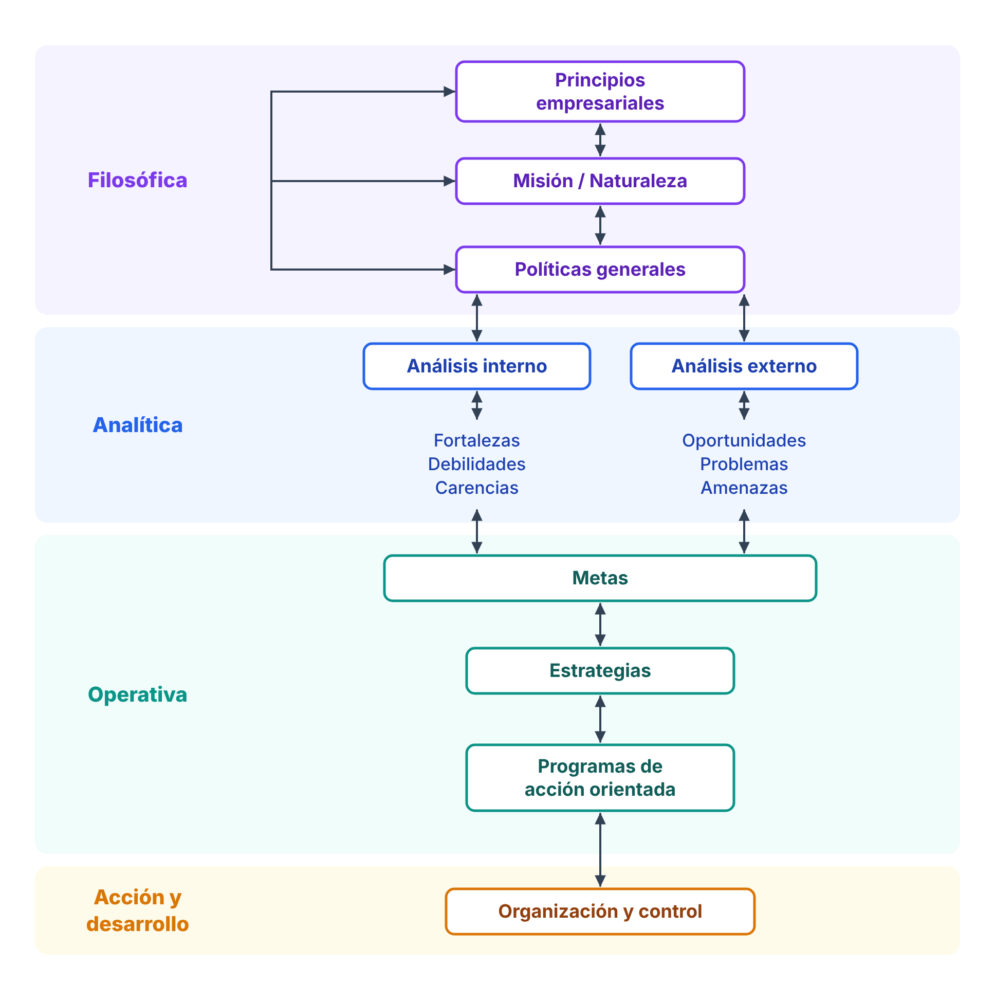
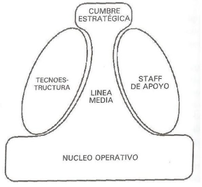
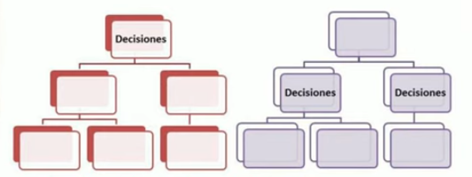

\newpage

# Procesos de negocio.

**Proceso de negocio**: **conjunto de tareas interrelacionadas que se realizan para fabricar un producto o prestar un servicio**. Los procesos de negocio pueden ser realizados por personas o por máquinas. ***Su finalidad es alcanzar los objetivos de la organización o resolver problemas del negocio***. **Ocurren en todos los niveles de la organización**.

> 📝 **Nota personal:** para mí, son todas las actividades de la organización que le agregan valor y ayudan a conseguir el objetivo.

Los procesos de negocio pueden ser de los siguientes tipos:

- **Estratégicos:** son los procesos relacionados con la dirección y el control de la organización.

- **Operativos:** son las tareas que agregan valor a los resultados de manera directa.

- **De apoyo:** son los procesos que generan productos invisibles para el cliente externo, pero imprescindibles para la gestión efectiva del negocio.

- **De gestión o de control:** son los procesos que abarcan una serie de acciones o deberes organizados e interconectados.

# El proceso administrativo.

Se define como **el conjunto de funciones y actividades que se desarrollan dentro de una organización, orientadas al logro de sus fines y objetivos**. Consiste en estudiar la administración como un proceso integrado por **fases y etapas**.

La unidad temporal de la administración implica que esta comprende varias fases, etapas o funciones que existen por separado o simultáneamente y que, por ello, forman parte de un proceso.

Cuando se administra cualquier empresa existen dos fases: una **estructural**, en la que se determinan su finalidad y su rumbo, así como las alternativas para conseguirlos, y otra **operativa**, en la que se ejecutan todas las actividades necesarias para lograr lo establecido durante el período de estructuración.

Estas dos fases se conocen como **fase mecánica**, que engloba la teoría, y **fase dinámica**, en la que se ejecuta la práctica.

- **Fase mecánica:** es la parte de la administración en la que se establece *qué debe hacerse*.

- **Fase dinámica:** se refiere a *cómo manejar la empresa*.

Existen diversos criterios y enfoques en cuanto al **número de etapas** que constituyen el proceso administrativo, aunque finalmente se establecen cuatro en común: **planeación, organización, dirección y control**. La planeación y la organización forman parte de la fase **mecánica**, y la dirección y el control, de la fase **dinámica**.

Cada una de las etapas del proceso administrativo responde a una pregunta:

- **Planeación: ¿qué se va a hacer?** Se debe establecer el objetivo que se pretende alcanzar.

- **Organización: ¿cómo se va a hacer?** Considerando el capital humano y los recursos materiales, financieros y técnicos con los que se cuenta.

- **Dirección: ¿cómo se está haciendo?** Busca guiar y dar seguimiento a la ejecución de los planes y de la organización.

- **Control: ¿cómo se hizo?** Es la etapa que retroalimenta todo el proceso: evalúa y verifica que las actividades se hayan ejecutado conforme a lo planeado, organizado y dirigido, con el objeto de corregir las desviaciones que hayan dificultado llegar al resultado.

> Según Chiavenato, el **control como función administrativa** forma parte del proceso administrativo de *planear, organizar, dirigir y controlar*: «es la función de acompañar y evaluar lo que fue planeado, organizado y dirigido, para detectar desviaciones o variaciones presentadas y efectuar las correcciones necesarias». Su base de acción es la **información de retorno** (retroalimentación) y puede realizarse en el nivel institucional (control estratégico), en el intermedio (control táctico) y en el operativo (control operativo). *(Chiavenato, Administración de recursos humanos, 5.ª ed., parte VII, p. 619.)*

El proceso administrativo cumple con el **principio de universalidad de la administración**, es decir, es aplicable en todas partes. Además, se caracteriza por tener un **efecto espejo**: cada etapa del proceso administrativo cuenta a su vez con sus propias etapas. Por ejemplo, la etapa de planeación requiere, para poder ejecutarse, de planeación, organización, dirección y control; a su vez, esa planeación que se realiza para la etapa de planeación también necesita planeación, organización, dirección y control, y así sucesivamente. Recibe este nombre porque, cuando colocamos un espejo frente a otro, vemos los reflejos repetirse infinitamente. El proceso administrativo tiene el mismo efecto en cada una de las etapas que lo conforman.

> 📝 **Apunte de clase:** el proceso administrativo es la fase en la cual la administración se lleva del punto de vista teórico al práctico. Sirve como cimiento para la ejecución de actividades tanto a nivel personal como organizacional, y nos permite llevar un orden cronológico y verificar que los resultados se obtengan de la mejor manera posible.

## Planificación (o planeamiento o planeación).

Es la determinación de los objetivos y la elección de los cursos de acción alternativos para lograrlos, con base en la investigación y la elaboración de un esquema detallado que ha de realizarse en el futuro.

> 📝 **Apunte de clase:** es la etapa que encabeza el proceso administrativo. *¿Qué se va a hacer?* Hay que saber hacia dónde se van a dirigir los esfuerzos y cómo se va a cumplir el objetivo predeterminado.

Palom Izquierdo lo resume así: la planificación es **«un proceso mediante el cual determinamos de dónde venimos, en qué situación estamos, a dónde queremos ir y cómo y cuándo llegaremos allí»**. Su propósito es decidir qué hay que hacer *hoy* para estar en una situación determinada en el futuro, por eso:

- **No se ocupa de las decisiones futuras, sino del impacto futuro de las decisiones actuales.** Se trabaja *hacia atrás*: desde los objetivos hasta lo que hay que hacer ahora.

- **No busca eliminar el riesgo**, sino asegurar que se asuman los riesgos oportunos en el momento oportuno.

- **Busca el uso eficaz de los recursos** para lograr los objetivos más importantes y **prevenir las crisis** antes de que aparezcan («una serie continuada de crisis indica una pobre planificación»).

- **Su objetivo no es "hacer un plan"**, sino instalar el proceso de planificación como una rutina de toda la empresa.

### Pasos de la planificación.

Sus **cinco pasos** son:

1. **Definición de los objetivos organizacionales.**

2. **Determinación de dónde se encuentra uno en relación con los objetivos.**

3. **Desarrollo de premisas considerando las condiciones futuras.**

4. **Identificación y elección entre cursos de acción alternativos.**

5. **Puesta en marcha de los planes y evaluación de los resultados.**

> 📝 **Apunte de clase:** este último paso vuelve a cerrar en el primero, para que cada vez que se ejecute haya una mejora continua.

### Principios de la planificación.

Los **principios** que la rigen son:

- **Factibilidad:** lo que se planea debe ser realizable.

- **Objetividad y cuantificación:** al planear es necesario basarse en hechos y datos reales, no en suposiciones. La planeación será más confiable y precisa cuanto más pueda medirse en tiempo, dinero, cantidades y especificaciones.

- **Flexibilidad:** el plan debe poder adaptarse a la situación y contemplar imprevistos sin desviarse del objetivo principal.

- **Unidad:** todos los planes específicos que se desarrollen dentro de una organización deben alinearse con un plan general que marque la dirección global. Esto asegura que los esfuerzos de las distintas áreas trabajen en armonía hacia los mismos objetivos.

- **Del cambio de estrategias:** si un plan se extiende en el tiempo, es necesario revisar las estrategias y, si hace falta, cambiarlas para adaptarlas a nuevas realidades o desafíos, de modo que el plan no quede obsoleto.

### Plazos y resultado de la planificación.

Puede realizarse en tres **plazos**: **corto** (hasta un año), **mediano** (de uno a cinco años) y **largo** (más de cinco años).

El **resultado** de la planificación es el **plan**. Los planes pueden definirse como diseños o esquemas detallados realizables a futuro, y deben contener las especificaciones necesarias para llevarlos a cabo. Según Palom Izquierdo, un buen plan:

- Está orientado a **objetivos específicos y medibles**.

- Se basa en **información actual** sobre el entorno y en las expectativas futuras.

- **Involucra a los subordinados** y asegura que lo comprendan.

- **Asigna tareas, responsables y plazos.**

- **Establece la base para el control.**

Por otro lado, la planeación es esencial para el correcto funcionamiento de cualquier grupo social, ya que **prevé los cambios** que pueden ocurrir con el tiempo y establece las medidas necesarias para afrontarlos.

### Niveles (tipos) de planeación.

La planeación se da en tres **niveles**, que se corresponden con los niveles jerárquicos de la organización:

- **Estratégica:** se da a nivel institucional (**alta gerencia**). Consiste en la toma de decisiones en una organización, mediante el análisis interno y externo, con el fin de evaluar su situación presente, fijar su rumbo a futuro y obtener una ventaja competitiva. **Se definen el alcance, cómo establecerse y cuál es la razón de ser de la empresa; está orientada al largo plazo.**

  Sus etapas se desarrollan en el apartado siguiente.

- **Táctica (departamental o funcional):** se da a nivel funcional o de departamento. Su punto de partida es el análisis de la situación de un área o departamento de la empresa, a fin de establecer objetivos tácticos, formular estrategias funcionales y diseñar planes de acción. Una vez hecha la planeación estratégica, se necesitan planes más específicos para lograr los objetivos estratégicos. **Se elaboran los planes de cada departamento de la empresa teniendo en cuenta los estratégicos. Su contenido es menos genérico y más detallado, y está orientada al mediano plazo.**

- **Operacional:** se refiere específicamente a las tareas y operaciones realizadas en los últimos niveles jerárquicos de la organización, y se orienta hacia la optimización y la maximización de los resultados. Responde a ***cómo hacer*** y ***qué hacer*** con los objetivos y planes que vienen de la planeación táctica, con base en la estratégica. **Su contenido es detallado y analítico, y está orientada al corto plazo.**

> 📝 **Apunte de clase:** los planes operacionales se orientan siempre hacia la **eficiencia**, es decir, lograr los resultados deseados con el mínimo de recursos. Los planes tácticos y estratégicos se orientan siempre hacia la **eficacia**, es decir, conseguir lo que se propone en el tiempo estipulado.

> Esto coincide en parte con Chiavenato, que divide la organización en tres niveles: el **institucional** (estratégico), que «busca la eficacia» tomando decisiones frente a la incertidumbre del ambiente; el **intermedio** (táctico o gerencial), que articula los otros dos y transforma las estrategias en programas de acción; y el **operacional** (núcleo técnico), que «busca la eficiencia» en operaciones estandarizadas y repetitivas. Chiavenato no le asigna al nivel intermedio la eficacia: eso es del apunte de clase. *(Chiavenato, Administración de recursos humanos, 5.ª ed., cap. 1, «Niveles organizacionales», Fig. 1.7.)*

### Planificación estratégica: concepto y etapas.

La **planificación estratégica** es la planificación del nivel institucional: el proceso por el cual la alta dirección define la razón de ser de la empresa, analiza su situación interna y su entorno, y a partir de eso fija los **objetivos de largo plazo** y las **estrategias** para alcanzarlos. Es la que da el marco a la planificación táctica y la operativa.

Según Palom Izquierdo, el proceso integrado de planificación estratégica tiene **cuatro etapas**: **filosófica, analítica, operativa y de acción y desarrollo**.

*Fuente: Palom Izquierdo, **Management: la tecnología punta del mando** (col. «Prodúctica», Marcombo, 1989), Fig. 3: El proceso integrado de planificación estratégica.*

1. **Filosófica:** establece *quién es* la empresa.

    - **Principios:** el sistema de valores que guía los actos de la organización, dentro y fuera de ella.

    - **Misión:** el objetivo central de la empresa, lo que le da sentido y razón de ser. Si los principios son *en qué creemos*, la misión es *qué vamos a hacer* con esos principios. Es dinámica, orientada al futuro, no habla de resultados económicos sino del valor que aporta a la sociedad, y se redefine cada tres a cinco años.

    - **Políticas:** acuerdos que guían las decisiones y acciones hacia los objetivos. Se escalonan en **generales** (toda la empresa), **departamentales** y **operacionales**.

2. **Analítica:** diagnostica la situación para poder fijar objetivos alcanzables y estrategias viables.

    - **Análisis interno:** **fortalezas** (ventajas que hay que explotar), **debilidades** (desventajas actuales o potenciales) y **carencias** (lo que la empresa debería tener para ser competitiva y todavía no tiene).

    - **Análisis externo**, del entorno actual y futuro: **oportunidades**, **problemas** y **amenazas** (factores de gran magnitud que hay que tener siempre en cuenta, aunque sean poco probables).

3. **Operativa:** convierte el diagnóstico en acción.

    - **Metas:** los resultados más importantes que se quieren alcanzar, descritos de forma **específica y medible**. Son el punto crucial: todo lo anterior prepara para generarlas y todo lo posterior decide cómo alcanzarlas.

    - **Estrategias:** la manera de alcanzar los objetivos. Para Drucker, «la mejor estrategia consiste en aprovechar los puntos fuertes de la empresa en zonas de oportunidad».

    - **Programas de acción:** bajan las estrategias a acciones concretas, con responsable, forma de ejecución, fecha y costo.

4. **Acción y desarrollo:** los programas de acción se documentan con **qué** hacer (acción), **quién** (responsabilidad), **cómo** (estrategia), **cuándo** (oportunidad), el **costo** y los **resultados** de cada etapa. Así sirven como instrumento de **control de la acción y control económico**, y su valoración permite armar los **presupuestos** y pasar a la organización y el control.

> 📝 **Apunte de clase:** en clase las actividades de la planeación estratégica se resumieron como **análisis del ambiente** (lo político, social, tecnológico, etc. que afecta a la organización desde afuera), **análisis organizacional** (recursos disponibles y necesarios, FODA) y **formulación de estrategias**. Corresponden a las etapas analítica y operativa de Palom.

> 📝 **Apunte de clase (campus):** Palom Izquierdo muestra cómo se operativizan los objetivos estratégicos. **En el ámbito de los SI/TI, los programas de acción son los proyectos en los que se divide el plan de SI/TI** (ver Unidad I).

## Organización.

La palabra *organización* se usa con dos sentidos:

- **Como entidad:** según Chiavenato (siguiendo a Barnard), una organización es **«un sistema de actividades conscientemente coordinadas, formado por dos o más personas, cuya cooperación recíproca es esencial»**. Solo existe cuando hay personas capaces de comunicarse, dispuestas a actuar en conjunto y que buscan un objetivo común. *(Chiavenato, Administración de recursos humanos, 5.ª ed., cap. 1, «Concepto de organizaciones».)*

- **Como etapa del proceso administrativo (organizar):** responde a *¿cómo se va a hacer?* Una vez definido el plan, organizar es **dividir el trabajo en actividades, agruparlas (departamentalizar), asignarlas a personas o áreas con la autoridad y responsabilidad correspondientes, y establecer cómo se coordinan**, junto con los recursos necesarios para cumplir los objetivos. Su resultado es la **estructura organizacional**.

### El proceso de organizar.

Una **estructura organizacional** es el conjunto de todas las formas en que se divide el trabajo en tareas distintas y en que luego se coordinan esas tareas (Mintzberg, 1984). **Establece tanto el sistema jerárquico de la empresa como la forma en que esta se va a gestionar.**

Su **función principal** es establecer las características de la organización de la empresa y estructurar el sistema de trabajo dentro de ella. También sirve para definir todos los procesos, organigramas, jerarquías y departamentos de la empresa.

Sus características son:

- **Permite la especialización de las distintas áreas. Cuanto más grande es la organización, más especializada debe ser.**

- **Puede ser centralizada o descentralizada**, según dónde se concentre la toma de decisiones.

- **Se diseña sobre la base de un objetivo realista y alcanzable**, para luego adaptarse a las tecnologías y herramientas que posee la organización.

- **Reduce o elimina la duplicación de esfuerzos**, al delimitar funciones y responsabilidades.

### Las cinco partes de la organización según Mintzberg.

Mintzberg identificó **cinco elementos clave en la estructura organizacional**, que explican cómo se divide el trabajo y cómo se coordinan las actividades dentro de una organización:

1. **Ápice estratégico:** es la parte superior de la organización, compuesta por la alta dirección o gerencia superior. Su función principal es garantizar que la organización cumpla su misión y se adapte al entorno, tomando decisiones estratégicas y supervisando el funcionamiento global.

2. **Línea media:** conecta el ápice estratégico con el núcleo operativo. Está formada por los mandos intermedios, como gerentes o supervisores, que se encargan de transmitir las decisiones estratégicas a los niveles operativos y de supervisar la ejecución de las tareas.

3. **Núcleo operativo:** comprende a los empleados que realizan las actividades esenciales para la producción de bienes o la prestación de servicios. Es el corazón del trabajo diario y representa la base de la organización.

4. **Tecnoestructura:** está formada por especialistas y analistas que diseñan procedimientos, estándares y sistemas para mejorar la eficiencia y el control. No participan directamente en la producción, pero influyen en cómo se lleva a cabo el trabajo.

5. **Staff de apoyo (personal de apoyo):** incluye a los departamentos o unidades que prestan servicios indirectos al resto de la organización, como recursos humanos, contabilidad, limpieza o servicios de seguridad. Su labor es facilitar el trabajo del núcleo operativo y de las demás partes.

*Fuente: Mintzberg, **La estructuración de las organizaciones**: las cinco partes fundamentales de la organización.*

### Tipos de estructuras organizacionales.

| Estructura | Cómo es | Ventajas | Desventajas |
|------|------------|---------|---------|
| **Lineal** | Jerarquía clara: la autoridad baja de arriba hacia abajo y cada trabajador responde a un único superior. Comunicación directa y vertical. | Simple; responsabilidades y autoridad claras; control riguroso. | Rígida ante los cambios; sobrecarga a los líderes; poca participación de los empleados. |
| **Funcional** (la más común) | Se organiza por funciones (producción, marketing, finanzas…); cada empleado reporta a un jefe funcional especializado. | Eficiencia y especialización; división del trabajo clara; desarrollo profesional por áreas. | Poca comunicación y coordinación entre departamentos; cada área puede priorizar sus objetivos sobre los de la empresa. |
| **Línea y staff** | Combina la autoridad lineal con el asesoramiento de especialistas: la línea decide y el staff da apoyo técnico. | Mejores decisiones gracias al asesoramiento; mejor planificación y control. | Conflictos entre línea y staff; más complejidad y costo. |
| **Divisional** | Subunidades por **productos**, **zonas geográficas** o **tipos de clientes**. | Por producto: mejor respuesta al mercado. Por zona: adaptación local. Por cliente: foco en su satisfacción. | Por producto: duplica funciones y costos. Por zona: descentralización excesiva. Por cliente: duplicación de esfuerzos. |
| **Por comités** | Las decisiones se toman en forma colegiada; promueve la participación y el consenso. | Diversidad de opiniones; trabajo en equipo. | Decisiones lentas; cuesta asignar responsabilidades. |
| **En trébol** | Cuatro partes: **núcleo profesional** (empleados clave y permanentes), **contratistas externos** (trabajo no esencial), **fuerza de trabajo flexible** (temporales o *freelance*) y **trabajo delegado a los clientes** (por ejemplo, el autoservicio). | Flexibilidad y menores costos; se adapta rápido a los cambios. | Menor compromiso de los temporales; comunicación y coordinación más difíciles. |

**Estructura simple (empresa pequeña):** línea media escasa, comunicación directa entre áreas, ápice estratégico a cargo del propietario, núcleo de operaciones con personas polivalentes y un staff de apoyo pequeño.

### Tipos de departamentalización.

> 📝 **Apunte de clase:** no hay una forma óptima de departamentalizar una organización; eso depende de cada una. La departamentalización **no es un fin**, sino un método para ordenar las actividades con el fin de facilitar el logro de los objetivos de la organización.

Se agrupan en departamentos las actividades de trabajo similares o que tienen una relación lógica:

- **Por función empresarial:** consiste en agrupar las actividades y tareas de acuerdo con las funciones principales que se desarrollan en la empresa. Se ve más en las grandes empresas.

- **Territorial o geográfica:** consiste en agrupar las actividades según el área donde se ejecutará el trabajo o el área que cubrirá la empresa.

- **Por clientes:** se basa en diferenciar y agrupar las actividades de acuerdo con el tipo de personas para quienes se realiza el trabajo.

- **Por productos o servicios:** se basa en agrupar las actividades de acuerdo con los productos y resultados que ofrece la empresa.

### Centralización, descentralización y desconcentración.

En la **centralización**, la máxima autoridad de la empresa concentra el poder y la toma de decisiones. La **descentralización** permite distribuir la autoridad y la responsabilidad de la toma de decisiones hacia los niveles más bajos de la jerarquía (hacia los mandos medios).

> 📝 **Apunte de clase:** ninguna es mejor que la otra; cada una es aplicable y óptima según las circunstancias.

*Fuente: no identificada.*

Ventajas de **descentralizar**:

- Los jefes están más cerca de los lugares donde hay que tomar las decisiones, lo que ahorra tiempo y dinero.

- Aumenta la eficiencia, ya que se optimiza el uso de los recursos.

- Alivia el trabajo de los jefes en la toma de decisiones, que pueden concentrar sus esfuerzos en temas de mayor importancia.

- Es adecuada si el trabajador conoce bien su área de trabajo.

- Las decisiones se toman más rápidamente.

- Estimula y promueve a la gerencia media, lo que permite formar empleados más motivados.

- Permite crecer en varias áreas al mismo tiempo.

Desventajas de **descentralizar**:

- Puede provocar que no haya un criterio uniforme en la toma de decisiones.

- Puede fracasar si no se aplica correctamente.

- Puede perderse el control sobre determinados temas.

- Lleva tiempo y esfuerzo capacitar a un empleado para que ocupe un puesto de toma de decisiones.

> ⚠️ **Revisar:** *«Aumenta la eficiencia, ya que se optimiza el uso de los recursos»* choca con lo que dice Robson para los SI: la descentralización «pone menos énfasis en los costos [...] y más en la efectividad», y su desventaja más importante es «el aumento de los costos por la duplicación». *(Robson, «Management de recursos de IS», sección «La ubicación de los IS».)*

En la **desconcentración**, la autoridad se delega y la responsabilidad se comparte. Está sujeta a diversos tipos de control que operan dentro de la administración central, pero puede manejarse con relativa libertad.

La diferencia con la descentralización está en **quién conserva el poder de decisión**:

- En la **desconcentración** se transfieren **funciones o tareas** a unidades subordinadas (por ejemplo, sucursales u oficinas regionales), pero estas **siguen dependiendo jerárquicamente** del órgano central, que conserva el control y las decisiones de fondo.

- En la **descentralización** se transfiere **el poder de decisión**: la unidad decide por sí misma dentro de su ámbito, con mayor autonomía.

> **Nota:**
> Las definiciones de *organizar* y la comparación entre desconcentración y descentralización son definiciones generales de administración.
