\newpage

# Explicación del Capítulo 5 de Andreu {-}

**Capítulo 5: Procedimientos de alineamiento de los Planes de Tecnologías y Sistemas de Información con la estrategia de negocio**

**Contenido del capítulo**

- **5.1. Introducción**

- **5.2. Evolución de la planificación de Sistemas de Información en la empresa**

  - Fase I: La introducción de la informática en la organización

  - Fase II: «Expansión anárquica» de las aplicaciones informáticas

  - Fase III: Coordinación SI-objetivos de empresa

  - Fase IV: Interdependencia estrategia de la compañía-TI/SI

- **5.3. Un procedimiento de planificación de TI/SI a partir de la estrategia del negocio**

  - 5.3.1. Esquema general del procedimiento *(Nota: en tu texto figura con un error de tipeo como 3.3.1)*

- **5.4. Algunas consideraciones adicionales**

- **5.5. A modo de resumen: Algunas características de los procedimientos de planificación de SI que parten de la estrategia de negocio**

- **Anexo al Capítulo 5: Descripción de un procedimiento de alineamiento del Plan de Tecnología y Sistemas de Información con la estrategia de negocio**

  - **A5.1. Introducción**

    - Desglose de la Fase I: Presentación y compromiso del equipo (Puntos I.1 al I.4)

    - Desglose de la Fase II: Descripción de la situación actual (Puntos II.1 al II.4)

    - Desglose de la Fase III: Elaboración del Plan de TI/SI (Puntos III.1 al III.8)

    - Desglose de la Fase IV: Programación de actividades (Puntos IV.1 al IV.3)

  - **A5.2. Fase I: Presentación y compromiso del equipo**

  - **A5.3. Fase II: Descripción de la situación actual**

  - **A5.4. Fase III: Elaboración del Plan de TI/SI**

  - **A5.5. Fase IV: Programación de actividades**

## 5.1. Introducción {-}

¡Excelente actitud! Como tu profesor, lo primero que te voy a decir para tranquilizarte es que **la sección "5.1. Introducción" es sumamente breve** (apenas dos párrafos), pero es clave porque funciona como el "ancla" conceptual de todo el capítulo.

Vamos a desglosar exactamente lo que plantea el autor en este punto, respondiendo a tus preguntas paso a paso.

### 1. El concepto central: ¿Qué es planificar según el autor? {-}

El texto arranca definiendo qué entienden los autores por "planificación de sistemas". Nos dicen que no es otra cosa que un **«procedimiento sistemático de toma de decisiones sobre qué hacer en el futuro con los sistemas de información»**.

Es decir, planificar no es adivinar el futuro ni comprar computadoras por comprar; es tener un método ordenado (sistemático) para decidir en qué tecnología vamos a invertir mañana.

### 2. El problema principal que plantea el autor {-}

El problema implícito que los autores quieren resolver es que **las empresas históricamente no han sabido cómo tomar estas decisiones tecnológicas de forma ordenada**.

Para que el lector entienda por qué necesitamos con urgencia el procedimiento de planificación que el libro va a enseñar, los autores explican que es necesario poner las cosas en contexto estudiando la "evolución histórica" que ha sufrido esta planificación a lo largo de los años.

Para explicar este problema, el documento nos adelanta que las organizaciones han tropezado a lo largo de **cuatro fases históricas diferenciadas** (basadas en los estudios clásicos de (Mel) Gibson y (Christopher) Nolan de 1974 sobre el crecimiento de la informática):

1. **Introducción:** Se mete la informática en la empresa solo para mecanizar lo básico.

2. **Expansión anárquica:** Todo el mundo pide aplicaciones sin control ni orden.

3. **Coordinación:** Se intenta alinear la tecnología con los objetivos de la empresa.

4. **Interdependencia:** La estrategia del negocio y la tecnología se planifican juntas.

### 3. ¿Por qué es importante alinear los Planes de TI/SI con el negocio? {-}

Aunque la sección 5.1 lo introduce de forma resumida, la importancia de la alineación radica en evitar el caos. Si no alineamos los planes de tecnología con la estrategia de la empresa, nos quedamos estancados en la fase de "expansión anárquica", gastando dinero en sistemas que no le sirven a los objetivos reales de la compañía. Alinear significa pasar a las fases superiores (Coordinación e Interdependencia), donde la tecnología realmente empuja al negocio hacia el éxito.

💡 **La Analogía para tu examen: "El crecimiento de una ciudad"**

Para que te quede grabado, imagina que los Sistemas de Información (SI) son las **calles y edificios** de una ciudad, y la Estrategia de Negocio es el **propósito de la ciudad** (por ejemplo, ser un centro turístico).

- **Fase 1 (Introducción):** Alguien construye una sola calle asfaltada en el medio de la nada para que pase el intendente. Es útil, pero limitada.

- **Fase 2 (Expansión Anárquica - El Problema):** Como la gente vio que el asfalto está bueno, cada vecino empieza a pavimentar frente a su casa y a construir edificios donde quiere. Gastan muchísima plata, pero las calles no se conectan entre sí y la ciudad es un laberinto caótico. *Este es el problema de no tener un plan.*

- **Fase 3 y 4 (Alineación y Planificación - La Solución):** El intendente y los arquitectos se sientan a pensar: *"Queremos ser una ciudad turística (Estrategia de negocio). Entonces, vamos a trazar (Planificar) un mapa sistemático donde las calles principales conecten directamente los hoteles con las playas (Sistemas de Información)"*.

**En resumen para tu examen:** La sección 5.1 nos dice que para entender por qué necesitamos un método de planificación hoy, tenemos que mirar los errores del pasado. Planificar sistemáticamente es la única forma de asegurar que nuestras decisiones tecnológicas futuras (el asfaltado) nos lleven exactamente a donde el negocio quiere ir (la ciudad turística).

¿Quedó clara esta introducción? Si estás listo, podemos avanzar a la sección **5.2**, donde el autor explica cada una de estas cuatro fases (o "etapas de la ciudad") con lujo de detalles.

## 5.2. Evolución de la planificación de Sistemas de Información en la empresa {-}

¡Excelente! Vamos a sumergirnos de lleno en la **Sección 5.2**. Como profesor, te digo que entender esta evolución histórica es fundamental, porque explica exactamente *por qué* las empresas modernas necesitan metodologías complejas de planificación.

Los autores del texto estructuran esta evolución basándose en el esquema clásico propuesto por los investigadores **Gibson (Les Paul) y Nolan en 1974** sobre el crecimiento de la informática en las empresas. A lo largo de la historia, las organizaciones han atravesado cuatro grandes fases, cada una con sus propias características, crisis y transiciones. Aquí te las detallo exhaustivamente:

### Fase I: La introducción de la informática en la organización {-}

Esta fase inicial, que comenzó masivamente en los años sesenta, se caracteriza por la llegada de grandes ordenadores que requerían infraestructuras especiales (como suelos falsos y climatización extrema) y cuyo manejo era un misterio absoluto para los no informáticos. El objetivo principal de los directivos en esta época era exclusivamente la **reducción de costes** mediante la mecanización de procesos puramente administrativos (como la contabilidad, la nómina y la facturación) para hacerlos de forma más rápida y precisa.

- **Características principales:** No existían "Planes de Sistemas" formales, simplemente se atendían las peticiones de los usuarios y se evaluaban mediante un simple análisis de coste-beneficio económico. El departamento, llamado de **"Proceso de Datos" (PD)**, dependía jerárquicamente de los servicios administrativos.

- **El problema central:** Debido a lo críptico de la tecnología y al desinterés de los directivos de negocio, se produjo un aislamiento progresivo del departamento informático. Apareció de forma natural un **"muro"** o barrera de comunicación entre el departamento de PD y la alta dirección, provocando que la conexión entre los planes tecnológicos y los objetivos de la empresa fuera totalmente inexistente.

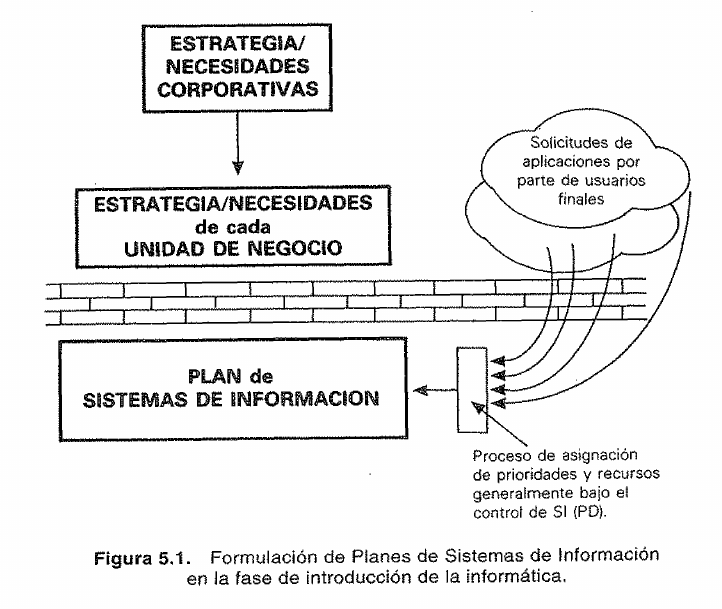{width=72%}

### Fase II: «Expansión anárquica» de las aplicaciones informáticas {-}

La transición hacia esta segunda etapa (que equivale a la fase de "Contagio" en la teoría de Gibson y Nolan) ocurre cuando la empresa ya tiene resueltos sus problemas básicos de mecanización transaccional. Al ver que la tecnología funciona, los usuarios de distintas áreas comienzan a pedir soluciones para problemas cada vez más complejos y ligados al núcleo del negocio.

- **Características principales:** Las empresas se llenan de multitud de aplicaciones transaccionales desconectadas entre sí. El responsable de Sistemas de Información (SI) es quien decide a qué proyectos asignar recursos.

- **El problema central:** Al existir todavía el "muro" de comunicación, los informáticos desconocen los objetivos estratégicos de la compañía. Por lo tanto, deciden qué aplicaciones construir basándose en **criterios totalmente equivocados**: la facilidad técnica, el atractivo o novedad de la tecnología, el "poder" o influencia del departamento que hace la petición, o el coste de desarrollo. El texto ejemplifica esto con una compañía de seguros que, por culpa de esta desconexión, trataba como "mantenimiento rutinario" a solicitudes que en realidad tenían un inmenso valor estratégico para sacar nuevos productos al mercado.

### Fase III: Coordinación SI-objetivos de empresa {-}

El paso a la tercera fase se da por una crisis: las inmensas inversiones que requiere mantener la tecnología obsoleta, sumado a las quejas constantes de los usuarios que no ven resueltas sus necesidades complejas, obligan a la alta dirección a intervenir.

- **Características y la Transición:** Al principio, esta fase arranca de forma caótica porque la alta dirección interviene directamente para dictar qué debe hacerse (asignación directa de recursos), lo cual diluye las responsabilidades y confunde el rol del área informática. Para solucionar esta anomalía, la empresa se ve obligada a instaurar **procedimientos formales de planificación de SI**.

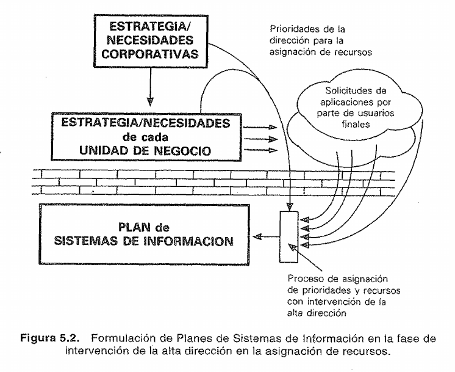{width=75%}

- **La solución y el nuevo paradigma:** El concepto clave de esta fase es **"derribar la pared"** (el muro nacido en la Fase I) para conectar por fin los planes tecnológicos con las necesidades corporativas. Sin embargo, esto choca contra enormes resistencias culturales, ya que esa pared llevaba años arraigada en la organización. Cuando se logra derribar, el Plan de SI pasa a reflejar claramente las prioridades estratégicas de la empresa, y el rol del director de SI cambia radicalmente: deja de ser un dictador unilateral de recursos para convertirse en el **coordinador** de un equipo interdepartamental que formula el plan.

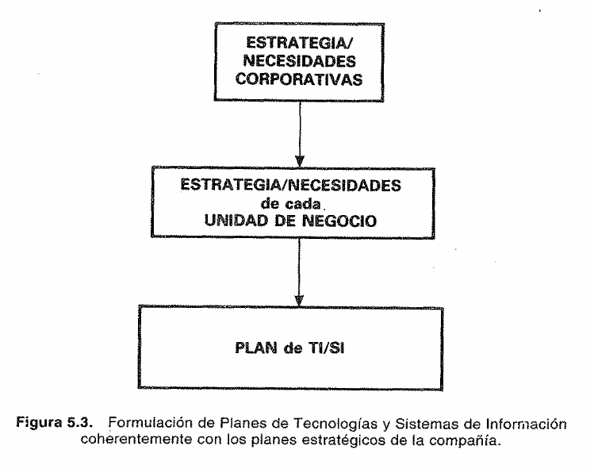{width=65%}

### Fase IV: Interdependencia estrategia de la compañía-TI/SI {-}

Una vez superado el aislamiento y lograda la "coordinación" (donde los sistemas apoyan fielmente a la estrategia del negocio de forma "pasiva"), la dirección general se da cuenta de que necesita ir un paso más allá para conseguir **ventajas competitivas sostenibles**.

- **Características principales:** Ya no basta con que la tecnología obedezca a la estrategia del negocio; ahora deben integrarse de forma **activa y simultánea**. En esta etapa de interdependencia, la estrategia de la compañía y los planes de TI/SI se formulan en paralelo, cooperando mutuamente para descubrir nuevas oportunidades de mercado.

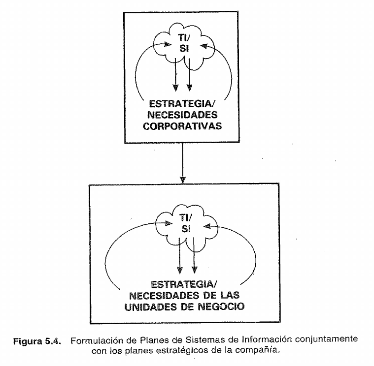{width=64%}

- **El problema central:** Alcanzar esta fase requiere una madurez y un aprendizaje organizativo inmenso. Muchas empresas intentan saltar a esta etapa activa pero fracasan porque aún están atrapadas en la anarquía (Fase II) o porque carecen de la cultura organizativa necesaria. Según autores como Vitale et al. (1988), para llegar a este nivel de interdependencia es indispensable que exista una cultura sensible al potencial de la tecnología y que el departamento de SI conozca a la perfección los objetivos del negocio. Por ello, los autores del libro sugieren que casi siempre es más seguro aplicar primero una metodología "pasiva" (la Fase III) para ir creando esta cultura paso a paso.

¿Qué te parece este desglose? Si logras explicar en tu examen cómo la aparición del "muro" en la Fase I generó la crisis de la Fase II, forzando la planificación formal en la Fase III para finalmente llegar a la interdependencia de la Fase IV, ¡tendrás la máxima calificación asegurada! Avísame si quieres que continuemos con el siguiente tema.

## 5.3. Un procedimiento de planificación de TI/SI a partir de la estrategia del negocio {-}

¡Aquí vamos! Prepárate porque esta sección es el corazón metodológico de tu material de estudio. Si en el examen te piden describir el **"Procedimiento de alineamiento"** desde cero, esta es la estructura exacta que debés dominar.

Como tu profesor, te voy a organizar esta sección en cuatro bloques fundamentales para que la entiendas a la perfección: 1) Qué es y qué debe incluir el Plan, 2) La regla de oro del cruce estratégico, 3) Quiénes lo hacen (Los equipos) y 4) El resumen de las cuatro fases.

### 1. ¿Hasta dónde llega el Plan? (Los Entregables) {-}

El texto de Andreu arranca la sección 5.3 haciéndose una pregunta clave: ¿Qué se supone que debe incluir exactamente un Plan de TI/SI? Lo más importante para tu examen es recordar que este plan **se elabora bajo una perspectiva fundamentalmente de negocio, no tecnológica**. Los detalles técnicos (qué código usar, qué marca de servidores comprar) se dejan para después.

Un Plan de TI/SI completo debe incluir obligatoriamente:

- **Lista de proyectos a 3-5 años:** Qué vamos a hacer a mediano plazo.

- **Diagnóstico inicial (Punto de partida):** Un juicio crítico de los sistemas que ya existen hoy en la empresa, evaluados tanto por su rendimiento técnico como por su utilidad real para el negocio.

- **Prioridades:** El orden en que se harán los proyectos, evaluando qué es más urgente para el negocio y qué infraestructura tecnológica previa se necesita.

- **Detalle exhaustivo del primer año:** Los proyectos que arrancan ya mismo deben tener su presupuesto y recursos calculados para incluirlos en el ejercicio anual.

- **Mecanismos de control:** Un calendario y presupuestos claros para evaluar si el plan se está cumpliendo.

### 2. La Regla de Oro: El Cruce Estratégico {-}

El autor define que el procedimiento consiste esencialmente en una sola cosa: **integrar las necesidades de información que surgen del cruce entre las directrices estratégicas de la empresa y los procesos de negocio de cada área**.

- *Ejemplo práctico:* Si la estrategia general es "Mejorar la atención al cliente", y el proceso de negocio es "Gestión de ventas", el cruce de ambas genera una **necesidad**: *"Necesitamos un sistema que le muestre al vendedor el historial de reclamos del cliente en tiempo real"*.

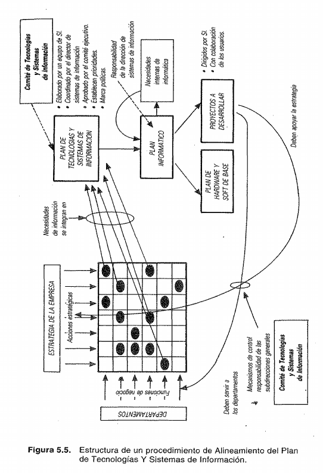{width=90%}

### 3. ¿Quiénes hacen el Plan? (La Estructura Humana - 5.3.1) {-}

El error más común es creer que el Plan lo hace el departamento de Informática. El libro es tajante: la responsabilidad recae en la **dirección de la empresa** y el equipo debe representar a todas las áreas para que el plan no salga sesgado. Para lograrlo, se arman tres grupos de trabajo:

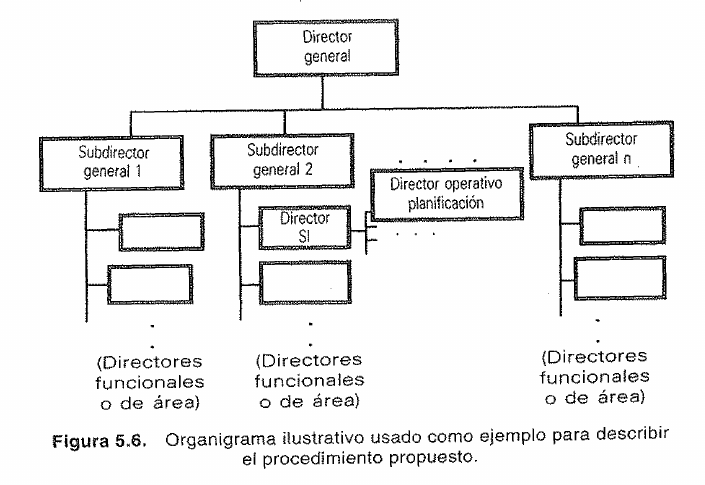{width=84%}

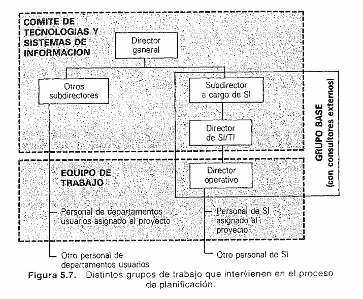{width=90%}

1. **El Comité de TI/SI (Los Jefes máximos):** Es el órgano con la responsabilidad última. Está formado por el Director General y los directores de las distintas áreas. Su función es dar la cara para que la empresa apoye el plan, fijar las prioridades estratégicas y **aprobar el plan definitivo**.

2. **El Grupo Base (Los Supervisores):** Supervisan el avance del proyecto y aseguran la consistencia. Actúan como un puente que "facilita la negociación" entre los usuarios y los informáticos. Está formado por el director de Sistemas y el Director Operativo del Proyecto (DOP).

3. **El Equipo de Trabajo (Los Operativos):** Son los que hacen el trabajo de campo diario, es decir, las entrevistas y el análisis técnico. Está formado por analistas de sistemas mezclados con **usuarios de los distintos departamentos** (para garantizar la visión de negocio).

### 4. El Esquema General (Las 4 Fases) {-}

El documento (en la sección 5.3.1) adelanta de forma muy resumida las cuatro fases del procedimiento (que luego se detallan a fondo en el Anexo):

- **Fase I: Presentación y compromiso del equipo:** Se forman los tres grupos de trabajo y la Alta Dirección presenta el proyecto al resto de la empresa. El objetivo es que todos entiendan que requerirá tiempo y esfuerzo de todos los departamentos, no solo de informática.

- **Fase II: Descripción de la situación actual:** Se analiza dónde estamos parados en dos dimensiones: el Negocio (cuáles son nuestras funciones y procesos) y los Sistemas Existentes (qué tecnología usamos hoy).

- **Fase III: Elaboración del Plan de TI/SI (El corazón del plan):** Se documentan las necesidades no cubiertas, se diseñan propuestas de nuevos sistemas (agrupadas en escenarios o alternativas) alineadas a la estrategia, y **el Comité aprueba la mejor opción**.

- **Fase IV: Programación de actividades:** Se agarra ese plan a largo plazo y se lo baja a la realidad, armando el calendario y presupuesto de los proyectos del **primer año**.

💡 **La Analogía para tu examen: "Construyendo el nuevo Hospital"**

Para memorizar todo el procedimiento 5.3 desde cero, imagina que tu empresa es un Hospital que se quedó chico y van a planificar una ampliación:

1. **El Entregable (Qué incluye):** No es el plano de los enchufes eléctricos (perspectiva técnica), es el plano de dónde irán los consultorios y qué se construirá el primer año con qué presupuesto.

2. **Los Equipos:**
   2.1. *Comité:* El Director del Hospital y los Jefes de Cirugía (deciden qué se prioriza y aprueban el gasto).
   2.2. *Grupo Base:* Los arquitectos en jefe (supervisan y negocian).
   2.3. *Equipo de trabajo:* Albañiles, pero acompañados siempre por un enfermero (el usuario) que les dice dónde hace falta la puerta.

3. **Las 4 Fases:**
   3.1. El Director anuncia a todo el hospital que empieza la obra (Fase 1: Compromiso).
   3.2. Miran cómo está el edificio viejo (Fase 2: Situación actual).
   3.3. Dibujan las nuevas alas que hacen falta según la estrategia de atender más urgencias, y el director aprueba el diseño final (Fase 3: Elaboración).
   3.4. Contratan a los obreros para arrancar la sala de guardia la semana que viene (Fase 4: Programación del primer año).

Con esta estructura mental, podés responder cualquier pregunta sobre el esquema general. ¿Te parece bien si en el próximo paso avanzamos a la sección 5.4 o querés que profundicemos en algún aspecto de esta parte?

## 5.4. Algunas consideraciones adicionales {-}

¡Excelente ritmo! Ya pasamos la parte más densa. Ahora vamos a "aterrizar" todo esto con los consejos prácticos y el resumen final que da el autor. Como tu profesor, te voy a traducir todo este lenguaje académico para que lo entiendas a la primera y te luzcas en el examen.

### 1. El Punto 5.4: Consideraciones Adicionales (Las "letras chicas" del manual) {-}

En esta sección, el autor hace una pausa y dice: *"Ojo, el procedimiento que acabamos de ver es larguísimo porque está pensado para empresas grandes. Pero si tu empresa es pequeña, no te asustes, lo puedes simplificar"*. Sin embargo, da una serie de advertencias y "notas al pie" que son innegociables:

**A. Lo que NO puedes eliminar (Los hitos innegociables):** Incluso si simplificas el método porque la empresa es pequeña (donde quizás 1 o 2 personas hacen todo el trabajo), el autor advierte que hay cosas que debes mantener sí o sí:

- Un **informe inicial** validado que describa y critique cómo están los sistemas actuales y qué funciones de negocio existen.

- Un **esquema global** de cómo será la estructura del nuevo Sistema de Información.

- Un **Plan final** detallado con su **calendario y presupuesto** para el próximo año.

- Mantener el **"espíritu"** del método: siempre centrado en el negocio y desarrollado por gente de la propia empresa.

**B. Advertencia sobre el tiempo:** ¿Cuánto tarda en hacerse todo este plan? El autor señala que puede tomar **desde 1 o 2 semanas hasta 4 o 5 meses**, dependiendo de la empresa. La advertencia aquí es clara: el Director Operativo del Proyecto (DOP) tiene que controlar el reloj estrictamente, o el proyecto se alargará eternamente.

**C. Advertencia sobre el uso de Software (¡Cuidado con las herramientas!):** El autor menciona que hoy en día hay programas que ayudan a hacer esta planificación, pero lanza una advertencia vital: **no te confundas de herramienta**.

- No debes usar herramientas de control de proyectos clásicas ni herramientas "CASE" (que sirven para programar el software *después* de tener el plan).

- Lo que necesitas aquí son herramientas para **documentar y estructurar datos** (como armar catálogos, diccionarios de datos o matrices que crucen información con áreas de negocio).

**D. La disciplina de documentar:** El formato exacto de los documentos (si usas Excel, Word o un formulario propio) no importa. Lo que importa es que todos produzcan **documentos homogéneos** para que se puedan unir fácilmente en el informe final. El autor recomienda usar procesadores de texto integrados y advierte que es el DOP quien debe imponer disciplina para que la gente los use correctamente.

## 5.5. A modo de resumen: Algunas características de los procedimientos de planificación de SI que parten de la estrategia de negocio {-}

### 1. El Punto 5.5: A modo de resumen (Las 5 Reglas de Oro) {-}

Para cerrar el capítulo, el autor resume la "esencia" de su método destacando cinco características principales. Aquí te las traduzco de lenguaje académico a un formato ideal para tu examen:

**1. "El plan es nuestro, no de los consultores":** El proceso debe ser llevado a cabo y dirigido por **personal propio de la empresa**. Se puede contratar ayuda externa (consultores) para que guíen con la metodología o controlen, pero el plan nunca debe ser un "enlatado" hecho por terceros.

**2. "Los jefes se tienen que ensuciar las manos":** No sirve que la alta dirección solo firme un papel. Las máximas instancias directivas de **todas las áreas** deben participar activamente, y el Director General debe hacer suyo el proyecto de manera explícita.

**3. "El filtro estratégico va al final, no al principio":** Esta es una característica brillante. Recordarás que el método cruza dos cosas: las funciones del negocio (filas) y la estrategia (columnas). El autor aclara que las necesidades del negocio se relevan desde el primer día, pero **los criterios estratégicos se aplican mucho más hacia el final del proceso**.

- *¿Por qué?* Porque si aplicas el "filtro estratégico" demasiado pronto, corres el riesgo de desechar necesidades informáticas que parecen poco importantes al principio, pero que luego resultan estar conectadas con otras piezas clave. Si las descartas muy temprano, tu sistema quedará incompleto o incoherente.

**4. "El divorcio entre el Coste y el Beneficio":** A diferencia de otros proyectos donde un contador calcula todo, aquí el análisis coste-beneficio se divide en dos fases y lo hacen personas distintas:

- **El Coste:** Lo estiman los **técnicos** del departamento de Informática (porque ellos lo van a construir).

- **El Beneficio:** Lo justifican los **directivos de negocio** (porque ellos son los que van a usar el sistema para sacarle "el jugo" o rentabilidad en su trabajo diario).

**5. "Aprender a hablar el mismo idioma" (Aprendizaje Organizativo):** Como el método obliga a que informáticos y directivos se sienten a analizar juntos los procesos de negocio, se logra un nivel de diálogo y comunicación que rara vez existe en las empresas. El autor destaca que este proceso es una excusa perfecta para derribar muros; por lo tanto, el **aprendizaje organizativo** debe ser planteado explícitamente como un objetivo más del plan.

Con este resumen, tienes dominada toda la parte teórica del Capítulo. Tienes la introducción, la historia de cómo llegamos hasta aquí, el método paso a paso, las advertencias prácticas y el resumen conceptual. ¿Hay alguna fase, término o concepto de este bloque que te gustaría repasar, o te sientes listo para el siguiente tema?

## Anexo al Capítulo 5: Descripción de un procedimiento de alineamiento del Plan de Tecnología y Sistemas de Información con la estrategia de negocio {-}

### A5.1. Introducción {-}

¡Seguimos a buen ritmo! Como bien notaste, si la primera parte del capítulo era la teoría, **el Anexo es el "manual de instrucciones" paso a paso**.

Como tu profesor, primero te voy a dar la visión general del Anexo y luego vamos a desglosar la Fase I con nivel de detalle de examen, respondiendo a todas tus preguntas.

#### 1. ¿De qué trata el Anexo en general (A5.1)? {-}

El Anexo es la descripción detallada y operativa del procedimiento que los autores introdujeron de forma teórica en la sección 5.3. Su objetivo es explicar exactamente qué actividades hay que hacer, en qué orden, quién es el responsable de cada una y qué herramientas o documentos se recomiendan utilizar. Para ello, estructura todo el trabajo en las **cuatro fases** que ya conocemos, pero subdividiéndolas en pasos muy específicos (con numeración del estilo I.1, I.2, II.1, etc.).

### A5.2. Fase I: Presentación y compromiso del equipo {-}

**¿Cuál es el objetivo principal de esta fase?**

Podrías pensar que el objetivo es simplemente "armar el grupo", pero para tu examen debes responder esto: el objetivo fundamental de la Fase I es **conseguir el compromiso explícito de la alta dirección y comunicar a toda la empresa que este es un proyecto de TODA la organización**, no solo del departamento de informática.

La elaboración del plan va a consumir muchísimos recursos, especialmente **el tiempo** de los directivos y empleados de las distintas áreas de negocio que tendrán que dar entrevistas y asistir a reuniones. Si el Director General no demuestra su apoyo total desde el día uno, las demás áreas no le prestarán atención al proyecto.

**¿Por qué arranca esta fase? (El contexto típico)**

El texto menciona un detalle brillante para tu examen: normalmente, la dirección decide arrancar este proceso después de una época de **quejas generalizadas** (usuarios diciendo "esta gente de informática no da el servicio que debiera"). Estas quejas son el síntoma claro de que no hay planificación, lo cual, al final del día, es responsabilidad de la dirección general.

**Desglose minucioso de los 4 pasos metodológicos (I.1 al I.4)**

Esta fase recae bajo la responsabilidad de los altos mandos **(el Comité de TI/SI y el Grupo Base)**. Se ejecuta en los siguientes cuatro pasos exactos:

**Paso I.1: La decisión de obtener un Plan de TI/SI y el Comité**

- Todo empieza con el Director General. Él debe exigir la elaboración del plan y convencer a sus colaboradores más directos (los Subdirectores o responsables de cada área) de que necesitan este proyecto.

- En este paso se forma el **Comité de Tecnologías y Sistemas de Información**, que es el órgano de máximo nivel.

- *¿Quiénes participan aquí?* El Director General, los Subdirectores generales de las distintas áreas (Comercial, Finanzas, etc.) y el Director de Sistemas de Información.

**Paso I.2: Formación del Grupo Base**

- Se crea un grupo más pequeño y táctico que funcionará como el "embrión" del equipo de trabajo final.

- *¿Quiénes participan aquí?* El Subdirector general a cargo de Sistemas, el Director de Sistemas, el Director Operativo del Proyecto (DOP) y, en muchas ocasiones, **consultores externos** expertos en planificación que vienen a guiar la metodología.

**Paso I.3: Identificación de áreas de análisis**

- Antes de salir a investigar a ciegas, el Grupo Base debe definir cómo van a dividir a la empresa para poder estudiar los sistemas de información que ya existen. Es decir, se establecen las "parcelas" o áreas (por ejemplo: Producción, Marketing, Recursos Humanos) sobre las cuales los analistas van a trabajar en la Fase II.

**Paso I.4: Formación del equipo de trabajo definitivo y Presentación del proyecto**

- Se termina de armar el equipo operativo sumando a la gente que va a hacer el trabajo de campo.

- *¿Quiénes participan aquí?* El Director Operativo del Proyecto (DOP), personal técnico de Sistemas y —esto es vital para tu examen— **personal adscrito a funciones de línea** (es decir, empleados y usuarios de los distintos departamentos de negocio).

- Finalmente, se hace la **presentación oficial** del proyecto a toda la organización para que todo el mundo sepa que el plan está en marcha y que deberán colaborar cuando sean citados.

💡 **El tip del profesor para tu examen:** Si te preguntan *"¿Por qué la Fase I incluye a personal que NO es de informática en sus equipos?"*, tu respuesta debe ser: *"Porque si solo participan informáticos, se pierde la perspectiva del negocio. Incluir a directivos funcionales y empleados de otras áreas garantiza que las decisiones tecnológicas estén atadas a lo que la empresa realmente necesita para operar y competir"*.

¿Quedó clara esta primera fase? Si ya la dominas, pasamos a la **Fase II: Descripción de la situación actual**, que es donde el equipo por fin sale a la cancha a investigar.

### A5.3. Fase II: Descripción de la situación actual {-}

¡Excelente! Entramos en una de mis fases favoritas porque es el momento donde el equipo "sale a la cancha". Si la Fase I fue hacer las promesas y armar el equipo, la **Fase II es esencialmente una auditoría profunda y un diagnóstico** de dónde está parada la empresa hoy.

Como tu profesor, te marco de entrada la respuesta a la pregunta de por qué esta fase es vital: **No se puede planificar hacia dónde ir si no sabemos exactamente dónde estamos ni qué herramientas tenemos.** Analizar la situación actual pone todas las futuras necesidades informáticas en el contexto real de la empresa. Además, obliga al equipo técnico a adoptar una **perspectiva de negocio**, forzándolos a entender de qué trabajan realmente los usuarios a los que les dan soporte.

El documento establece que la situación actual se analiza siempre desde **dos dimensiones fundamentales: 1) El negocio, y 2) Los sistemas existentes**.

Vamos a desglosar exhaustivamente los cuatro pasos internos de esta fase para tu examen:

**Paso II.1: Identificación de las principales funciones y procesos de negocio por área**

A diferencia de lo que muchos creen, no se empieza haciendo un inventario de computadoras. Se empieza entendiendo **qué hace la empresa**.

- **¿Qué se recopila?** Se elabora un catálogo o lista de las funciones y procesos de cada departamento de la empresa.

- **La regla de los dos niveles:** El autor aconseja que este catálogo no sea infinitamente detallado para que sea manejable. Se recomienda estructurarlo en dos niveles: un nivel agregado (no más de media docena de funciones "macro" por área) y un nivel que desglosa subprocesos concretos. Un ejemplo sería el Área Comercial (Nivel 1) -> Preparación plan de marketing (Nivel 2) -> Estudios de mercado (Nivel 3).

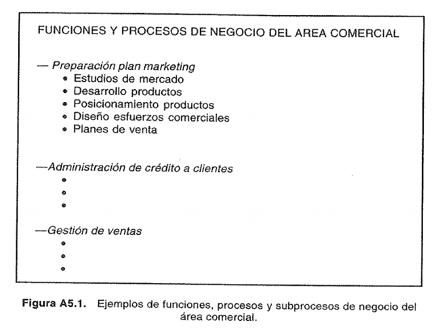{width=82%}

- **Hito clave:** Esta lista debe ser **validada explícitamente por los directores funcionales** de cada área para asegurar que el equipo informático entendió bien a qué se dedica el departamento.

**Paso II.2: Descripción de los sistemas existentes (Procesos y estructuras de datos)**

Una vez que sabemos qué hace el negocio, mapeamos la tecnología actual desde dos dimensiones: **los procesos y los datos**.

1. **¿Qué se analiza exactamente?** Para cada proceso informático actual, se debe documentar:

2. A qué subsistema pertenece.

3. Los **inputs**: Qué datos necesita usar el proceso.

4. Los **outputs**: Qué datos nuevos crea o modifica.

5. Cómo procesa esa información (búsquedas, cálculos, etc.) y cómo está implementado (ej. si es un sistema corporativo o un Excel armado por un empleado).

6. **Herramientas recomendadas:** El autor sugiere usar **matrices** para cruzar los procesos con los datos, y destaca que si la empresa tiene un **Diccionario de Datos**, este es el momento ideal para usarlo o empezar a armarlo.

7. *Nota para destacar en el examen:* Se debe documentar cuidadosamente cualquier **"intervalo de decisión"**. Estos son los baches en un sistema donde el software no puede actuar solo y necesita que un humano tome una decisión (por ejemplo, el sistema lista los clientes morosos, pero un empleado debe decidir si se les envía o no la carta de intimación).

**Paso II.3: Crítica de los sistemas existentes (técnica y de negocio)**

No alcanza con hacer un inventario descriptivo; ahora hay que evaluarlo con ojo crítico. Esta es la parte más rica porque se levanta información cualitativa a través de **entrevistas a los usuarios y al personal de Sistemas (SI)**. Esta crítica se divide en dos enfoques:

- **La crítica Técnica:** La hacen los informáticos. Se evalúa el rendimiento actual de las máquinas, los volúmenes de información, la tecnología base utilizada y cómo se conectan los sistemas entre sí. Sirve para identificar si hay que cambiar el planteamiento tecnológico porque quedó obsoleto.

- **La crítica de Negocio (La más vital):** Es la que suele faltarle a las empresas. Se analiza el **grado de soporte real** que el software le da a las funciones de negocio relevadas en el paso II.1. Aquí se documentan las quejas: si la estructura de datos es incómoda para el trabajo diario de los empleados, cuáles son los puntos fuertes y débiles percibidos, y qué áreas exigen mejoras urgentes.

**Paso II.4: Elaboración del informe acerca de los sistemas existentes**

Toda la información anterior (las matrices que cruzan procesos de negocio con sistemas, las críticas y los cuellos de botella) debe consolidarse en un documento final.

- **El hito de Validación:** Este informe no se aprueba solo. Debe someterse a la validación oficial del **Subdirector general responsable de cada área** en una reunión formal de trabajo. En esta reunión participan el Director de Sistemas (SI), el Director Operativo del Proyecto (DOP) y el equipo de trabajo. Si los dueños del negocio no están de acuerdo con la "radiografía" que se tomó de su departamento, el plan no puede avanzar.

💡 **La Analogía para tu examen: "La Remodelación de la Casa"**

Siguiendo con nuestras analogías de arquitectura: Imagina que la Fase I fue contratar a los arquitectos y lograr que toda la familia se comprometa a soportar el polvo de la obra. La **Fase II es la inspección de la casa actual**:

1. **El Negocio (II.1):** Primero, el arquitecto te pregunta cómo usa tu familia la casa hoy ("Acá comemos, allá dormimos").

2. **Los Sistemas (II.2):** Luego, mira los planos viejos para ver por dónde pasan los caños de agua y los cables de luz hoy.

3. **La Crítica (II.3):** El electricista dice "los cables están viejos" (crítica técnica), pero tú le dices "además, no tengo enchufes cerca de la cama y eso me molesta todos los días" (crítica de negocio).

4. **El Informe (II.4):** El arquitecto hace un diagnóstico completo del estado de la casa y te lo hace firmar antes de ponerse a dibujar la casa nueva (Fase III).

Con este nivel de estructura, tienes la respuesta perfecta y blindada para tu examen. ¿Estamos listos para avanzar a la Fase III, donde por fin empezamos a diseñar las soluciones, o te quedó alguna duda de esta etapa de diagnóstico?

### A5.4. Fase III: Elaboración del Plan de TI/SI {-}

¡Llegamos al corazón de la metodología! Como decís vos, esta es la fase del "núcleo duro", porque acá dejamos de diagnosticar el pasado y empezamos a diseñar el futuro tecnológico de la empresa.

Acomodate, porque vamos a desglosar los 8 pasos de la **Fase III: Elaboración del Plan de TI/SI** con un rigor de nivel universitario, pero traduciendo el lenguaje académico para que lo domines a la perfección en tu examen.

**Paso III.1: Preparación del equipo y posibles nuevas áreas**

Antes de salir a relevar qué necesita la empresa, hay que preparar el terreno.

- **El Equipo:** El autor recomienda mantener a las mismas personas que trabajaron en la Fase II, porque ya conocen los sistemas actuales y tienen "rodaje". Sin embargo, el Director Operativo del Proyecto (DOP) debe gestionar posibles bajas o rotaciones. Se menciona un concepto clave de McFarlan: en **"proyectos de gran riesgo"** (aquellos muy grandes o con tecnologías a las que la empresa no está acostumbrada), es vital mantener la máxima estabilidad del personal.

- **Reestructuración de Áreas:** Se utiliza la información recopilada en la Fase II para reflexionar: ¿Sigue sirviendo dividir a la empresa como lo hicimos al principio? Si se detectaron puntos débiles muy graves en un sector particular, puede que convenga crear una "nueva área de análisis" específica para estudiarla más a fondo.

**Pasos III.2 y III.3: Relevamiento y descripción de necesidades**

*(El autor los ejecuta casi en simultáneo en su explicación).* Aquí el equipo vuelve a salir a la cancha a entrevistar a los usuarios, pero esta vez la pregunta no es "¿qué usas hoy?", sino **"¿qué información necesitas para hacer bien tu trabajo y que hoy no tienes?"**. Para hacer esto con rigor, el autor exige tres metodologías o enfoques de trabajo:

1. **Factores Críticos para el Éxito (Rockart):** Para que los usuarios no pidan cosas irrelevantes, se utiliza este concepto. Se le pregunta al usuario qué variables son críticas para que su departamento triunfe, y en base a eso se deducen sus verdaderas necesidades de información.

2. **Atomización de necesidades:** Está prohibido aceptar que un usuario diga "necesito un sistema de marketing nuevo". El analista debe *atomizar* (desglosar) esa petición en necesidades de datos muy concretas.

3. **Identificación "al vuelo":** Mientras el usuario habla, el analista ya debe ir imaginando las *entidades de datos* y los *procesos lógicos* que harán falta para generar esa información.

**Paso III.4: Integración (El trabajo de gabinete)**

Este es el paso más técnico e intelectual de la fase. El equipo vuelve a la oficina con una montaña de necesidades inconexas y debe organizarlas para descubrir la **estructura global del futuro Sistema de Información (SI)**. Para estructurar este "rompecabezas", el autor da metodologías y consejos muy precisos que debes saber:

- **Alineación con la Cadena de Valor:** Identificar si un grupo de necesidades corresponde a un proceso de negocio central. Si es así, conformarán el núcleo del "SI central".

- **Análisis de Datos:** Si aparecen datos totalmente nuevos, significa que hay que cubrir un área virgen. Pero si son datos viejos que los usuarios quieren estructurar de forma diferente, es un síntoma de que el negocio está cambiando y habrá que rediseñar sistemas enteros.

- **Agrupación y Fronteras:** Se buscan necesidades que se parezcan para agruparlas en un nuevo "subsistema". El objetivo metodológico es que las fronteras entre subsistemas sean limpias; hay que evitar crear sistemas que se crucen o interactúen de forma muy compleja entre sí.

- **Sistemas Aislados e Intervalos de Decisión:** Si un sistema no interactúa con el resto, se lo cataloga como "aislado" (suele ocurrir con tecnologías operativas de línea). Si una necesidad es muy vaga, probablemente estemos ante un "intervalo de decisión" que no se puede automatizar del todo y requerirá un sistema de apoyo especializado.

**Paso III.5: Validación de la estructura del SI emergente**

Ese "mapa" o estructura de sistemas nuevos que el equipo inventó en el paso anterior no se aprueba solo. Debe someterse a un proceso de validación oficial en dos rondas:

1. **Reuniones departamentales:** Con el Subdirector de cada área y su equipo. Aquí se aseguran de que el diseño informático tenga sentido para el negocio.

2. **Reunión del Comité de TI/SI en pleno:** Para que la alta dirección le dé el carácter de "oficial" a la nueva estructura.

**Paso III.6: Informe de la estructura del SI**

Una vez que se acordó la arquitectura tecnológica, los procesos y las estructuras de datos, se elabora un informe consolidado. Este documento marca el puente para empezar a evaluar cuántos recursos de programación y dinero costará construirlo.

**Paso III.7: Propuestas alternativas (Los Escenarios)**

¡Atención aquí porque es clave para el examen! Nunca se puede construir absolutamente todo lo que los usuarios pidieron, porque los recursos (dinero y tiempo) no alcanzan. La metodología dicta que el departamento de Informática debe "empaquetar" las soluciones y presentar **3 o 4 propuestas alternativas (escenarios)** para que la dirección elija. ¿Cómo se filtran y arman estas alternativas? Cruzando dos tipos de criterios:

- **Criterios Generales (Técnicos y Operativos):** Se busca que los paquetes sean organizativamente asimilables (no cambiar todo de golpe), que el departamento de SI pueda "digerir" el volumen de trabajo sin tanto riesgo, que no pasen el límite de presupuesto y que tengan coherencia técnica (ej. que compartan la misma base de datos). Además, se deben sumar explícitamente las necesidades de infraestructura (ej. comprar nuevos servidores).

- **Criterios Estratégicos (El Negocio):** Aquí entra a jugar la "columna" de la famosa matriz. La Dirección dicta qué priorizar: ¿Queremos un escenario que mejore la productividad, uno que dé resultados a corto plazo, o uno que priorice la atención al cliente?.

**Paso III.8: Elaboración y aprobación del plan definitivo**

El Comité de TI/SI (la alta dirección) se reúne en sesión plenaria para analizar esos 3 o 4 escenarios y elegir el definitivo para los próximos 3 a 5 años.

Para tomar esta decisión, el autor introduce una metodología brillante de **Análisis Coste-Beneficio "Divorciado"**: En los proyectos de TI, medir la rentabilidad es dificilísimo. Por eso, las responsabilidades se dividen:

- **El Coste:** Lo estiman pura y exclusivamente los técnicos informáticos, que saben cuántas horas de programación o servidores hacen falta.

- **El Beneficio:** Lo debe justificar el directivo o usuario del negocio. Como muchos sistemas (ej. un software de marketing) tienen beneficios intangibles que no se pueden medir en ahorro de horas-hombre, es el directivo quien debe dar la cara y demostrar que ese sistema le sacará rentabilidad a su área.

**Resumen rápido de la Fase III:** El equipo prepara el terreno (III.1), encuesta qué le falta a la empresa (III.2 y III.3), diseña un mapa ideal de sistemas en el escritorio (III.4), los jefes lo validan (III.5 y III.6), los técnicos arman 3 o 4 presupuestos posibles o escenarios (III.7) y la alta dirección elige el ganador justificando el gasto frente a los beneficios (III.8).

¿Qué te pareció este desglose? Si logras explicar en tu examen cómo funciona el trabajo de gabinete (III.4), cómo se arman los escenarios (III.7) y cómo se divide el cálculo de costo-beneficio (III.8), te vas a ganar el aplauso de tu profesor. ¡Dime si quieres que repasemos la última fase (Fase IV) para cerrar el anexo!

### A5.5. Fase IV: Programación de actividades {-}

¡Llegamos a la meta! Te felicito por haber mantenido el ritmo, porque ya dominás la parte más compleja. Ahora nos toca aterrizar toda esa estrategia en la realidad del día a día.

Como tu profesor, te adelanto algo clave para tu examen: si la Fase III era estratégica y de negocio, la **Fase IV es netamente operativa y técnica**. Aquí ya no se discute "qué" vamos a hacer, sino "cuándo empezamos" y "quién lo hace".

Vamos a desglosar esta última etapa, sus entregables y luego haremos el cierre final de todo el método.

Una vez que el Comité de TI/SI eligió el escenario ganador en la fase anterior, el plan vuelve a las oficinas de Informática para que lo conviertan en cronogramas reales. El índice del texto nos marca tres pasos fundamentales:

**Paso IV.1: Descripción detallada del Plan acordado y Calendario del primer año**

- **¿Qué se hace?** El Director Operativo del Proyecto (DOP) toma ese gran plan a 3-5 años y lo "desmenuza" en una lista de proyectos informáticos concretos y manejables.

- Se establece un **calendario detallado y estricto exclusivamente para el primer año** de vigencia del Plan. (Los años 2, 3 y 4 quedan en un cronograma más general, porque la tecnología cambia rápido).

**Paso IV.2: Inclusión de proyectos en el presupuesto**

- **¿Qué se hace?** Se proponen y asignan los recursos exactos. El DOP calcula cuántas horas de los programadores se van a necesitar, qué equipos de hardware hay que comprar y cuánto dinero costará ejecutar esos proyectos del primer año.

**Paso IV.3: Plan de evaluación y revisión**

- **¿Qué se hace?** Se establecen las métricas para controlar que el proyecto avance según lo acordado a lo largo del año. Es importante destacar que el autor aclara que, aunque vimos las fases de forma secuencial, en la práctica siempre son necesarias **iteraciones** (es decir, ir y volver sobre los pasos si algo no cuadra).

**¿Cómo se cierra formalmente el procedimiento?** El proceso se cierra con una última validación. Todo este trabajo súper especializado (que se hace puertas adentro del departamento de Sistemas) debe someterse a la **aprobación final del Comité de TI/SI**.

- *Nota para sumar puntos en el examen:* El autor aclara que para esta última reunión de aprobación del cronograma, **ya no es imprescindible la asistencia del Director General**, porque las decisiones fuertes de negocio ya se tomaron en la Fase III. Quien presenta el cronograma final es el subdirector general a cargo de Sistemas.

**¿Qué Entregables (resultados concretos) salen de esta fase?**

Si el profesor te pregunta "¿Qué tiene en la mano la empresa al terminar el procedimiento de alineamiento?", tu respuesta debe ser:

1. Una **lista de proyectos informáticos** concretos a desarrollar.

2. Una **asignación de recursos clara** (presupuesto económico, horas-hombre y equipos necesarios).

3. Un **calendario detallado** para empezar a ejecutar las obras del primer año.

### Cierre Explicativo Brillante (Tu comodín para el examen) {-}

Para terminar de consolidar todo en tu mente, vamos a unir nuestra analogía de la "Construcción" con el concepto central de todo el Capítulo 5: **"Derribar el Muro"**.

A lo largo de la historia, las empresas construían sistemas a ciegas porque había un "muro" de incomunicación entre los informáticos (que solo querían máquinas nuevas) y los directivos (que no entendían de tecnología). Para derribar ese muro y lograr la alineación estratégica, este procedimiento nos obliga a seguir cuatro pasos lógicos:

1. **Fase I (El Compromiso):** Contratamos a los arquitectos e involucramos a toda la familia. Si el dueño de casa (Director General) no dice "esto es importante", nadie colabora.

2. **Fase II (El Diagnóstico):** Miramos la casa vieja. Los directivos de negocio nos dicen "cómo viven" (funciones de negocio) y los técnicos miran por dónde pasan los caños hoy (sistemas actuales). Ambos critican lo que no funciona.

3. **Fase III (La Estrategia):** Dibujamos la casa nueva. Cruzamos lo que la familia necesita con los planos arquitectónicos. Los técnicos arman 3 opciones (escenarios) diciendo cuánto cuesta cada una, y el dueño de casa elige la mejor justificando por qué les dará más confort (beneficio).

4. **Fase IV (La Operación):** Se aprueba el presupuesto de materiales, se contrata a los albañiles y se fija el calendario para empezar a levantar la primera pared la semana que viene.

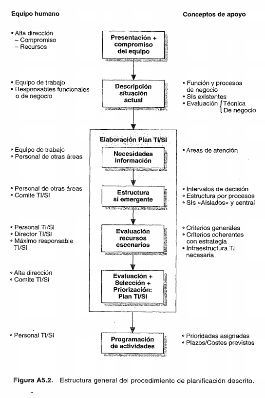{width=90%}

**Conclusión final:** Este método es una excusa perfecta para forzar a los gerentes y a los técnicos a sentarse en la misma mesa y hablar el mismo idioma. Al finalizar, el Plan de TI/SI ya no es "un invento de los informáticos", sino el **motor tecnológico exacto que el negocio necesitaba para cumplir su estrategia**.

\newpage

# Explicación Sobre los Roles en el Alineamiento Estratégico {-}

## Estructura de los Grupos de Trabajo y Roles Generales {-}

La metodología de alineamiento estratégico de Sistemas de Información (SI) y Tecnologías de la Información (TI) establece una estructura de comités y grupos para garantizar que el plan se elabore fundamentalmente desde una **perspectiva de negocio** y no puramente tecnológica:

- **Comité de Tecnologías y Sistemas de Información (Comité de TI/SI):** Es el órgano con la **responsabilidad última** sobre el Sistema de Información que se diseñe. Está compuesto por el **máximo responsable de la compañía** (director general o presidente), los **responsables de las distintas áreas funcionales** (subdirectores de área) y el **director de Sistemas de Información**. Su rol consiste en supervisar el proyecto de planificación, explicitar el compromiso de toda la organización con el plan, proporcionar los criterios estratégicos de priorización y asignación de recursos, y otorgar la aprobación final al plan desarrollado.

- **Grupo Base:** Es el órgano encargado de la supervisión táctica y de asegurar la consistencia metodológica del proyecto. Está integrado por el **subdirector general a cargo de Sistemas de Información**, el **director de Sistemas de Información**, el **Director Operativo del Proyecto (DOP)** y, eventualmente, por **consultores externos** expertos en planificación. Su función es facilitar la negociación y el diálogo entre las áreas usuarias y el personal de Sistemas, supervisar al equipo de trabajo y coordinar el avance con mayor asiduidad de la que puede realizar el Comité de TI/SI.

- **Director Operativo del Proyecto (DOP):** Es el líder técnico que se encarga de la **labor diaria de dirección** de la planificación. Es el responsable de coordinar el trabajo operativo del equipo, asegurar que los documentos de diseño sean homogéneos y coherentes (evitando inconsistencias en datos y procesos comunes) y elaborar el calendario de proyectos para el corto plazo. Generalmente es una persona del departamento de Sistemas.

- **Equipo de Trabajo:** Es el grupo dedicado a realizar la labor operativa y de análisis diario de campo. Está conformado de manera mixta por **personal técnico del departamento de Sistemas** y **personal de los departamentos usuarios** (áreas funcionales) asignados especialmente al proyecto. Su rol consiste en realizar las tareas operativas de descripción de la situación actual y levantamiento de necesidades futuras de información.

- **Directores o Responsables Funcionales (Subdirectores de Área):** Aunque no realicen el trabajo operativo diario, su rol es vital para el éxito del proyecto, ya que deben ceder constructivamente el tiempo de las personas a su cargo, validar la descripción de los procesos y sistemas existentes de sus respectivas áreas, y asumir la **responsabilidad de estimar y comprometerse con los beneficios de negocio** esperados de las nuevas aplicaciones.

## Actuación y Roles de los Integrantes por Fase de la Planificación {-}

El procedimiento de planificación se divide en cuatro fases secuenciales en las cuales los anteriores integrantes asumen responsabilidades diferenciadas:

### Fase I: Presentación y compromiso del equipo {-}

- **Responsables de la fase:** El **Comité de TI/SI** y el **Grupo Base**.

- **Actuación y roles:**

  - La **dirección general** (máximo responsable) toma la decisión explícita de elaborar el plan, convence a sus colaboradores directos (subdirectores) de la necesidad del proyecto y les exige el compromiso de aportar los recursos humanos necesarios de sus áreas.

  - Se constituye formalmente el **Comité de TI/SI** para supervisar el proceso.

  - Se forma el **Grupo Base** (que puede incluir consultores externos) y se definen preliminarmente las áreas de análisis para describir el sistema actual.

  - Se constituye el **Equipo de Trabajo definitivo** y se presenta formalmente el proyecto a la organización.

### Fase II: Descripción de la situación actual {-}

- **Responsables de la fase:** El **Equipo de Trabajo** y los **departamentos involucrados**.

- **Actuación y roles:**

  - El **Equipo de Trabajo** realiza la labor de campo, identificando las funciones y procesos de negocio por área mediante entrevistas con los usuarios. Describe los sistemas y subsistemas existentes documentando tanto los datos que manejan como los procesos y su nivel de soporte.

  - El **DOP** (y en su caso el **Grupo Base**) supervisa de cerca al equipo de trabajo para asegurar la consistencia del diseño y que todos los datos comunes de la empresa se describan homogéneamente.

  - Los **Subdirectores Generales (directores funcionales)** de cada área analizada participan activamente revisando, discutiendo y **validando de manera explícita** el informe crítico elaborado por el equipo técnico antes de finalizar la fase.

### Fase III: Elaboración del Plan de TI/SI {-}

- **Responsables (Análisis de necesidades):** El **Equipo de Trabajo** y los **departamentos involucrados**.

- **Responsables (Estructura y Plan definitivo):** El **personal de SI** elabora; el **Comité de TI/SI** aprueba.

- **Actuación y roles:**

  - El **Equipo de Trabajo** se reúne con los usuarios funcionales para inventariar y documentar las necesidades de información no cubiertas, priorizándolas mediante técnicas como los Factores Críticos para el Éxito (CSF).

  - El **DOP**, el **Director de SI** y el **Grupo Base** lideran el análisis de gabinete para integrar las necesidades detectadas y proponer la arquitectura o estructura global del nuevo sistema.

  - El **Comité de TI/SI** valida y aprueba formalmente esta estructura emergente del SI futuro, dándole carácter de "oficial".

  - El **personal técnico de SI (DOP y Director de SI)** prepara y diseña un máximo de tres o cuatro alternativas de planes técnicos y estima con precisión los recursos financieros y costes de implementación de cada alternativa.

  - Los **Subdirectores Generales** analizan los costes asociados de las alternativas para decidir qué sistemas de información justifican su inversión y definir la prioridad de cada uno de ellos en sus áreas de negocio.

  - El **Comité de TI/SI** (en sesión plenaria liderada por el subdirector a cargo de SI) evalúa los escenarios propuestos, resuelve por negociación los conflictos de interés interdepartamentales y aprueba por consenso el **Plan de TI/SI definitivo** a mediano plazo (3 a 5 años).

  - *Socio-responsabilidad del análisis coste-beneficio:* En la aprobación, el **departamento de SI** asume la responsabilidad de construir y entregar los sistemas en los costes y plazos acordados; el **usuario o departamento de negocio** asume la responsabilidad única de explotar el sistema para obtener el beneficio comercial o institucional estimado.

### Fase IV: Programación de actividades {-}

- **Responsables de la fase:** El **personal de SI (elabora)** y el **Comité de TI/SI (aprueba)**.

- **Actuación y roles:**

  - El **DOP** asume la responsabilidad de elaborar la programación técnica detallada, traduciendo el plan estratégico a un calendario concreto y vinculante exclusivo para el primer año de vigencia del Plan.

  - El **DOP** propone y asigna los recursos humanos, de hardware y software requeridos para cada proyecto, y somete este cronograma y presupuesto al Director de SI y al subdirector a cargo de SI.

  - El **subdirector general a cargo de SI** presenta formalmente este calendario y el presupuesto integrado al **Comité de TI/SI** para su validación final (en una sesión donde no es imprescindible la asistencia del director general).

  - El **Comité de TI/SI** otorga la aprobación final a la programación de actividades y al presupuesto anual, estableciendo los mecanismos e hitos de control que regularán el seguimiento del desarrollo de los proyectos.

\newpage

# Explicación sobre la cartera de aplicación y las estrategias {-}

La **Cartera de Aplicaciones** (u *Ornamento de la Cartera de Sistemas*) es uno de los marcos conceptuales más importantes y preguntados en los exámenes de Dirección Estratégica de SI/TI. Fue desarrollada originalmente por **F. Warren McFarlan** en 1984 y posteriormente adaptada y profundizada por **Edwards, Ward y Bytheway** en su bibliografía de referencia.

Su filosofía central es revolucionaria para la época: propone gestionar las aplicaciones y tecnologías de una organización como si fuesen **activos de una cartera financiera o un portafolio de productos comerciales**. En lugar de clasificar los sistemas por su aspecto técnico (ej. si es Web, cliente-servidor o móvil), la matriz los clasifica estrictamente por **la contribución presente y futura que hacen al éxito y la supervivencia del negocio**.

A continuación, te presento una guía de estudio exhaustiva, estructurada y diseñada para que obtengas la calificación máxima en tu examen.

## 1. La Matriz de la Cartera (Los 4 Cuadrantes) {-}

La herramienta se grafica como una matriz de doble entrada de 2×2. Los cuadrantes se definen cruzando el impacto del sistema en la **estrategia futura del negocio** (eje vertical) frente al impacto en las **operaciones actuales** (eje horizontal).

Para que tu respuesta brille ante los profesores, **asocia siempre cada cuadrante con su equivalente en la clásica Matriz BCG (Boston Consulting Group)** y aplicalo al caso práctico de tu TP de Vialidad Provincial:

| **Cuadrante** | **Definición Conceptual** | **Rol Estratégico y Meta** | **Equivalente BCG** | **Ejemplo Práctico (Tu TP)** |
|------------|---------------|----------------|---------------|--------------|
| **Estratégicas** *(Strategic)* | Sistemas fundamentales para ejecutar la estrategia de negocio futura y asegurar la ventaja competitiva a largo plazo. | **Orientación al negocio.** Su fin es ganar mercado, diferenciarse de los rivales o cumplir de forma directa los Factores Críticos de Éxito (FCE) de la dirección. | **"Estrellas nacientes"** (Alta inversión y alto valor futuro). | **ERP Vial Integral (In-House):** Recupera la soberanía tecnológica y el control total de la obra pública frente a las contratistas. |
| **De Alto Potencial** *(High Potential)* | Ideas o tecnologías innovadoras que *podrían* ser vitales en el futuro, pero cuyo valor real de negocio aún no ha sido demostrado. | **Investigación y Desarrollo (I+D).** Su meta es la experimentación controlada para evaluar costes y oportunidades antes de decidir si se invierte fuertemente en ellas. | **"Niños difíciles" / "Interrogantes"** (Incertidumbre, pero semillero del futuro). | **GeoVial (GIS DVP):** Incorporación pionera de mapas de accidentología para planificar de forma inteligente la inversión vial. |
| **Clave para las Operaciones** *(Key Operational)* | Sistemas críticos de los que depende actualmente el funcionamiento diario, la operatividad y la supervivencia de la empresa. | **Mitigación del riesgo.** No buscan generar ventajas competitivas, sino evitar que un fallo operativo paralice la empresa o la coloque en una desventaja letal. | **"Vacas lecheras"** (Sostienen la facturación y la estabilidad del día a día). | **Sistemas Logísticos Integrados (StockDVP + TallerDLM):** Evitan la duplicación de tareas y garantizan el mantenimiento de la flota. |
| **De Apoyo** *(Support)* | Aplicaciones valiosas para mejorar la eficiencia operativa y administrativa, pero no críticas para el éxito estratégico. | **Eficiencia y reducción de costes.** Suelen ser sistemas genéricos, estandarizados o administrativos que deben gestionarse con el menor gasto posible. | **"Perros"** (Son útiles para tenerlos cerca, pero no hay que disipar recursos valiosos en ellos). | **Legajo Digital Único / LexDoctor:** Herramientas administrativas y de gestión procesal obligatoria que no hacen al "Core" del negocio. |

## 2. Estilos de Gestión Asociados (Las Estrategias Genéricas de Parsons) {-}

Una de las mayores trampas en las que caen las empresas es intentar gestionar todos sus sistemas bajo un mismo criterio (ej. exigirle rentabilidad financiera a un proyecto de I+D o un plan de contingencia rígido a una idea de alto potencial).

Para solucionar esto, **Gregory Parsons (1983)** identificó **seis estrategias genéricas** para vincular la gestión de TI con las necesidades del negocio. Ward y Bytheway demostraron que existe un **"encaje ideal"** entre las estrategias de Parsons y los cuadrantes de la cartera:

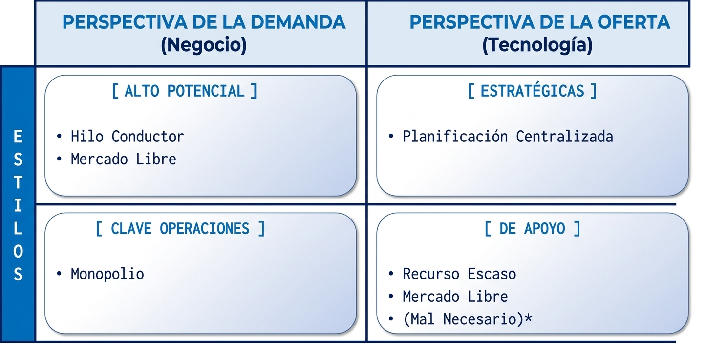{width=100%}

*(Nota: El "Mal Necesario" es una estrategia reactiva que suele adoptarse por error o negligencia, y genera graves desventajas competitivas).*

### A. Planificación Centralizada (Ideal para Aplicaciones Estratégicas) {-}

- **En qué consiste:** La estrategia de SI/TI se integra directamente con la planificación corporativa a nivel de alta dirección.

- **Por qué encaja aquí:** Permite comprender los requisitos competitivos del negocio a nivel global, facilitando las grandes inversiones financieras necesarias para desarrollar sistemas que cambien las reglas del mercado.

### B. Hilo Conductor (Ideal para Aplicaciones de Alto Potencial) {-}

- **En qué consiste:** Asume de forma proactiva que la tecnología de vanguardia (*"estado del arte"*) generará ventajas competitivas y se enfoca en liderar la innovación tecnológica antes que los rivales.

- **Por qué encaja aquí:** Estimula la creatividad y el aprendizaje tecnológico sin asfixiar la innovación con excesiva planificación formal en etapas tempranas.

### C. Monopolio (Ideal para Aplicaciones Clave para las Operaciones) {-}

- **En qué consiste:** Todos los sistemas de información son suministreos por un único proveedor interno y centralizado de TI al que los usuarios deben acudir de manera obligatoria.

- **Por qué encaja aquí:** Prioriza el control rígido de la oferta, garantizando soluciones de altísima calidad, estabilidad de datos y seguridad, eliminando el riesgo de parálisis operativa.

### D. Recurso Escaso (Ideal para Aplicaciones de Apoyo) {-}

- **En qué consiste:** Se asigna un presupuesto cerrado y sumamente estricto de antemano, obligando a los proyectos a competir ferozmente por fondos limitados.

- **Por qué encaja aquí:** Es una excelente estrategia de control financiero. Fuerza a que los sistemas de apoyo se justifiquen estrictamente mediante análisis económicos de reducción de costes (ROI), impidiendo que se "fugue" el presupuesto de la empresa en áreas no prioritarias.

### E. Mercado Libre (Útil para Alto Potencial y Apoyo) {-}

- **En qué consiste:** Sostiene que los directivos de área son quienes mejor conocen sus necesidades, por lo que se les da plena autonomía para adquirir soluciones fuera de la empresa o competir con el departamento interno de TI.

- **Por qué encaja aquí:** Promueve una rápida innovación descentralizada guiada por el usuario (en Alto Potencial) o permite tercerizar eficientemente la eficiencia administrativa (en Apoyo).

## 3. Priorización e Inversión utilizando la Cartera {-}

Edwards, Ward y Bytheway señalan que para definir prioridades y optimizar recursos bajo un entorno de incertidumbre, se debe evaluar cada proyecto en función de tres criterios básicos: **Beneficios** *(qué ganar)*, **Recursos** *(qué dotar)* y **Riesgos** *(qué puede fallar)*.

La lógica de priorización cambia de forma radical según el cuadrante que ocupe la aplicación:

1. **En Aplicaciones de Apoyo (Evaluación Sustitutiva):** Se prioriza usando el **análisis coste-beneficio tradicional**. La prioridad número uno la tendrán los proyectos que demuestren el mayor desplazamiento o evitación de costes tangibles empleando la menor cantidad de recursos.

2. **En Aplicaciones Clave para las Operaciones (Evaluación Complementaria):** La priorización es más compleja. Se evalúa el balance entre las ventajas económicas, la mejora de la infraestructura de datos y, fundamentalmente, la reducción de riesgos del negocio actual.

3. **En Aplicaciones Estratégicas (Evaluación Innovadora):** Se priorizan de acuerdo a su **adecuación estratégica**. La métrica de éxito es la contribución directa a los objetivos declarados de la empresa y a sus **Factores Críticos de Éxito (FCE)**.

4. **En Aplicaciones de Alto Potencial (Evaluación de Innovación):** Dado que sus beneficios son inicialmente desconocidos (I+D), su prioridad depende del impacto potencial estimado en múltiples FCE y de la **"energía y entusiasmo de su defensor"** (*champion*) para impulsar y defender el proyecto con un presupuesto estrictamente acotado en tiempo y recursos.

**La Fórmula de Priorización Global:**

Para armar el Plan Global, la dirección debe comparar proyectos de diferentes cuadrantes entre sí (ej. decidir si se desarrolla un sistema estratégico o uno operativo clave). El plan se debe estructurar respetando la siguiente proporción matemática:

$$\text{Prioridad del Proyecto} = \frac{\text{Beneficios a obtener (ajustados para el riesgo)}}{\text{Consumo de recursos limitados}}$$

## 4. Ubicación en las Fases de Alineamiento (Metodología de Andreu) {-}

Si te preguntan dónde entra la Cartera de Aplicaciones dentro del proceso formal de planificación del alineamiento estratégico, la respuesta es que **atraviesa activamente las fases II, III y IV del modelo de Andreu, Ricart y Valor**:

- **Fase II (Diagnóstico de la situación actual):** Se utiliza para clasificar la **"cartera de aplicaciones actuales"**. Permite realizar la *crítica de los sistemas existentes*, visualizando si la empresa tiene un cimiento operativo frágil o si está disipando recursos de forma ineficiente manteniendo demasiadas aplicaciones de "Apoyo" en detrimento de las "Estratégicas".

- **Fase III (Elaboración del Plan):** Es la fase estrella de la herramienta. Se utiliza para clasificar las **"cartera de aplicaciones futuras"**. Permite agrupar los nuevos proyectos de SI/TI en los cuatro cuadrantes, asociarles su estrategia de gestión de Parsons correspondiente para el plan de acción (evitando una estrategia universal equivocada) y definir el orden de prioridades globales.

- **Fase IV (Programación de actividades):** Se aplica como el **orden de ejecución táctico**. La estructuración del calendario del primer año y la asignación concreta del presupuesto anual se realizan respetando el peso estratégico y la jerarquía definidos por la cartera de aplicaciones en la fase previa.

💡 **Consejo clave para tu examen:** En la defensa oral o escrita, usá este argumento diferenciador: *"La cartera de aplicaciones no es una receta estática de clasificación, sino una herramienta de aprendizaje organizativo y un vehículo de comunicación estructurado para que el área técnica de SI/TI y los gerentes de negocio acuerden de forma unificada el valor estratégico de la tecnología en la organización"*.

🎧 Recordá que en tu panel de **Estudio** tenés disponible el **Resumen de Audio** que generamos anteriormente. Es un complemento ideal para repasar la interacción de la cartera con todo el Trabajo Práctico de Vialidad Provincial. ¿Querés que simulemos una pregunta típica de parcial sobre la relación entre el análisis de portafolio y los beneficios tangibles/intangibles de Robson?

\newpage

# Mapa integral de las estrategias en SI/TI {-}

En un examen de **Dirección Estratégica de SI/TI**, la palabra "estrategia" se utiliza en múltiples niveles. Para que no te confundas y puedas responder con total solidez académica, tu examen exige que domines **cuatro niveles distintos de estrategias**.

A continuación, te presento el mapa estratégico definitivo que integra toda la materia:

### Nivel 1: La distinción madre (Estrategia de SI vs. Estrategia de TI) {-}

Es el concepto más importante de la materia. Los autores (Andreu, Edwards, Ward y Bytheway) insisten en que **no son lo mismo** y que confundirlas es la causa principal del fracaso tecnológico de las empresas.

| Criterio de Comparación | Estrategia de Sistemas de Información (SI) | Estrategia de Tecnologías de la Información (TI) |
| :--- | :--- | :--- |
| **El Foco** | **La Demanda** (Centrada en las necesidades del negocio). | **La Oferta** (Centrada en la provisión de tecnología). |
| **La Pregunta Clave** | **¿QUÉ** sistemas y qué información requiere la organización para sus procesos y objetivos? | **¿CÓMO** se van a satisfacer y estructurar técnicamente esas necesidades de información? |
| **Liderado por** | **Directivos de negocio y usuarios clave** (quienes entienden la estrategia de la empresa). | **Especialistas de TI y tecnólogos** (quienes administran los fierros y redes). |
| **Métrica de Éxito** | **Efectividad y Adecuación Estratégica** (¿Ayuda a cumplir los objetivos de la empresa?). | **Eficiencia Técnica y Costo** (¿Se instaló a tiempo, dentro del presupuesto y de forma estable?). |
| **Ejemplo (Tu TP)** | Determinar que se necesita cruzar el inventario de rutas con mapas de accidentes para planificar obras. | Decidir usar servidores con base de datos PostgreSQL, extensión PostGIS y código Node.js. |

### Nivel 2: Las Estrategias Genéricas de Gestión de SI/TI (McFarlan / Parsons) {-}

Define **cómo debe administrar la organización su cartera de aplicaciones**. Parsons y Ward identificaron que, según el cuadrante de la cartera, se debe aplicar una estrategia de gestión diferente para evitar desvíos de recursos:

1. **Planificación Centralizada (para Aplicaciones Estratégicas):** La estrategia de SI/TI se diseña en conjunto con la alta dirección. Se enfoca en la demanda del negocio para habilitar ventajas competitivas que requieran grandes inversiones.

2. **Hilo Conductor (para Aplicaciones de Alto Potencial):** Orientada a la demanda pero impulsada por la tecnología. Consiste en experimentar con tecnologías de vanguardia (*"estado del arte"*) para descubrir innovaciones antes que la competencia.

3. **Monopolio (para Aplicaciones Clave para las Operaciones):** Orientada estrictamente a controlar la oferta. Toda la tecnología la provee un único departamento centralizado para garantizar máxima seguridad, calidad de datos y evitar que la empresa se paralice operativamente.

4. **Recurso Escaso (para Aplicaciones de Apoyo):** Estrategia de control financiero basada en la oferta. Se asigna un presupuesto rígido y cerrado para obligar a que las aplicaciones compitan por fondos y se justifiquen únicamente por reducción de costos tangibles (ROI).

5. **Mercado Libre (para Apoyo o Alto Potencial):** Descentralización absoluta. Da autonomía a los jefes de área para que compren el software que deseen o contraten proveedores externos si el área de sistemas interna no los satisface.

6. **Mal Necesario (Estrategia Defensiva/Inadecuada):** El sistema solo se usa si no hay alternativa o por obligación legal. Se cae en ella por negligencia o escasez extrema de recursos, degradando la moral y competitividad.

### Nivel 3: El Alineamiento con las Estrategias Competitivas (Michael Porter) {-}

Los sistemas de información deben estar directamente acoplados a la estrategia competitiva elegida por la unidad de negocio para posicionarse en su sector:

- **Si la empresa compite por Liderazgo en Costes:** Los SI/TI se dirigen de forma prioritaria a **automatizar, simplificar procesos y reducir costos de transacción** (foco en Eficiencia).

- **Si la empresa compite por Diferenciación:** Las inversiones en SI/TI se enfocan en **mejorar la calidad, la velocidad del servicio posventa y la personalización** para el cliente (foco en Efectividad), permitiendo cambiar las reglas del sector.

### Nivel 4: Las Estrategias de Conversión o Transición Técnica (Kendall & Kendall) {-}

Es el nivel más bajo (u operativo) y define **cómo pasar físicamente del sistema de información viejo al sistema de información nuevo** durante la etapa de implantación técnica:

- **Estrategia Directa:** Se apaga el sistema viejo y se enciende el nuevo en un día específico (alto riesgo).

- **Estrategia Paralela:** Se ejecutan ambos sistemas a la vez por un tiempo para comparar resultados y asegurar estabilidad (costosa en tiempo y esfuerzo de personal).

- **Estrategia Gradual (por Fases):** Se va subiendo el volumen de transacciones de forma paulatina para que los usuarios se adapten progresivamente.

- **Estrategia de Prototipo Modular:** Se instala y activa el software módulo por módulo (por ejemplo, primero Compras, luego Contabilidad).

- **Estrategia Distribuida:** Se hace la transición completa en una sucursal piloto y, tras validarla, se replica secuencialmente en las demás sucursales.

📊 ¿Querés que hagamos un simulacro de examen rápido con 3 preguntas de opción múltiple para medir si lográs identificar qué tipo de estrategia aplicar en escenarios reales?

\newpage

# Preguntas que nos hizo la profesora {-}

## ¿Cuál es la diferencia entre DOP y Director de SI/TI? {-}

La principal diferencia entre ambas figuras radica en el **nivel de responsabilidad y el enfoque de sus tareas** dentro del proceso de planificación estratégica. Mientras que el Director de SI/TI tiene un rol estratégico, político y de coordinación de alto nivel, el DOP (Director Operativo de Proyecto o de Planificación) es quien ejecuta la labor táctica y se "ensucia las manos" con la gestión del día a día.

Basándonos en la teoría de Andreu, Ricart y Valor y en los análisis que venimos realizando sobre tu Trabajo Práctico, aquí te detallo las responsabilidades de cada uno:

### El Director de SI/TI (El Estratega y Coordinador) {-}

- **Enfoque orientado al negocio:** Su rol actual está mucho más relacionado con entender el negocio de la empresa que con los detalles puramente tecnológicos. Dejó de ser un administrador aislado que decide qué máquinas comprar, para convertirse en un **coordinador del equipo interdepartamental** que elabora el plan.

- **Posicionamiento institucional:** Es miembro permanente del **Comité de Tecnologías y Sistemas de Información** (el órgano de máxima autoridad), donde se sienta junto al Director General y los directores de las áreas funcionales para fijar prioridades y aprobar el plan definitivo.

- **Dirección formal:** Dirige formalmente el Equipo de Trabajo, pero delega el control rutinario. Además, en la etapa final de programación, es quien **aprueba formalmente la asignación de recursos y el calendario** propuesto por el DOP.

### El DOP - Director Operativo de Proyecto (El Ejecutor y Controlador) {-}

- **Gestión del "día a día" (Trabajo de campo):** Aunque el Director de SI/TI es el jefe formal, es el DOP quien **lleva a cabo la labor diaria de dirección del Equipo de Trabajo**. Suele ser un profesional del departamento de Sistemas (como un analista funcional senior), aunque no es un requisito excluyente.

- **Control metodológico y documental:** Tiene la tarea vital de velar por la **homogeneidad de los documentos y las estructuras de datos** elaboradas durante las entrevistas con los usuarios, obligando al equipo a mantener la disciplina. Además, es quien debe planificar y controlar estrictamente los plazos del proyecto de planificación para evitar que se alargue de forma indefinida.

- **Responsable de la Fase IV (Programación):** Cuando el plan general está aprobado, el DOP es el "responsable más natural" de **elaborar la lista de proyectos informáticos concretos y proponer la asignación exacta de recursos** (tiempo de programadores, equipos, horas-hombre). Como repasamos anteriormente en tu TP (en el Hito 2), el DOP es quien valida los prototipos (*mockups*) cara a cara con los usuarios de negocio y quien presenta los informes de avance y desvíos ante el Comité de TI/SI al finalizar cada hito.

**En resumen:** Ambos trabajan en conjunto y conforman el **Grupo Base** (encargado de facilitar la negociación con los usuarios y asegurar la consistencia del plan). Sin embargo, haciendo una analogía con una obra de construcción, el **Director de SI/TI** es el arquitecto en jefe que acuerda con los dueños (el Comité) qué edificio se va a construir para cumplir con los objetivos del negocio; el **DOP** es el director de obra que está en el terreno todos los días coordinando a los obreros (el Equipo de Trabajo), controlando que los planos se documenten bien y calculando cuántos materiales y horas se van a necesitar en el primer año.

## Estrategias de conversión {-}

Dentro de la fase de implementación, la **conversión** es el proceso físico de cambiar o hacer la transición del sistema de información viejo al sistema nuevo o modificado. Como te estás preparando para un examen, es fundamental que conozcas que la bibliografía plantea **cinco estrategias principales de conversión** y que cada una tiene ventajas y desventajas muy claras.

A continuación, te detallo cada uno de estos cinco enfoques para que los puedas estudiar a fondo:

### 1. Conversión Directa {-}

En este enfoque, **en una fecha específica se abandona por completo el sistema viejo y se pone en uso el nuevo sistema**.

- **¿Cuándo usarlo?:** Funciona mejor cuando se pueden tolerar algunos retrasos en el procesamiento o cuando hay un mandato gubernamental que obliga al cambio inmediato. Solo debe hacerse si se ha realizado una comprobación extensa de antemano.

- **Ventajas:** Obliga a los usuarios a adaptarse al nuevo sistema, ya que no tienen la posibilidad de seguir usando el viejo.

- **Desventajas y Riesgos:** Se considera un enfoque muy arriesgado. Si ocurren errores, puede haber grandes retrasos porque no hay un sistema alterno de respaldo. Además, los usuarios pueden sentir que se les impone una herramienta sin recurso, y es difícil comparar los resultados del nuevo sistema con los del anterior.

### 2. Conversión Paralela {-}

Consiste en **ejecutar el sistema viejo y el nuevo al mismo tiempo (en paralelo)** durante un periodo específico. Es el enfoque más utilizado y funciona muy bien cuando el sistema que se reemplaza es uno manual.

- **Ventajas:** Ofrece una gran seguridad, ya que se pueden comparar los resultados de ambos sistemas para detectar errores de procesamiento en el nuevo. Además, los usuarios se sienten más seguros porque no se les obliga a un cambio abrupto.

- **Desventajas:** El costo es alto porque se deben mantener dos sistemas operativos al mismo tiempo. Esto virtualmente duplica la carga de trabajo de los empleados durante la conversión. Otro problema es que, ante la opción, los empleados pueden preferir seguir usando el sistema viejo simplemente por costumbre.

### 3. Conversión Gradual (o por fases) {-}

Intenta combinar las mejores características de la conversión directa y la paralela para reducir los riesgos. En este modelo, **el volumen de las transacciones que maneja el nuevo sistema se va aumentando poco a poco** conforme el sistema se introduce por fases.

- **Ventajas:** Permite que los usuarios se involucren e interactúen con el sistema de forma paulatina. También da la oportunidad de descubrir y corregir errores sobre la marcha sin desperdiciar mucho tiempo.

- **Desventajas:** Toma demasiado tiempo implementar el sistema por completo y no es una estrategia adecuada para sistemas que sean pequeños o muy sencillos.

### 4. Conversión de Prototipo Modular {-}

En este esquema se utilizan prototipos modulares operativos para **cambiar del sistema viejo al nuevo de forma gradual, módulo por módulo**. Conforme un módulo específico se modifica y es aceptado, pasa a ponerse en uso real.

- **Ventajas:** Garantiza que cada módulo se pruebe exhaustivamente antes de usarse en la operación diaria. Además, los usuarios se familiarizan poco a poco con cada módulo conforme se vuelven funcionales.

- **Desventajas:** No siempre es posible usar la técnica de elaboración de prototipos, lo que descarta este enfoque de entrada. Adicionalmente, el analista debe prestar muchísima atención a las interfaces para garantizar que, una vez que todos los módulos estén construidos, trabajen juntos como un sistema unificado.

### 5. Conversión Distribuida {-}

Se utiliza **cuando hay múltiples instalaciones físicas del mismo sistema**, como ocurre en bancos, franquicias de restaurantes o cadenas de tiendas. Se realiza la conversión completa (usando cualquiera de las otras metodologías) en una sola sucursal o sitio. Una vez que el sistema funciona con éxito en ese sitio de prueba, se realizan las conversiones en los demás.

- **Ventajas:** Los problemas se pueden detectar y contener en un solo lugar, en lugar de afectar a todas las sucursales u oficinas al mismo tiempo.

- **Desventajas:** Aunque la conversión sea exitosa en la primera sucursal, cada uno de los sitios posteriores tendrá sus propias peculiaridades o problemas locales que deberán resolverse de forma particular.

💡 **Tip clave para tu examen:** Si el profesor te pregunta cuál es la "mejor" estrategia de conversión, la respuesta correcta es que **no hay una única estrategia que sea siempre la mejor**. Los analistas de sistemas deben aplicar un **"enfoque de contingencia"**. Esto significa que se deben evaluar las variables organizacionales, la complejidad del sistema de información y los deseos del cliente para seleccionar la estrategia más apropiada en cada situación específica.

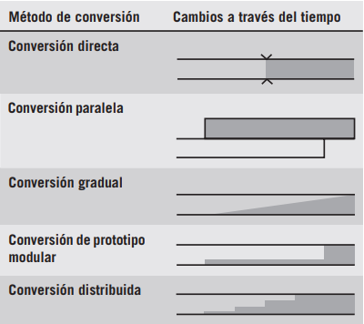{width=66%}

## Diferencia entre el enfoque gradual y el modular {-}

La diferencia principal radica en **qué aspecto del sistema se va introduciendo poco a poco**: si es la cantidad de trabajo que procesa o si son las partes funcionales del software en sí.

En la **conversión gradual (o por fases)**, el enfoque está en administrar el **volumen de las transacciones**. En este plan, la cantidad de operaciones que maneja el nuevo sistema **aumenta gradualmente conforme el sistema se introduce por fases**. Es decir, el sistema puede estar listo, pero se empieza procesando solo una pequeña parte del trabajo para que los usuarios se involucren gradualmente y se puedan corregir errores sin desperdiciar tiempo.

Por otro lado, la **conversión de prototipo modular** se enfoca en implementar el sistema **parte por parte (módulo por módulo)**. En este enfoque, se construyen prototipos modulares y operacionales para ir cambiando de los sistemas viejos a los nuevos. **Conforme cada módulo específico se modifica y es aceptado por los usuarios, se pone en uso real**. La gran ventaja aquí es que cada módulo independiente se prueba de manera completa y los usuarios se familiarizan con él antes de pasar a construir la siguiente parte del sistema. Sin embargo, este método exige prestar especial atención a las interfaces para garantizar que, al final, todos los módulos trabajen juntos como un solo sistema.

En resumen, el **enfoque gradual** regula la "carga de trabajo" (las transacciones) que entra al nuevo sistema general, mientras que el **enfoque modular** construye e instala el sistema "pieza por pieza".

### Un ejemplo práctico {-}

Para que te quede clarísimo para el examen, vamos a llevar la teoría a la práctica usando el mismo escenario de tu trabajo práctico: **la implementación del nuevo ERP Vial Integral en Vialidad Provincial**.

Imaginemos que Vialidad ya tiene el software listo y debe decidir cómo hacer el cambio del sistema viejo al nuevo.

Aquí tenés el ejemplo de cómo se vería cada enfoque en la vida real:

#### 1. El enfoque Gradual o por fases (Regula el volumen de trabajo) {-}

En este escenario, el sistema ERP ya está completo y tiene todas sus funciones listas, pero **se limita la cantidad de datos (transacciones) que ingresan** para no sobrecargar a los usuarios ni arriesgarse a una falla masiva.

- **El ejemplo práctico:** Vialidad decide que, durante el primer mes, **sólo la Zona 1 (Resistencia)** utilizará el nuevo ERP para todas sus tareas. Las otras 4 zonas de la provincia seguirán usando planillas de Excel y los sistemas viejos. Al mes siguiente, cuando ven que la Zona 1 ya se acostumbró y no hubo errores graves, incorporan al sistema a la Zona 2 y la Zona 3.

- **¿Qué pasó?** El sistema era el mismo desde el día uno, pero **el volumen de las transacciones manejadas por el nuevo sistema aumentó gradualmente** hasta abarcar a toda la provincia.

#### 2. El enfoque de Prototipo Modular (Regula las partes del software) {-}

En este escenario, **no se implementa el sistema entero de una sola vez**, sino que se va construyendo e instalando "pieza por pieza" (módulo por módulo).

- **El ejemplo práctico:** En lugar de lanzar el ERP completo, el equipo de sistemas decide instalar primero **únicamente el "Módulo de Compras"**. Todas las zonas de la provincia empiezan a usar este módulo nuevo para las compras, pero siguen usando el sistema viejo para certificar obras y liquidar sueldos. Conforme este módulo específico de compras se modifica, se prueba exhaustivamente y es aceptado por los usuarios, se pone en uso real. Recién un par de meses después, los programadores traen la siguiente pieza: el **"Módulo de Certificaciones de Obra"**, y así sucesivamente.

- **¿Qué pasó?** Aquí no importó el volumen de personas o transacciones (toda la provincia lo usó desde el día uno), sino que **los usuarios se fueron familiarizando con cada módulo funcional** uno por uno, cambiando el sistema viejo por el nuevo pieza por pieza.

**En resumen para tu examen:**

- Si el profesor te habla de que el sistema se prueba primero con el **10% de los expedientes** y luego se sube al 50% y luego al 100%, es **Gradual**.

- Si te habla de que primero se instala el **subsistema de Recursos Humanos**, luego el **subsistema Contable** y por último el **subsistema de Logística**, es **Modular**.

## Cómo influye la IA con la perspectiva de negocio que debe tener un plan de SI/TI {-}

Aunque creas que no está en la bibliografía, tus fuentes **sí** abordan explícitamente el impacto de la Inteligencia Artificial (IA) y los sistemas expertos, por lo que podemos armar una respuesta académicamente sólida y blindada para tu examen.

La influencia de la IA en la perspectiva de negocio que debe tener un plan de SI/TI se fundamenta en cuatro grandes pilares teóricos:

### 1. La IA como motor de Transformación (Tercera Era de la Información) {-}

La IA y los sistemas expertos se consideran sistemas de alto nivel que capturan las técnicas de razonamiento y el conocimiento humano para solucionar problemas específicos y apoyar la toma de decisiones estratégicas. Desde la perspectiva de negocio (según el modelo de Silk), esto significa que la IA no busca simplemente lograr eficiencia (ahorrar costos operativos), sino generar verdaderos **beneficios de avance estratégico**. Su influencia en el plan radica en transformar el negocio, logrando una ventaja competitiva al modificar las prácticas comerciales actuales o al crear nuevos mercados.

### 2. Su ingreso como un proyecto de "Alto Potencial" (Matriz de McFarlan) {-}

Al incorporar la IA en un plan de SI/TI, la perspectiva de negocio exige que no se la trate inmediatamente como un sistema operativo crítico, sino que se la ubique en el cuadrante de **Alto Potencial** de la Cartera de Aplicaciones. En esta etapa, la IA funciona como un área de Investigación y Desarrollo (I+D) donde la empresa experimenta de forma controlada para descubrir oportunidades y beneficios aún desconocidos. Es un detalle excelente que en el TP1 de tu grupo hayan ubicado a los "Asistentes de Inteligencia Artificial" exactamente en esta categoría. Si la experimentación valida que la IA genera valor, pasará a ser una aplicación **Estratégica**.

### 3. El impacto en la Incertidumbre y el Riesgo (Economía de la Información) {-}

Incluir IA en la planificación cambia la forma en que el negocio evalúa las inversiones. Según el modelo de Parker y Benson, implementar soluciones de inteligencia artificial dispara la **Incertidumbre técnica**, dado el altísimo nivel de innovación y los conocimientos informáticos exigidos que la empresa quizás aún no domina. Por lo tanto, la perspectiva de negocio influye obligando a que el plan no intente justificar la IA mediante un simple análisis tradicional de reducción de costos, sino sumando factores positivos orientados al mercado, como la **Valuación de la innovación** y el impacto directo en la **Ventaja competitiva**.

### 4. El freno a la "moda tecnológica" (El postulado de Andreu) {-}

Finalmente, la perspectiva de negocio actúa como un filtro racional para el plan de SI/TI. Andreu advierte explícitamente sobre el peligro de dejarse llevar por la "moda" de la inteligencia artificial o los sistemas expertos si se habla de ellos sin hacer una referencia explícita a las necesidades reales del negocio. La tecnología no debe "tirar" ciegamente de la empresa; la inclusión de la IA en el plan de sistemas solo es válida si la organización se ha planteado estratégicamente cómo puede usarla para competir de manera más efectiva, y nunca simplemente porque la tecnología existe en el mercado.

## En la elaboración del plan de SI/TI, ¿qué estructuras se utilizan para realizar el análisis de las necesidades? {-}

Para estructurar el análisis de las necesidades de información durante la elaboración de un plan de SI/TI (específicamente en la **Fase III** de la metodología de Andreu, Ricart y Valor), se utilizan herramientas que abandonan el enfoque puramente tecnológico para centrarse en los requerimientos del negocio.

Las estructuras principales utilizadas para realizar este análisis son:

### 1. Matriz de Integración (Funciones de Negocio vs. Directrices Estratégicas) {-}

La estructura organizativa central de este análisis es una matriz de doble entrada que permite cruzar la operatoria con la estrategia:

- **Las filas representan las funciones y procesos de negocio:** Esta dimensión se utiliza desde el primer momento para estructurar la recolección de datos. Su objetivo es identificar y documentar sistemáticamente qué necesidades de información tiene cada área que los sistemas actuales (evaluados en la fase previa) no cubren o satisfacen de manera deficiente.

- **Las columnas representan los criterios de carácter estratégico:** Estos criterios se cruzan con las necesidades funcionales para evaluarlas bajo las prioridades de la alta dirección, garantizando que los futuros sistemas aporten valor a la estrategia competitiva de la empresa y no sean meros caprichos operativos.

### 2. La Metodología de los Factores Críticos para el Éxito (FCE) {-}

Al momento de inventariar las necesidades en las entrevistas con los referentes de cada área, la teoría recomienda aplicar el concepto de **Factores Críticos para el Éxito** (introducido por Rockart). Esta estructura de análisis sirve como un filtro para **priorizar y determinar la urgencia y vitalidad de las necesidades de información**. En lugar de anotar todo lo que el usuario "desea", el analista se enfoca en la información que el directivo necesita obligatoriamente para que su área sea exitosa y cumpla sus objetivos.

### 3. Desglose Sistemático en Procesos y Estructuras de Datos {-}

A medida que se recaban las necesidades, no se las documenta como ideas vagas (por ejemplo, "un sistema nuevo para ventas"), sino que se estructuran mediante la **atomización de las necesidades**. Esto implica documentar de manera sistemática los **procesos específicos y las estructuras de datos** involucradas. Al identificar de manera temprana las entidades de datos y los procesos requeridos, el equipo puede agrupar necesidades similares de diferentes departamentos y comenzar a dibujar la arquitectura del futuro Sistema de Información central.

### 4. La Matriz de Necesidades Operativa (Como en tu TP de Vialidad Provincial) {-}

Llevando estos conceptos metodológicos a la práctica, en su Trabajo Práctico ustedes estructuraron este análisis mediante una **Matriz de Necesidades** sumamente rigurosa. Esta herramienta tabular organiza la información consolidando las siguientes variables de izquierda a derecha:

- El **Área o Jefatura** responsable y su **Proceso de Negocio**.

- La **Necesidad de Información** puntual detectada mediante el análisis de los procesos.

- La **Estrategia de SI (El "Qué")**: qué se va a resolver a nivel de los flujos del negocio para cumplir ese requerimiento.

- La **Estrategia de TI (El "Cómo")**: qué herramienta tecnológica específica dará soporte a ese requerimiento (ej. el desarrollo de un Data Warehouse para la Alta Dirección o una app móvil para el control de combustible en terreno).

En conclusión, el análisis de necesidades no se estructura realizando un listado de hardware o software deseado, sino **organizando la información de las unidades de la organización (procesos) y filtrándolas a través de la estrategia corporativa (FCE) para diseñar sistemas que generen verdadero impacto en el negocio**.

## ¿Cuáles son las herramientas que se pueden utilizar en el alineamiento, más específicamente en la fase 3? {-}

En la **Fase III (Elaboración del Plan de TI/SI)** de la metodología de alineamiento, la cual tiene como finalidad documentar las necesidades futuras de información y proponer actuaciones, se emplean herramientas específicas para asegurar que la tecnología responda a la estrategia de la empresa.

Las principales herramientas y técnicas utilizadas en esta fase son:

### 1. Metodología de los Factores Críticos para el Éxito (FCE) {-}

Se aplica durante el levantamiento de información y las entrevistas con los usuarios para evaluar y priorizar qué necesidades de información son verdaderamente vitales. Actúa como un filtro para que el analista no documente simples deseos, sino únicamente la información que cada área necesita de manera crítica para alcanzar sus objetivos y tener éxito.

### 2. Matriz de la Cartera de Aplicaciones (Modelo de McFarlan/Edwards) {-}

Es en la Fase III donde esta herramienta tiene su aplicación más fuerte y directa. Una vez que los técnicos formulan los proyectos o escenarios propuestos, la matriz se usa para estructurar toda la propuesta mediante tres acciones:

- **Clasificación:** Ubica los nuevos proyectos propuestos en sus cuatro cuadrantes (estratégicos, de alto potencial, clave para las operaciones o de apoyo) en función de la ventaja competitiva que se espera lograr.

- **Asignación de estrategias de gestión:** Permite asociar a cada proyecto su estrategia de gestión más adecuada (por ejemplo, *Monopolio* para las claves o *Hilo Conductor* para las de alto potencial), evitando administrar todos los sistemas bajo una misma regla.

- **Definición de prioridades:** Sirve para comparar los proyectos midiendo beneficios, recursos y riesgos, y ordenar qué se debe hacer primero para optimizar los limitados recursos de la empresa.

### 3. Formulación de Escenarios o Propuestas Alternativas {-}

Como habíamos repasado al corregir tu Trabajo Práctico, para definir el plan el equipo técnico no debe presentar una única solución cerrada. Se deben desarrollar tres o cuatro escenarios que combinen posibles subsistemas bajo distintos criterios estratégicos de negocio y restricciones de capacidad de desarrollo.

### 4. Análisis Costo-Beneficio "a dos bandas" {-}

Es una técnica de evaluación en la que el análisis se divide de acuerdo a las responsabilidades. El personal técnico del departamento de sistemas se encarga de estimar y responsabilizarse por los **costos** del proyecto, mientras que el personal "de negocio" (los usuarios o gerentes de área) son quienes estiman, justifican y se comprometen a explotar los **beneficios** en un marco estratégico.

### 5. Refinamiento Iterativo {-}

Es una técnica analítica utilizada para agrupar y consolidar lógicamente las bases de datos surgidas de las necesidades de las distintas áreas, permitiendo deducir progresivamente cuál será la estructura global y la arquitectura del futuro Sistema de Información.

### 6. Matrices de Integración o de Necesidades (Visto en nuestro análisis previo) {-}

Estructuras tabulares (como la que usaron en su TP) donde se cruzan directamente los procesos de negocio evaluados con las estrategias corporativas, documentando la necesidad de información exacta, la estrategia de SI (el "Qué" a nivel de negocio) y la estrategia de TI (el "Cómo" a nivel de herramienta).

La aplicación conjunta de todas estas herramientas garantiza que la organización formule un plan de TI/SI consensuado, evaluado financieramente de forma realista y estrictamente enfocado en apuntalar las estrategias y el éxito del negocio.

## ¿Quién es el mayor responsable de la elaboración de la fase 4 del plan de SI/TI: Programación de actividades? {-}

El mayor responsable de la elaboración de la **Fase IV: Programación de actividades** es el **Director Operativo de Proyecto (DOP)**, trabajando en conjunto con el personal técnico del departamento de Sistemas de Información.

Tal como repasamos en las diferencias de roles, esta fase abandona el plano puramente estratégico y es, en su mayor parte, una **responsabilidad técnica**. Al ser el ejecutor principal, la teoría señala que el DOP es el "responsable más natural" para llevar a cabo las siguientes tareas críticas en esta etapa:

1. **Elaborar la lista de proyectos:** Define qué proyectos informáticos específicos son necesarios para poder implementar los sistemas que ya fueron aprobados en el Plan general de TI/SI.

2. **Proponer la asignación de recursos:** Estima y detalla cuánto tiempo de programación, horas-hombre, equipos e infraestructura se van a necesitar para llevar a cabo dichos proyectos.

Toda esta labor de programación es una actividad sumamente especializada que, por lo general, se maneja internamente y no trasciende más allá de las fronteras del departamento de Sistemas de Información.

**¿Quién aprueba este trabajo?** Una vez que el DOP elabora el calendario detallado para el primer año y propone la asignación de los recursos, debe someter todo este trabajo a la revisión del Director de SI y del directivo de mayor rango a cargo del área (por ejemplo, el Subdirector General). Finalmente, la aprobación oficial del presupuesto y del plan de evaluación recae en el **Comité de TI/SI**.
