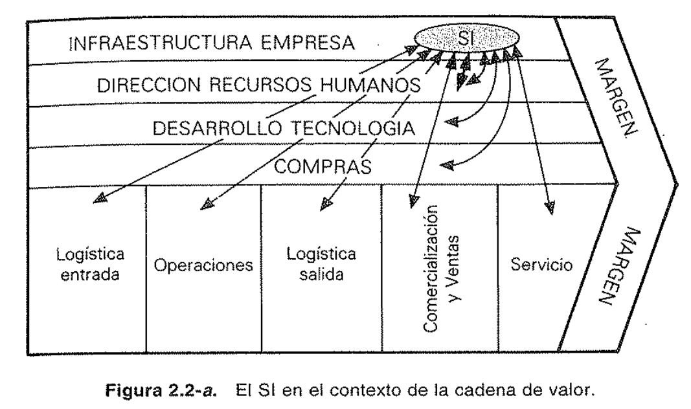
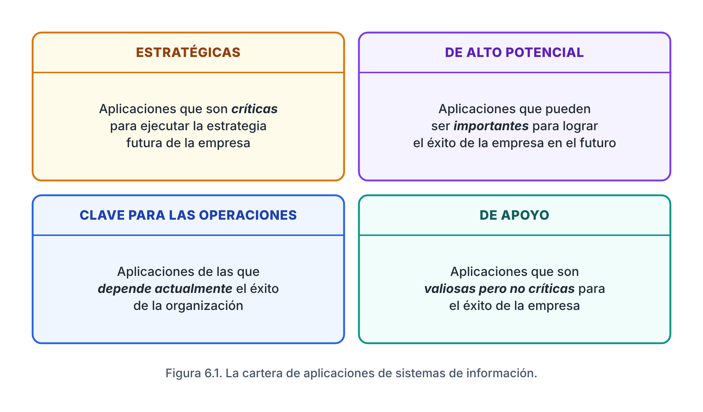
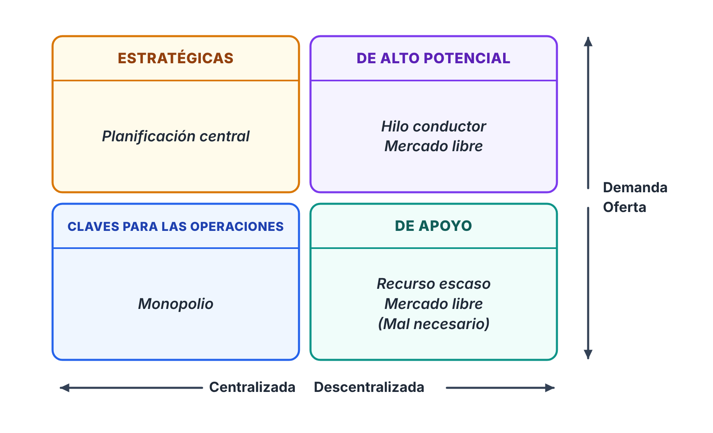
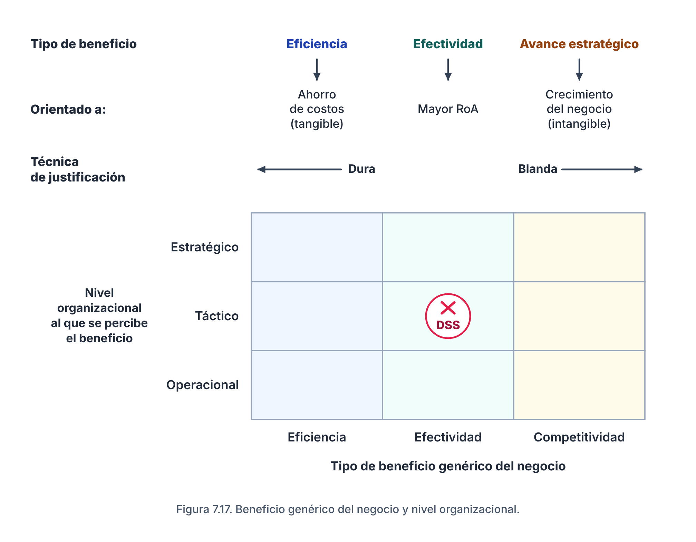

\newpage

# Temas y bibliografía {-}

| Temas | Libro |
| --- | --- |
| El enfoque de Tavistock. Los recursos organizacionales. La racionalidad de las organizaciones. | Chiavenato |
| Los sistemas de información en la empresa. El SI en el contexto de la cadena de valor. El rol de las tecnologías de la información. | Andreu, Ricart y Valor |
| Valor de la información e inversión en IS. Costos de los IS. Beneficios de los IS. | Robson |
| Planificación de los SI/TI a partir de la estrategia del negocio. Esquema general del procedimiento de alineación de las estrategias de SI/TI con las estrategias organizacionales. | Andreu, Ricart y Valor |
| Análisis de la cartera de aplicaciones. Las estrategias genéricas de gestión de SI/TI. | Edwards, Ward y Bytheway |

> La cátedra pide que los puntos **1, 3, 4, 5-b-II, 5-b-VI y 11** sean respuestas y conclusiones **elaboradas por el alumno** a partir del material.

# 1. Ubicación y función de los SI/TI en la cadena de valor {-}

> *Interpretar, teniendo en cuenta la definición de sistemas de información propuesta por Andreu, Ricart y Valor, la ubicación y función de los SI/TI en la cadena de valor de la organización.*

Definición de **sistema de información** según Andreu, Ricart y Valor:

> *«Conjunto formal de procesos que, operando sobre una colección de datos estructurada de acuerdo con las necesidades de una empresa, recopila, elabora y distribuye (parte de) la información necesaria para la operación de dicha empresa y para las actividades de dirección y control correspondientes, apoyando, al menos en parte, la toma de decisiones necesaria para desempeñar las funciones y procesos de negocio de la empresa de acuerdo con su estrategia».*

*Fuente: Andreu, Ricart y Valor, **Estrategia y sistemas de información** (2.ª ed.), Fig. 2.2-a: El SI en el contexto de la cadena de valor.*

**Ubicación:** el SI forma parte de la **infraestructura de la empresa**, una de las actividades de soporte de la cadena de valor. Pero, como todas las actividades (básicas y de soporte) necesitan y generan información, el SI **interactúa con todas ellas**: no es un eslabón más, sino algo que atraviesa toda la cadena.

**Función:** podemos distinguir cuatro funciones principales del SI.

- **Coordinación entre actividades:** el SI recopila la información que generan unas actividades y la distribuye a las que la necesitan para operar o decidir. Coordina actividades básicas entre sí (por ejemplo, hacer llegar los pedidos a producción), básicas con soporte (cualquier actividad de control) y de soporte entre sí.

- **Apoyo a la dirección y el control:** como subraya la definición, el SI no solo registra transacciones, sino que organiza la información para que los que deciden puedan planificar, controlar y diseñar acciones con el mayor conocimiento de causa posible.

- **Explotación de los vínculos entre actividades:** el SI permite identificar y aprovechar las influencias mutuas entre eslabones de la cadena. Explotarlos con una visión global permite mejoras radicales, como la reingeniería de procesos, e incluso reconfigurar la cadena de valor para obtener ventajas competitivas.

- **Soporte a la estrategia de negocio:** el SI está al servicio del enfoque de negocio. Su función es apoyar la ejecución de la estrategia, y puede llegar a ser un elemento activo de ella.

# 2. Relación entre sistemas de información y tecnologías de información {-}

Los **SI** definen el **qué**: cuál es la información que la organización necesita para funcionar, cuál es realmente significativa para la toma de decisiones y cuál sirve para alinearse con la estrategia de negocio.

Las **TI** se enfocan en el **cómo**: en qué tecnologías nos apoyamos para llevar a cabo el plan de SI. Son el soporte que permite implementar los SI, y elegir una TI adecuada es esencial para que el SI funcione bien.

Además, la tecnología **no es neutral**: tiene su propia idiosincrasia e influye sobre el SI. Puede ofrecer mejores maneras de hacer las cosas, pero también puede obligar a la empresa a cambiar su forma de trabajar. Por eso no alcanza con "hacer lo mismo de siempre con otra tecnología"; hay que conocer lo que la tecnología puede aportar al SI.

# 3. ¿Por qué deben alinearse los SI con las estrategias de la organización? {-}

Porque **el SI no es un elemento independiente: su propósito es contribuir a poner en práctica la estrategia del negocio**. Si las estrategias son lo que la empresa tiene que llevar a cabo para lograr sus objetivos, el SI tiene que ser coherente con ellas en su estructura y en sus funciones; de lo contrario, apoya cosas que no son prioritarias o deja sin apoyo las que sí lo son.

Integrar la planificación de los SI/TI con la estrategia empresarial asegura que la inversión en tecnología no se convierta en un gasto ineficaz, sino que responda a las demandas reales del negocio.

Edwards, Ward y Bytheway (cap. 4) muestran lo que pasa cuando falta una estrategia coherente de SI. Entre otros problemas:

- Competidores, proveedores y clientes consiguen ventajas sobre la empresa.

- Los objetivos empresariales se vuelven inalcanzables por las limitaciones de los sistemas.

- Los sistemas no están integrados: duplicación de esfuerzos, datos inexactos, retrasos y mala gestión de la información.

- Los proyectos se retrasan, exceden el presupuesto y no dan los beneficios esperados, porque no se definieron bien las necesidades del negocio.

- Las prioridades y los planes cambian todo el tiempo, lo que genera conflictos entre usuarios y personal de SI.

- Las tecnologías elegidas no se integran e incluso limitan a la empresa.

- No hay forma de fijar niveles de recursos adecuados ni de priorizar las inversiones de manera coherente.

En síntesis: sin alineación se gasta más de lo necesario para obtener menos beneficios de los esperados.

# 4. Metodología de alineamiento de Andreu, Ricart y Valor {-}

> *Interprete cada etapa (finalidad, posibles técnicas) y deduzca qué salida se obtiene de cada etapa y a qué alimenta. ¿Qué es un Plan de SI/TI?*

El **Plan de TI/SI** es el resultado de un procedimiento sistemático de toma de decisiones que define qué debe hacer la organización en el futuro próximo con sus sistemas de información (ver la pregunta 11). Se elabora **desde una perspectiva de negocio y no puramente tecnológica**, por eso es responsabilidad de la dirección y deben participar todas las áreas de la empresa. Los detalles técnicos quedan para las fases posteriores, a cargo de especialistas.

El procedimiento tiene cuatro fases:

## Fase I: Presentación y compromiso del equipo {-}

- **Finalidad:** que la organización asuma la planificación como un proyecto de toda la empresa y no solo del área de sistemas. La alta dirección decide explícitamente elaborar el plan y se constituyen el Comité de TI/SI, el grupo base y el equipo de trabajo.

- **Técnicas:** reuniones de la alta dirección para formalizar y comunicar el compromiso, conformación de equipos interdepartamentales (negocio y técnicos) e identificación preliminar de las áreas a analizar.

- **Salida:** el equipo de trabajo constituido, con responsabilidades claras en todos los niveles, y el anuncio oficial del proyecto a la organización.

- **Alimenta a:** la Fase II, a la que le da el marco organizativo, las personas y el respaldo de la dirección para empezar el trabajo de campo.

## Fase II: Descripción de la situación actual {-}

- **Finalidad:** describir la situación desde dos dimensiones, el negocio (funciones y procesos) y los sistemas existentes, y hacer una crítica de esos sistemas desde el punto de vista técnico y desde su utilidad para el negocio.

- **Técnicas:**

    - **Matrices** que relacionan procesos con colecciones de datos (qué procesos usan y generan qué datos).

    - **Diccionarios de datos**, con herramientas tipo CASE para registrar el inventario de datos y procesos.

    - **Entrevistas** con los usuarios (crítica de negocio) y con el personal de sistemas (crítica técnica).

- **Salida:** un informe validado por los directores de área, con los procesos de negocio, la arquitectura actual de los sistemas y un diagnóstico de sus puntos fuertes, débiles y grado de cobertura.

- **Alimenta a:** la Fase III, como punto de partida para detectar las necesidades de información no cubiertas.

## Fase III: Elaboración del Plan de TI/SI {-}

- **Finalidad:** documentar las necesidades de información futuras, proponer actuaciones (sistemas nuevos o mejoras) que incidan en las líneas estratégicas, armar escenarios alternativos, evaluarlos y aprobar el plan definitivo.

- **Técnicas:**

    - **Factores críticos de éxito (FCE)** en las entrevistas, para priorizar las necesidades vitales.

    - **Refinamiento iterativo** para consolidar las estructuras de datos y deducir la estructura global del futuro SI.

    - **Escenarios alternativos**, combinando subsistemas según distintos criterios estratégicos y restricciones de capacidad.

    - **Análisis costo-beneficio en dos partes:** los técnicos estiman el costo y los usuarios de negocio estiman los beneficios.

- **Salida:** el **Plan de TI/SI aprobado**: estructura global del nuevo sistema, lista de proyectos a 3-5 años, sus prioridades y una estimación de los recursos necesarios.

- **Alimenta a:** la Fase IV, a la que le da los proyectos concretos y las directrices.

## Fase IV: Programación de actividades {-}

- **Finalidad:** detallar cómo se van a ejecutar a corto plazo las directrices del plan. Es una labor fundamentalmente técnica: se asignan calendarios, personas y fondos a proyectos concretos.

- **Técnicas:** planificación y gestión de proyectos, integración con el ciclo anual de presupuestos y definición de hitos de seguimiento y control.

- **Salida:** el calendario detallado del primer año, el presupuesto del período siguiente y un plan de evaluación y revisión.

- **Alimenta a:** la ejecución (compras de hardware y software, desarrollo de aplicaciones) y el control de la dirección, que verifica que el SI se construya de acuerdo con la estrategia.

# 5. Cartera de aplicaciones {-}

**a)** Antes de leer este tema en Edwards, Ward y Bytheway hay que conocer la **matriz BCG**, para entender cómo los autores la trasladan a la clasificación de aplicaciones. Ver el video [Conceptos previos para la cartera de aplicaciones](https://www.youtube.com/watch?v=k5VDNqOUPSw).

**b)** Preguntas sobre la cartera de aplicaciones:

*Fuente: Edwards, Ward y Bytheway, **Fundamentos de sistemas de información** (2.ª ed.), Fig. 6.1: La cartera de aplicaciones de sistemas de información.*

## I. ¿Qué es el análisis de la cartera de aplicaciones? {-}

Es un esquema de clasificación, desarrollado originalmente por **McFarlan**, que permite evaluar y administrar el conjunto de sistemas de información de una empresa (actuales, planificados y potenciales) según **la contribución que hacen al éxito del negocio**, y no según la forma en que se suministran.

Así como una empresa gestiona una cartera de productos o de inversiones, este enfoque trata a las aplicaciones como activos que hay que gestionar según sus características y su valor presente y futuro. Las clasifica en cuatro categorías:

- **Estratégicas:** críticas para ejecutar la estrategia futura de la empresa.

- **De alto potencial:** pueden ser importantes para el éxito futuro.

- **Clave para las operaciones:** de ellas depende actualmente el éxito de la organización.

- **De apoyo:** valiosas, pero no críticas para el éxito.

Su mayor fuerza no es dar una receta para clasificar sistemas, sino servir de **vehículo para una discusión informada**: permite que la alta dirección, los mandos medios, los usuarios y los profesionales de SI lleguen a una visión común para **optimizar el uso de los recursos, mejorar la contribución de los sistemas actuales y elegir el mejor enfoque para las nuevas inversiones**.

## II. ¿Qué significa cada segmento respecto de su aporte a la organización en el contexto estratégico? {-}

- **Estratégicas:** son críticas para ejecutar la estrategia futura y asegurar el éxito a largo plazo. Su aporte es **obtener o mantener una ventaja competitiva** o alcanzar los factores críticos de éxito fijados por la dirección. En la analogía con la BCG, son las **"estrellas"**.

- **De alto potencial:** pueden llegar a ser vitales para el éxito futuro, pero su valor todavía tiene que demostrarse. Funcionan como el **I+D de los sistemas**: experimentan e innovan para detectar oportunidades. Son la fuente de las futuras aplicaciones estratégicas: si una idea se valida y la empresa apuesta por ella, pasa a ser estratégica. Equivalen al **"niño problema"**.

- **Clave para las operaciones:** de ellas depende **hoy** el funcionamiento y la supervivencia de la organización. Su aporte es la estabilidad operativa: evitan que una falla deje a la empresa en **desventaja competitiva**. Son las **"vacas"**.

- **De apoyo:** son útiles, pero no críticas ni para el éxito actual ni para la estrategia futura. Suelen ser sistemas estándar o administrativos. Su aporte no es la ventaja competitiva, sino **mejorar la eficiencia, cumplir requisitos legales y controlar costos**, sin consumir recursos que hacen falta en los otros cuadrantes. Se asemejan al **"perro"**.

## III. ¿Qué son y cuáles son las estrategias genéricas para la gestión de los SI/TI? {-}

**¿Qué son?** Son **marcos generales que guían cómo una organización vincula la gestión de los SI/TI con la dirección general de la empresa**: cómo identifica las oportunidades de la TI, cómo asigna recursos, a qué ritmo adopta nuevas tecnologías y qué impacto espera de la TI.

**¿Para qué sirven?** Para gestionar con éxito los SI/TI a largo plazo, aplicando el enfoque más adecuado a cada segmento de la cartera.

Son seis:

- **Planificación centralizada:** la estrategia de SI/TI está integrada con la estrategia corporativa mediante una unidad especializada en la alta dirección. Está impulsada por las necesidades globales del negocio. Es la adecuada para las **aplicaciones estratégicas**.

- **Hilo conductor:** parte de que la TI dará ventaja competitiva y usa tecnología de punta para adelantarse a la competencia. Está impulsada por la innovación tecnológica. Ideal para las **aplicaciones de alto potencial**.

> **Para recordar:** en la *planificación centralizada*, el **negocio** le dice a la tecnología qué hacer; en el *hilo conductor*, la **tecnología** le muestra al negocio qué podría hacer.

- **Mercado libre:** los directivos, que a la vez son usuarios, saben qué es lo mejor para sus áreas y eligen libremente cómo satisfacer sus necesidades; el servicio interno de TI compite con proveedores externos. Útil para las **aplicaciones de alto potencial** y las **de apoyo**.

- **Monopolio:** un único proveedor interno al que la organización debe recurrir siempre. Busca el control central de la oferta y soluciones de calidad que eviten riesgos operativos. Es la que mejor funciona para las **aplicaciones clave para las operaciones**.

- **Recurso escaso:** se fija de antemano un presupuesto limitado y las aplicaciones compiten por él, justificando estrictamente su rentabilidad. Sirve para controlar el gasto en las **aplicaciones de apoyo**.

- **Mal necesario:** los SI/TI solo se usan para cumplir requisitos legales e inversiones de alto rendimiento, o cuando no hay otra alternativa. Suele adoptarse por error, negligencia o extrema escasez de recursos, y tiene grandes desventajas: degrada la competitividad y la moral.

*Fuente: Edwards, Ward y Bytheway, **Fundamentos de sistemas de información** (2.ª ed.), Fig. 6.3: Relación entre las estrategias genéricas y la cartera de aplicaciones.*

## IV. ¿Cuáles son los factores para la evaluación de las prioridades de las aplicaciones? {-}

Para optimizar el uso de los recursos y afrontar la incertidumbre (la probabilidad de que una aplicación fracase), hay que evaluar **tres factores** (Edwards, p. 120):

- **Beneficios:** lo que es más importante conseguir.

- **Recursos:** lo que la empresa puede hacer o dotar.

- **Riesgos:** lo que probablemente va a ocurrir. Los principales factores de riesgo son el tamaño y la duración del proyecto, la inestabilidad de la empresa, la tasa de cambio de la organización, el número de partes que la componen y los factores técnicos de usar tecnologías nuevas.

## V. ¿Cuáles son las etapas propuestas por Edwards, Ward y Bytheway para determinar las prioridades? {-}

**Etapa 1. Evaluar cada aplicación según los tres factores** de la pregunta anterior: beneficios, recursos y riesgos (p. 120).

**Etapa 2. Definir prioridades dentro de cada segmento** de la cartera, porque cada tipo de aplicación se justifica con una lógica distinta (pp. 120-121):

- **De apoyo:** primero las que den mayores beneficios económicos con menos recursos.

- **Estratégicas:** primero las que más contribuyan a los objetivos de la empresa, expresados en los **factores críticos de éxito (FCE)** a los que conducen, con menos recursos.

- **De alto potencial:** deben mostrar relación con los objetivos y los FCE, aunque sea con menos claridad. En la práctica, se autogestionan según **la energía y el entusiasmo de sus defensores**.

- **Clave para las operaciones:** son las más complejas: se combinan consideraciones económicas, riesgos para el negocio actual, aporte a los FCE y mejoras de infraestructura.

**Etapa 3. Definir las prioridades globales**, comparando entre segmentos (pp. 122-123). Es el mayor desafío, porque las estratégicas puntúan más en FCE, las de apoyo en economía y las clave en riesgos e infraestructura. La dirección decide cuánto pesa cada tipo de beneficio, según:

- las **fortalezas o debilidades de la empresa** (defender la posición actual o innovar),

- las **fortalezas o debilidades de los sistemas actuales** y la capacidad del área de SI/TI,

- la **experiencia y competencia de los usuarios**,

- la **confianza de la dirección en su propio criterio** frente a los argumentos puramente financieros.

El plan global se ordena según la proporción:

> **Beneficios a obtener (ajustados para el riesgo) / Consumo de recursos limitados**

Así, **los recursos pueden reasignarse desde las aplicaciones de prioridad más baja hacia las de prioridad más alta**, con una base lógica y el acuerdo de los usuarios, y se pueden fijar los niveles de recursos necesarios para el futuro.

## VI. ¿Dónde aplicaría la cartera de aplicaciones en el alineamiento estratégico? {-}

Ubicándola en las cuatro fases de la metodología de Andreu, Ricart y Valor:

- **Fase I – Presentación y compromiso:** la matriz todavía no se usa, pero se sientan las bases para usarla. Al comprometer a la dirección y a los responsables de negocio, el juicio sobre qué es "estratégico" o "de apoyo" va a ser consensuado y de negocio, no solo técnico.

- **Fase II – Situación actual:** primera gran aplicación, sobre la **cartera de aplicaciones actuales**. En la crítica de los sistemas existentes, ubicarlos en los cuadrantes sirve de **diagnóstico**: muestra si el esfuerzo y el presupuesto actuales tienen sentido (por ejemplo, si se gastan demasiados recursos en aplicaciones de apoyo) y revela debilidades de base antes de proponer desarrollos nuevos.

- **Fase III – Elaboración del plan:** es donde más se aplica, sobre la **cartera futura**:

    - **Clasificación** de las necesidades y proyectos propuestos en los cuadrantes.

    - **Asignación de la estrategia genérica** más adecuada a cada uno, evitando una única regla para todos.

    - **Definición de prioridades** antes de que el Comité apruebe el plan, con la lógica de cada cuadrante (beneficios, recursos y riesgos).

- **Fase IV – Programación:** la cartera define el **orden de ejecución**: el calendario del primer año y el presupuesto respetan las prioridades definidas en la fase anterior.

# 6. Las tres cuestiones que requiere una estrategia de SI para implementarse {-}

> *Sintetice las tres cuestiones principales que requiere una estrategia de SI para implementarse, en el contexto del "Valor de la inversión en IS".*

Para que una estrategia de SI se haga realidad hay que **asignar recursos**, y eso exige gestionar **tres conjuntos interrelacionados de cuestiones** (Robson, cap. 7):

1. **Los costos de los IS:** qué se resigna con la inversión. El costo no es solo financiero: incluye el capital, pero también **el esfuerzo, el tiempo, el entusiasmo, el poder, el compromiso y la certeza**, porque se abandona lo conocido sin saber cuál será el resultado.

2. **Los beneficios de los IS:** qué recursos o atributos útiles gana la organización. Además del capital, incluyen **poder, estatus, conformidad y certeza** (mejor información para decidir).

3. **El balance entre costos y beneficios:** evaluar cada decisión en función de lo que aporta frente a lo que exige. Para eso hay que **entender las direcciones estratégicas y los perfiles de riesgo, e identificar técnicas apropiadas para estimar el desempeño dentro de plazos adecuados**.

El riesgo no es un aspecto separado, sino el **eje de toda asignación de recursos en IS**: toda inversión lleva a la empresa de lo conocido a lo desconocido. Solo se puede juzgar si vale la pena ese riesgo sabiendo hacia dónde quiere ir la empresa, y con técnicas que valoren también los beneficios intangibles, que las técnicas contables tradicionales no capturan. Concertar estos criterios de costo y beneficio es lo que permite equilibrar el riesgo.

# 7. ¿Cuáles son los costos de un SI? {-}

Los costos de un SI no se limitan a la inversión de capital: incluyen elementos **tangibles e intangibles**, costos "visibles" y "ocultos". En sentido amplio, un costo es renunciar a un recurso o atributo importante (esfuerzo, tiempo, entusiasmo, poder, compromiso, certeza).

La lista de control de **Hochstrasser y Griffiths** (en Robson) los desglosa así:

- **Hardware:** no solo el de procesamiento, sino también impresoras, almacenamiento y accesorios. Aunque son visibles, su dispersión hace que sean difíciles de localizar y auditar.

- **Software:** los paquetes son la opción más barata, aunque implican costos de evaluación y especificación; los desarrollos internos pueden implicar sumas enormes y desconocidas, y los generadores de aplicaciones tienen costos de aprendizaje.

- **Instalación:** varía con la complejidad; puede requerir especialistas externos, carga de datos (*data entry*) al reemplazar sistemas manuales o conversión de datos en los ya informatizados.

- **Entorno:** el entorno físico (cableado, muebles, aire acondicionado) y el humano (seguridad, salud, costos legales).

- **Funcionamiento:** energía, comunicaciones y suscripciones a servicios externos de datos.

- **Mantenimiento:** planificado mediante contratos o menos predecible con personal interno. El software se "avería" tanto como el hardware.

- **Seguridad:** medidas contra daños accidentales o deliberados, el costo de los riesgos inevitables y los planes de recuperación ante desastres.

- **Red:** software, hardware y gestión de redes, además de los costos de gestión de datos (modelado, repositorios, almacenamiento), que son enormes y suelen no estar documentados.

- **Capacitación:** los más subestimados; su verdadero alcance (formación de base, específica, apoyo y actualización continua) casi nunca está documentado.

- **Costos organizacionales amplios:** incompatibilidades, nuevas estructuras salariales, costos de transición y de gestión del cambio organizacional.

Un aspecto que suele pasarse por alto es que **la inversión inicial es solo una parte del costo total**: casi todo proyecto de IS inicia un compromiso permanente de recursos. Según **Keen** (en Robson), un desarrollo de software de 1 millón de dólares compromete a la empresa a invertir 4 millones en los cinco años siguientes, porque por cada dólar de desarrollo hay que agregar costos de operación y mantenimiento. Esos costos no son discrecionales y suelen ser los mayores costos "ocultos".

# 8. ¿Qué son los beneficios de un SI? {-}

Los beneficios de un SI son **las diversas formas en que una empresa puede mejorar su situación como consecuencia de la manera en que maneja la información**. El beneficio es ganar un recurso o atributo útil. El valor se acumula en atributos de la información como la precisión, la calidad, la productividad, la velocidad, la confiabilidad o la flexibilidad.

Los beneficios pueden ser **tangibles o intangibles**. Según una investigación de Clarke McKee citada por Robson, más del 80 % de las empresas descubren que los **beneficios intangibles representan al menos el 30 % del valor** de sus inversiones en IS. Entre los más importantes están la mejora del servicio al cliente, una mayor ventaja competitiva (o evitar una desventaja), información de gestión más oportuna, mejor apoyo a las funciones básicas del negocio, mayor calidad del producto, mejores comunicaciones y cambio por medio de la innovación.

Según el tipo de impacto esperado, **Parker et al.** distinguen tres tipos de aplicaciones (Edwards, cap. 6):

- **Sustitutiva:** cambiar personas por máquinas; la economía es la fuerza principal y mejora la eficiencia. Se relaciona sobre todo con las aplicaciones **de apoyo** y **clave para las operaciones**.

- **Complementaria:** aumenta la productividad y la eficacia del personal, al permitir que el trabajo se haga de otra forma. Se relaciona con las **clave para las operaciones** y las **estratégicas**.

- **Innovadora:** busca obtener o mantener una ventaja competitiva, cambiando las prácticas comerciales o creando mercados nuevos. Se relaciona con las **estratégicas** y las **de alto potencial**.

Para justificar estos beneficios, Edwards (siguiendo a Parker) propone, además del análisis costo-beneficio tradicional, técnicas como la **vinculación del valor** (coordinar mejor tareas de áreas distintas), la **aceleración del valor** (hacer antes las cosas y tener los datos con más antelación), la **reestructuración del valor** (racionalizar tareas y áreas) y la **valoración de la innovación**.

La clasificación de los beneficios según el nivel organizacional en que se perciben está en la pregunta 9, y las categorías de valor de la Economía de la información, en la 10.

# 9. ¿Cómo se clasifican los beneficios genéricos de los SI? {-}

Según el modelo de **Silk** (en Robson), los beneficios genéricos se relacionan con el nivel de la organización que los percibe:

| Beneficio genérico | Nivel en que se percibe | Orientado a | Justificación | Era de la información |
| --- | --- | --- | --- | --- |
| **Eficiencia** | Operacional | Ahorro de costos (tangible) | "Dura": se centra en desplazar o evitar costos | **E1: automatizar** |
| **Efectividad** | Táctico (por ejemplo, un DSS) | Mayor rendimiento de los activos (RoA) | Tiende a "blanda": incluye algo de capital y mide los intangibles con encuestas | **E2: informar** |
| **Avance estratégico** (competitividad) | Estratégico | Crecimiento del negocio (intangible) | Técnicas complejas de largo plazo; los efectos reales solo se ven después, por eso Silk habla de justificación por **"acto de fe"** | **E3: transformar** (su beneficio genérico es la **explotación**) |

Las tres eras de la información las distinguen Silk y Tapscott y Caston; la denominación E1, E2 y E3 es de Remenyi et al. (Robson, Fig. 7.23).

*Fuente: Robson, **Planteo de estrategias efectivas de sistemas de información** (tomo 3), cap. 7, Fig. 7.17: Beneficio genérico del negocio y nivel organizacional.*

# 10. ¿Cómo se clasifican los factores generadores de valor de la información, según la Economía de la Información? {-}

La **Economía de la información** (Parker y Benson) no reemplaza el análisis costo-beneficio tradicional, sino que lo **extiende** (un RoI ampliado con la vinculación, la aceleración y la reestructuración del valor y la valoración de la innovación) para incorporar lo que las técnicas contables no capturan.

**Categorías de valor en el uso de la información.** Robson menciona seis categorías que pueden servir de base para justificar una inversión:

1. **Rendimiento de la inversión:** el análisis costo/beneficio clásico (ahorros e ingresos frente a costos de desarrollo y operación).

2. **Adecuación estratégica:** apoyo directo a una estrategia comercial declarada.

3. **Ventaja competitiva:** valor creado por un nuevo negocio o producto, o por más participación de mercado.

4. **Apoyo de información para el management:** información sobre aspectos cruciales de la empresa.

5. **Reacción competitiva:** alcanzar o superar la posición de un competidor.

6. **Arquitectura estratégica de los IS:** inversión básica que posibilita futuras aplicaciones estratégicas.

**Factores de evaluación, por dominio.** Los factores que no capturan las técnicas tradicionales se dividen en dos dominios, cada uno con factores **positivos** (aumentan el atractivo del proyecto) y **negativos** (riesgo o incertidumbre):

| | Factores positivos | Factores negativos |
| --- | --- | --- |
| **Dominio empresarial** | **Adecuación estratégica** (apoyo directo a las estrategias), **ventaja competitiva** (mejoras en la cadena de valor: márgenes, ventas, costos de suministro), **apoyo a la información de management** (apoyo a actividades básicas), **reacción competitiva** (cuánto perdería la empresa si no hiciera el proyecto) | **Riesgo del proyecto u organizacional:** cuán preparada está la empresa; a mayor brecha entre lo requerido y lo disponible, mayor riesgo |
| **Dominio tecnológico** | **Arquitectura estratégica de los IS:** valor de mantener la capacidad de los IS (métodos, estándares, hardware y software) lista para futuros proyectos | **Incertidumbre de decisión** (cuánto se conocen los requerimientos), **incertidumbre técnica** (cuánta innovación y conocimiento nuevo exige), **riesgo de infraestructura** (cuántos cambios de fondo requiere en la infraestructura existente) |

Con todos estos factores se arma la **ficha de evaluación** (Robson, Fig. 7.33), que se completa en cuatro pasos: **ponderar** cada factor, **multiplicar** el puntaje por la ponderación, **sumar** el puntaje de cada proyecto y **clasificar** los proyectos para seleccionar.

**Relación con el resto de la unidad.** La Economía de la información funciona como el engranaje entre la estrategia y la decisión de inversión:

- Equilibra **costos y beneficios**, dándole peso a los intangibles.

- Su factor de **adecuación estratégica** asegura que los recursos vayan a proyectos alineados con la estrategia.

- Su factor de **ventaja competitiva** y la **vinculación del valor** se miden sobre la **cadena de valor**.

- Da una forma estructurada de evaluar los **beneficios, recursos y riesgos** que se usan para priorizar la **cartera de aplicaciones**.

# 11. ¿Qué es un Plan de SI/TI? {-}

El Plan de SI/TI es **el documento que traduce la estrategia de la empresa en decisiones concretas sobre sus sistemas de información**: qué proyectos se van a desarrollar en los próximos años, en qué orden y con qué recursos. No es un plan técnico sino de negocio, porque parte de las necesidades de información que surgen de cruzar las estrategias con las funciones y procesos de la empresa.

Según Andreu, Ricart y Valor, su aporte central es que, además de listar los proyectos, **explicita las prioridades de la empresa para asignar recursos en TI**. Eso permite que las decisiones que se tomen durante su vigencia sean coherentes con las que se tomaron al elaborarlo.

Debe incluir:

- Una **lista de proyectos** para los próximos 3 a 5 años.

- El **punto de partida**: la situación actual de los SI/TI, con un juicio crítico técnico y de negocio.

- La **prioridad de cada proyecto**, que combina la importancia para el negocio y los aspectos técnicos.

- Para los proyectos del **primer año**, el detalle suficiente para evaluar sus recursos e incluirlos en el presupuesto anual.

- **Mecanismos de evaluación y control**: un calendario y un presupuesto suficientemente detallados.

- Una lista de **actividades de la empresa donde la TI pueda aumentar la eficacia o la eficiencia**.

Su elaboración es **responsabilidad de la dirección**, con participación del área técnica y de todas las áreas de la empresa, y se lleva a cabo con el procedimiento de cuatro fases descrito en la pregunta 4.

En síntesis: el Plan de SI/TI es lo que hace que la alineación entre negocio y sistemas deje de ser una intención y se convierta en proyectos priorizados, presupuestados y controlables.
