\newpage

# El enfoque de TAVISTOCK.

> 📝 **Apunte de clase:** *Es una forma de **ver a las organizaciones como sistemas abiertos** que **transforman recursos en productos o servicios**, y que **no pueden entenderse sin considerar al mismo tiempo a las personas y a la tecnología** que usan.*

Una manera de estudiar un sistema abierto es dar importancia a su proceso de transformación cuando las organizaciones están, de una manera u otra, inmersas en el proceso de manejo de recursos. Por consiguiente, algunos autores conciben la organización como un sistema sociotécnico.

**Las organizaciones cumplen una doble función: técnica (relacionada con la coordinación de trabajo y la ejecución de tareas con la ayuda de la tecnología disponible) y social (que se refiere a la manera de interrelacionar a las personas, al modo de hacerlas trabajar juntas)**.

**El sistema técnico o tecnológico** depende de los requerimientos típicos de las tareas que la organización ejecuta, los cuales cambian de acuerdo con la empresa y están determinados por la especialización del conocimiento y por las habilidades exigidas para operar distintos modelos de máquinas, por los equipos y las materias primas utilizadas y por la disposición física de las instalaciones. La tecnología determina casi siempre las características de las personas que la organización necesita. Los conocimientos, la experiencia, la calificación personal, las habilidades y destrezas son factores que dependen de la tecnología que la empresa utiliza.

> El sistema técnico no puede estudiarse aisladamente, pues es responsable de la eficiencia potencial de la organización.

Para operar el sistema técnico, se necesita un **sistema social** compuesto de personas que se relacionan e interactúan profundamente. Ninguno de ellos —sistemas técnico y social— puede considerarse de manera aislada, sino en el contexto de la organización en conjunto. **Las modificaciones realizadas en uno de ellos repercuten en el otro**.

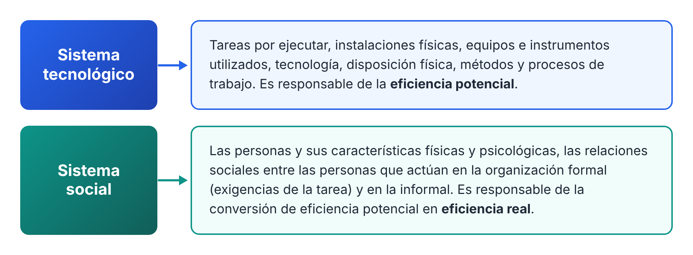

*Fuente: Chiavenato, **Administración de recursos humanos** (5.ª ed.), Fig. 1.3: El sistema sociotécnico como resultante de la interacción entre el sistema tecnológico y el sistema social.*

El modelo sociotécnico de Tavistock lo propusieron en un principio los sociólogos y psicólogos del Instituto Tavistock, de Londres. Trist y sus colaboradores afirman que toda organización consta de una combinación administrada de tecnología y de personas, de modo que ambas se relacionan recíprocamente. Además de considerarse como un sistema abierto en constante interacción con su ambiente, la organización también se ve como un sistema sociotécnico estructurado.

> 💡 *«La tecnología y los métodos fijan el techo teórico de lo que se puede producir (eficiencia potencial), pero son las personas y su motivación las que determinan cuánto de ese potencial se concreta en la realidad (eficiencia real).»*

El sistema sociotécnico lo constituyen tres subsistemas principales:

1. **Sistema técnico o de tareas**: lo que hace la empresa. Incluye el flujo de trabajo, tecnología utilizada, roles de las tareas y variables tecnológicas. Responde por el flujo de información técnica necesaria para conseguir los objetivos organizacionales.
   📝 *Apunte de clase:* define las **habilidades** necesarias, cómo se **organiza el trabajo** y qué tecnología se usa.

2. **Sistema gerencial o administrativo**: implica la estructura organizacional, las políticas, los procedimientos y las reglas, el sistema de recompensas y castigos, el modo de tomar las decisiones y otros elementos proyectados para facilitar los procesos administrativos. Está influido por ambos subsistemas. Define los objetivos del sistema según su capacidad tecnológica.
   📝 *Apunte de clase:* define cómo se **toman decisiones**, cómo se **organiza la estructura**, las **políticas**, las **normas** y los **incentivos**.

3. **Sistema social o humano**: relacionado en primer lugar con la cultura organizacional, los valores y las normas, y la satisfacción de las necesidades personales. En el sistema social también están incluidos la organización informal, el nivel motivacional de los miembros y sus actitudes individuales.

> 📝 **Apunte de clase:** hay que **alinear la tecnología con las personas**.

El sistema gerencial garantiza la administración y el desarrollo de la organización y sus procesos de toma de decisiones. Este sistema busca optimizar las relaciones entre los sistemas social y técnico, a medida que trabajan orientados hacia las metas organizacionales.

El sistema gerencial (círculo 1) influye y está influido por los sistemas técnico y social. La administración define los objetivos del sistema técnico, según su capacidad tecnológica. Los objetivos económicos son modificados por consideraciones tecnológicas, mientras que el grado de tecnología se modifica de acuerdo con aspectos económicos.

El sistema técnico (círculo 2) responde por el flujo de información técnica necesaria para conseguir los objetivos organizacionales. El sistema técnico limita y adapta el sistema social a la necesidad de negociar con los trabajadores el desempeño de tareas, y a su vez, está determinado por la capacidad de los trabajadores para negociar las tareas y las relaciones que se establecen durante la realización del trabajo en la organización.

El sistema social (círculo 3) recibe la influencia del sistema gerencial en cuanto al aumento de participación de los miembros en los procesos de toma de decisiones en la organización. El sistema gerencial busca que el sistema social se desarrolle en una cultura de colaboración, ya que el grado de cooperación de los individuos y grupos determina los resultados operacionales, y pretende incrementar el nivel de control y dirección o hacer más énfasis en el desarrollo de las capacidades de desempeño.

**Figura: diagrama de Venn de los tres subsistemas**

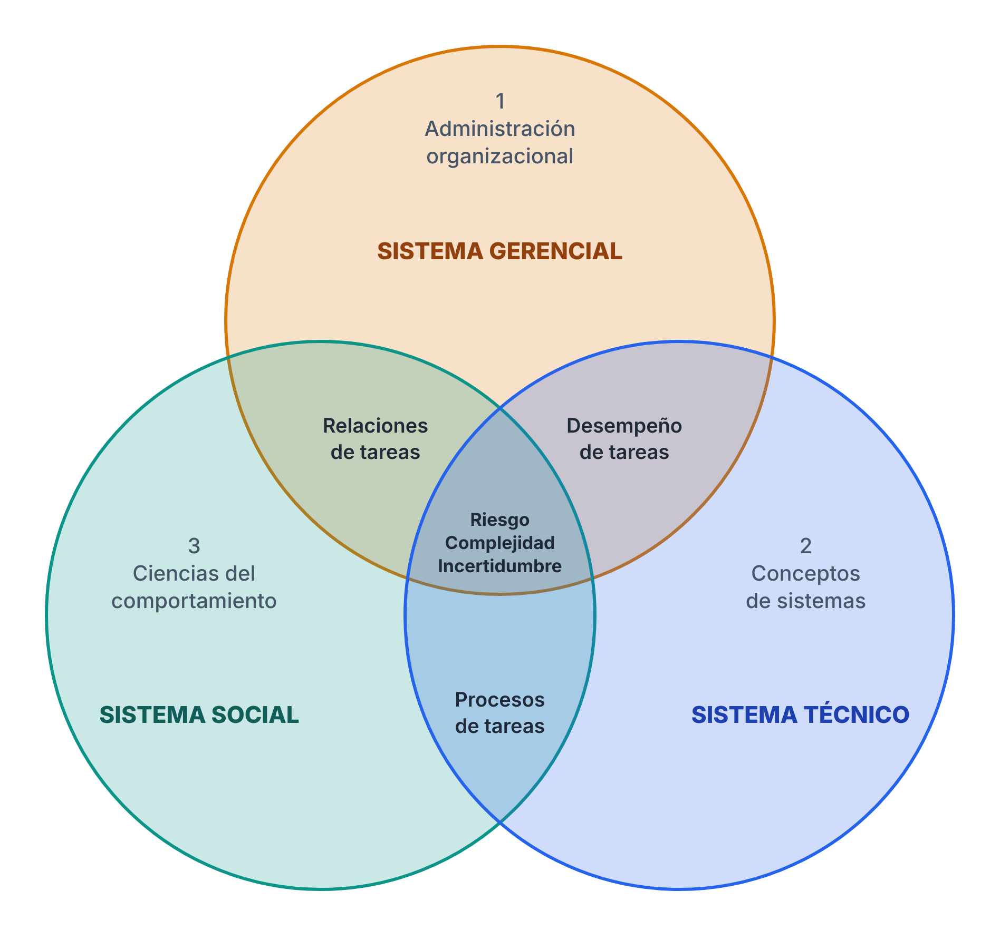

*Fuente: Chiavenato, **Administración de recursos humanos** (5.ª ed.), Fig. 1.4: El sistema sociotécnico.*

**Figura: relaciones entre subsistemas**

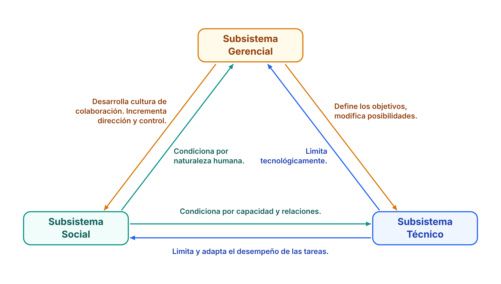

*📝 Apunte de clase, elaborado a partir del texto de Chiavenato, **Administración de recursos humanos** (5.ª ed.) sobre la Fig. 1.4.*

Lo primordial de este enfoque radica en el hecho de que cualquier sistema de producción necesita una organización tecnológica (equipo y distribución de procesos) y una organización del trabajo (que incluye a quienes desempeñan las tareas necesarias). Aunque las exigencias tecnológicas condicionan y limitan la clase de organización del trabajo, esta presenta características sociales y psicológicas propias, independientes de la tecnología.

# Los recursos organizacionales.

La organización es un proyecto social que reúne varios recursos para alcanzar determinados objetivos. Sin recursos no pueden lograrse los objetivos. Los recursos son **medios** que las organizaciones poseen para realizar sus tareas y lograr sus objetivos: son bienes o servicios utilizados en la ejecución de las labores organizacionales.

Los recursos organizacionales pueden clasificarse como:

1. **Físicos o materiales**: necesarios para efectuar operaciones básicas de la organización, ya sea para prestar servicios o producir bienes o productos. El espacio físico, los terrenos, edificios, el proceso productivo, la tecnología, los métodos y procesos de trabajo, etc. Gran parte de lo que se refiere a tecnología puede aplicarse también al área de los recursos materiales y físicos de la organización. No obstante, la tecnología no se limita a los recursos físicos o materiales, aunque estos son su mayor componente.

2. **Financieros**: se refieren al dinero, en forma de capital, flujo de caja, financiación, créditos, etc., que están disponibles de manera inmediata o mediata para enfrentar compromisos que adquiere la organización. También se incluyen los ingresos producidos por las operaciones de la empresa y las inversiones de terceros. Estos recursos garantizan los medios para adquirir los demás recursos que la organización necesita. En cierta medida, los recursos financieros definen la eficacia de la organización para lograr sus objetivos, ya que ellos permiten que la empresa adquiera los recursos necesarios para operar dentro de un volumen adecuado.

3. **Humanos**: personas que ingresan, permanecen y participan en la organización, en cualquier nivel jerárquico o tarea. Los recursos humanos están distribuidos en el nivel institucional de la organización (dirección), en el nivel intermedio (gerencia) y en el nivel operacional. El recurso humano es el único recurso vivo y dinámico de la organización, y decide el manejo de los demás. Constituye un tipo de recurso que posee una vocación encaminada hacia el crecimiento y desarrollo. Las personas aportan a la organización sus habilidades, conocimientos, actitudes, comportamientos, percepciones, etc. Sin importar su cargo, las personas cumplen distintos roles dentro de la jerarquía de autoridad y responsabilidad de la organización. Además, las personas difieren entre sí y constituyen un recurso muy diversificado.

4. **Mercadológicos**: constituyen los medios que las organizaciones emplean para localizar, contactar e influir en los clientes o usuarios. También incluyen al propio mercado de consumidores o clientes de los productos o servicios ofrecidos por la organización. Estos recursos comprenden todas las actividades de investigación y análisis de mercado, el sistema de ventas, promoción, publicidad, distribución, desarrollo de nuevos productos según nuevas demandas, fijación de precios, asistencia técnica al consumidor, etc. Sin estos recursos, de nada servirían los demás recursos, ya que la organización perdería a los clientes y desaparecería de manera inevitable su razón de existir.

5. **Administrativos**: constituyen los medios con los cuales se planean, dirigen, controlan y organizan las actividades empresariales. Incluyen los procesos de toma de decisiones y distribución de la información necesaria, además de los esquemas de coordinación e integración utilizados por la organización.

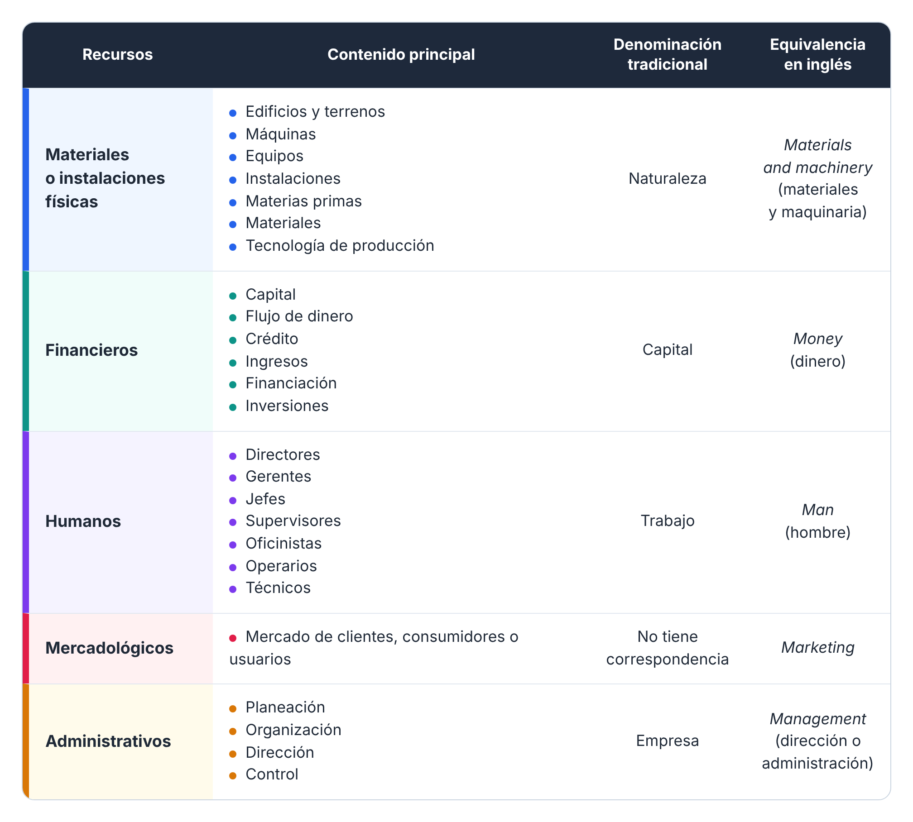

*Fuente: Chiavenato, **Administración de recursos humanos** (5.ª ed.), Fig. II.1: Clasificación de los recursos organizacionales.*

En toda organización ocurre el fenómeno de división del trabajo y de especialización que provoca la diferenciación. Gracias a esta, cada conjunto de recursos semejantes se administra dentro de un esquema de división del trabajo y especialización de actividades, por lo cual le damos un nombre que lo diferencia. A cada área de recursos corresponde una especialidad de administración:

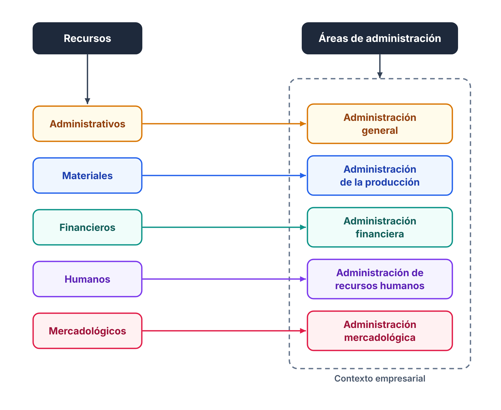

*Fuente: Chiavenato, **Administración de recursos humanos** (5.ª ed.), Fig. II.2: Los recursos organizacionales y las especialidades de la administración.*

Por esta razón, la administración requiere varias especializaciones y cada recurso una especialización:

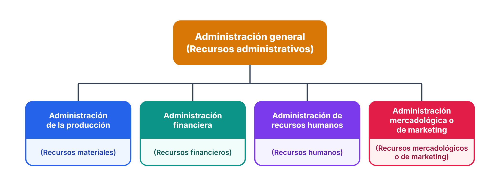

*Fuente: Chiavenato, **Administración de recursos humanos** (5.ª ed.), Fig. II.3: Las especialidades de la administración y los recursos implicados.*

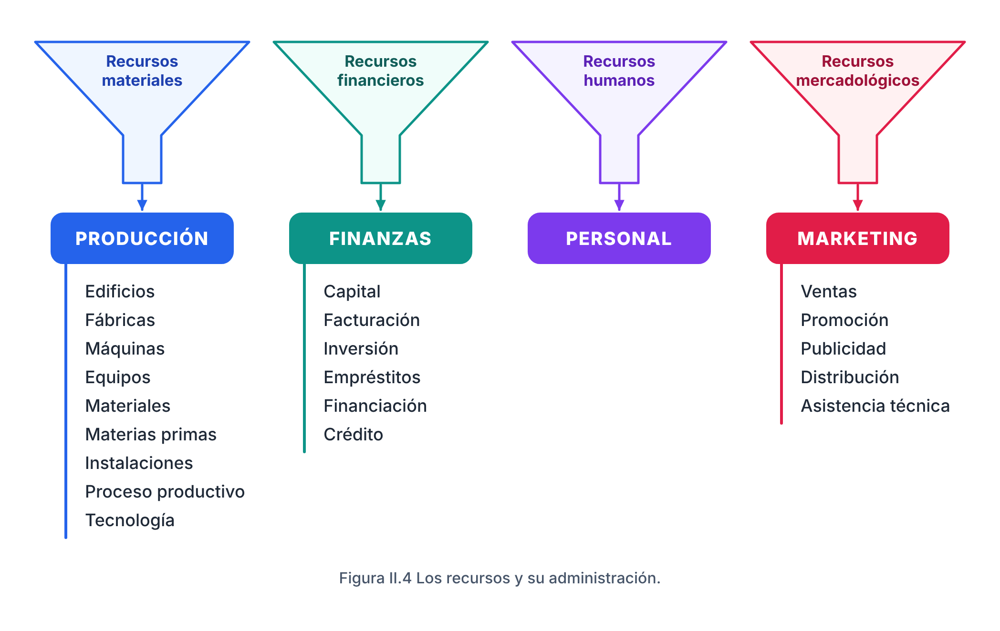

*Fuente: Chiavenato, **Administración de recursos humanos** (5.ª ed.), Fig. II.4: Los recursos y su administración.*

En el procesamiento de los demás recursos es necesaria la presencia de los recursos humanos. Esto significa que los ejecutivos de la administración de la producción, administración financiera, administración de marketing y aun los de la de recursos humanos necesitan personas para poder procesar los recursos básicos. **Las personas son los únicos recursos que están presentes en todas las áreas, aspectos y niveles de la organización.**

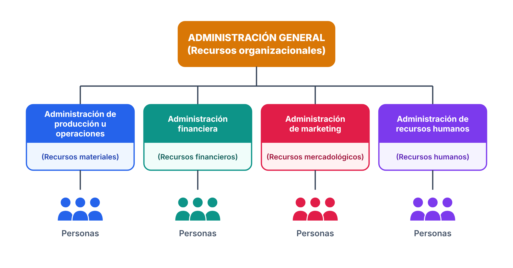

*Fuente: Chiavenato, **Administración de recursos humanos** (5.ª ed.), Fig. II.5: Las personas son recursos que están en todas las áreas de la organización.*

En este contexto, administrar personas es una tarea común a todas las áreas y niveles de la organización. *La administración de recursos humanos (ARH) no es una labor exclusiva del profesional de ARH*, **sino una responsabilidad que compete a todas las áreas y niveles de la organización**. Además de sus responsabilidades específicas, cada director, cada gerente, cada jefe, administra personas que son sus subordinados, directa o indirectamente.

# La racionalidad de las organizaciones.

La **racionalidad** implica **adecuar los medios utilizados a los fines y objetivos que se desean alcanzar**. En el contexto de la teoría de la burocracia, esto significa ***eficiencia***: una organización es racional si se escogen los medios más eficientes para lograr los objetivos deseados, aunque solo se tengan en cuenta los objetivos organizacionales y no los individuales.

Sin embargo, el hecho de que una organización sea racional no implica, necesariamente, que sus miembros actúen de manera racional en lo que se refiere a sus aspiraciones y objetivos personales. Por el contrario, cuanto más racional y burocrática se vuelva la organización, más automáticamente trabajarán sus miembros, que actuarán como simples engranajes de una máquina y se olvidarán del propósito y significado de su comportamiento. La **racionalidad se logra mediante normas y reglamentos** que rijan el comportamiento de los participantes ***en la búsqueda de la eficiencia***.

> *«Cuanto más burocrática y reglamentada se vuelve una organización para buscar la eficiencia, más deshumaniza a sus empleados como piezas mecánicas, sin lograr que alineen verdaderamente sus aspiraciones personales con los objetivos de la empresa.»*

La racionalidad se emplea en muchas situaciones: cuando el problema implica una reducción de medios para obtener un fin determinado (utilización mínima de recursos) o cuando los fines deseados determinan la forma de comportamiento de un sistema (adecuación de recursos). En este caso, se busca lograr el objetivo específico con los recursos disponibles y de la manera más eficiente.

La **eficiencia** se relaciona con la utilización de los recursos para obtener un fin u objetivo (se expresa matemáticamente como $\text{Eficiencia} = \frac{\text{Productos}}{\text{Recursos}}$, es decir, $E = \frac{P}{R}$). La eficiencia es resultado de la racionalidad, puesto que una vez establecidos los objetivos, le compete a esta descubrir los medios más adecuados para conseguirlos.

Existe una racionalidad organizacional: toda organización se comporta de acuerdo con una racionalidad que le es inherente. La racionalidad está ligada a los medios, métodos y procesos con los cuales la organización considera que alcanzará determinados fines o resultados. Se basa en una **presuposición de causa y efecto**: se asume que determinadas acciones conducirán inevitablemente a determinados resultados. Existe racionalidad porque el comportamiento de la organización está planeado y dirigido hacia ciertos objetivos que desea alcanzar. Para que exista la racionalidad es necesario que los medios, métodos, procedimientos, procesos, etc., sean coherentes con el logro de los objetivos deseados.

Toda organización debe considerar la **eficiencia** y la **eficacia** de manera simultánea. La **eficacia** es una medida normativa del logro de resultados; la **eficiencia** es una medida normativa de la utilización de recursos en ese proceso.

En términos económicos, la eficacia de una organización se refiere a su capacidad de satisfacer una necesidad social mediante el suministro de productos (bienes o servicios), en tanto que la eficiencia es una relación técnica entre las entradas y las salidas. La **eficiencia** es la relación entre costos y beneficios, enfocada hacia la búsqueda de la mejor manera de hacer o ejecutar las tareas (métodos), con el fin de que los recursos (personas, máquinas, materias primas) se utilicen del modo más racional posible. La **eficiencia** busca utilizar los medios, métodos y procedimientos más adecuados y debidamente planeados y organizados para asegurar un óptimo empleo de los recursos disponibles. La **eficiencia** no se preocupa por los fines, sino por los medios. El logro de los objetivos previstos no es competencia de la eficiencia, sino de la eficacia.

## Los 5 tipos (dimensiones) de la racionalidad y su conflicto.

Chiavenato explica que la racionalidad organizacional no es puramente técnica ni de un solo tipo; convive simultáneamente con cinco dimensiones que pueden entrar en conflicto entre sí:

- **Económica:** coherencia con la teoría económica, reducción de costos y beneficio de la empresa.

- **Legal:** adecuación estricta a las leyes y la jurisprudencia vigentes.

- **Social:** coherencia con las normas y valores de la sociedad y condiciones laborales dignas.

- **Política:** cálculo del poder y la influencia institucional que se desea alcanzar.

- **Técnica:** utilización de métodos y evidencias científicas y tecnológicas.

> 💡 **Regla de examen:** Cumplir una racionalidad al extremo suele perjudicar a las otras (por ejemplo, aplicar máxima racionalidad *técnica* o *económica* imponiendo condiciones inhumanas a los empleados destruye la racionalidad *social*; o maximizar la racionalidad *técnica* encareciendo excesivamente el producto perjudica la racionalidad *económica*).

## Diferencias entre eficiencia y eficacia.

| **Eficiencia** | **Eficacia** |
| --- | --- |
| Énfasis en los **medios**. | Énfasis en los **resultados y fines**. |
| Hacer bien las cosas. | Hacer las cosas correctas. |
| Resolver problemas. | Alcanzar objetivos. |
| Salvaguardar los recursos. | Optimizar la utilización de los recursos. |
| Cumplir tareas y obligaciones. | Obtener resultados y agregar valor. |
| Capacitar a los subordinados. | Proporcionar eficacia a los subordinados. |
| Mantener las máquinas. | Máquinas disponibles. |
| Presencia en los templos / Rezar. | Práctica de valores religiosos / Ganarse el cielo. |
| Jugar fútbol con técnica. | Ganar el campeonato. |

*Fuente: Chiavenato, **Administración de recursos humanos** (5.ª ed.), p. 34, Cuadro 1.3: Diferencias entre eficiencia y eficacia (adaptado de William J. Reddin).*

## Los 3 niveles organizacionales de Chiavenato.

> ⚠️ **Atención (Complemento fuera del temario):** En la página 38, Chiavenato cierra la idea explicando que las organizaciones se dividen en tres niveles justamente para poder aplicar la racionalidad sin que la incertidumbre externa paralice las operaciones:

- **Nivel Institucional (Estratégico / Cúpula):** es el nivel más alto (directores, propietarios, altos ejecutivos). Funciona con lógica de **sistema abierto**, mira hacia el ambiente externo y lidia permanentemente con la **incertidumbre**, buscando alcanzar la **eficacia**.

- **Nivel Intermedio (Táctico / Gerencial):** compuesto por los mandos medios (gerencias de departamento). Actúa como **amortiguador y articulador** entre la incertidumbre de arriba y la rutina de abajo, transformando las estrategias globales en planes y programas de acción.

- **Nivel Operacional (Núcleo Técnico / Primera línea):** es el nivel interno e inferior de la empresa. Funciona con lógica de **sistema cerrado**, enfocado en la **certeza, previsibilidad y ejecución de rutinas** y procedimientos estandarizados, buscando la **eficiencia**.

# Los sistemas de información en la empresa.

Una primera visión de qué se entiende por SI es: **el sistema encargado de coordinar los flujos y registros de información necesarios para llevar a cabo las funciones de una empresa determinada de acuerdo con su planteamiento o estrategia del negocio**.

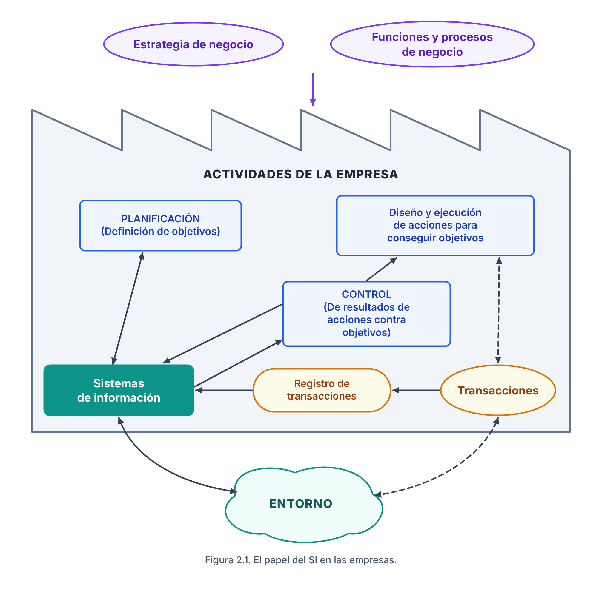

*Fuente: Andreu, Ricart y Valor, **Estrategia y sistemas de información** (2.ª ed.), Fig. 2.1: El papel del SI en las empresas.*

1. **Estrategia de negocio y funciones/procesos de negocio:**
   Estos dos elementos guían las actividades de la empresa. La estrategia define la dirección y los objetivos generales, mientras que las funciones y procesos de negocio representan las acciones específicas que se realizan para alcanzar esos objetivos.

2. **Actividades de la empresa:**
   Las actividades principales se dividen en tres partes:

   - **Planificación:** implica la definición de objetivos y la creación de estrategias para alcanzarlos.

   - **Diseño y ejecución de acciones:** se enfoca en la implementación de los planes mediante acciones concretas para lograr los objetivos planteados.

   - **Control:** se encarga de evaluar los resultados de las acciones en relación con los objetivos, identificando posibles desviaciones para realizar ajustes.

3. **Sistemas de información:**
   Apoyan estas actividades proporcionando datos y herramientas que facilitan la toma de decisiones. La planificación, la ejecución y el control dependen del acceso a información precisa y oportuna.

4. **Registro de transacciones:**
   Se encarga de capturar los datos de las operaciones diarias, como ventas, compras o movimientos de inventario, que alimentan los sistemas de información.

5. **Entorno:**
   Representa los factores externos que afectan a la empresa, como el mercado, la competencia o los cambios en la tecnología. El entorno genera transacciones que son registradas y evaluadas a través del sistema de información para ajustar la planificación y el control.

> 📝 **Apunte de clase:** el Sistema de Información actúa como el vínculo entre la planificación, la ejecución y el control, integrando datos internos y externos para mejorar la toma de decisiones y la eficiencia organizacional.

Ahora, **una definición formal de lo que es un SI**: el conjunto ***formal*** de procesos que, operando sobre una ***colección de datos estructurada de acuerdo con las necesidades de una empresa***, recopila, elabora y distribuye (parte de) la información necesaria para la ***operación*** de dicha empresa y para las actividades de dirección y control correspondientes, apoyando, al menos en parte, la ***toma de decisiones*** necesaria para desempeñar las ***funciones y procesos de negocio*** de la empresa de acuerdo con su estrategia.

> 📝 **Apunte de clase:** en definitiva, la definición propuesta se centra fundamentalmente en el para qué del SI, más que en el cómo o el qué.

Algunas aclaraciones:

- ***Formal***: la parte del mismo claramente definida, que toda empresa conoce y sabe cómo utilizar. No se quiere decir que no se consideren importantes los SI informales. Simplemente se trata de reconocer la limitación de que los SI informales son, por naturaleza, menos estudiables, menos planificables y, seguramente también, menos dirigibles, al menos desde un punto de vista cohesionado y global.

- ***Colección de datos estructurada de acuerdo con las necesidades de una empresa***: está incluida en el SI y opera sobre ella. La base de datos (BDD) es un componente muy importante de todo SI.

- ***Operaciones y toma de decisiones***: estas son necesarias en las actividades de dirección y control, y se quiere enfatizar el hecho de que no solo existen necesidades de información para coordinar acciones operativas, sino también para ayudar a tomar decisiones y para ejercer el control que se considere adecuado en cada caso.

- ***Funciones, procesos y estrategia de negocio***: el SI de una empresa debe estar al servicio de su enfoque de negocio. Al fin y al cabo, el SI es solamente uno más de los elementos que la empresa diseña y utiliza para conseguir sus objetivos, y es, por tanto, imprescindible que se coordine de manera explícita con ellos.

**Transacciones**: actividades operativas básicas de toda actividad empresarial, que a menudo involucran interacciones de la empresa con su entorno.

En definitiva, los SI existen no solo para satisfacer necesidades de información para la coordinación de acciones operativas, sino también para ayudar a tomar decisiones y ejercer el control adecuado en cada caso.

> 📝 **Recordá:** *"La función de Sistemas de Información opera como un **negocio en sí mismo** («empresa dentro de la empresa»): atiende a clientes internos, desarrolla productos tecnológicos y presta servicios. Para lograrlo, gestiona de forma integrada **recursos técnicos (hardware y software)** y **recursos humanos especializados**, articulados mediante **mecanismos de administración** (metodologías de desarrollo, acuerdos de nivel de servicio y políticas de seguridad y gobierno)".*

## El SI en el contexto de la cadena de valor.

El concepto de **cadena de valor** hace referencia a que en la producción se debe asegurar que cada eslabón o etapa de la cadena le dé "valor agregado" a lo que se está produciendo. El SI va a dar conexiones entre los eslabones y además brindará la información necesaria a cada uno de ellos.

El concepto de cadena de valor distingue entre dos tipos de actividades básicas en toda empresa: las «**de línea**» o «**básicas**», que tienen que ver directamente con **la creación de valor**, y las «**de soporte**», en las que las anteriores se apoyan para coordinarse, compartir información, etc.

> 📝 **Apunte de clase:**
>
> - *Las de línea*: son las que están directamente involucradas en la **creación física del producto, su venta y el servicio postventa.**
>
> - *Las de soporte*: sirven de **sustento a las actividades primarias**, facilitando recursos, capacidades y condiciones para que funcionen eficientemente.

En la figura de la cadena de valor (más abajo), una de las actividades de soporte se denomina infraestructura de la empresa. Dado que el SI de una empresa forma parte precisamente de la infraestructura de esta, se entiende que todas las actividades de línea precisan apoyo del SI. También, dado que las distintas actividades de soporte se apoyan entre sí, se llega a la conclusión de que el SI está llamado a interaccionar con todas las demás actividades de cualquier empresa, ya sean básicas o de soporte, y además en un grado no trivial.

> 📝 **Apunte de clase:** la **infraestructura de la empresa** es el **conjunto de funciones administrativas, financieras, legales, estratégicas y tecnológicas** que permiten que todas las demás actividades (producción, ventas, logística, etc.) se lleven a cabo de manera eficaz y coordinada. Y dentro de esta infraestructura, el **Sistema de Información (SI)** juega un papel central como conector, soporte y facilitador.

**Figura: la cadena de valor**

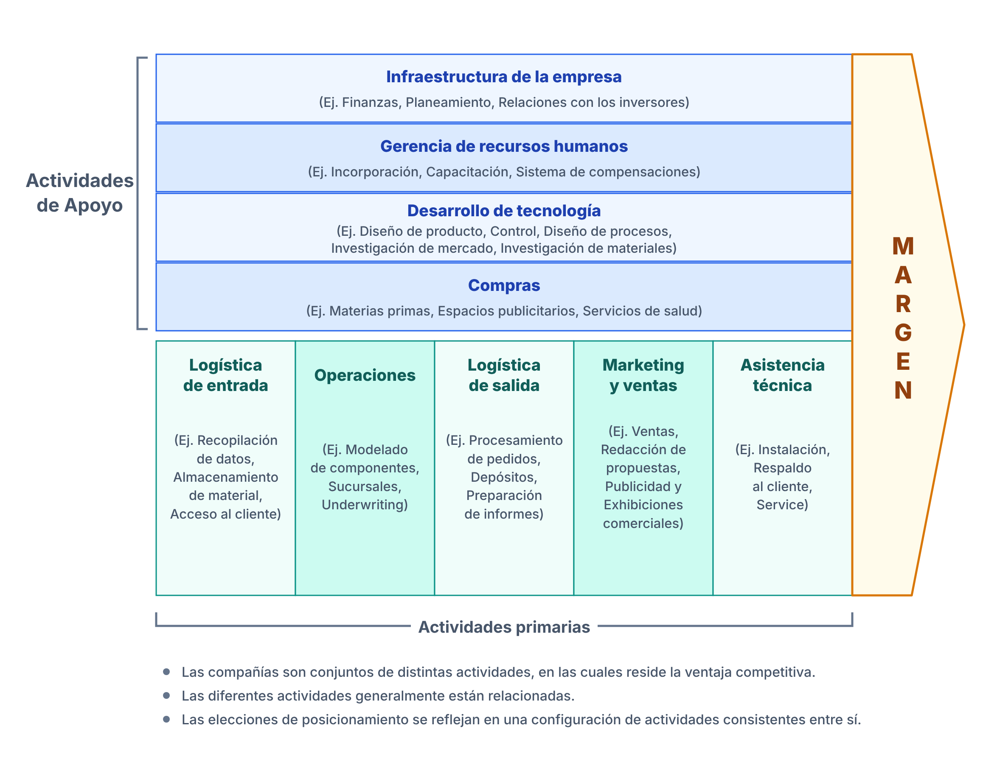

*📝 Apunte de clase: cadena de valor de Porter con ejemplos. La versión del libro es la de Andreu, Ricart y Valor, **Estrategia y sistemas de información** (2.ª ed.), Fig. 2.2: Esquema genérico del concepto de cadena de valor.*

*Todas las actividades de la cadena de valor, ya sean básicas o de soporte, necesitan y generan información.* El SI recopila la información que, generada por las distintas actividades, es luego necesaria para el funcionamiento de otras. El propio SI distribuye dicha información a cada actividad. Desde esta perspectiva, el SI juega un importante papel de coordinación entre las distintas actividades de la cadena de valor a todos los niveles. Ello incluye tanto coordinación de actividades básicas entre sí (por ejemplo, hacer llegar los pedidos a producción en una empresa que fabrica sobre pedido) como entre actividades básicas y de soporte (cualquier actividad de control es un buen ejemplo de ello), y también de actividades de soporte entre sí (por ejemplo, seguimiento del personal adscrito a actividades de soporte). Consecuentemente, el SI juega un papel central en el buen funcionamiento de estas interacciones entre actividades de la cadena de valor.

La información que el SI «**básico**» maneja, aunque generada o utilizada por actividades concretas, ***no pertenece** a ninguna actividad en particular; pertenece a la empresa considerada globalmente*.

> 📝 **Apunte de clase:** un sistema es básico cuando es transversal a varias áreas. Siempre que es básico, forma parte de la infraestructura de la empresa.

Es posible que las actividades precisen elaborar, tratar y utilizar volúmenes importantes de la información en un grado de detalle que **nadie más en la empresa necesite**. Cuando se da esta circunstancia puede decirse que existen sistemas o subsistemas de información **circunscriptos** a *actividades concretas que, estrictamente hablando, no forman parte del SI «básico»*, es decir del SI que forma parte de la infraestructura de la empresa. Es evidente que algunos procesos de información están circunscriptos a una actividad muy concreta de la cadena de valor, por lo que lo razonable es planificarlos, diseñarlos, financiarlos y utilizarlos desde la perspectiva de dicha actividad. Entendemos por subsistemas circunscriptos aquellos limitados a *una actividad muy concreta de la cadena de valor*. Lo fundamental es que dichos subsistemas sean lo más independientes posibles de la información de otras actividades. Esto no quita que estos subsistemas puedan generar o utilizar información relevante para otras actividades, siempre y cuando lo hagan en volúmenes poco importantes.

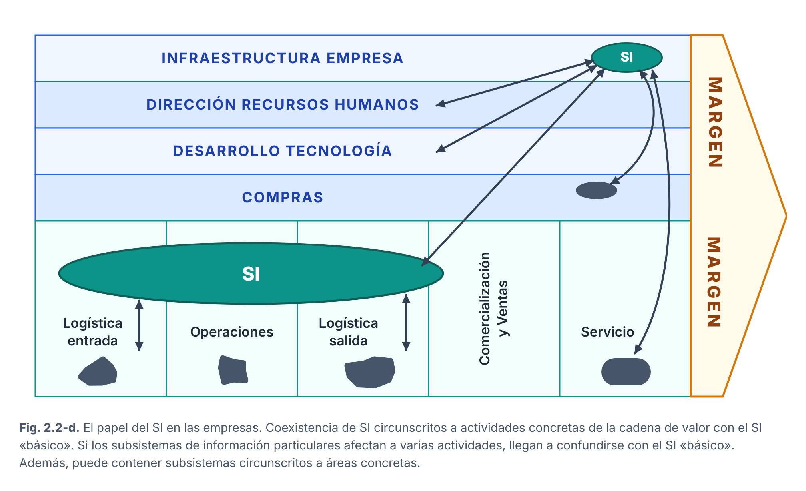

*Fuente: Andreu, Ricart y Valor, **Estrategia y sistemas de información** (2.ª ed.), Fig. 2.2-d: El papel del SI en las empresas.*

**Fig. 2.2-d — El papel del SI en las empresas.** Coexistencia de SI circunscriptos a actividades concretas de la cadena de valor con el SI «básico». Si los subsistemas de información particulares afectan a varias actividades, llegan a confundirse con el SI «básico». Además, el SI «básico» puede contener subsistemas circunscriptos a áreas concretas.

> 📝 **Apunte de clase:** el SI básico **centraliza y distribuye lo importante para toda la empresa**, mientras que los subsistemas circunscriptos **gestionan información profunda y operativa**, útil para un área en particular, **aunque puedan compartir algo con el SI básico si hace falta**.

### La explotación de los «vínculos» y la reconfiguración de la cadena de valor.

- Los **vínculos** son definidos por Andreu, Ricart y Valor como las ***«influencias mutuas y a veces indirectas entre distintas actividades de la cadena de valor»*** (por ejemplo, cómo el registro de quejas de los clientes en las actividades de Comercialización o Postventa influye para orientar y mejorar el control de calidad en la actividad de Operaciones).

- El SI es la herramienta clave para coordinar y explotar estos vínculos adoptando una visión global de la empresa. En casos estratégicos, explotar estos vínculos mediante el SI trasciende la coordinación operativa y llega a **reconfigurar la propia cadena de valor**, cambiando el diseño de la estructura de la empresa, dando lugar a nuevos enfoques para el negocio y generando notables **ventajas competitivas**.

> **Proceso de negocio** (Andreu): es un conjunto de actividades relacionadas a través de vínculos susceptibles de ser mejorados radicalmente, en particular con la ayuda de las TI.

> ⚠️ **¡Atención!**: De ahora en adelante, por SI entenderemos el concepto de SI ***básico***. Cuando queramos referirnos a todos los subsistemas, incluyendo aplicaciones específicas de las TI a actividades concretas, utilizaremos el término SI/TI.

## Los SI y los demás sistemas de la empresa.

Los SI son parte integrante del conjunto que configura la infraestructura de la empresa. El SI ***forma un conjunto, que se supone coherente y coordinado, con el resto de los sistemas** que componen dicha infraestructura*: el sistema de planificación, el sistema de control, la estructura organizativa, el sistema de compensación, entre otros.

**Figura: los SI y los demás sistemas de la empresa**

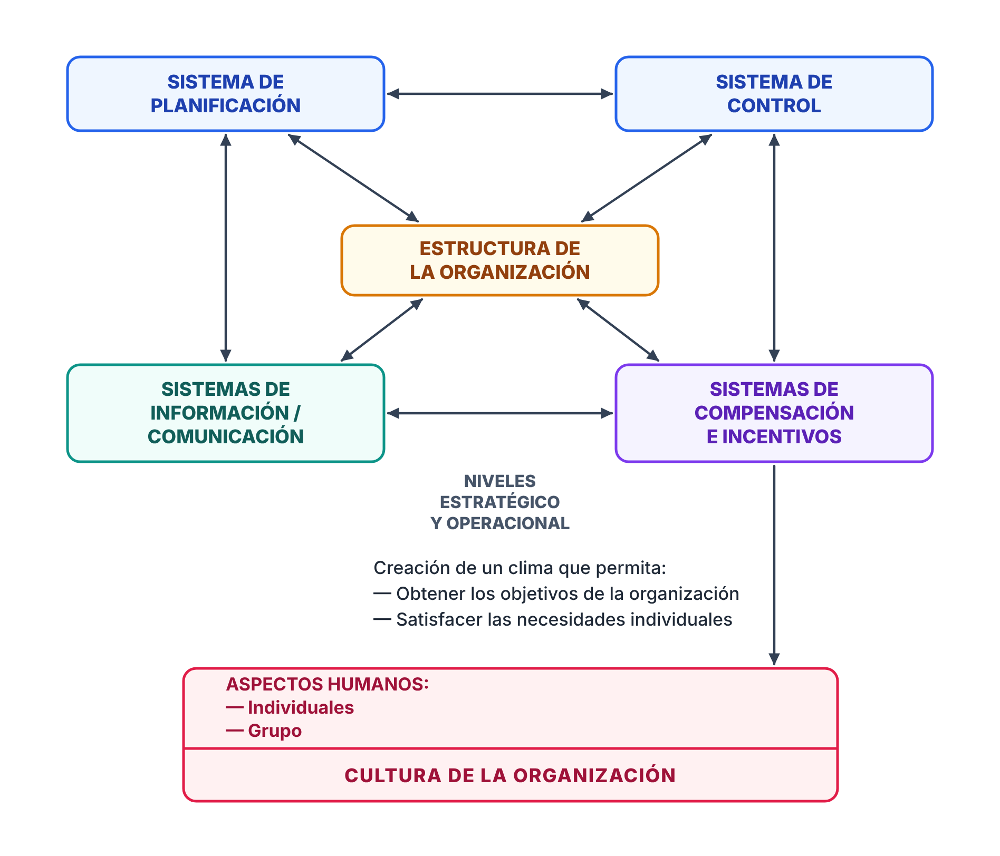

*Fuente: Andreu, Ricart y Valor, **Estrategia y sistemas de información** (2.ª ed.), Fig. 2.3: Sistemas de la empresa que configuran su infraestructura (adaptado de Hax y Majluf, 1984).*

Este conjunto de sistemas debe ser coherente tanto **internamente** (es decir, entre sí) como **externamente**, con los objetivos estratégicos que la empresa se ha propuesto alcanzar y a cuya consecución deben contribuir explícitamente.

Desde esta perspectiva, el SI no puede ser considerado como un elemento aislado, sino como un componente que debe **interactuar de manera equilibrada y directa** con todos los demás sistemas organizativos. El SI **capta, organiza y distribuye información** que es vital para el funcionamiento de los demás sistemas, y también se ve afectado por ellos. Esto significa que no hay subordinación jerárquica, sino **interdependencia total**: el SI influye y es influido por el sistema de planificación, el sistema de control, la cultura organizacional y los aspectos humanos que atraviesan la empresa.

> 📝 **Apunte de clase:** el SI básico es una **estructura transversal que interconecta y da soporte a todos los sistemas organizacionales de la empresa. Es la columna vertebral de la misma. Permite que funcione como un todo y no como componentes aislados.**

Este enfoque implica la necesidad de **mantener un equilibrio sistémico**: cualquier cambio en el SI (por ejemplo, su actualización tecnológica o su rediseño organizacional) **no puede hacerse sin considerar su impacto** en el resto de los sistemas de la infraestructura. Si no se cuida esa coherencia, se pueden generar tensiones o disfuncionalidades que luego obligarán a la organización a realizar ajustes costosos y complejos para volver al equilibrio.

Por lo tanto, el SI debe diseñarse, modificarse y gestionarse **como parte de un sistema más amplio**, en el que cada componente debe contribuir de forma alineada a los objetivos estratégicos generales, sin romper la armonía funcional entre las distintas partes de la organización. Esta mirada sistémica es esencial para garantizar un funcionamiento eficaz y sostenible de la empresa en su conjunto.

## El rol de las tecnologías de la información (TI).

A pesar de que hablemos de tecnología, conviene no perder de vista que la **necesidad inicial se plantea en términos de SI** (por ello los autores señalan que la influencia de las TI sobre el diseño y planificación de los SI es inicialmente *«solamente coyuntural»*: son un medio y no un fin en sí mismo). No obstante, sería poco realista argumentar que por esta razón la tecnología es irrelevante. Es **relevante**, y puede llegar a serlo mucho.

> 📝 **Apunte de clase:** la necesidad surge siempre desde el SI, y la tecnología debe **servir a esa necesidad**, no dominarla ni imponer condiciones ciegamente.

Las TI son el conjunto de recursos tecnológicos utilizados para la implementación de los SI. Como mínimo, están conformadas por: aplicaciones, comunicaciones, y todo dispositivo que se necesite para acceder a la información.

El punto de contacto inicial entre estas tecnologías y los SI es obvio, ya que estas proporcionan soluciones claras a determinados problemas que se presentan en la implementación de todo SI: almacenamiento de datos y acceso posterior a ellos según pautas difíciles de anticipar, tratamiento de datos rápido y con pocos errores, comunicaciones automáticas, etc.

Conviene darse cuenta de que, si se desea utilizar las TI en la implementación de SI, ***a menudo no será posible simplemente hacer lo mismo que antes y de la misma manera, solo que utilizando una tecnología diferente***. Esto se debe a que **la tecnología no es neutral, sino que aporta su propia idiosincrasia**.

Una implicación importante de todo ello es que *alguien* en la estructura organizativa de la empresa debe responsabilizarse de estar al día acerca de las cambiantes posibilidades de las TI y de mantener una actitud crítica frente a las mismas desde la perspectiva de las necesidades de SI.

Pueden darse dos situaciones:

1. Que la tecnología aporte *mejores* maneras de hacer las cosas.

2. Que nos *fuerce* a tener que hacerlas de maneras peores (puede que más eficientes, pero quizá menos efectivas). *Es imprescindible conocer claramente las posibilidades de la tecnología en términos de lo que puede aportar **para nuestro SI***.

### Los 4 grandes aportes históricos de las TI a los SI (Andreu, cap. 3).

Desde una perspectiva histórica, la influencia de las TI en los SI ha tenido cuatro aportaciones sumamente positivas que enriquecieron la gestión empresarial:

1. **El concepto de Base de Datos (BD):** aportó disciplina para estructurar, organizar y agrupar todos los datos relevantes de la empresa en un único lugar evitando redundancias, exigiendo además que los usuarios participen en su diseño.

2. **El concepto de DSS (*Decision Support Systems*):** nació al comprender una limitación clave de las TI: aunque pueden automatizar *secuencias de procesos*, no pueden automatizar todas las decisiones humanas complejas (**intervalos de decisión**). Así, su rol pasó a enfocarse en *apoyar* al decisor humano con diseños flexibles y prototipos en vez de intentar reemplazarlo.

3. **Impulso del aprendizaje organizativo:** enseñó que incorporar tecnología afecta simultáneamente a la estructura, el control, los incentivos y las personas, exigiendo un cambio armónico y gradual a través de etapas de madurez (como el modelo de **Gibson y Nolan**).

4. **Innovación y reingeniería de procesos:** ayudó a identificar los procesos de negocio de la empresa susceptibles de ser rediseñados radicalmente con ayuda de las TI para lograr mejoras sustanciales.

# Planificación de los SI/TI a partir de la estrategia del negocio.

> 📝 **Apunte de clase:** La **administración** es el proceso sustantivo, fundamental y esencial que dirige toda la empresa. Cuando se decide administrar, se realizan permanentemente cuatro tareas: *Planificar, Organizar, Dirigir y Controlar*. La administración como proceso no se encuentra en un área. La llevan adelante *la alta gerencia, las gerencias medias y las gerencias de primera línea*. Esos tres niveles organizacionales son los que tienen que administrar y lo que administran va a depender de su nivel jerárquico.

**Estrategia**: según Edwards, una estrategia se puede definir como «*un conjunto integrado de acciones encaminadas a incrementar a largo plazo la prosperidad y las fortalezas de la empresa*».

> 📝 **Apunte de clase:** la estrategia es el conjunto de acciones que va a indicar el curso de acción para llegar al objetivo y que después va a tener que marcar con qué prioridad se asignan recursos y se ejecutan esas acciones.

> 📝 **Apunte de clase:** la estrategia marca el rumbo y la administración lo ejecuta.

## Las 4 etapas de la Planificación Estratégica (Palom Izquierdo).

> ⚠️ **Atención (Complemento fuera del temario):** *El modelo de Palom Izquierdo pertenece al material de Conceptos Previos y no figura explícitamente en la tabla bibliográfica del Temario de la Unidad I (que cita a Edwards y Andreu). Se incluye aquí como complemento porque explica cómo se formula la estrategia de negocio previa al alineamiento de SI/TI.*

1. **Etapa Filosófica:** define la esencia de la empresa mediante:

   - **Principios empresariales:** el sistema de valores y convicciones que guía los actos de la organización frente a la sociedad.

   - **Misión:** el objetivo central que da razón de ser a la empresa; es dinámica, orientada al futuro y expresa el valor que aporta a la sociedad (no resultados económicos).

   - **Políticas generales:** acuerdos que canalizan y guían las decisiones y acciones hacia los objetivos.

2. **Etapa Analítica:** diagnostica dónde está parada la empresa mediante dos frentes:

   - **Análisis interno:** identifica **Fortalezas** (ventajas diferenciales a explotar), **Debilidades** (desventajas actuales en las que hoy se falla) y **Carencias** (recursos o características que hoy no se tienen pero serán indispensables para competir en el futuro).

   - **Análisis externo:** estudia el entorno actual y futuro para identificar **Oportunidades**, **Problemas** (impacto negativo actual) y **Amenazas o Riesgos** (factores latentes de gran magnitud).

3. **Etapa Operativa:** convierte el diagnóstico en camino a seguir mediante:

   - **Metas:** resultados específicos, cifrados y mesurables que se desean alcanzar.

   - **Estrategias:** el arte o manera de alcanzar los objetivos aprovechando los puntos fuertes (fortalezas) en las zonas de oportunidad.

4. **Etapa de Acción y Desarrollo:** traduce las estrategias en **Programas de acción orientada a objetivos** (documentos detallados por escrito con qué tareas se harán, en qué orden, quién es el responsable, en qué plazos, con qué costos y qué resultados se esperan lograr), sirviendo de base para la organización y el control.

## El contexto de las estrategias de SI/TI.

> ***Edwards - Capítulo 4.***

La estrategia empresarial de una organización se formula mediante el análisis de diversos ***inputs*** internos y externos, empleando varias técnicas para generar objetivos, políticas y planes de acción. Algunos de estos procesos precisarán el desarrollo o la mejora de los sistemas de información. Esa definición de requisitos (*¿Qué es preciso hacer?*) debe entonces trasladarse a soluciones basadas en tecnología (*¿Cómo satisfacer las necesidades?*).

> ⚠️ **Atención (Complemento del Cuestionario de Autoestudio):** *El siguiente listado de problemas ante la falta de alineación corresponde a la Pregunta 3 del Cuestionario de Autoestudio (Edwards, cap. 4). Se incluye como complemento para justificar por qué deben alinearse los SI con la estrategia.*

**Consecuencias de no contar con una estrategia coherente de SI/TI (Edwards, cap. 4):**

- Los competidores, proveedores y clientes consiguen ventajas sobre la empresa.

- Los objetivos empresariales se vuelven inalcanzables por las limitaciones de los sistemas.

- Los sistemas no están integrados: duplicación de esfuerzos, datos inexactos, retrasos y mala gestión de la información.

- Los proyectos se retrasan, exceden el presupuesto y no dan los beneficios esperados porque no se definieron bien las necesidades del negocio.

- Las prioridades y los planes cambian todo el tiempo, generando conflictos entre usuarios y personal de SI.

- Las tecnologías elegidas no se integran e incluso limitan a la empresa.

- No hay forma de fijar niveles de recursos adecuados ni de priorizar las inversiones de manera coherente (*en síntesis: se gasta más de lo necesario para obtener menos beneficios de los esperados*).

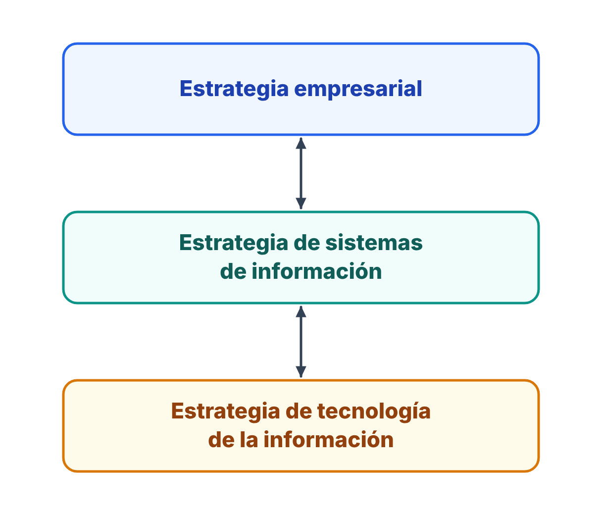

*Fuente: Edwards, Ward y Bytheway, **Fundamentos de sistemas de información** (2.ª ed.), Fig. 4.1: La estrategia de SI y TI.*

El impacto potencial de los SI/TI sobre la empresa y en su entorno dependerá no solamente de lo que esta desee hacer, sino también de lo que los demás estén haciendo o de lo que sean capaces de hacer. Por eso, **planificar los SI/TI es también planificar la competitividad de la empresa**.

Los SI/TI pueden y deben ser tenidos en cuenta en el proceso de la formulación de la estrategia empresarial, por cuanto pueden hacer que la estrategia de la empresa sea una realidad.

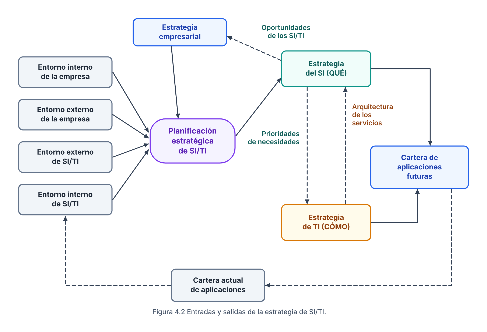

*Fuente: Edwards, Ward y Bytheway, **Fundamentos de sistemas de información** (2.ª ed.), Fig. 4.2: Entradas y salidas de la estrategia de SI/TI.*

La integración de los SI y la estrategia empresarial debe incorporar métodos para evaluar el impacto potencial que pueden tener los SI/TI sobre la organización y su entorno. *Los componentes de una estrategia SI/TI son*, por tanto, **la estrategia de sistemas de información y la estrategia de tecnología de la información**.

### La estrategia de sistemas de información (SI).

La estrategia de SI define las necesidades de información y de sistemas que tiene la empresa, así como las funciones que la integran. Si la organización opera en más de un negocio, entonces cada negocio tendrá su estrategia, y, además, habrá una estrategia para satisfacer las necesidades corporativas globales. Debe definir **QUÉ** sistemas de información precisa la empresa para el futuro, sobre la base de un análisis de la propia empresa, su entorno y su estrategia de negocio.

El objetivo es **definir** las necesidades de aplicaciones de SI/TI, en línea con los planes y aspectos críticos de la empresa. Estas necesidades cambiarán con el tiempo y han de actualizarse, revisarse y priorizarse de forma continua, con base en las exigencias del negocio.

La estrategia debe también definir quién, en términos de la organización, ha de ser responsable de la planificación, entrega e implantación de los sistemas de información que sean necesarios.

### La estrategia de tecnología de la información (TI).

La estrategia de TI define cómo se van a satisfacer las necesidades con base en las prioridades de la estrategia de SI y en la tecnología de la información necesaria para desarrollar y operar las aplicaciones actuales y futuras. Esto supone determinar la forma en que han de desarrollarse las aplicaciones y cómo se van a adquirir, utilizar, controlar y gestionar los recursos tecnológicos y humanos necesarios para satisfacer las necesidades de la empresa. También describirá qué actividades han de llevarse a cabo y la forma en que se han de organizar.

Por lo tanto:

- **Las estrategias de SI (demanda)**: determinación de la demanda de aplicaciones.

- **Las estrategias de TI (oferta)**: satisfacción de la demanda de aplicaciones.

> 📝 **Apunte de clase:** con la estrategia de SI tengo una demanda de información que debe ser satisfecha mediante aplicaciones; la estrategia de TI define las formas en las que esa demanda puede ser satisfecha.

## Planificación de la estrategia de los SI/TI.

La planificación de la estrategia de los SI/TI debe llegar a ser un proceso continuo e integrado en la planificación de la empresa. El personal de la empresa y el de TI que ha de implantar la estrategia deben considerarla como cosa propia y, por tanto, deben participar activamente en su desarrollo y comprender sus implicaciones. El proceso de planificación ha de ser manejable, tanto en términos de alcance como de duración, y debe generar resultados válidos a lo largo de su desarrollo, no solamente al final. Ha de haber hitos de control claros en los que se logre un acuerdo, y es preciso contar con el respaldo de la dirección antes de continuar un análisis y una formulación más detallados. Todos deben recibir la siguiente información antes de empezar:

- Lo que está en juego y lo que se puede conseguir.

- Cómo hay que lograrlo.

- Qué productos se esperan obtener.

Un Plan de SI/TI debe incluir:

- **Una lista de proyectos a desarrollar en los próximos 3-5 años**.

- **Referida a la situación en el momento de preparar el Plan**. Es decir, con el reconocimiento explícito del *punto de partida* del que se supone que debe arrancar el Plan, en cuanto a la situación de las TI/SI en la empresa de que se trate. **No solo desde un punto de vista técnico sino también desde un punto de vista de negocio.**

> 📝 **Apunte de clase:** antes de empezar, es importante entender la situación actual de la empresa respecto a la tecnología. No solo desde el lado técnico (qué sistemas ya tiene, qué herramientas usa), sino también desde el lado del negocio (qué necesita mejorar o fortalecer).

- **La prioridad de cada proyecto**. Tal prioridad debe contemplar tanto aspectos de importancia para el negocio (lo más relevante) como aspectos técnicos, relacionados con su implementación con una determinada infraestructura tecnológica.

- Para los proyectos a desarrollar en el primer año, **el detalle suficiente que permita su evaluación en términos de recursos necesarios en su desarrollo**, con objeto de poder incluirlos en el presupuesto anual correspondiente. Para proyectos que no se inicien hasta ejercicios posteriores, una aproximación será suficiente.

- **Mecanismos de evaluación adecuados para permitir los procedimientos de control necesarios en el seguimiento del plan**. Esto quiere decir fundamentalmente un **calendario con fechas clave y un presupuesto suficientemente detallado**.

- **Una lista de actividades de la empresa donde la TI pueda utilizarse como herramienta de soporte para aumentar su eficacia o su eficiencia**.

Es importante observar que **el contenido del Plan de TI/SI es muy poco tecnológico**. ***Los detalles tecnológicos se incluyen solo cuando es estrictamente necesario.*** *La perspectiva bajo la que se elabora el Plan de SI/TI es* **fundamentalmente una perspectiva de negocio**, *no una perspectiva tecnológica*.

**Figura: esquema general del procedimiento de alineación de las estrategias de SI/TI con las estrategias organizacionales**

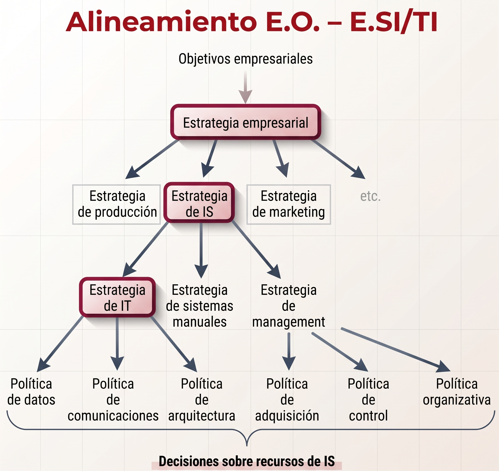{width=70%}

*Fuente no identificada en los PDF del proyecto ("Decisiones sobre recursos de IS", correspondiente al cap. 9 de Robson); verificar con la cátedra.*

El plan debe **alinear las estrategias de SI/TI con la estrategia empresarial general**. Para lograr esa alineación, se parte de las siguientes entradas (*inputs*) clave:

- Entorno empresarial externo

- Entorno empresarial interno

- Entorno externo de SI/TI

- Entorno interno de SI/TI

### El entorno empresarial externo.

Esta entrada (*input*) del proceso consiste en una evaluación de las fuerzas que afectan a la industria en que opera la empresa: la situación económica de la industria, su estructura y base competitiva, y dentro de ella, los aspectos concretos y las presiones que afectan al negocio.

> 📝 **Apunte de clase:** de este análisis surgen las **oportunidades y amenazas** (la "OA" del FODA).

### El entorno externo de SI/TI.

Una organización necesita comprender dos aspectos del entorno externo de los SI/TI:

- **Las nuevas tecnologías**: además de beneficios, todas las nuevas tecnologías conllevan algún riesgo y una curva de aprendizaje para la empresa.

- **La utilización de la tecnología**: una organización necesita conocer la forma en que la tecnología de la información es empleada por otros dentro de la industria, con qué objetivo y con qué resultados. Además, el conocimiento del uso de los SI/TI en otras industrias puede proporcionar una fuente de buenas ideas que se pueden trasplantar.

### El entorno empresarial interno.

Esta entrada (*input*) del proceso consiste en un análisis de las necesidades de información y de sistemas sobre la base *de lo que hace la empresa, de cómo lo hace, y de cómo está organizada y dirigida*. Estará relacionado con la misión del negocio, con su actividad, con sus capacidades y con su estructura.

- Misión y objetivos de la empresa.

- Las actividades de la empresa: describir los principales procesos de la empresa que le permiten ofrecer productos y servicios a sus clientes, así como lo que es preciso hacer para controlar y desarrollar el negocio.

- Las fortalezas y debilidades.

- Estructura organizativa y estilo de dirección: es importante comprender cómo funciona la organización y cómo se toman las decisiones.

> 📝 **Apunte de clase:** de este análisis surgen las **fortalezas y debilidades** (la "FD" del FODA).

### El entorno interno de los SI/TI.

La evaluación de la estrategia de SI/TI ha de tener en cuenta *los sistemas en uso y los recursos tecnológicos que se utilizan*. Incluso hay que observar la información en sí como un recurso con importancia estratégica.

**Los recursos de sistemas y de información de la empresa**

Es preciso comprender totalmente los puntos fuertes y débiles de los sistemas existentes en la empresa (la cartera de aplicaciones actuales) antes de emprender nuevos desarrollos, pues, de otra manera, fracasarán a causa de los cimientos inadecuados sobre los que se habrán construido.

**Las ventajas y los recursos de los SI/TI**

Es necesario determinar si la capacidad y la tecnología actuales de la organización son adecuadas para las necesidades futuras. Esto no es solamente una auditoría de la tecnología disponible (hardware, software, etc.), sino también una evaluación del equipo humano, de sus habilidades, de la forma en que son dirigidos y de los métodos empleados para desarrollar y soportar los sistemas y la tecnología de base.

## Esquema general del procedimiento de alineación de las estrategias de SI/TI con las estrategias organizacionales.

### Las 4 fases históricas de evolución de la planificación de SI (Andreu 5.2 / Gibson Les Paul y Christoper Nolan).

Para Andreu, Ricart y Valor, la planificación de SI es *«un procedimiento sistemático de toma de decisiones sobre qué hacer en el próximo futuro con los sistemas de información»*. Históricamente, la planificación en las empresas ha atravesado cuatro fases evolutivas (basadas en **Gibson y Nolan**, 1974):

- **Fase I: La introducción de la informática en la organización:** comienza en los años sesenta con grandes ordenadores cuyo manejo era críptico para los no especialistas. El foco era reducir costos mecanizando tareas administrativas básicas (nómina, contabilidad, facturación). El área de «Proceso de Datos» (PD) dependía de administración y quedó progresivamente aislada, naciendo el **«muro» o pared de incomunicación** con la alta dirección.

- **Fase II: «Expansión anárquica» de las aplicaciones informáticas (Contagio):** una vez resueltas las mecanizaciones básicas, proliferan solicitudes de aplicaciones más complejas pero desconectadas entre sí. Como sigue existiendo el «muro», el responsable de informática desconoce la estrategia de la empresa y asigna prioridades y recursos con **criterios erróneos**: *facilidad técnica de implementación, atractivo o novedad tecnológica para el área informática, poder o influencia política del departamento que hace el pedido, o costo de desarrollo*.

- **Fase III: Coordinación SI-objetivos de empresa (Alineamiento pasivo):** la crisis por los altos costos y el descontento de los usuarios obliga a la alta dirección a intervenir e instaurar un procedimiento formal de planificación para **«derribar la pared»**. Los planes de $TI/SI$ pasan a alinearse con la estrategia de negocio (apoyándola), y el director de SI deja de decidir aisladamente para convertirse en el **coordinador de un equipo interdepartamental**.

- **Fase IV: Interdependencia estrategia de la compañía-TI/SI (Alineamiento activo / Madurez):** etapa de máxima madurez organizativa, donde los planes de $TI/SI$ ya no van «detrás» del negocio, sino que **la estrategia de negocio y la de $TI/SI$ se formulan en paralelo y simultáneamente**, retroalimentándose para crear ventajas competitivas sostenibles.

**La responsabilidad de desarrollar el Plan de TI/SI recae fundamentalmente en la dirección de la empresa, aunque en el proceso debe también participar el estamento técnico**. Además, debido a que el Plan de TI/SI abarca toda la organización, **el equipo que lo desarrolle debe representar efectivamente todas las áreas de la empresa**. De otro modo se obtendría un plan arbitrariamente sesgado.

**Recordando que… el contenido del Plan de TI/SI es muy poco tecnológico**, entonces un procedimiento que cumpla con las condiciones anteriores debe integrar las necesidades de información emanadas del cruce de las directrices estratégicas de la empresa con las funciones y procesos de negocio de las distintas unidades organizativas.

Conforme observamos el esquema, podemos interpretar lo siguiente:

> 📝 **Apunte de clase:** se parte de la matriz conformada por las **Estrategias Organizacionales o Estrategias de la Empresa** y los departamentos de la misma, realizando una identificación de las **Necesidades de Información** correspondientes a las *funciones de negocio* involucradas en los *objetivos o acciones estratégicas* identificadas. De estas últimas, realizamos una integración de las necesidades de información (priorizadas o en su totalidad) y derivamos de ellas las Estrategias SI/TI, las cuales conformarán, en parte, el Plan de SI/TI (las pautas que deben ser incluidas en este plan están especificadas más arriba). Estos planes deben estar avalados por el Comité de SI/TI y se traducen en un plan informático que tendrá que ver con los proyectos a desarrollar en cuanto a aplicaciones en HW y SW.

**Figura: matriz de alineamiento estratégico (necesidades)**

*Fuente: Andreu, Ricart y Valor, **Estrategia y sistemas de información** (2.ª ed.), Fig. 5.5: Estructura de un procedimiento de alineamiento del Plan de Tecnologías y Sistemas de Información.*

### Esquema general del procedimiento.

Las actividades que se describen a continuación deben entenderse más como algo que ***hay que hacer*** para elaborar un plan de TI/SI, y no ***cómo hacerlo***, aunque algunas pueden resultar directamente aplicables en determinadas situaciones.

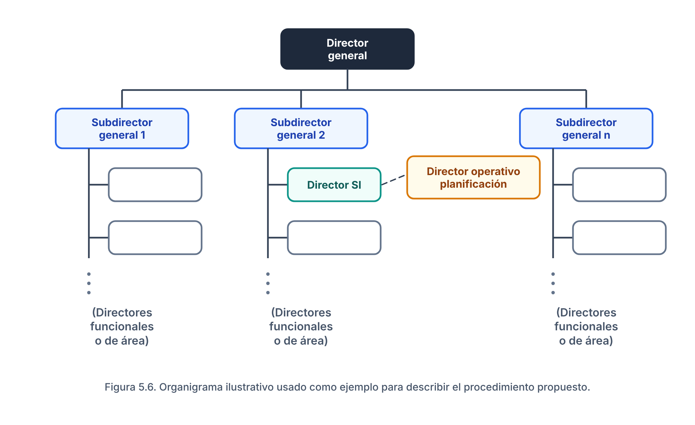

*Fuente: Andreu, Ricart y Valor, **Estrategia y sistemas de información** (2.ª ed.), Fig. 5.6: Organigrama ilustrativo usado como ejemplo para describir el procedimiento propuesto.*

> No se propone que la organización de la empresa deba acomodarse a este esquema. Es puramente ilustrativo, con el fin de facilitar la comprensión de las funciones organizativas determinadas que participan en el procedimiento.

El procedimiento de planificación precisa de varios grupos de trabajo para su implementación. Esta es su composición y funciones principales de manera esquemática:

- **Comité de SI/TI**: es el órgano con responsabilidad última sobre el Sistema de Información que se diseñe. Formado por el máximo responsable de la compañía, los responsables de las distintas áreas funcionales y el director de Sistemas de Información. Sus responsabilidades concretas incluyen la supervisión del proyecto de planificación, explicitar el compromiso de la organización con el Plan en desarrollo, proporcionar criterios estratégicos para la fijación de prioridades y la asignación de recursos y, finalmente, aprobar el Plan de SI/TI desarrollado. **Incluye a los gerentes o directores que formen parte de la Gerencia General y las Gerencias Medias de la organización.** Dentro de las Gerencias Medias se incluye la Gerencia de Sistemas y, dentro de ella, al **subdirector a cargo de SI y al director de SI/TI.**

- **Grupo base**: integrado por **el subdirector general a cargo de SI, el director de Sistemas de Información, el DOP y, eventualmente, por consultores externos expertos en planificación de sistemas de información.** Las labores de este grupo son facilitar la negociación entre usuarios, asegurar la consistencia de los desarrollos y supervisar el equipo de trabajo con mayor asiduidad de la que puede llevar a cabo el comité de Tecnologías y Sistemas de Información. Se puede decir que este grupo debe ***mandar*** sobre el equipo de trabajo, y de alguna manera sobre los usuarios, aun sin disponer de una línea jerárquica explícita.

- **Equipo de trabajo**: lleva a cabo el trabajo operativo encaminado a elaborar el Plan de SI/TI. Está dirigido formalmente por el **director de Sistemas de Información**, aunque **la labor diaria de dirección la lleva a cabo el director operativo de proyecto (DOP)**. En general, el DOP será una persona del departamento de Sistemas, aunque no necesariamente. El equipo está integrado por personal de Sistemas y de los departamentos usuarios especialmente dedicados al proyecto de planificación. (El director líder del proyecto del sistema, con el Director Operativo de Proyecto (DOP) y el personal de sistemas asignado al proyecto. Dependiendo de la envergadura del proyecto, puede haber varios DOP. También se incluye a los jefes o supervisores de las áreas más conflictivas que se hayan detectado en las primeras reuniones del Comité.)

> 📝 **Apunte de clase:** el grupo base vuelve a involucrar al que ofició como gerente de sistemas. Está conformado por los niveles gerenciales de sistemas y los grupos de expertos que son externos. Es el gran staff para poder definir los planes y estrategias de sistemas.

**Fig. 5.7 — Distintos grupos de trabajo que intervienen en el proceso de planificación**

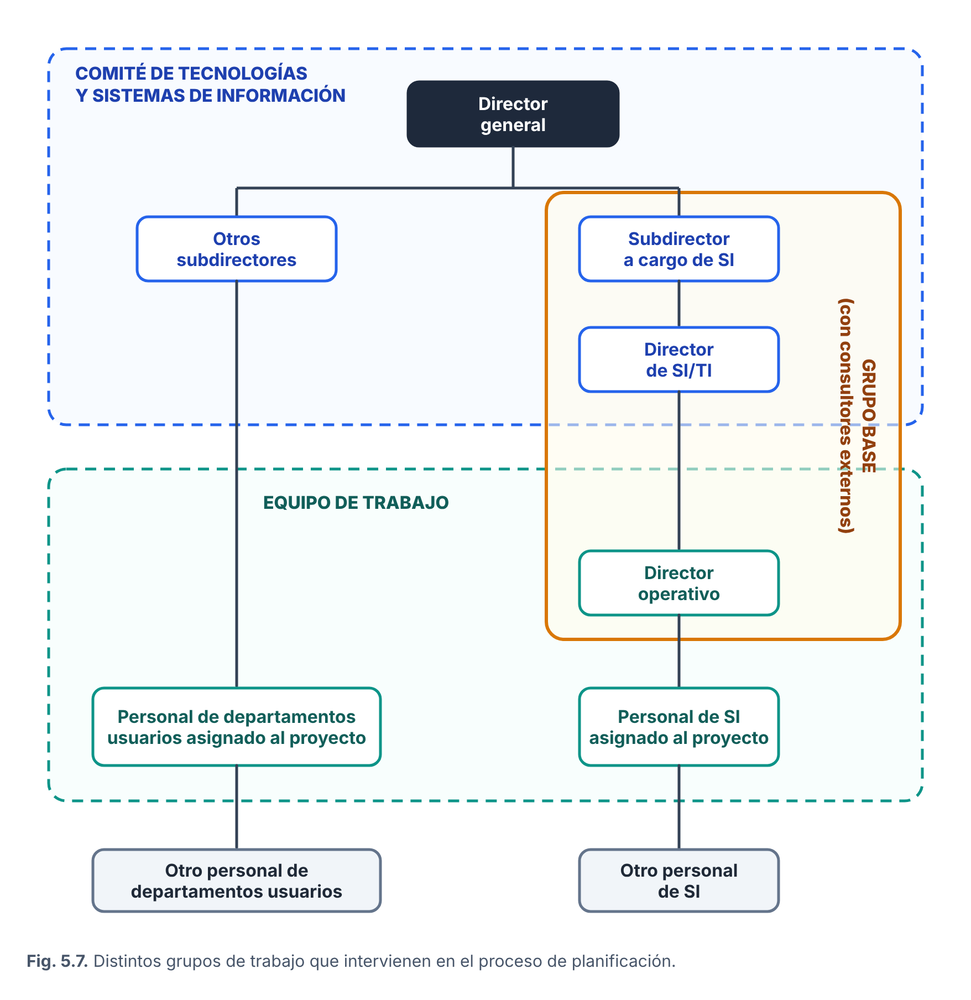

*Fuente: Andreu, Ricart y Valor, **Estrategia y sistemas de información** (2.ª ed.), Fig. 5.7: Distintos grupos de trabajo que intervienen en el proceso de planificación.*

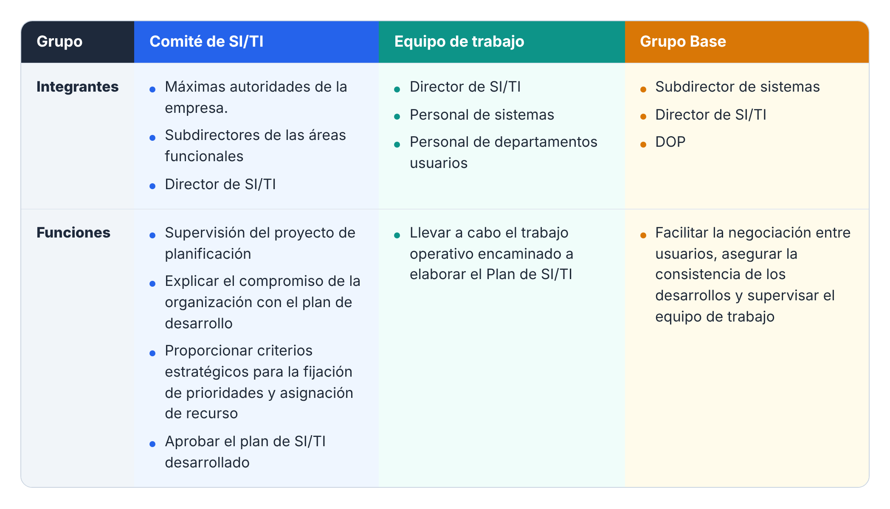

*📝 Apunte de clase: tabla resumen de los grupos de trabajo, basada en Andreu, Ricart y Valor, **Estrategia y sistemas de información** (2.ª ed.), cap. 5.*

> 📝 **Apunte de clase:** existen ocasiones en que no está definida el área de sistemas; por lo tanto, el subdirector a cargo de SI no es necesariamente el gerente de sistemas, sino quien los tenga a cargo, como el nombre lo indica, pudiendo ser, por ejemplo, un gerente administrativo.

#### Fase I: Presentación y compromiso del equipo.

El objetivo de esta fase es constituir el equipo de trabajo que llevará a cabo el esfuerzo de planificación y su presentación a la organización.

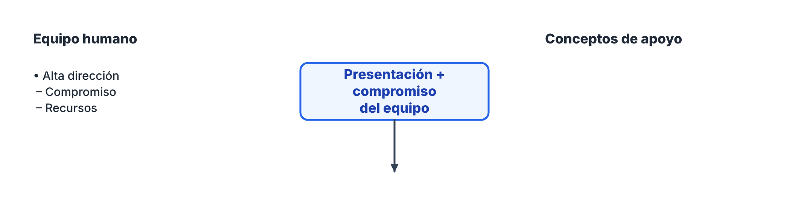

*Fuente: Andreu, Ricart y Valor, **Estrategia y sistemas de información** (2.ª ed.), fragmento de la Fig. A5.2 (Fase I).*

##### **Pasos propuestos**:

1. La decisión de obtener un Plan de TI/SI por parte del Comité de Tecnologías y Sistemas de Información.

2. Formación del grupo base (un embrión del equipo de trabajo, posiblemente con la participación de consultores externos).

3. Identificación de áreas de análisis para describir el Sistema de Información existente.

4. Formación del equipo de trabajo definitivo. Presentación del proyecto.

**Responsables de la fase I: Comité de TI/SI y grupo base.**

#### Fase II: Descripción de la situación actual.

> 📝 **Apunte de clase:** ¿Dónde estoy?

Consiste en describir la situación de la compañía desde dos dimensiones:

1. El negocio.

2. Los sistemas existentes.

Se deben identificar una serie de funciones y procesos de negocio por área de análisis; alrededor de dichas funciones de negocio se organizará el análisis posterior, incluyendo los flujos de información existentes en la empresa y el grado de cobertura que la «informática» da a estos.

Es conveniente no concluir con una lista de funciones y procesos demasiado detallada, porque resultaría inmanejable en las tareas de análisis posteriores. A menudo resulta cómodo trabajar con dos niveles de funciones y procesos: unas muy agregadas (que no sobrepasen la media docena por área y que hagan referencia a las funciones y procesos de negocio más importantes) y, para cada una de ellas, otras un poco más detalladas que ayuden a entender cómo se llevan a cabo aquellas funciones. Es importante que esta lista sea validada explícitamente por los directores funcionales de cada área.

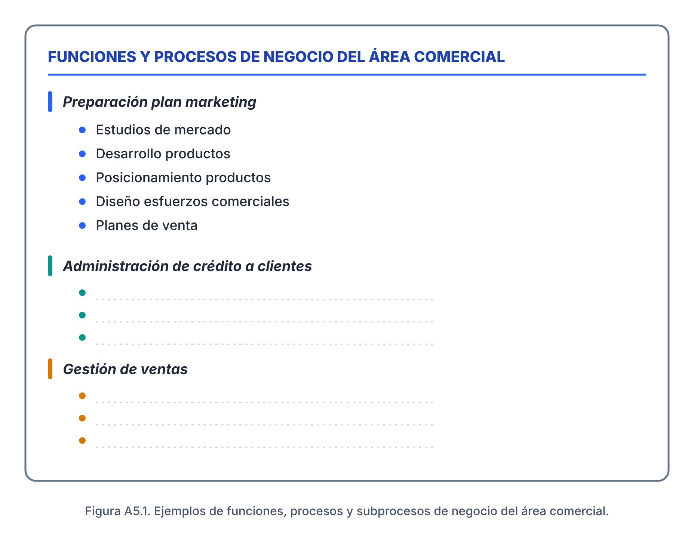

*Fuente: Andreu, Ricart y Valor, **Estrategia y sistemas de información** (2.ª ed.), Fig. A5.1: Ejemplos de funciones, procesos y subprocesos de negocio del área comercial.*

Un objetivo de esta fase es también obtener una ***descripción precisa y no muy extensa de los subsistemas de información existentes en la empresa***, a fin de poder elaborar posteriormente una crítica de los mismos, tanto desde el punto de vista técnico como de negocio. Dicha descripción tiene dos dimensiones:

1. Los datos manejados.

2. Los procesos que configuran los subsistemas existentes.

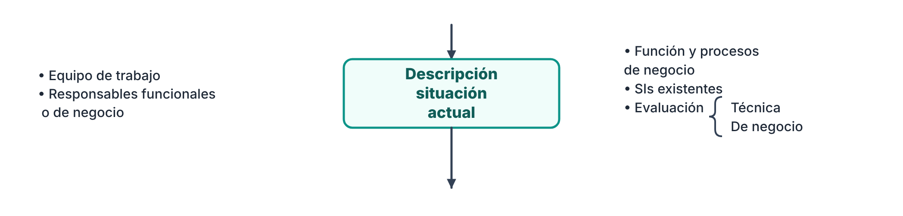

*Fuente: Andreu, Ricart y Valor, **Estrategia y sistemas de información** (2.ª ed.), fragmento de la Fig. A5.2 (Fase II).*

**La información que se precisa acerca de los procesos es**:

1. Su agrupación por subsistemas (es decir, a la implementación de qué subsistema de información pertenece cada proceso).

2. La especificación de qué datos utiliza cada proceso en su funcionamiento (***los inputs***).

3. La lista de los datos que se crean o modifican como resultado de la operación de dichos procesos (***los outputs***).

4. Una breve descripción de:

   1. cómo cada uno de ellos está implementado (por ejemplo, si forma parte de un gran sistema, o se soporta con una aplicación que puede haber desarrollado el propio usuario en un ordenador personal).

   2. el procedimiento de tratamiento de datos que el proceso requiere (cálculos, búsquedas, etc.).

La utilización de matrices para representar el grado de interacción de cada proceso con cada unidad de datos relevante puede resultar útil a la hora de elaborar, manipular e incluso presentar los resultados de esta actividad.

Aquí resulta central el papel del director operativo del proyecto (y en su caso del grupo base), que deberá velar por la homogeneidad de las estructuras de datos que vayan elaborando, por coherencia, asegurándose de que los datos comunes a distintas estructuras se describan de la misma manera, etc. Si al empezar el proyecto existiera en la empresa un diccionario de datos, sería de gran utilidad en esta actividad. Si no, esta fase del proyecto constituye una buena oportunidad para empezar a desarrollarlo.

Posteriormente a la descripción de los sistemas existentes debemos elaborar una evaluación de ellos. La crítica debe ser doble: por un lado, una crítica ***desde la perspectiva tecnológica*** y, por otro, una crítica ***desde una perspectiva de negocio***.

La crítica centrada en los **aspectos de negocio** debe incluir al menos los apartados siguientes:

1. El grado de soporte que cada subsistema proporciona a cada función o proceso de negocio;

2. El grado de conveniencia que las actuales estructuras de datos suponen en el desempeño de cada función o proceso de negocio;

3. Lo que se percibe como puntos fuertes y débiles de cada subsistema de información, y

4. Las áreas de mejora que, a juicio de los usuarios, tienen más necesidad de ser atacadas, cómo y por qué.

Desde el punto de vista **técnico** conviene analizar los aspectos siguientes:

1. Tecnología básica empleada en cada subsistema y sus procesos correspondientes,

2. Interrelaciones entre diferentes subsistemas y cómo están resueltas,

3. Rendimientos,

4. Volúmenes y frecuencias.

La información necesaria para todo ello se obtiene fundamentalmente a través de entrevistas que los miembros del equipo de trabajo mantienen con los usuarios de los distintos sistemas y con personal del departamento de SI, que proporciona los datos de carácter más técnico.
**La inclusión de personal del departamento de SI en el equipo de trabajo facilita la obtención de datos técnicos.**

Existen **varias maneras de presentar los resultados de esta tarea de análisis**, y no puede decirse que alguna de ellas resulte claramente la mejor. En función de lo que sea habitual en la compañía pueden ser útiles cuadros de doble entrada que resuman cómo distintos procesos apoyan distintas funciones o procesos de negocio, utilizando cada celda del cuadro para indicar cuán importante es dicho apoyo y cómo se consigue; en otro cuadro pueden resumirse las interacciones entre procesos y su naturaleza, etc. **Lo importante es que la documentación que se acabe generando sea a la vez completa y comprensible**, de modo que pueda servir de base tanto para la validación que se menciona en el apartado siguiente como para documentar referencias futuras a los sistemas actuales.

Finalmente, el contenido del análisis crítico elaborado debe ser validado por el subdirector general responsable de cada área analizada.

##### **Pasos propuestos**:

1. Identificación de las principales funciones y procesos de negocio por área.

2. Descripción de los sistemas existentes. Procesos y estructuras de datos.

3. Crítica de los sistemas existentes, desde el punto de vista técnico y de negocio. Validación.

4. Elaboración del informe acerca de los sistemas existentes.

> 📝 **Apunte de clase:** en el paso 1 empiezo a identificar las estrategias organizacionales y, a partir de ahí, la información que se tiene o se utiliza. En el paso 3 la pregunta es "¿sirve?", y se da una propuesta: estos sistemas permanecen, estos no, y así. El informe del paso 4 es detallado y abarca los sistemas relacionados con los procesos de negocio.

**Responsables de desarrollar la fase II: Equipo de trabajo y los departamentos involucrados.**

#### Fase III: Elaboración del Plan de TI/SI.

> 📝 **Apunte de clase:** ¿A dónde quiero ir y cómo lo voy a hacer?

En esta fase se lleva a cabo la planificación propiamente dicha. El primer paso es documentar las ***necesidades de información*** de cada una de las funciones y procesos de negocio descritos en la fase anterior.

**Se debe hacer especial énfasis en aquellas necesidades que los sistemas actuales no cubren o cubren de manera insatisfactoria.**

En este relevamiento y descripción sistemática de necesidades (Pasos III.2 y III.3) se aplican dos técnicas específicas propuestas por los autores:

- **Factores Críticos para el Éxito (FCE de Rockart):** se utiliza en las entrevistas con los referentes de cada área para priorizar y filtrar deseos irrelevantes, concentrándose en la información vital de la que depende el éxito de cada función de negocio.

- **Atomización de necesidades e identificación «sobre la marcha»:** no se aceptan pedidos globales o vagos de subsistemas enteros, sino que se desglosan (*atomizan*) en procesos y entidades de datos concretas que el analista va identificando preliminarmente durante las reuniones.

A partir de las necesidades documentadas hay que identificar la **estructura global del SI necesario** (sus subsistemas, procesos y estructuras de datos). Para tratar de ser un poco sistemático en esa identificación, pueden darse algunos consejos:

- **Identificar los procesos de negocio fundamentales en la empresa**.

- **¿Se detectan entidades en las estructuras de datos que parecen nuevas?** En caso afirmativo, analizar si se trata de conjuntos de datos nuevos (que en el SI existente no se tratan porque la cobertura del área correspondiente es baja o nula), o por el contrario se trata de nuevas maneras de estructurar datos ya tratados por el SI existente. Este último caso es síntoma de que quizá los cambios en los planteamientos de negocio exigen nuevas maneras de organizar los datos, circunstancia que, si se da, puede implicar rediseños importantes no solo de la base de datos, sino también de subsistemas de información enteros.

- **¿Se detectan procesos de información parecidos a otros ya sean existentes o nuevos?** En caso afirmativo, un conjunto de procesos parecidos puede dar pistas acerca de lo que puede convertirse en un subsistema de información con identidad más propia. Analizar si dicho subsistema tiene sentido, por ejemplo, en el esquema de la cadena de valor.

- **Analizar las fronteras que se van configurando entre candidatos a subsistemas**: ¿Qué datos comparten? ¿Se trata de fronteras claramente definidas o, por el contrario, resultan difíciles de acotar? Tratar de evitar definiciones de subsistemas que interaccionen con otros de modo complejo o poco claro. Mantener la visión de los sistemas que corresponden a procesos de negocio.

- **Identificar en especial los subsistemas que parecen aislados**: seguramente hacen referencia a procesos que pueden separarse de la estructura del SI central, simplificándola así.

- **Catalogar las necesidades de información vagas o poco claras:** existe la posibilidad de que se refieran a procesos de toma de decisiones que en todo caso deberán apoyarse en subsistemas muy especializados.

> 📝 **Apunte de clase:** en la cátedra se propone una matriz, la *matriz de alineamiento estratégico o de necesidades*, conformada por las Estrategias Organizacionales o Estrategias de la Empresa y los departamentos de la misma, realizando una identificación de las Necesidades de Información correspondientes a las funciones de negocio involucradas en los objetivos o acciones estratégicas identificadas. De estas últimas, **realizamos una integración de las necesidades de información (priorizadas o en su totalidad) y derivamos de ellas las Estrategias SI/TI** (a partir de la matriz de necesidades, y de las necesidades identificadas, derivo las estrategias de SI y de ellas las estrategias de TI), las cuales conformarán, en parte, el Plan de SI/TI. Estos planes deben estar avalados por el Comité de SI/TI y se traducen en un plan informático que tendrá que ver con *los proyectos a desarrollar en cuanto a aplicaciones en HW y SW y el plan de HW y SW de base.*

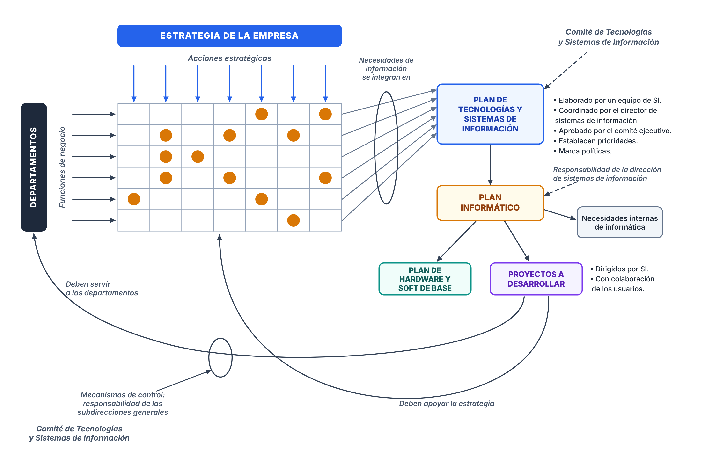

*Fuente: Andreu, Ricart y Valor, **Estrategia y sistemas de información** (2.ª ed.), Fig. 5.5 (repetida).*

**Figura: etapas de la Fase III (Elaboración Plan TI/SI)**

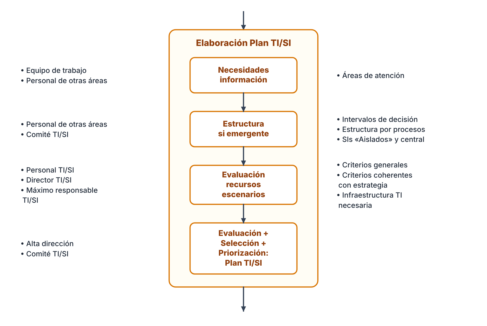

*Fuente: Andreu, Ricart y Valor, **Estrategia y sistemas de información** (2.ª ed.), fragmento de la Fig. A5.2 (Fase III).*

La estructura que acabe identificándose es casi siempre el resultado de sucesivas iteraciones en un proceso de refinamiento progresivo que el director de TI/SI y el director operativo, con el apoyo del grupo base, deben liderar.

**La estructura elaborada debe ser validada** explícitamente mediante un proceso de dos fases:

1. Reuniones departamentales.

2. Una reunión del comité de TI/SI en pleno.

Una vez acordada una arquitectura para el SI necesario, y especificados los procesos y estructuras de datos necesarios para la obtención de la información precisa, es **necesario evaluar los recursos** que harían falta para construir los distintos subsistemas integrantes del SI global.

Generalmente existen **varias soluciones técnicas** para pasar de la situación actual a la futura, con distintos costes y prestaciones. Será necesario **preparar planes alternativos** para que el comité de TI/SI elija el que crea más conveniente para la compañía.

Para ello es conveniente que los especialistas en las tecnologías adecuadas (informática y afines) preparen dichos planes alternativos y sus evaluaciones técnicas y las sometan a la consideración de los responsables de las diferentes áreas de negocio.

> Estos últimos, a la vista de los costes asociados, deben tomar al menos dos decisiones: 1) qué sistemas parecen justificar sus costes (en términos de utilidad para sus actividades de gestión, rentabilidad esperada, etc.), y 2) qué prioridad tiene cada uno de los sistemas justificados en el contexto global.

> En el contexto del proyecto de planificación de SI que estamos describiendo, la preparación de las estimaciones de coste es responsabilidad del director de SI y del director operativo del proyecto.

Con las necesidades documentadas se deben formular propuestas de actuación que incidan de manera directa en las líneas estratégicas más importantes de la compañía. El resultado es una serie de **acciones de TI/SI** a realizar durante la vigencia del Plan.

##### **Pasos propuestos**:

1. Preparación del equipo de trabajo para el análisis de necesidades. Posibles nuevas áreas.

2. Necesidades de SI por áreas, funciones y procesos de negocio. Importancia y urgencia.

3. Descripción sistemática de necesidades. Procesos y estructuras de datos.

4. Integración. Centros de atención emergentes.
   **Responsables de elaborar esta primera parte de la fase III: Equipo de trabajo y los departamentos involucrados.**

5. Validación de la estructura del SI emergente.
   **Aprueba la estructura: Comité de TI/SI**.

6. Informe acerca de la estructura del SI necesario en el futuro.
   **Elabora el informe: Equipo de trabajo.**

7. Elaboración de propuestas alternativas para el plan de TI/SI. Evaluación de los recursos necesarios.
   **Formula las propuestas: Personal técnico de Sistemas de Información.**

8. Elaboración y aprobación del definitivo Plan de TI/SI.
   **Elabora: Personal de SI. Aprueba: Comité de Sistemas de Información.**

**Resultado: conjunto de acciones de SI/TI.**

#### Fase IV: Programación de actividades.

> Esta fase es, en su mayor parte, responsabilidad de los técnicos.

Se detallan las acciones específicas en forma de proyectos a llevar a cabo durante el primer año de vigencia del Plan.

Se debe elaborar la lista de proyectos necesarios para implementar los sistemas integrantes del Plan aprobado. El DOP es el responsable más natural para elaborar la lista de proyectos necesarios para implementar los sistemas integrantes del Plan aprobado. Suya es también la responsabilidad de proponer una asignación de recursos (tiempo de personas, de equipos, etc.) a dichos proyectos y someterla a la aprobación del director de SI y del subdirector general a cargo de SI.

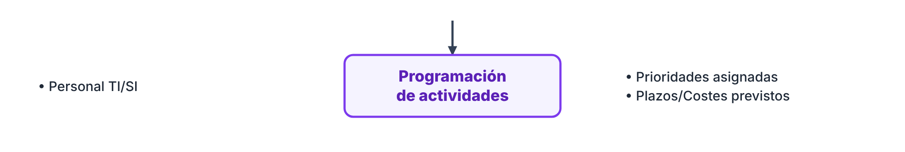

*Fuente: Andreu, Ricart y Valor, **Estrategia y sistemas de información** (2.ª ed.), fragmento de la Fig. A5.2 (Fase IV).*

##### **Pasos propuestos**:

1. Descripción detallada del Plan de TI/SI acordado. Calendario concreto para el primer año. Validación.

2. Inclusión de proyectos en el presupuesto del período siguiente.

3. Plan de evaluación y revisión.
   **Elabora: Personal de SI. Aprueba: Comité de TI/SI**.

### Estructura general del procedimiento de planificación.

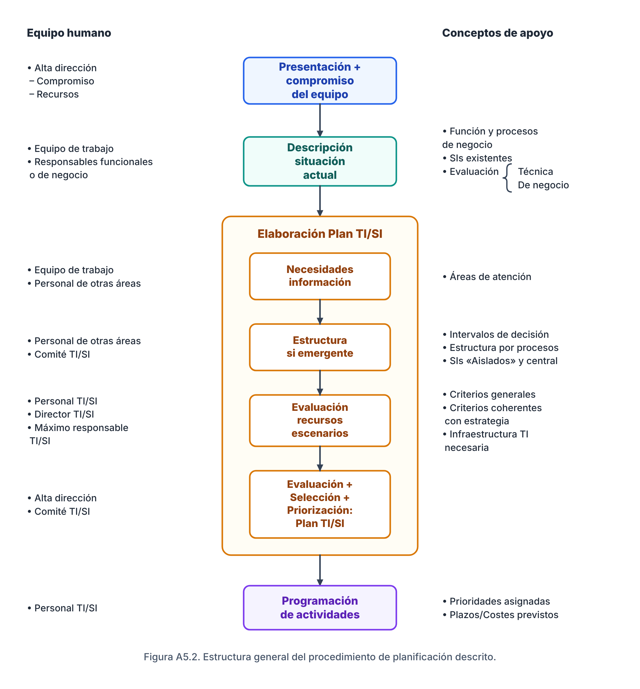

*Fuente: Andreu, Ricart y Valor, **Estrategia y sistemas de información** (2.ª ed.), Fig. A5.2: Estructura general del procedimiento de planificación descrito.*

> Aun cuando dicha estructura aparece como estrictamente secuencial en la figura, **siempre son necesarias iteraciones** en la aplicación del procedimiento.

\newpage

📝 **Cuadro resumen integrador de las 4 fases:**

| **Fase** | **Responsables principales** | **Resultados / Entregables clave** |
| --- | --- | --- |
| **I. Presentación y compromiso** | Comité de TI/SI y Grupo Base (impulsa Alta Dirección). | Grupos de trabajo constituidos (Comité, Grupo Base y Equipo con DOP), áreas de análisis delimitadas y compromiso institucional. |
| **II. Descripción de la situación actual** | Equipo de Trabajo (guiado por el DOP) y departamentos involucrados. Validan Subdirectores de área. | Catálogo validado de funciones/procesos, descripción de sistemas actuales (datos y procesos) e informe de crítica técnica y de negocio validado. |
| **III. Elaboración del Plan de TI/SI** | Equipo de Trabajo y áreas (necesidades); Personal de SI (propuestas/costes); Directivos de área (beneficios/prioridades); Comité de TI/SI (aprueba). | Matriz de necesidades, arquitectura del SI futuro validada y Plan de TI/SI definitivo a 3-5 años (conjunto de acciones de SI/TI). |
| **IV. Programación de actividades** | **Elabora:** DOP y Personal de SI (revisan Director de SI y Subdirector a cargo). **Aprueba:** Comité de TI/SI. | Calendario detallado del 1.er año, presupuesto anual de recursos (RRHH, HW y SW) y plan de evaluación y revisión. |

### Consideraciones adicionales (Andreu 5.4) y las 5 características resumen (Andreu 5.5 y Cap. 6).

- **Qué software usar para planificar (Sección 5.4):** se deben utilizar herramientas de documentación, catálogos, diccionarios de datos y matrices que crucen información con procesos de negocio, junto con procesadores de texto que mantengan la homogeneidad documental. **NO** se deben usar herramientas *CASE* (que sirven recién para programar los sistemas una vez aprobado el plan) ni herramientas clásicas de control de proyectos. Asimismo, en empresas pequeñas el procedimiento puede simplificarse fusionando roles, pero nunca pueden eliminarse el informe crítico inicial validado, el esquema global del nuevo SI ni el calendario y presupuesto del primer año.

- **Las 5 reglas de oro del método de alineamiento (Sección 5.5 y Cap. 6):**

  1. **Propiedad interna:** el proceso debe ser dirigido y ejecutado por gente propia de la empresa; los consultores externos solo asesoran en aspectos metodológicos y de proceso o actúan como catalizadores.

  2. **Compromiso activo:** requiere la participación real y explícita de los máximos directivos de todas las áreas funcionales y del Director General.

  3. **Filtro estratégico al final:** las funciones y procesos de negocio (filas de la matriz) guían el relevamiento desde el día uno, pero el filtro estratégico (columnas) se aplica con fuerza recién hacia el final de la Fase III (al evaluar escenarios) para no descartar prematuramente necesidades operativas que luego resulten vitales para dar coherencia e integrar todo el sistema.

  4. **Análisis Coste-Beneficio «divorciado» (a dos bandas):** los técnicos del departamento de SI estiman y responden por el **coste**; los directivos y usuarios de negocio evalúan, justifican y responden por materializar el **beneficio**.

  5. **Aprendizaje organizativo:** el diálogo y la comunicación entre técnicos de TI y gerentes de negocio para «derribar la pared» constituyen un objetivo explícito en sí mismo.

# Valor de la Información e inversión en SI.

> Robson usa la sigla **IS** (*information systems*); en este apartado IS y SI significan lo mismo.

La formulación de una estrategia de IS involucra la planificación de un modelo de asignación de recursos de IS. **El punto en donde la planificación se transforma en acción constituye el proceso de asignación de recursos de IS**.

Llevar a la realidad la estrategia de los IS mediante la asignación de recursos requiere gestionar (management) tres conjuntos interrelacionados de cuestiones:

- Cuestiones relacionadas con los costos de los IS.

- Cuestiones relacionadas con los beneficios de los IS.

- Cuestiones relacionadas con el balance entre los costos y los beneficios de los IS.

En este contexto, el **costo** implica **renunciar a algún recurso o atributo que se considera importante**. Tales recursos incluirán el capital, pero también el esfuerzo, el entusiasmo, el poder, el compromiso, la certeza (no se sabe cuál será el verdadero resultado de la actividad), entre otros.

Por otra parte, **beneficio** es **ganar algún recurso o atributo que se considera útil**. También en este caso, los recursos incluyen el capital y, además, el poder, el estatus, la conformidad, la certeza, etc.

Debido a la índole de los atributos ganados o abandonados potencialmente, es evidente que el **riesgo** está presente (y es clave) en todos los aspectos de las asignaciones de recursos de los IS. Al articular los conceptos de costo y beneficio, se deduce que el balance del riesgo se logra mediante el proceso de concertar los criterios de costo/beneficio.

**Balancear los costos y beneficios** implica entender las direcciones estratégicas y los perfiles de riesgo, e identificar las técnicas apropiadas para estimar el desempeño de la empresa y de los SI dentro de plazos adecuados. Es importante que toda decisión empresarial se evalúe dentro del contexto de los beneficios que brinda y de los costos que trae. Es necesario hallar una forma adecuada para que todos los integrantes de la empresa tengan un panorama de los costos, los beneficios y su balance. Este panorama se denomina arquitectura de inversión, que forma parte de una economía de información dentro de una empresa. El sentido de dirección indicado por las estrategias empresariales y de los SI se transforma en acciones a través del conjunto de mecanismos para definir costos, beneficios y la relación entre las actividades de la empresa, incluyendo la de los SI.

Las inversiones de los SI son:

1. **Según el impacto deseado** → **¿Para qué se hace la inversión? ¿Qué tipo de valor empresarial se busca obtener?**

   1. **Inversiones de valor operacional**: estos proyectos de mejora en la productividad son proyectos de inversiones en el proceso de transacción, con perspectivas de ganancia a corto plazo.
      📝 *Apunte de clase:* este tipo de inversiones también involucra aquellas que benefician la realización de los procesos de negocio. → *Hacer mejor lo que ya se hace.*

   2. **Inversiones de valor estratégico**: cuando un proyecto de mejora empresarial o de disminución de riesgo intenta aumentar el potencial para generar ingresos, el horizonte de ganancia (período anterior a la obtención de un beneficio determinado) probablemente será de largo plazo; el valor de este proyecto será directo pero muy difícil de cuantificar a pesar de que los índices de crecimiento de ingresos pueden proporcionar alguna aproximación.
      📝 *Apunte de clase:* cuando me ayuda a tomar decisiones estratégicas → *hacer cosas nuevas que generen crecimiento o diferenciación.*

2. **Según la necesidad de inversión** → **¿Qué tan obligatoria o estructural es la inversión para la empresa?**

   1. **Inversión de umbral**: son las que debe hacer una empresa para operar dentro de la industria, **son las mínimas y necesarias**. Si bien los rendimientos no son fáciles de identificar, la inversión es efectivamente obligatoria.
      📝 *Apunte de clase:* es decir, cuando la aplicación es para **mantenerme** y estar al día con mis competidores. De lo contrario, me quedo atrás.

   2. **Inversiones de infraestructura**: estas inversiones tienen típicamente horizontes de ganancia de mediano plazo y no suelen generar beneficios directos, tales como ahorros en los costos de personal, pero contribuyen con muchos otros generadores de valor, como una mejora en la comunicación de management. Estos proyectos tienen el objetivo de crear una estructura para la empresa y por lo tanto pueden considerarse y evaluarse como activos.
      📝 *Apunte de clase:* este tipo de inversiones también involucra las que generan capacidad instalada. Por ejemplo, el hardware que necesito: **inversiones que tengo que hacer para mejorar mis tecnologías**.

Cada estilo de inversión está relacionado con un tipo diferente de valor; cada tipo de valor debe ser articulado y evaluado, pero no necesariamente cuantificado. Los diferentes tipos de objetivos y beneficios requerirán distintos enfoques para justificar la inversión.

> 📝 **Apunte de clase:** estas dos visiones son complementarias, **NO** excluyentes.

📝 **Apunte de clase — ejemplos:**

| **Según el impacto deseado** | **Según la necesidad de inversión** |
| --- | --- |
| **Valor operacional:** sistema de mesa de entradas. Sistema de control de stock. Mejora de SYSACAD. Mejora del sistema de ventas. | **Umbral:** una app web para una empresa comercial de alcance regional. |
| **Valor estratégico:** sistema de análisis de mercado. Laboratorio de TIC móviles. App que evalúa dónde están los mejores perfiles para un rol determinado en un nuevo negocio. | **Infraestructura:** migración de fibra óptica. Aplicación de gestión de aulas inteligente. Sistema que integra info de varias áreas. |

Una manera alternativa de considerar las clases de valor de información proviene de los conceptos de Economía de la información, en donde se definen seis categorías de **valor en el uso de la información**, que pueden formar la base para justificar la inversión:

- **Rendimiento de la inversión**: los análisis financieros de costo/beneficio evidencian una diferencia positiva entre el flujo de desarrollo y costo operativo, y la reducción de costos de negocio y el flujo creciente de ingresos.
  📝 *Apunte de clase:* cuánto gasto frente a cuánto ingreso o ahorro obtengo.

- **Adecuación estratégica**: es el apoyo directo a una estrategia comercial declarado por un proyecto determinado.
  📝 *Apunte de clase:* aunque el beneficio no sea inmediato, **apoya un objetivo estratégico clave**.

- **Ventaja competitiva**: el valor creado por una nueva empresa o producto, o un aumento en la participación del mercado.
  📝 *Apunte de clase:* no solo acompaña la estrategia, sino que **crea diferenciación real**.

- **Apoyo de información para el management**: provee información sobre aspectos cruciales de la empresa. Esos aspectos deben llevarse a cabo correctamente para que la empresa tenga resultados favorables.
  📝 *Apunte de clase:* la información se vuelve una **herramienta de gestión clave**.

- **Reacción competitiva**: las actividades informáticas que tienen como objetivo alcanzar la posición del competidor o aventajarla.
  📝 *Apunte de clase:* el valor radica en **mantenerse competitivo o nivelarse con el mercado**.

- **Arquitectura estratégica de los SI**: una inversión básica y necesaria que posibilita la ocurrencia de otras aplicaciones estratégicas posteriores.
  📝 *Apunte de clase:* es como construir **los cimientos tecnológicos** para el futuro.

> ⚠️ **Atención (Complemento del Cuestionario de Autoestudio):** *La siguiente tabla de factores positivos y negativos por dominio (Robson, Fig. 7.33) excede el rango de figuras citado en el Temario (figs. 7.17 a 7.25), pero se incluye como complemento porque responde a la Pregunta 10 del Cuestionario de Autoestudio de la cátedra.*

| **Dominio** | **Factores positivos (aumentan el atractivo)** | **Factores negativos (riesgo o incertidumbre)** |
| --- | --- | --- |
| **Dominio empresarial** | **Adecuación estratégica**, **ventaja competitiva** (mejoras en la cadena de valor), **apoyo a la información de management** y **reacción competitiva** (cuánto perdería la empresa si no hiciera el proyecto). | **Riesgo del proyecto u organizacional:** cuán preparada está la empresa para absorber el cambio (a mayor brecha entre lo requerido y lo disponible, mayor riesgo). |
| **Dominio tecnológico** | **Arquitectura estratégica de los IS:** valor de mantener la capacidad tecnológica (métodos, estándares, HW y SW) lista para habilitar futuros proyectos. | **Incertidumbre de decisión** (cuánto se conocen los requerimientos), **incertidumbre técnica** (cuánta innovación exige) y **riesgo de infraestructura** (cambios de fondo requeridos). |

La siguiente ecuación define los límites del valor de la información:

$$\text{Valor esperado de elementos de información dados} = \text{Ganancia posible con la información} - \text{Ganancia posible sin la información}$$

Si bien generalmente es imposible definir el valor exacto de todo elemento de información dado, es posible establecer el límite superior, el valor de la información perfecta, que elimina todo riesgo asociado con acciones futuras.

- **El origen real del valor y el error frecuente al aplicar la ecuación:** Robson subraya que el valor se asocia con la forma en que se *usa* la información y no con los sistemas (hardware o software) en sí mismos. Al aplicar la fórmula anterior, **el error clásico que cometen las empresas es olvidar calcular la «ganancia posible sin la información»**, asumiendo erróneamente que si no se implementa el nuevo sistema la empresa se quedaría completamente estática.

## Costos de los IS.

Un costo, en el contexto de los SI, implica renunciar a algún tipo de recurso o atributo que se considera importante. Los costos de los SI están compuestos de dos elementos: **tangibles e intangibles**.

### Costos visibles vs. costos ocultos y la regla de Keen (1991).

Al igual que los beneficios, en la jerga de los negocios los costos suelen dividirse en **costos «visibles»** y **costos «ocultos»**:

- El error más grave en el que caen las organizaciones es olvidar que casi todo proyecto de IS inicia un compromiso permanente de recursos: genera **«costos de continuidad» automáticos y no discrecionales** (operación y mantenimiento futuros obligatorios), que constituyen el principal ejemplo de **costos ocultos**.

- Según **Keen (1991)** (en Robson), un proyecto de desarrollo de software de **$1\text{ millón de dólares}$** compromete a la empresa a invertir **$4\text{ millones adicionales}$** durante los siguientes cinco años (agregando anualmente $\$0,20$ para operación y $\$0,40$ para mantenimiento por cada dólar de desarrollo inicial).

Es necesario predecir los costos y reducirlos cuando sea apropiado, si bien no a expensas del nivel de beneficios netos.

El problema en la estimación/pronóstico de los costos nace en primer lugar porque para ello se necesita conocer de antemano y en forma detallada el posible proyecto, algo que habitualmente no se hace o no puede hacerse. En segundo lugar, la estimación acertada de los costos suele requerir cierta base histórica para que pueda generarse. Esos datos históricos no están disponibles cuando los proyectos son los primeros en su tipo.

Esta **lista de control para los costos de los IS** ayuda a las empresas a identificar, cuantificar y evaluar los costos de los IS. La lista contempla:

- **Costos de hardware**: están compuestos por el hardware de procesamiento, por maquinarias tales como impresoras, soportes de almacenamiento, accesorios, etc.
  *Ejemplos (Robson): servidores centrales, PCs distribuidas, impresoras, discos de almacenamiento y accesorios (cuya dispersión física dificulta auditarlos).*

- **Costos de software**: la solución más barata está representada por los paquetes ya hechos, aunque involucran costos significativos de evaluación y especificación. Los desarrollos internos pueden implicar sumas enormes y desconocidas.
  *Ejemplos (Robson): compra de paquetes enlatados (más el costo de evaluarlos), programación interna a medida y curva de aprendizaje inicial de generadores de aplicaciones.*

- **Costos de instalación**: las instalaciones de sistemas varían en complejidad y, por lo tanto, en costos. Algunas pueden requerir de especialistas externos cuyo costo también debe incluirse, así como el costo de ingreso de datos o ***data entry*** cuando se convierten sistemas manuales, o el costo de conversión de datos en los sistemas ya computarizados.
  *Ejemplos (Robson): honorarios de consultores/instaladores externos, tipeo inicial de archivos manuales en papel (data entry) y migración/conversión de bases de datos viejas.*

- **Costos de entorno**: se refiere al entorno físico de los sistemas de información: cableado, muebles, aire acondicionado, etc. Asimismo, deben incluirse los costos de entorno humano, tales como seguridad, salud y costos legales.
  *Ejemplos (Robson): cableado, mobiliario, refrigeración/aire acondicionado y pisos falsos (entorno físico); ergonomía, higiene laboral y cumplimiento de normativas legales (entorno humano).*

- **Costos de funcionamiento**: los costos de energía eléctrica, de comunicación de datos para el trabajo remoto y de tarifas de suscripción para servicios externos de datos, tales como bases de datos online, etc.
  *Ejemplos (Robson): facturas de electricidad, líneas telefónicas/enlaces para trabajo remoto, insumos de impresión y abonos a bases de datos online o bulletin boards.*

- **Costos de mantenimiento**: debe establecerse si estos costos serán realizados de manera planeada y previsible a través de contratos de servicio y mantenimiento, o bien de forma menos predecible mediante el personal interno.
  *Ejemplos (Robson): abonos anuales de soporte técnico con proveedores externos (previsibles) o horas del personal técnico interno reparando fallas de hardware y «averías» o actualizaciones de software.*

- **Costos de seguridad**: deben comprender la toma de medidas para reducir el peligro de daños accidentales o deliberados a elementos lógicos o físicos de los IS; también abarca el costo de los riesgos inevitables y de los planes de recuperación de desastres.
  *Ejemplos (Robson): backups externos (off-site), controles de acceso y contraseñas, antivirus, sistemas contra incendios no contaminantes, seguros de equipos/datos y planes de contingencia.*

- **Costos de red**: software, hardware y management de redes involucran costos adicionales a los de las aplicaciones que utilizan la red.
  *Ejemplos (Robson): equipos y software de conectividad para enlazar PCs en red, además de los costos de administración de datos (modelado de datos corporativos, planificación de repositorios y gestión de almacenamiento).*

- **Costos de capacitación**: son los más desestimados, y prácticamente está aceptado que el verdadero alcance de los costos de capacitación, de educación de fondo, de capacitación específica y de apoyo y actualización continua está indocumentado.
  *Ejemplos (Robson): cursos de formación general para el personal, entrenamiento específico en el nuevo software para usuarios finales y capacitación continua de los técnicos en nuevas metodologías.*

- **Costos amplios organizacionales**: en este ítem globalizador se ubican los costos de incompatibilidad, las estructuras nuevas de salarios, los costos transicionales y los costos de management.
  *Ejemplos (Robson): costos de gestión del cambio organizacional, recategorización salarial para retener especialistas, pérdida temporal de ritmo o doble trabajo mientras se pasa de la operatoria vieja a la nueva (costos transicionales) y tiempo gerencial dedicado a negociar y reorganizar tareas.*

### Niveles de inversión en IS.

El management de los costos de los IS consiste primero en identificar todos los costos, tanto los ocultos como los aparentes; segundo, en entender la contribución que hace cada elemento al conjunto; y tercero, en establecer niveles apropiados para esos costos. En otras palabras, una vez que se estima el gasto, se decide en qué se lo va a aplicar. La empresa busca adecuar el nivel de costos al imperativo de la estrategia: gastar lo que debe gastar.

Consideraremos dos tipos de management, ***el management (o gestión) de computación y el management de información***. El primero ve los costos de los IS como un **gasto operativo**, y así su atención se centra en reducir costos a fin de mejorar la eficiencia; el segundo ve la información como un recurso corporativo, por ende, como una **inversión de capital** en la cual la atención del management se centra en una maximización de los beneficios.

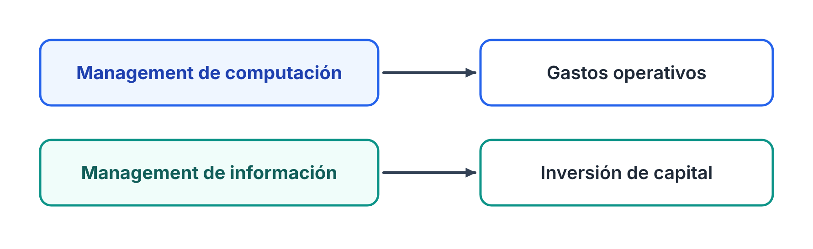

*Fuente: Robson, **Planteo de estrategias efectivas de sistemas de información** (tomo 3), cap. 7, Fig. 7.4: Costos de IS.*

> 📝 **Apunte de clase:** los gerentes suelen ir más por el lado del management de computación. En el management de información, el capital son los sistemas, que se pueden convertir en una ventaja competitiva.

> 📝 **Apunte de clase:** **no se trata solo de analizar los costos y beneficios de un sistema, sino también de evaluar el valor de la información en sí misma**. Si solo me enfoco en el **costo/beneficio del sistema**, puedo perder de vista que la información generada y gestionada por ese sistema también tiene un valor estratégico.

> 📝 **Apunte de clase:** uno maneja al SI como un gasto para la organización que se debe minimizar para así aumentar la eficiencia; y el otro lo maneja como una inversión a largo plazo que mejorará/maximizará los beneficios de la organización.

### Auditoría de los costos de los IS.

Involucra identificar todos los costos y evaluar las inversiones del pasado. No basta con conocer qué elementos de los IS incurren en costos para apreciar la necesidad de estimar los costos visibles y ocultos de cualquier proyecto potencial, ni para advertir cómo varían los niveles de inversión. También es preciso saber qué cantidad de las inversiones hechas en el pasado aún son válidas en el presente.

Este proceso puede ser facilitado creando un balance de activos de los IS, a pesar de que los elementos más valiosos de los IS (los datos y el software) no pueden contabilizarse como activos por cuestiones impositivas; sin embargo, **añaden valor a la organización**. Por lo tanto, el listado de activos registra el valor que tiene para la empresa la situación que resulta de los costos incurridos en los IS.

Esta idea de listado de activos está relacionada con el concepto de un registro de beneficios. La diferencia fundamental entre estos dos conceptos radica en que el listado de activos de IS es un registro del valor ***real*** de los IS, mientras que la declaración de los beneficios de los IS es un registro del valor ***pretendido***.

> 📝 **Apunte de clase:** al momento de auditar mi SI, yo registro el valor real que posee y luego el beneficio que quiero que me genere como un valor que pretendo llegar a tener.

> En conjunto, ambos permiten contrastar el valor real alcanzado con el valor proyectado, facilitando así una toma de decisiones más informada y estratégica.

## Beneficios de los IS.

El beneficio, en contexto de SI, significa ganar algún recurso o atributo que se considera útil. Los beneficios de los SI están compuestos de dos elementos: tangibles e intangibles. Los beneficios son las **diversas formas en las que una empresa puede mejorar su situación como consecuencia de la manera en que se maneja/utiliza la información**. Los beneficios surgen como resultado de lo que puede hacer una empresa.

El valor surge potencialmente de un número de aspectos de la información; la siguiente lista es extensiva, e identifica los puntos donde se acumula el valor como: precisión, satisfacción del usuario, importancia, rentabilidad, calidad, funcionalidad, productividad, velocidad, capacidad de uso, confiabilidad, seguridad, volumen, flexibilidad, utilización.

Dichas listas de atributos de la información ***definen*** los aspectos que potencialmente dan valor a la información. La diferencia entre eficiencia, es decir, hacer algo bien, y efectividad, hacer lo que está bien, se ve aquí desde una perspectiva económica.

Si en la siguiente figura A y B son sistemas reales, existe una cantidad ***medible*** de ineficiencia en el sistema A, que es la cantidad de costos adicionales efectuados para la misma capacidad o, por el contrario, una mejora medible en la eficiencia del sistema B. Ambos producen la misma calidad, pero el sistema A incurre en más gastos para hacerlo. Esto no significa que exista un punto ***óptimo*** (excepto quizá a costo cero) de eficiencia, sino simplemente la frontera alcanzada que, como toda frontera, se verá constantemente desplazada por los nuevos desarrollos.

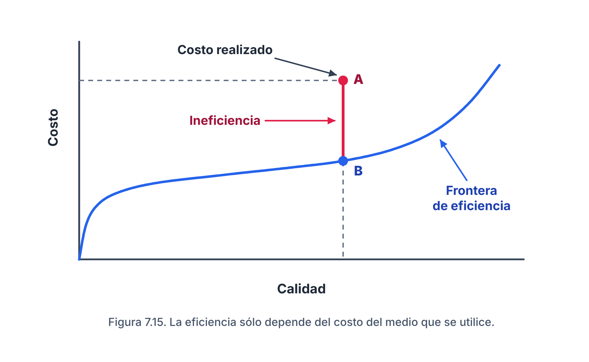

*Fuente: Robson, **Planteo de estrategias efectivas de sistemas de información** (tomo 3), cap. 7, Fig. 7.15: La eficiencia solo depende del costo del medio que se utilice.*

En el siguiente gráfico se ilustra el beneficio de los IS como resultado de un balance entre los costos y el valor obtenido.

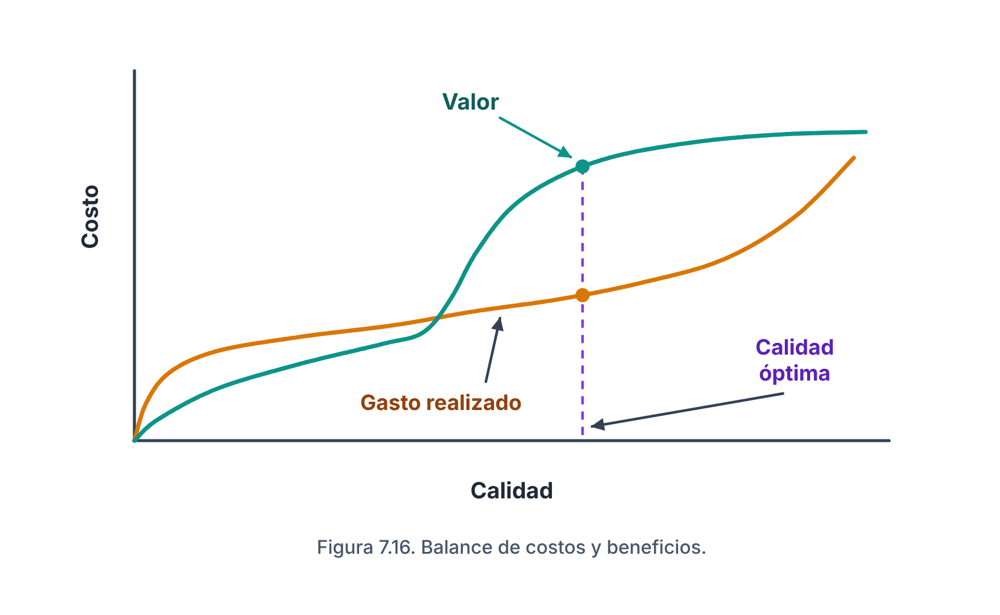

*Fuente: Robson, **Planteo de estrategias efectivas de sistemas de información** (tomo 3), cap. 7, Fig. 7.16: Balance de costos y beneficios.*

📝 *Apunte de clase:*

- La **curva de costo** sube a medida que se busca mejor calidad.

- La **curva de valor** también sube, pero **llega un punto en que se aplana**.

- El **punto óptimo** está donde la **diferencia entre valor y costo es máxima.**

Se demuestra que ***generalmente*** existe un incremento en los costos cuando se mejora la calidad; esto origina la curva de costo para un sistema o proyecto determinado. Sin embargo, la curva de valor, que representa el beneficio para la empresa, sigue una línea diferente.

En este diagrama existe un estado óptimo, que se encuentra en el punto de mayor diferencia positiva entre el valor obtenido y el costo, es decir, donde se obtiene el mejor balance.

La eficiencia en la información consiste en bajar los costos tanto como sea posible recurriendo a las herramientas de productividad y de control de proyectos. La efectividad en la información solo puede estimarse estableciendo la curva de valor; para hacerlo, se requiere entender los atributos de generación del valor asociados con la información.

### Los 3 tipos de aplicaciones según sus beneficios (Parker et al.) y la regla del 30 %.

- **La regla del $30\%$ de beneficios intangibles:** según investigaciones de Clarke McKee citadas por Robson, en más del $80\%$ de las empresas los beneficios **intangibles** representan al menos el **$30\%$ del valor total** resultante de sus inversiones en IS (tales como mejora del servicio al cliente, mayor ventaja competitiva o evitar una desventaja, información de gestión más oportuna, apoyo a funciones básicas y mejores comunicaciones).

- **Clasificación de las aplicaciones según el impacto de sus beneficios (Parker et al.):**

  1. **Sustitutiva:** reemplaza personas por máquinas; la fuerza principal es la economía directa y la mejora en la eficiencia (se relaciona con las aplicaciones *clave para las operaciones* y *de apoyo*).

  2. **Complementaria:** aumenta la productividad y la eficacia del personal al permitir que el trabajo se ejecute de otra forma (se relaciona con las aplicaciones *clave para las operaciones* y *estratégicas*).

  3. **Innovadora:** busca obtener o mantener una ventaja competitiva cambiando las prácticas comerciales actuales o creando mercados nuevos (se relaciona con las aplicaciones *estratégicas* y *de alto potencial*).

> ⚠️ **Atención (Complemento del Cuestionario de Autoestudio):** *Las siguientes técnicas adicionales de evaluación de Parker (Edwards cap. 6, págs. 114-115 / Robson cap. 7) superan la página 113 indicada en el Temario, pero se mencionan como complemento porque están en la Pregunta 8 del Cuestionario de Autoestudio y se aplicaron en el TP1.*

Para justificar los beneficios cuando no basta el análisis costo-beneficio tradicional (desplazamiento o evitación de costos), Parker propone técnicas como la **vinculación del valor** (coordinar mejor tareas de áreas distintas), la **aceleración del valor** (lograr antes los beneficios o cobros en el tiempo), la **reestructuración del valor** (racionalizar tareas hacia actividades de mayor productividad) y la **valoración de la innovación**.

### Tipos de beneficios genéricos.

Debemos justificar los beneficios e indicar a qué nivel organizacional apunta dicho beneficio; para esto un diagrama como el siguiente puede ser útil:

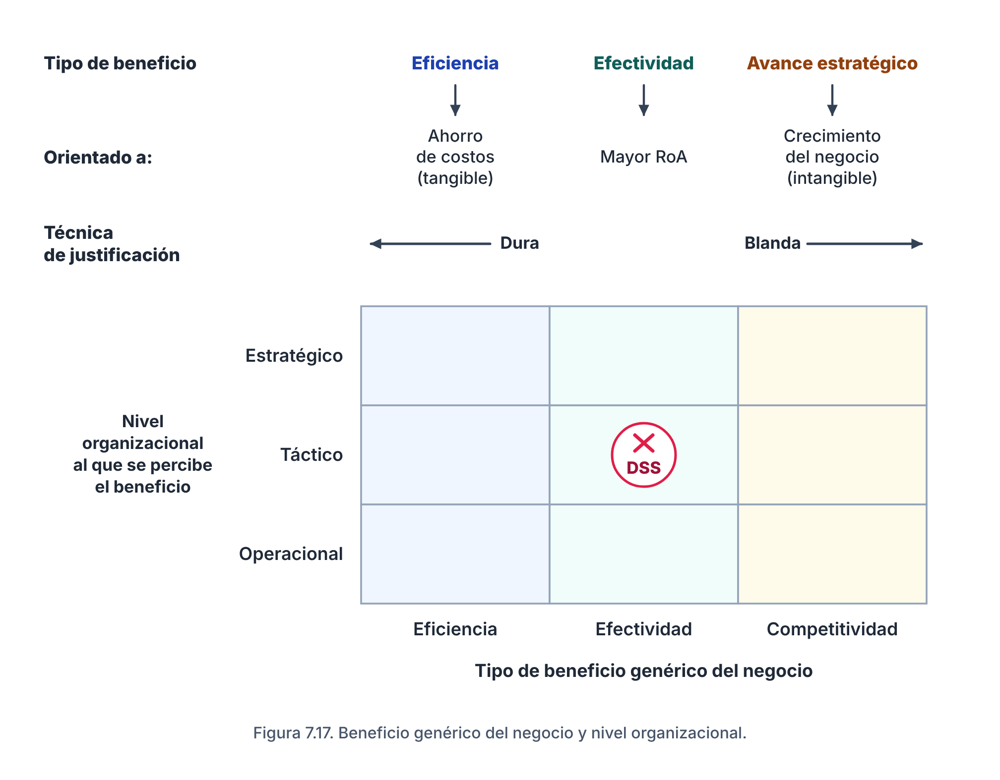

*Fuente: Robson, **Planteo de estrategias efectivas de sistemas de información** (tomo 3), cap. 7, Fig. 7.17: Beneficio genérico del negocio y nivel organizacional.*

> 📝 **Apunte de clase:** cuando el beneficio está a nivel operativo, estoy en la eficiencia.
> Cuando el beneficio está a nivel táctico, estoy en la efectividad (logro de resultados).
> Cuando el beneficio está a nivel estratégico, estoy en la competitividad.

Según el modelo de **Silk (1991)** y las **tres eras de la información** (Silk; Tapscott y Caston; Remenyi et al., en Robson Fig. 7.23), cada tipo de beneficio genérico se asocia con un nivel organizacional y una forma de justificación:

| **Beneficio genérico** | **Nivel en que se percibe** | **Orientado a** | **Justificación** | **Era de la información** |
| --- | --- | --- | --- | --- |
| **Eficiencia** | Operacional | Ahorro de costos (tangible) | **"Dura":** se centra en desplazar o evitar costos | **E1: Automatizar** |
| **Efectividad** | Táctico (ej. un DSS) | Mayor rendimiento de los activos (**RoA**) | **Tiende a "blanda":** incluye algo de capital y mide intangibles con encuestas | **E2: Informar** |
| **Avance estratégico (Competitividad)** | Estratégico | Crecimiento del negocio (intangible) | Técnicas complejas de largo plazo; como los efectos reales solo se ven después, Silk habla de justificación por **"acto de fe"** | **E3: Transformar** (su beneficio genérico es la explotación) |

- **$E_1$ — Automatizar (Eficiencia):** reemplaza trabajo manual rutinario en el nivel operacional. Su beneficio es **«duro» (tangible)** y se evalúa con métricas contables tradicionales (VAN, flujo de fondos) midiendo el desplazamiento o la evitación de costos (escala base $B_1$).

- **$E_2$ — Informar (Efectividad):** provee información a los mandos tácticos (ej. sistemas DSS) para decidir mejor y elevar el **RoA**. Su beneficio es **«blando»** (combina algo de $E_1$ con beneficios intangibles medidos mediante encuestas o investigaciones) y su impacto potencial es mayor ($B_2 = B_1 \times 10$).

- **$E_3$ — Transformar (Explotación / Avance estratégico):** utiliza los SI/TI a nivel estratégico para transformar el negocio y ganar competitividad. Es una inversión de largo plazo sin probabilidades conocidas a priori pero de altísimo impacto potencial ($B_3 = B_1 \times 100$), por lo que se justifica mediante **«acto de fe»** (*«si apoya nuestra dirección estratégica, debemos hacerlo»*).

> ⚠️ **Atención (Complemento integrador):** *El siguiente cuadro resume el cruce entre los 3 niveles de Chiavenato, los beneficios de Silk/Robson y los estilos de Management de Robson para facilitar preguntas de relación de columnas en los exámenes.*

| **Nivel Jerárquico (Chiavenato)** | **Entorno y Foco** | **Tipo de Beneficio (Silk/Robson)** | **Orientación / Medición** | **Enfoque del Management (Robson 6.1.2)** |
| --- | --- | --- | --- | --- |
| **3. Institucional (Alta Dirección)** | Sistema Abierto / Incertidumbre | Competitividad (Avance Estratégico) | Crecimiento / Intangible (*Acto de fe*) | **Management de información** (ve al SI como **inversión de capital**) |
| **2. Intermedio (Táctico / Mandos Medios)** | Amortiguador / Articulador | Efectividad | Mayor RoA / Técnicas blandas (Ej.: Sistemas DSS) | *Transición crítica entre ambos* (del control del gasto a la concreción de beneficios por el uso de la información) |
| **1. Operacional (Núcleo Técnico)** | Sistema Cerrado / Certeza y Rutinas | Eficiencia | Ahorro de Costos / Tangible (Técnicas duras) | **Management de computación** (ve al SI como **gasto operativo**) |

Así como involucraban costos tangibles e intangibles, las inversiones en los IS también involucran **beneficios tangibles e intangibles**. Uno de los grandes problemas al juzgar el valor de la información consiste en reconocer la diferencia entre beneficios tangibles e intangibles, y en tener algún método para estimar el valor de los beneficios intangibles.

Si los beneficios ***directos*** pero intangibles de las inversiones en los IS son bastante difíciles de cuantificar, estimar los beneficios intangibles ***indirectos*** que resultan de las inversiones en los sistemas de la estructura básica empresarial resulta aún más difícil; evaluar los beneficios intangibles devengados de las inversiones en los servicios de la estructura de los IS es imposible.

Es imposible mantener un grado de exactitud con relación a los beneficios, pero muchos pronósticos de ***costos*** padecen el mismo inconveniente, y aun así en muchas empresas el management pone más atención en estimar y controlar los costos que en estimar y controlar los ***beneficios***.

📝 **Apunte de clase — ejemplo**: sistema de gestión académica en una universidad.

**Tangible**

- Directo: los alumnos se inscriben más rápido → menor carga administrativa.

- Indirecto: no es necesario ampliar personal de ventanilla.

**Intangible**

- Directo: los alumnos perciben una experiencia moderna y organizada.

- Indirecto: mejora la imagen de la universidad ante nuevos aspirantes.

> 📝 **Apunte de clase:** para justificar una inversión en SI, no alcanza con evaluar **los ahorros** (eficiencia), sino que hay que considerar también el **valor que agrega** a distintos niveles: táctico y estratégico. Esto implica **identificar claramente los beneficios tangibles e intangibles**, directos e indirectos, y reconocer que **muchos beneficios clave no se pueden medir fácilmente, pero son fundamentales para la competitividad**.

# Análisis de la cartera de aplicaciones.

> 📝 **Apunte de clase:** esta parte está relacionada con las fases III y IV.

Hay muchas maneras de clasificar los sistemas de información. Hasta ahora, la mayoría de las clasificaciones se basaban en la forma en que se suministran los sistemas, en lugar de en la contribución que hacen al éxito de la empresa. Hay un esquema de clasificación desarrollado originalmente por **McFarlan** que es de gran utilidad: compara el papel de los SI/TI entre diferentes organizaciones y facilita el análisis del conjunto de sistemas, tanto los actuales como los planificados y los potenciales. Toma la forma de una matriz y clasifica una aplicación como:

- **De alto potencial**.

- **Estratégica**.

- **Clave para las operaciones**.

- **De apoyo**.

> 📝 **Apunte de clase:** las apps de apoyo son aquellas que no tienen gran incidencia en las necesidades estratégicas de la organización y el impacto/esfuerzo tecnológico que hay que hacer no es muy importante. **Son valiosas**, pero **NO SON CRÍTICAS**. Ej.: todo el tema de las transacciones que hay que avisar a ARCA.

Esta clasificación se hace según sus contribuciones presentes y futuras, y tal y como las percibe la dirección de la empresa. La alta dirección, los mandos intermedios, los usuarios y los profesionales de SI pueden utilizar la matriz para conseguir una visión consensuada del contenido e implicaciones de la cartera.

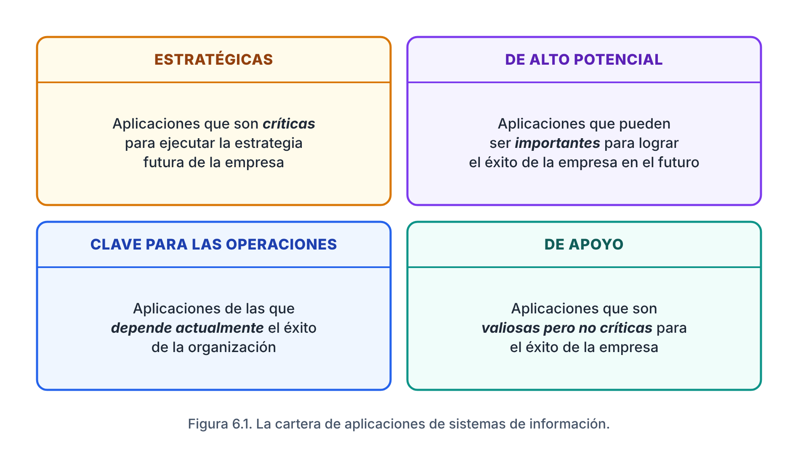

*Fuente: Edwards, Ward y Bytheway, **Fundamentos de sistemas de información** (2.ª ed.), Fig. 6.1: La cartera de aplicaciones de sistemas de información.*

> 📝 **Apunte de clase:** todas son aplicaciones estratégicas (si lo queremos ver) porque todas salen del alineamiento. La app estratégica posee una crítica competitiva.
> ¿Por qué es estratégica la app estratégica? Va a apoyar altamente a la ejecución y estructura de la estrategia, la acompaña.
> Pienso en los procesos de negocio que tengo (estrategias).

> 📝 **Apunte de clase:** la cartera de aplicaciones es una HERRAMIENTA para clasificar las aplicaciones, en función de los beneficios y los recursos utilizados en ellas. Se agregaría el uso de la herramienta al plan de SI/TI.

Algunos sistemas pueden existir ya, otros pueden estar en desarrollo, y otros pueden ser solamente una idea, pero todos ellos deben estar situados en la matriz según la contribución actual y futura, real o potencial, que ofrecen. La posición de una aplicación puede variar de una empresa a otra, según la madurez de la empresa y sus objetivos estratégicos. La fuerza del modelo de cartera no radica en que proporcione una receta para clasificar los sistemas, sino en que es un **vehículo para llevar a cabo una discusión constructiva e informada y alcanzar acuerdos**.

El modelo de cartera nos permite ver el equilibrio de las inversiones en términos de recursos y fondos. Podemos ver dónde se están aplicando recursos y esfuerzos, y dónde está planificado hacerlo. Si esto no se ajusta a los objetivos de la empresa, entonces los recursos se pueden modificar o reasignar.

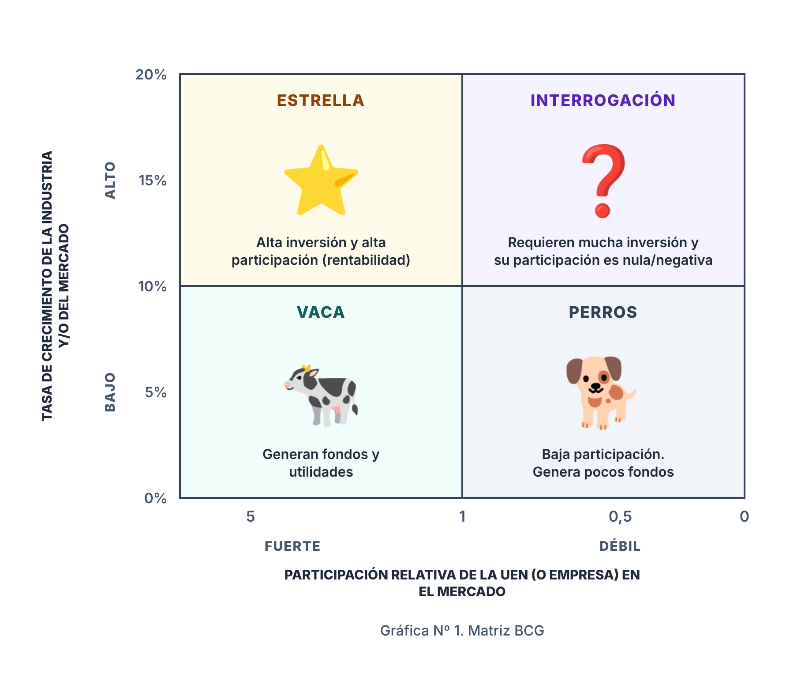

*📝 Apunte de clase: Gráfica N.º 1, Matriz BCG.*

**Ejemplos de cartera de aplicaciones**

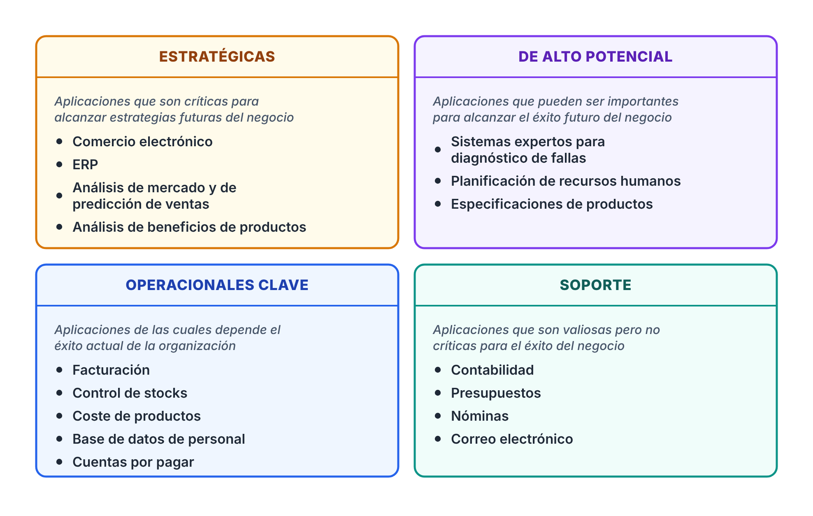

*📝 Apunte de clase: ejemplos de cartera. Se basa en Edwards, Ward y Bytheway, **Fundamentos de sistemas de información** (2.ª ed.), Fig. 6.2, pero no coincide del todo (el libro ubica *Base de datos de personal* en apoyo).*

## Aplicaciones de alto potencial.

La filosofía básica de las aplicaciones de alto potencial es la investigación y desarrollo, es decir, una experimentación controlada para identificar los beneficios, las oportunidades y los potenciales costes asociados a ellas. Solo cuando se comprende esto es posible decidir si merecen la pena más inversiones y de qué manera.

> 📝 **Apunte de clase:** es decir, nacen como soluciones puntuales o innovaciones, pero cuyo impacto real, en términos de beneficios estratégicos, tácticos u operativos, **no puede anticiparse completamente al inicio**. Estas aplicaciones suelen surgir dentro de procesos de **investigación y desarrollo (I+D)**, y requieren cierta **experimentación controlada** para determinar si valen la pena y cómo deben ser aprovechadas.

> 📝 **Apunte de clase:** el problema es que **es difícil prever su impacto total al inicio**, porque nace con un propósito específico, pero podría tener más aplicaciones en el futuro.

Las aplicaciones de alto potencial suelen surgir por:

| 💥 **Fuerza motriz** | ✅ **Requisito necesario** |
| --- | --- |
| 💡 Una nueva idea o tecnología dentro de la empresa | Evaluación rápida de prototipos y capacidad de **detectar fracasos temprano**, para no desperdiciar recursos |
| 👤 Una iniciativa individual propuesta por alguien con liderazgo | **Entender su potencial** frente a la estrategia de la empresa y **analizar sus implicancias económicas** |
| 🎯 Un objetivo puntual que podría derivar en algo más grande | Saber **cómo seguir, quién debe hacerlo y para qué**, si demuestra capacidad de generar valor |

> 📝 **Apunte de clase:** un ejemplo concreto de una aplicación de alto potencial es un chat interno con IA desarrollado por un empleado del área de soporte técnico para agilizar la búsqueda de respuestas en bases de conocimiento. Aunque surgió como una solución puntual, con el tiempo comenzó a ser utilizado también por Recursos Humanos, Ventas y Legales para responder consultas frecuentes, acceder a información crítica y estandarizar respuestas. Su impacto real no era previsible al inicio, pero al experimentar con su uso, la empresa descubrió que podía convertirse en una herramienta transversal, generando beneficios en eficiencia, efectividad y competitividad. Solo después de implementarla fue posible dimensionar su valor estratégico.

## Aplicaciones estratégicas.

El enfoque predominante para las aplicaciones estratégicas es la orientación al negocio. El planteamiento ideal de las TI debe estar limitado por los imperativos del negocio; el principal riesgo es la pérdida de una oportunidad de negocio. Para que se pueda considerar como estratégica, cualquier aplicación debe estar claramente relacionada con los **factores críticos de éxito derivados de los objetivos de la empresa**.

> 📝 **Apunte de clase:** una aplicación será de índole estratégica cuando me coloque en una **posición ventajosa con respecto a la competencia**.

| **Fuerzas motrices** | **Requisitos** |
| --- | --- |
| Necesidades del mercado y/o presiones competitivas provocadas esencialmente desde el exterior. | Desarrollo rápido para alcanzar los objetivos de la empresa y hacer realidad los beneficios comerciales que ofrezca el marco de oportunidades. |
| Objetivos empresariales, factores de éxito y visión de la dirección sobre cómo lograrlos. | Una solución flexible que se pueda adaptar aún más para responder a los cambios en el entorno empresarial. |
| Obtener una ventaja y luego mantenerla mediante desarrollos posteriores, si es posible. | Enlazar con una iniciativa de negocio asociada, o cambiar para mantener el compromiso de la empresa con el desarrollo de SI/TI. |

## Aplicaciones clave para las operaciones.

Este es el dominio tradicional de los SI/TI, para el que se han desarrollado herramientas y metodologías en los últimos treinta años. Los mejores planteamientos de SI/TI, derivados de años de experiencia, no han de comprometerse para la conveniencia de la empresa. Estas aplicaciones surgen para mejorar el **rendimiento de las actividades existentes**, integrar los sistemas y los datos, etc. Cada vez más se pueden adquirir como paquetes de software, aunque no son baratos y suelen requerir mucho esfuerzo de implantación. Edwards las compara con las **"vacas lecheras"**: son críticas para la generación de facturación y beneficios. Su integración con los sistemas existentes es crítica para conseguir congruencia y exactitud, ya que necesitan los datos que ya están disponibles en esos sistemas.

> 📝 **Apunte de clase:** una aplicación será clave para la operación cuando la **agilice**, por ejemplo, el sistema de cajas y control de stock de un supermercado. Implica todo lo que haga un uso **eficiente** de los recursos.

| **Fuerzas motrices** | **Requisitos** |
| --- | --- |
| Mejorar el rendimiento de las actividades existentes en términos de velocidad, exactitud, eficacia y economía. | Soluciones de alta calidad y gestión eficiente de los datos para garantizar estabilidad y reducir costos de modificaciones. |
| Integrar los sistemas y datos para evitar errores y duplicaciones, y minimizar riesgos de ejecución inconsistente o ineficaz. | Equilibrar los costos con los beneficios y riesgos del negocio para encontrar la mejor solución al problema. |
| Evitar una desventaja para la empresa o impedir que un riesgo llegue a ser crítico. | Evaluar las opciones disponibles y seleccionar la más eficaz mediante un análisis objetivo de alternativas viables. |

> 📝 **Apunte de clase:** pensamos en los procesos de negocio de los que depende el funcionamiento de la organización.

## Aplicaciones de apoyo.

Son aplicaciones **valiosas pero no críticas** para el éxito de la empresa. Las que son importantes solamente para un departamento (por ejemplo, un sistema presupuestario muy especializado) o que son universales por naturaleza (como el procesador de texto) no son estratégicamente significativas, aunque son valiosas para mantener bajos los costes o tener las cosas bajo control. Edwards las compara con los **"perros"** de una cartera de productos: queremos o tenemos que tenerlas alrededor, pero no son críticas para el éxito actual o futuro.

Para las aplicaciones de apoyo, el mejor enfoque y razón principal para decidir si seguir adelante o no será el **análisis económico de la inversión**.

También es el área en que hay disponible una **gran cantidad de software estándar**, porque las aplicaciones de apoyo suelen ser *genéricas* o comunes para todas las industrias.

Por ejemplo, un sistema de contabilidad general puede estar desfasado y ser ineficaz, pero como no se considera crítico, su nuevo desarrollo sería una decisión económica; probablemente lo más barato sea un paquete llave en mano.

> 📝 **Apunte de clase:** no tienen gran incidencia en las estrategias; me hacen estar presente en el mercado. Por ahí conviene comprar algo que esté hecho. Ejemplo: la aplicación fiscal de ARCA, impuesta por una norma jurídica que hay que cumplir (los requisitos legales figuran entre las fuerzas motrices de estas aplicaciones, ver tabla).

| **Fuerzas motrices** | **Requisitos** |
| --- | --- |
| Mejora en la productividad y la eficiencia de tareas específicas ya existentes. | Coste ínfimo, soluciones a largo plazo que muchas veces conducen a paquetes de software que sacrifican las necesidades del usuario frente a las soluciones disponibles. |
| Requisitos legales que hay que cumplir para evitar delitos. | Evitar la obsolescencia adaptándose a la evolución constante de la industria de SI/TI. |
| El uso más eficiente en términos de coste de los fondos y recursos de SI/TI, para hallar la solución más eficaz. | Análisis coste/beneficio objetivo para reducir el riesgo financiero y asegurar que los costes de desarrollo se controlen fácilmente. |

📝 **Apunte de clase — resumen:**

| Tipo de aplicación | Objetivo principal | Características clave | Ejemplo |
| --- | --- | --- | --- |
| 🔷 **Alto potencial** | **Explorar innovaciones** que podrían tener gran impacto | Surgen en I+D o como ideas puntuales. Requieren experimentar y evaluar. | Chat interno con IA creado por un empleado |
| 🔴 **Estratégica** | **Generar o sostener ventaja competitiva** | Vinculadas a factores críticos de éxito. Responden a presiones del mercado. | App de fidelización con IA en retail |
| 🟠 **Clave para la operación** | **Hacer funcionar eficientemente** las operaciones diarias | Mejoran velocidad, precisión, integración. Vitales para operar. | Sistema de stock y facturación |
| 🔵 **De apoyo** | **Cumplir tareas auxiliares o legales** | No son parte del negocio central. Suelen ser software estándar. | Software fiscal ARCA |

# Las estrategias genéricas de gestión de SI/TI. (Edwards)

Las cuestiones a abordar en cada segmento de la matriz son diferentes, de igual forma que lo son los riesgos de error y los beneficios potenciales. Se describen seis estrategias por las que una organización puede vincular la gestión de los SI/TI con la dirección general de la empresa.

Estas estrategias son marcos generales que guían la identificación de las oportunidades de la TI, los recursos para desarrollar TI, el ritmo al que se adoptan las nuevas tecnologías, el nivel de impacto de la TI dentro de la empresa, las tendencias estructurales que siguen las empresas para aplicar la TI a sus negocios y, por lo tanto, se les puede denominar "estrategias genéricas".

> 📝 **Apunte de clase:** **no son estrategias para las aplicaciones individuales**, sino **formas en que la organización —como conjunto— decide gestionar sus sistemas de información y tecnologías (SI/TI)**, **dependiendo del tipo de aplicaciones que quiere priorizar** y **de cómo entiende su valor**.
>
> **Son formas de encarar cómo la empresa gestiona todo el conjunto de aplicaciones y decisiones de SI/TI**, **no cómo se desarrolla una aplicación puntual**.

## Planificación centralizada (aplicaciones estratégicas).

- La estrategia de los SI/TI está totalmente integrada con la estrategia corporativa a través de una unidad centralizadora y especializada, a nivel de la alta dirección.

- La planificación centralizada permite una mejor comprensión de las oportunidades y requisitos competitivos.

- Permite una asignación óptima de los recursos y la realización de grandes inversiones, especialmente las que afectan a varias aplicaciones propuestas.

Esta estrategia requiere mucha dedicación por parte de la alta dirección y puede, por tanto, ser difícil de implementar. También puede distanciarse de la realidad operativa de la empresa e inhibir la innovación.

La planificación central es esencialmente una estrategia de gestión ***orientada a la demanda***, ya que se centra en responder a las necesidades de la organización, mediante la cual la empresa y los directivos de TI planifican en conjunto la mejor forma de responder a todas las peticiones de aplicaciones prioritarias.

> 📝 **Apunte de clase:** interviene la alta gerencia y el comité de SI/TI. Un estado, para su funcionamiento, podría utilizarlo.

## Hilo conductor (alto potencial).

Conlleva de forma implícita la aceptación de que la TI va a generar ventajas competitivas y que se debe utilizar el "estado del arte" de la tecnología respecto al resto de los competidores de la industria.

Supone efectuar gastos en I+D y perder alguna inversión y, por lo tanto, requiere el compromiso de la alta dirección para su definición (pero no su implicación a fondo para desarrollarla).

Esta estrategia puede ser cara y precisa una dirección experta para convertir las ideas innovadoras en aplicaciones de éxito. Es una estrategia necesaria si se trata de explotar los aportes de la tecnología, pero no se ajustará a todas las aplicaciones.

> 📝 **Apunte de clase:** una organización dedicada a la investigación de tecnologías invierte aun con el riesgo de pérdida (según Soria).

El mercado libre y el hilo conductor son estrategias para la innovación: el primero se mueve por las necesidades de la empresa, mientras que el hilo conductor responde a los desarrollos de la tecnología.

> 📝 **Apunte de clase:** es una estrategia proactiva, **usada cuando se quiere estar a la vanguardia.**

El hilo conductor (alto potencial) es un planteamiento de gestión orientado a la demanda impulsado por la tecnología.

## Mercado libre (aplicaciones de alto potencial y de apoyo).

- Supone que los directivos, a la vez que son usuarios, saben qué es mejor para la empresa, incluyendo los SI/TI y, por lo tanto, pueden evaluar sus propias necesidades y satisfacerlas a voluntad.

- Los servicios internos de TI deben competir con los proveedores externos, y pueden esperar muy poca atención o apoyo por parte de la alta dirección.

- Por la misma razón, el servicio de TI puede intentar trabajar fuera de la organización y sentirse menos comprometido con las necesidades internas.

Este planteamiento puede producir duplicidades en la inversión y tasas de desarrollo diferenciadas a lo largo de la organización; sin embargo, conducirá a una innovación en SI/TI dirigida por el usuario. Es una estrategia que produce sistemas aislados que no están integrados.

Es una estrategia de innovación que se mueve por las necesidades de la empresa.

> 📝 **Apunte de clase:** es una estrategia **descentralizada** donde los **usuarios lideran la innovación**, pero puede generar caos si no se coordina.

El **mercado libre** *(aplicaciones de alto potencial y de apoyo)* puede hacer posible que los usuarios **determinen la demanda** y también decidan la fuente de aprovisionamiento.

## Monopolio (aplicaciones clave para las operaciones).

El monopolio es una estrategia de gestión **orientada a la *oferta***, es decir, que controla la oferta de tecnología y recursos (no los fondos) para satisfacer las necesidades del usuario, que están siempre en evolución.

> 📝 **Apunte de clase:** en una **estrategia orientada a la oferta** (como el monopolio), **es TI quien define lo que ofrece**, independientemente de si el negocio lo ha pedido o no.

> 📝 **Apunte de clase:** me caso con alguien que conoce las operaciones, que me puede dar algo eficaz. Por ejemplo, ECOM en la provincia. Una gran ventaja es que todos los sistemas tienen la **misma plataforma tecnológica**; por eso no es la estrategia indicada para innovar (el libro dice que con el monopolio la innovación puede ser **lenta**).

Los SI/TI los proporciona un único proveedor dentro de la organización, al que debe acudirse en todos los casos. Esto no quiere decir que el grupo de TI haga todo el trabajo, pero retiene la autoridad y controla la forma en que los usuarios resuelven sus problemas.

Será necesaria una cierta capacidad ociosa para responder rápidamente a todas las demandas del usuario.

La medida principal de la efectividad de este planteamiento es la satisfacción del usuario con los servicios centralizados; también será importante la magnitud de la cartera de peticiones de sistemas pendientes.

El gasto global en SI/TI es fácil de identificar y controlar.

El enfoque del monopolio puede dar lugar a que la innovación sea lenta y, por lo tanto, que haya problemas para responder a las necesidades competitivas. No obstante, un monopolio que funcione bien proporcionará un servicio profesional y sistemas de calidad.

## Recurso escaso (aplicaciones de apoyo).

- Se define un presupuesto con antelación y las aplicaciones compiten puramente para obtener una parte de los recursos disponibles.

- Se trata de una estrategia muy popular que asegura una gestión cuidadosa de los recursos de TI, mediante el empleo de controles financieros.

- Las inversiones han de justificarse en términos financieros.

- Es frecuente utilizar la rentabilidad de la inversión a la hora de especificar las prioridades.

Aquí se tratan los SI/TI como un **centro de costos** y el objetivo es su uso controlado y bien justificado. Esto no propicia la explotación de los SI y la TI como un arma empresarial. Esta estrategia no reconoce los cambios en la demanda, y la definición de prioridades será una cuestión importante en el proceso de planificación.

El recurso escaso (aplicaciones de apoyo) es una estrategia de **gestión de la oferta** basada en la limitación de los recursos financieros.

## Mal necesario (aplicaciones de apoyo).

- Los SI/TI solamente se dedican a cumplir los requisitos legales y a realizar inversiones de alto rendimiento.

- Los SI/TI se utilizan solamente donde no hay otra alternativa disponible.

Esta estrategia tiene muchas desventajas. Puede llegarse a ella por error, por negligencia o por una excesiva escasez de recursos. A menos que los SI/TI sean casi totalmente irrelevantes para la empresa, la capacidad para competir eficazmente se irá degradando paulatinamente.

Los síntomas son los mismos en muchas industrias: alta rotación del staff y directivos de TI muy a la defensiva, incompetentes y sin deseo alguno de aceptar riesgos. La desmoralización conduce a una falta de capacidad, y una vez que existe esa situación es muy difícil resolverla: generalmente precisará un gasto significativo y una dirección de TI completamente nueva.

> En la figura 6.3 de Edwards, el mal necesario aparece entre paréntesis en el cuadrante de apoyo.

## Resumen de las estrategias genéricas.

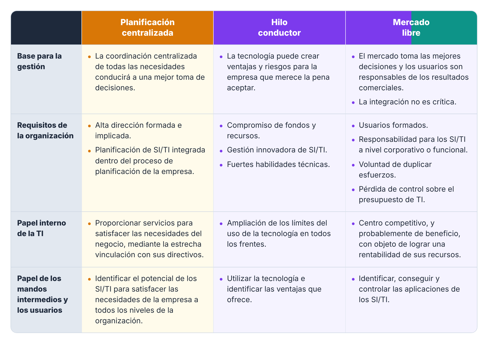

*Fuente: Edwards, Ward y Bytheway, **Fundamentos de sistemas de información** (2.ª ed.), Tabla 6.5: Las estrategias genéricas (según Parsons), parte 1.*

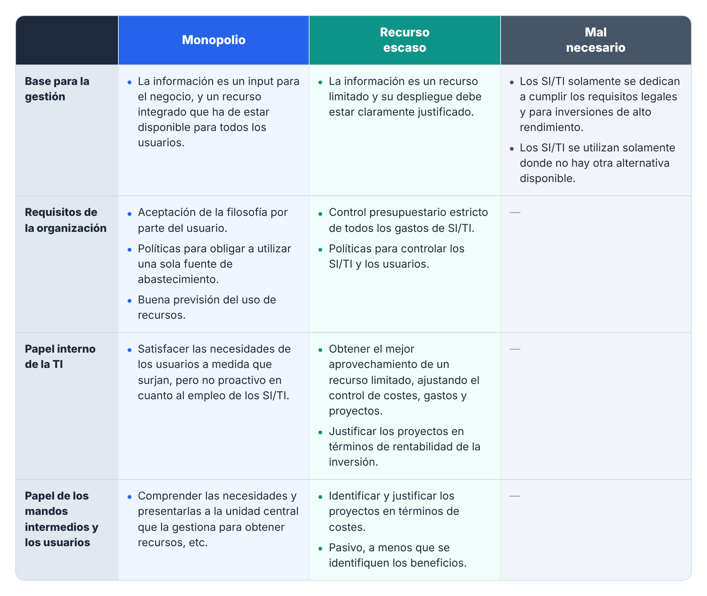

*Fuente: Edwards, Ward y Bytheway, **Fundamentos de sistemas de información** (2.ª ed.), Tabla 6.5: Las estrategias genéricas (según Parsons), parte 2.*

## Proyectando las estrategias genéricas sobre el modelo cartera.

Parsons examina la forma en que cada estrategia se ajusta a la cartera de aplicaciones para así identificar el mejor encaje en cada segmento. Concluye que, en cada caso, hay una o dos estrategias que funcionarán mejor.

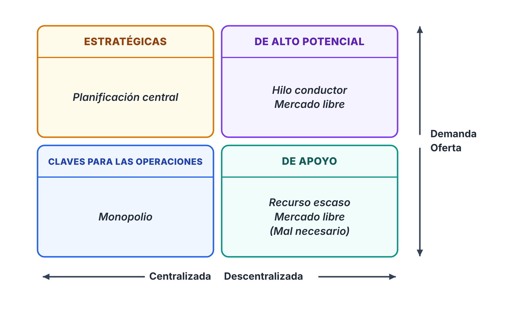

*Fuente: Edwards, Ward y Bytheway, **Fundamentos de sistemas de información** (2.ª ed.), Fig. 6.3: Relación entre las estrategias genéricas y la cartera de aplicaciones.*

> 📝 **Apunte de clase:** en el cuadro que mostró Soria no aparece en la parte de "De alto potencial" → Mercado libre. Solo está Hilo conductor. (Por las dudas.)

Obsérvese que:

- La planificación centralizada (aplicaciones estratégicas) es una estrategia de gestión de la demanda impulsada por las necesidades del negocio, mientras que el monopolio (aplicaciones clave para las operaciones) es fundamentalmente un planteamiento de gestión de la oferta; ambas **implican una centralización de la toma de decisiones**.

- El hilo conductor (alto potencial) es un planteamiento de gestión orientado a la demanda impulsado por la tecnología.

- El recurso escaso (aplicaciones de apoyo) es una estrategia de gestión de la oferta basada en la limitación de los recursos financieros.

- El mercado libre (aplicaciones de alto potencial y de apoyo) puede hacer posible que los usuarios determinen la demanda y también decidan la fuente de aprovisionamiento.

**Estrategias para las aplicaciones de alto potencial**: una planificación excesiva de las aplicaciones de alto potencial puede ahogar la innovación. Las dos estrategias que mejor se adaptan son el **hilo conductor** y el **mercado libre**; ambas son arriesgadas, pero producirán innovación. Las cuestiones principales en este cuadrante tienen que ver con la evaluación de oportunidades y la identificación de la mejor forma de obtener beneficios.

**Estrategias para las aplicaciones estratégicas**: las aplicaciones estratégicas precisan un enfoque de planificación centralizada para garantizar que sea la orientación hacia el negocio la que determine los requisitos y el planteamiento más apropiados para la implantación. También resuelve el nivel de riesgo que merece la pena correr para alcanzar los beneficios. Los sistemas estratégicos solamente tendrán éxito cuando llegan a tiempo, es decir, cuando están bien formulados y estrechamente integrados con las necesidades específicas de la empresa.

**Estrategias para las aplicaciones clave para las operaciones**: el monopolio es potencialmente restrictivo, aunque es ideal para reducir riesgos. Proporciona soluciones de calidad a largo plazo, una necesidad de los sistemas clave para las operaciones. El planteamiento altamente centralizado y controlador permite resolver las cuestiones críticas sobre la integración de funciones y de datos, de modo que se satisfacen todas las necesidades básicas de la empresa de la forma más eficaz y sin riesgo de error. Es esencial un enfoque muy estructurado.

**Estrategias para las aplicaciones de apoyo**: la escasez de recursos (recurso escaso) es ideal para controlar las inversiones en sistemas de apoyo, porque obliga a realizar una clara evaluación de los resultados esperados antes de que suceda nada en absoluto. **También se puede aplicar mercado libre siempre que se permita a los usuarios utilizar sus propios fondos**. Esto puede funcionar bien, puesto que la integración no va a ser normalmente una cuestión crítica; incluso reduce el riesgo mediante una paulatina evolución de las ideas acerca de los sistemas, al tiempo que permite al usuario cierta autonomía y control financiero.

> 📝 **Apunte de clase:** hay varias estrategias acá por el hecho de que son de apoyo: no hay plata.

**La utilización de las estrategias genéricas.** Las estrategias genéricas facilitan una adecuada gestión de los SI/TI de dos formas:

- **Para el diagnóstico**: aportan una perspectiva para evaluar la situación actual y comprender cómo se están gestionando los SI/TI. Hay una fuerte relación causa-efecto entre las aplicaciones desarrolladas y las estrategias adoptadas.

- **Para la formulación**: una vez identificada la futura cartera de aplicaciones y evaluados los puntos fuertes y débiles de las existentes, se pueden usar para identificar un plan de migración. Así se evita la **trampa de una sola estrategia universal**: decir "necesitamos la planificación centralizada" resulta atractivo, pero es imposible planificar todo de forma centralizada.

## Migraciones de un segmento a otro (Edwards).

La cartera de aplicaciones responde a la demanda de sistemas de información con los medios de abastecimiento más apropiados. Las aplicaciones de los cuatro cuadrantes vienen justificadas por diferentes razones y necesitan distintos enfoques para su desarrollo y gestión. El papel de los sistemas evolucionará también en el tiempo y será necesario migrar desde *un* segmento de la cartera a otro:

- De alto potencial a estratégico, a medida que se logre el potencial.

- De estratégico a clave para las operaciones, a medida que se pierde la ventaja competitiva y las desventajas amenazan, es decir, el sistema también se hará menos estable.

- Las oportunidades de alto potencial pueden producir solamente beneficios locales limitados de la categoría de apoyo.

- Los sistemas clave para las operaciones pueden llegar a ser menos críticos a medida que la empresa evoluciona, llegando a ser reclasificados como "de apoyo".

Finalmente, algunas aplicaciones, principalmente los sistemas de apoyo, quedarán obsoletas y será preciso eliminarlas.

Esta evolución refleja la de los productos en la cartera comercial de una empresa: los productos de éxito se desplazan con el tiempo de "niño problema" a "estrella naciente", luego a "vaca" y a "perro", antes de ser eliminados. En cada etapa precisan una gestión diferente y más o menos recursos. Del mismo modo, a medida que una aplicación pasa de un cuadrante a otro debe cambiar el enfoque de su desarrollo y gestión; si no, se produce un uso excesivo y desequilibrado de recursos.

## Prioridades.

El mecanismo utilizado para decidir si las aplicaciones han de seguir adelante o no también debería utilizarse para definir prioridades. Algunas prioridades surgen de simples dependencias. Es preciso incluir **tres factores en la evaluación de prioridades: beneficios, recursos y riesgos.**

La definición de prioridades dentro de los segmentos de la cartera:

**De apoyo**
La definición de prioridades no debe ser demasiado difícil, puesto que la prioridad más alta deberá corresponder a las que proporcionen los mayores beneficios económicos empleando menos recursos.

**Estratégico**
Dentro del segmento estratégico, la lógica básica es igualmente clara. Las aplicaciones que más contribuyan a alcanzar los objetivos de la empresa y utilicen menos recursos deberán ir en primer lugar.

Para evaluar esto, puede resultar útil una simple tabla de decisiones para cuantificar la contribución estratégica de los diferentes proyectos, expresando cada proyecto en términos de los factores críticos de éxito (FCE) a que conduce. Si los FCE no pueden medirse, es posible que los objetivos de la empresa reciban unas prioridades relativas. Cada definición de aplicación debe aclarar cómo y en qué grado conducirá a unos FCE.

**De alto potencial**
Al igual que las aplicaciones estratégicas, las de alto potencial han de mostrar una relación con los objetivos y los FCE, aunque sea con menos claridad.

Dado que tiene que ver con la energía y el entusiasmo de sus defensores, la priorización y la utilización de recursos por una aplicación de alto potencial son, en efecto, autogestionadas, aunque los recursos secundarios esenciales pueden ser un problema. Los resultados dependerán no solamente del valor de la idea, sino también de la fuerza con la que se persiga.

**Clave para las operaciones**
La definición de prioridades para los sistemas clave para las operaciones es más problemática que para los sistemas de apoyo o los estratégicos, porque la lógica es más compleja. Los argumentos para los sistemas clave para las operaciones serán básicamente consideraciones económicas, riesgos para el negocio actual, FCE y mejoras de infraestructura.

Debe compararse el costo y los recursos empleados por el proyecto con su importancia en cada una de las cuatro categorías para establecer las prioridades globales.

**Definición de prioridades dentro de la cartera**:

Esta tarea es compleja porque **cada tipo de aplicación** (estratégica, de apoyo, operativa) **genera distintos beneficios** y responde a diferentes criterios de evaluación. Por ejemplo, las aplicaciones estratégicas pueden tener baja rentabilidad financiera en el corto plazo, pero ser clave para la competitividad a futuro, mientras que las aplicaciones de apoyo pueden mostrar beneficios financieros inmediatos pero menor impacto estratégico.

**La dirección debe decidir qué tipo de beneficio será prioritario**: **si se enfocará en el retorno económico, en la generación de ventajas competitivas o en la reducción de riesgos**. Esta decisión se verá influida por varios factores: la *estrategia general de la empresa* (por ejemplo, si busca liderazgo o eficiencia), las *capacidades internas del área de SI/TI* (especialmente su nivel de servicio y recursos), y *la experiencia de los usuarios para identificar necesidades y adoptar soluciones con éxito.*

Un plan global de SI/TI debe desarrollarse con una secuencia lógica de prioridades basada en una relación entre los beneficios esperados (ajustados por el riesgo) y el consumo de los recursos limitados. Esto permite asignar los recursos de forma más racional, establecer niveles adecuados de captación futura y tener previsibilidad para realizar inversiones sostenidas.

📝 **Apunte de clase — resumen:**

| Segmento | ¿Cómo se prioriza? |
| --- | --- |
| **De apoyo** | Más beneficio con menos costo |
| **Estratégico** | Mayor aporte a los objetivos + eficiencia en recursos |
| **Alto potencial** | Por impulso interno, entusiasmo y viabilidad práctica |
| **Clave para operaciones** | Por riesgo, economía, aporte a FCE y mejora de estructura |

📝 **Apunte de clase — ¿Qué hago cuando quiero implementar un nuevo sistema o aplicación?**

1. **Clasifico** la aplicación según su función en la empresa:

   - ¿Es **estratégica**? → ayuda a cumplir un objetivo clave del negocio.

   - ¿Es **clave para operar**? → si no funciona, la empresa se paraliza.

   - ¿Es de **alto potencial**? → una idea innovadora con futuro, pero incierta.

   - ¿Es de **apoyo**? → útil, pero no esencial.

2. **Le asigno una estrategia genérica de gestión**:

   - ¿La va a coordinar la alta dirección? (Planificación centralizada)

   - ¿La impulsa un usuario o área concreta? (Mercado libre)

   - ¿Es una inversión innovadora pero riesgosa? (Hilo conductor)

   - ¿Requiere control total y proveedor único? (Monopolio)

   - ¿Hay pocos recursos y debe justificarse todo? (Recurso escaso)

   - ¿Se hace solo porque es obligatorio? (Mal necesario)

3. **La priorizo**, según su tipo:

| Tipo de aplicación | ¿Cómo se prioriza? |
| --- | --- |
| **Apoyo** | Más beneficio económico con menos costo |
| **Estratégica** | Más contribución a los objetivos del negocio (FCE) |
| **Alto potencial** | Por el impulso del defensor y viabilidad |
| **Clave para operaciones** | Por riesgo, costo, impacto en infraestructura y continuidad |

---

# Modelo de Administración de Recursos de SI/TI.

> ⚠️ **Atención (Sección en borrador / fuera del temario de la Unidad I):** *Este apartado quedó inconcluso en el apunte original porque el tema «Management de los Recursos de IS» (Robson, cap. 9) fue excluido de la planificación de la Unidad I y se evalúa en unidades posteriores.*

📝 **Apunte de clase.**

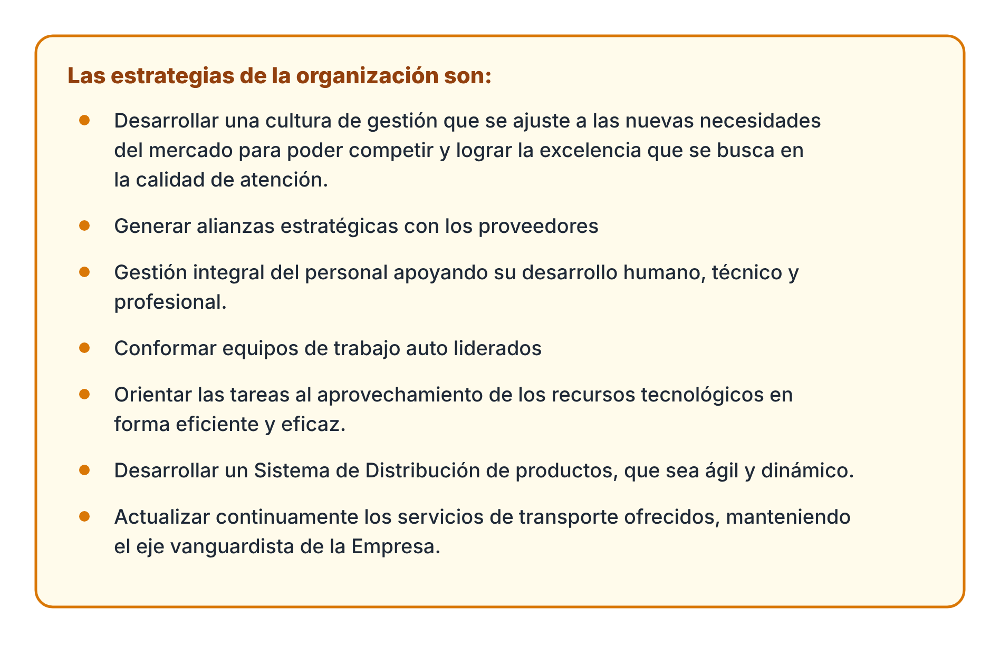

*📝 Apunte de clase.*
