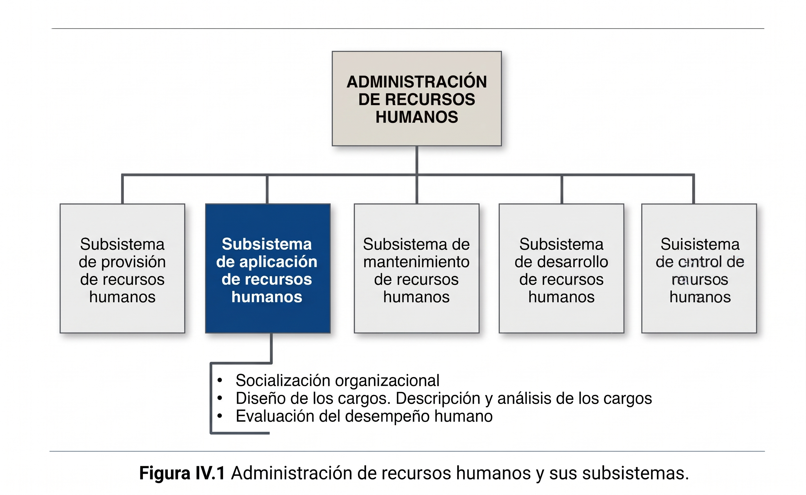
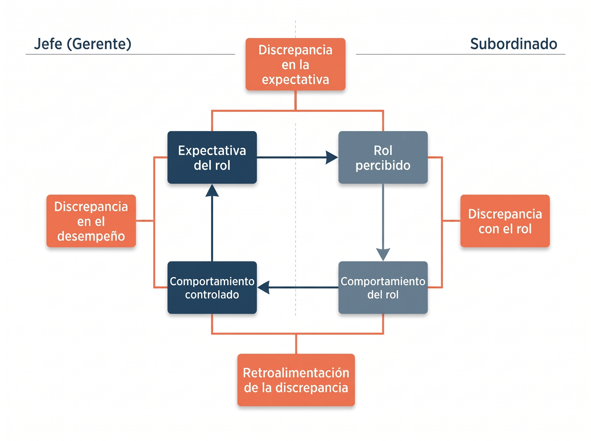
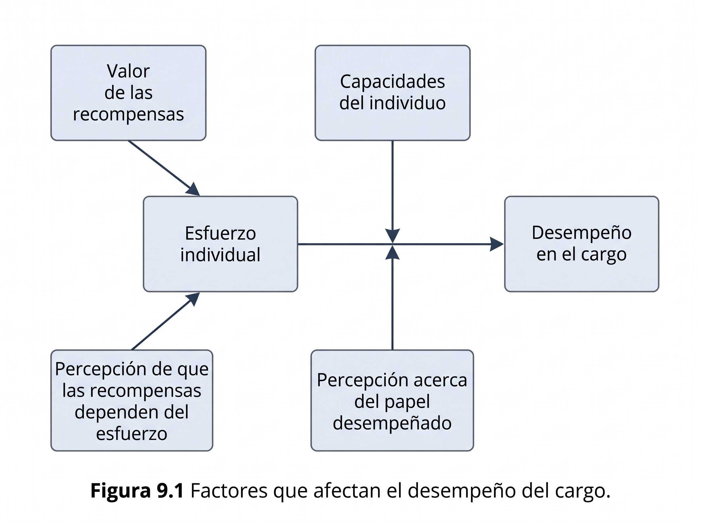

\newpage

# PARTE I: Aplicación de RRHH y Gerenciamiento de SI (Chiavenato y Robson)

## Socialización: concepto, momentos, aspectos claves.

* **Concepto:** Es el proceso permanente de inculcar en todos los empleados las actitudes, normas, valores y patrones de conducta (incluidos los del cargo) que espera la organización. Busca que la incorporación del nuevo miembro no sea traumática, aportando estabilidad y eficacia.

* **Momentos:**

  * *Inicio:* Puede comenzar en los **tramos finales del proceso selectivo** (entrevistas).

  * *Desarrollo:* Durante la **integración inicial al puesto** (entre 1 y 5 días en programas intensivos) y el **seguimiento a mediano plazo** por un tutor/supervisor.

  * *Finalización:* Termina cuando el nuevo miembro se siente a gusto con la organización y su puesto, y ha aceptado sus normas y valores.

* **Aspectos claves:**

  * **Conflicto Socialización vs. Personalización:** La organización intenta adaptar al individuo a sus necesidades (*socialización*), mientras el individuo intenta adaptar la empresa a sus metas personales (*personalización*). El **plan de carrera** permite que ambos convivan.

    > *«El plan de carrera es el camino formal de evolución y crecimiento profesional de una persona dentro de la estructura de cargos de la organización. Sirve para alinear las metas personales del empleado (personalización) con los objetivos de la empresa (socialización), se prepara mediante el enriquecimiento vertical y horizontal del cargo, y se gestiona a través de la evaluación de desempeño y la capacitación».*

  * **Los 5 métodos para promoverla:** 1) Planeación del proceso selectivo (aquí se piensan formas de comenzar a socializar, en un nivel mínimo, durante el propio proceso de selección); 2) Contenido inicial de la tarea (tareas retadoras y gradualmente más complejas para evitar desmotivación); 3) Papel del gerente/supervisor (actúa como tutor: da descripción clara de la tarea, información técnica y retroalimentación); 4) Grupos de trabajo («escuela informal» para satisfacer necesidades sociales); 5) Programas de integración (entrenamiento intensivo sobre asuntos organizacionales, beneficios, presentación y deberes del cargo).

## ¿Qué incluye el subsistema de aplicación? Efectúe un cuadro sinóptico.
El subsistema de aplicación es el puente entre la **provisión** (reclutar/seleccionar) y el **mantenimiento** (retener/motivar). Define cómo funcionan los recursos dentro de la estructura existente asignando cada persona a un cargo.

| Dimensión del Subsistema | Objetivo Principal | Procesos / Actividades que incluye |
| :--------------- | :------------------- | :-------------------------------------------- |
| **1. Socialización Organizacional** | Integrar a los nuevos miembros al contexto cultural y laboral. | Métodos de socialización (proceso selectivo, tarea inicial, rol del gerente, grupos de trabajo, programas de integración). |
| **2. Diseño, Descripción y Análisis de Cargos** | Estructurar el trabajo en el organigrama y definir qué se hace y qué se exige. | • **Diseño:** Modelos clásico, humanista y situacional; enriquecimiento. \newline • **Descripción (Intrínseco):** Qué, cuándo, cómo y por qué se hace. \newline • **Análisis (Extrínseco):** Requisitos intelectuales, físicos, responsabilidades y condiciones. \newline • **Equipos formales y de proyecto.** |
| **3. Evaluación del Desempeño** | Apreciar sistemáticamente el comportamiento de rol en el cargo y su potencial. | • Definición de evaluadores (gerente, autoevaluación, APO, 360°, comité, RRHH). \newline • Aplicación de métodos tradicionales (escalas gráficas, elección forzada, investigación de campo, incidentes críticos). \newline • Entrevista de devolución. |

## La empresa como un sistema de roles: concepto de rol. ¿Cuáles son las posibles discrepancias en el desempeño del rol?

* **Concepto de Rol:** Es el conjunto de actividades y comportamientos (expectativa de conducta subjetiva: liderazgo, comunicación, etc.) que se solicitan a un individuo que ocupa una determinada posición en la organización. La empresa es un sistema de roles superpuestos.

    > *«Se dice que la empresa es un sistema de roles superpuestos porque la organización no es una suma de puestos aislados, sino una red de grupos humanos que se entrelazan. Alrededor de cada individuo gira un conjunto de personas que tienen expectativas sobre su comportamiento, y como cada persona interactúa simultáneamente en varios grupos (siendo a la vez subordinado de su jefe, líder de su equipo y colega de sus pares), todos esos conjuntos de roles se solapan entre sí».*

* **Proceso y las 4 Discrepancias en el desempeño del rol:**

  1. **Discrepancia de la expectativa:** Diferencia entre la *expectativa del rol* (lo que el jefe explica y pide) y el *rol percibido* (lo que el subordinado entiende según su interpretación).

  2. **Discrepancia con el rol:** Diferencia entre el *rol percibido* (lo que el empleado entendió) y el *comportamiento del rol* (lo que realmente logra hacer; falla por falta de capacitación o problemas personales).

  3. **Retroalimentación de la discrepancia:** Diferencia entre el *comportamiento del rol* (lo que el subordinado hizo) y el *comportamiento controlado* (lo que el jefe observa y evalúa, ya que no siempre ve todo).

  4. **Discrepancia en el desempeño:** Diferencia final entre el *comportamiento controlado* (lo evaluado por el jefe) y la *expectativa del rol* original que el jefe transmitió.

## ¿Qué es un cargo?

* **Cargo:** Es un conjunto de **funciones** (tareas o atribuciones) con una **posición definida en la estructura organizacional (organigrama)**, sumado a un **rol** (expectativa de conducta). Ubicarlo en el organigrama define su nivel jerárquico, área/departamento, a quién reporta (*terminal superior = responsabilidad*), a quién supervisa (*terminal inferior = autoridad*) y sus relaciones laterales.

* **Conceptos base que lo integran:**

  * **Tarea:** Actividad individual simple y rutinaria (*lo que hace*, cargos por hora).

  * **Atribución:** Actividad individual más diferenciada que implica **poder de decisión** (*lo que decide*, cargos mensuales).

  * **Función:** Conjunto de tareas o atribuciones ejecutadas de manera sistemática y reiterada (*el propósito o para qué lo hace*).

  * **Puesto:** Es una ocurrencia o instancia de un cargo (un cargo puede tener varios puestos/ocupantes).

## Diseño de cargos: componentes.
Diseñar un cargo consiste en establecer **4 condiciones fundamentales**:

1. **Contenido del cargo:** El conjunto de tareas o atribuciones que el ocupante deberá cumplir (*¿Qué hace?*).

2. **Métodos y procesos de trabajo:** Cómo deberá cumplir esas tareas o atribuciones (*¿Cómo lo hace?*, ej. metodologías de desarrollo).

3. **Responsabilidad:** A quién deberá reportar el ocupante (*relación con su jefe*, por qué cosas o equipos responde).

4. **Autoridad:** A quién deberá supervisar o dirigir (*relación con sus subordinados*).

> *Nota:*
>
> *Además incluye la Descripción del cargo (aspectos intrínsecos), el Análisis/Especificación del cargo (aspectos extrínsecos: requisitos intelectuales, físicos, responsabilidades implícitas y condiciones de trabajo) y los métodos de recolección: Observación directa, Cuestionario, Entrevista directa y Mixtos, siendo **responsabilidad de línea y función de staff**.*

## Elaborar un cuadro sinóptico de los tres modelos de diseño de los cargos.

| Criterio | 1. Modelo Clásico o Tradicional | 2. Modelo Humanista (Relaciones Humanas) | 3. Modelo Situacional o Contingencial |
| :--- | :--- | :--- | :--- |
| **Foco y Premisa** | **Para hacer, no para pensar.** Tareas simples, repetitivas y estandarizadas (Administración Científica). | **Para motivar y relacionarse.** Importa más el contexto social del cargo que su contenido técnico. | **Según las circunstancias.** Convergen 3 variables dinámicas: *Estructura de la organización, Tarea y Persona*. |
| **Concepción del trabajador** | *Hombre económico* (apéndice de la máquina; motivado solo por incentivos salariales). | *Hombre social* (motivado por reconocimiento, interacción grupal y liderazgo). | Persona con **autodirección y autocontrol** (objetivos planeados con el gerente). |
| **Características del cargo** | Rígido, aislado, obediencia estricta al jefe. Fracasó en la práctica por causar alta rotación, ausentismo y apatía. | Mantiene la tarea clásica pero suma participación, comunicación e integración grupal. | **Dinámico y evolutivo.** Aplica el **Enriquecimiento de cargos** (*Horizontal*: más variedad; *Vertical*: más complejidad/planeación). |
| **Condiciones de éxito** | Mecanización y supervisión por simple observación. | Grupos cohesionados y atmósfera amigable. | Lograr **3 estados psicológicos** (trabajo significativo, responsabilidad por resultados y conocer resultados) mediante **5 dimensiones esenciales (V-A-S-I-R)**: *Variedad, Autonomía, Significado, Identidad y Retroalimentación*. |

## ¿Qué es un equipo efectivo de trabajo?

* **Concepto:** A diferencia de un *grupo de trabajo* (donde el trabajo y la responsabilidad son individuales y hay un único líder fijo), un **equipo de trabajo** es un grupo formal pequeño cuyos miembros poseen **habilidades complementarias** y trabajan intensamente por un **propósito común específico**, con responsabilidad individual y mutua, liderazgo compartido y **sinergia positiva** (el todo supera la suma de las partes).

* **Etapas de evolución:** 1) *Formación*, 2) *Tormenta* (conflictos; el gerente debe hacerla breve), 3) *Normatividad*, 4) *Desempeño* (máxima productividad) y 5) *Disolución* (en **equipos de proyecto**, que son efímeros, multiculturales, creados a partir de la tarea y subordinados al objetivo).

* **Las 8 características de un Equipo Efectivo (Alto Desempeño):**

  1. **Objetivos claros.**

  2. **Habilidades relevantes** (técnicas e interpersonales).

  3. **Confianza mutua.**

  4. **Unidad de compromiso.**

  5. **Buena comunicación** (con retroalimentación).

  6. **Habilidades de negociación.**

  7. **Liderazgo apropiado** (guía y facilitador).

  8. **Apoyo interno y externo** (capacitación, recursos, incentivos).

> *«Se dice que los equipos de proyecto son "multiculturales" porque sus miembros se seleccionan a partir de la tarea por su especialidad técnica y provienen de distintas áreas funcionales, profesiones e incluso de afuera de la empresa. Por eso no comparten los mismos valores, jergas ni modelos mentales, y el gerente de proyecto debe lograr que se integren y comuniquen en muy corto plazo porque el equipo tiene una existencia efímera».*

## ¿En qué consiste la evaluación de desempeño?

* **Concepto:** Es la apreciación sistemática del desempeño de cada persona **en el cargo** (su comportamiento de rol) y de su potencial de desarrollo futuro. Es un medio/herramienta integradora para localizar problemas de supervisión o integración, adecuar la persona al cargo, capacitar y promover.

* **Factores que condicionan el desempeño:** Es situacional; depende del **esfuerzo individual** (condicionado por el *valor de las recompensas* y la *percepción de que estas dependen del esfuerzo*), sumado a las **capacidades del individuo** y su **percepción del papel desempeñado**.

* **Responsabilidad:** Es **responsabilidad de línea** (el gerente evalúa día a día) y **función de staff** (RRHH diseña, asesora y estandariza el sistema). También puede hacerla el propio empleado (autoevaluación), empleado + gerente (**APO**: objetivos por consenso, compromiso, negociación de recursos, desempeño, medición y retroalimentación), el equipo, un Comité, RRHH o **360°** (todos los que interactúan con él).

* **Métodos tradicionales:** 1) *Escalas gráficas* (doble entrada: continuas, semicontinuas o discontinuas; simple pero sufre efecto halo/subjetividad); 2) *Elección forzada* (bloques de frases positivas/negativas; elimina subjetividad pero es complejo de armar); 3) *Investigación de campo* (gerente + especialista de staff; el más completo pero costoso y lento); 4) *Incidentes críticos* (registra solo extremos muy positivos o muy negativos); 5) *Comparación por pares* y *Frases descriptivas*.

* **Cierre obligatorio:** La **entrevista de evaluación de desempeño** para dar retroalimentación al empleado.

## Para pensar: ¿qué relación tiene la Aplicación de RRHH con el proceso de provisión de RRHH?
Tienen una **relación bidireccional y de retroalimentación continua**:

1. **De Provisión a Aplicación:** La aplicación se nutre de la provisión; una vez que las personas son reclutadas y seleccionadas (provisión), ingresan al subsistema de aplicación para ser socializadas, asignadas a sus cargos y evaluadas.

2. **De Aplicación a Provisión:** El subsistema de aplicación es el que **genera el insumo y detecta la necesidad de nueva provisión**. La *Descripción y Análisis de Cargos* define el perfil y los requisitos para saber a quién reclutar y seleccionar; y la *Evaluación de Desempeño* detecta si faltan recursos humanos, si hubo rotación o si las personas seleccionadas realmente se adecuaron al puesto.

## ¿Cuáles son los roles de los SI, desde el punto de vista del gerenciamiento de los mismos?
El rol de los SI evoluciona desde el control técnico hacia un facilitador estratégico:

* **Según la evolución de su relación con los usuarios (5 etapas):**

  1. *Hacerles algo a ellos:* SI impone las reglas (estructura tradicional).

  2. *Hacer algo para ellos:* Orientación al servicio a medida (guiada por BBDD).

  3. *Hacer algo con ellos:* Puentes y participación conjunta (grupos de proyectos funcionales).

  4. *Ayudarlos a que lo hagan por sí mismos:* Influencia y guía, no control (centros de información y apoyo a decisiones / BI).

  5. *Mantener un depósito de información:* Puente entre proveedores y usuarios de información interna/externa (enfoque externo).

* **Según los 5 Modelos de Rol/Estructura frente al negocio:**

  1. **Modelo de Servicio:** El usuario pide y SI entrega como obligación de servicio.

  2. **Modelo de Participación:** Trabajan codo a codo para diseñar soluciones, pero SI sigue siendo soporte.

  3. **Modelo de Vendedor:** SI comercializa sus servicios interna y externamente (compite en valor y precio, ej. *Agunsa*).

  4. **Modelo de Expansión:** SI crea y custodia una arquitectura común y flexible (APIs, plataformas) para que las áreas configuren sus soluciones.

  5. **Modelo de Ventaja Estratégica:** Unión total; SI y el negocio forman un solo equipo que cocrea productos competitivos.

* **Los 3 roles lógicos que deben estructurarse de forma diferenciada:**

  1. *Provisión de Infraestructura de IS (operación y administración):* Asegurar el funcionamiento diario y estable de redes, BBDD y servicios centrales.

  2. *Investigación y Desarrollo (I+D) a largo plazo:* Separar la innovación y políticas tecnológicas futuras de las urgencias cotidianas.

  3. *Facilitar la informática a nivel de usuario final:* Rol asesor/consultor para que el usuario use la tecnología con autonomía.

## RUO (Rol – Ubicación y Organización del área de SI/TI): Concepto de Rol, de Ubicación y de Organización.
*(Aclaración clave de cátedra: RUO se refiere al **ÁREA de sistemas y sus RRHH**, es una definición organizativa alineada a la estrategia, no tecnológica).*

* **Rol (¿Qué harán los SI/TI?):** Define la naturaleza de las interacciones del área de SI con el resto de la organización, qué funciones cumple y cómo se relaciona con las áreas usuarias (soporte operativo vs. socio estratégico).

* **Ubicación (¿Dónde estarán los SI/TI?):** Define la dispersión física y de *management* (poder de toma de decisiones y control) de los recursos de SI dentro de la empresa (Centralizada, Descentralizada o Delegada).

* **Organización (¿Cómo se dispondrán los SI/TI?):** Define cómo se estructura internamente el área de SI/TI: cómo se agrupan los profesionales (departamentalización), qué responsabilidades tienen y bajo qué jerarquías y líneas de mando se distribuyen.

## ¿Qué decisiones deben tomarse respecto de la ubicación de los SI?
Se debe decidir **qué componente de los SI ubicar en cada lugar y qué decisiones centralizar, descentralizar o delegar**, considerando **3 aspectos**:

1. **Localización:** La ubicación física del equipamiento y del personal de sistemas.

2. **Control:** En qué nivel empresarial se toman las decisiones.

   * *Decisiones que se suelen **centralizar**:* Manejo de fondos, objetivos estratégicos, inversiones y presupuestos, designación de cuadros superiores (gerente de SI) y niveles salariales.

   * *Decisiones que se suelen **descentralizar/delegar**:* Producción/desarrollo de aplicaciones y organización interna/tareas operativas.

3. **Estructura:** Si las responsabilidades de los sistemas quedan retenidas en la función central de SI o se transfieren a los grupos de usuarios, optando entre tres esquemas (o una combinación):

   * **Centralizada:** Un único acceso y servicio; se retienen *todas* las decisiones en la gerencia central de SI (ej. sistema contable provincial).

   * **Descentralizada:** Múltiples minidepartamentos de SI que son **réplicas de la centralización**; se delegan solo decisiones operativas pero no el desarrollo (ej. *Sysacad* en las regionales de UTN).

   * **Delegada:** Es el verdadero opuesto a la centralización; dispersión geográfica y de *management* donde el usuario local tiene autonomía total sobre el procesamiento y desarrollo (ej. sistema de expedientes).

## Comparar los SI centralizados y no centralizados según estos criterios:

| Criterio | SI Centralizados | SI No Centralizados (Descentralizados / Delegados) |
| :--- | :--- | :--- |
| **Grado de control sobre los sistemas** | **Muy alto y estricto.** Mayor control sobre operaciones, producción, seguridad e integridad de BBDD. Menor riesgo de incompatibilidad y estándares unificados. | **Disperso / Compartido con el usuario.** Mayor autonomía e involucramiento del usuario final. En esquemas delegados, el control central se reemplaza por cooperación, exigiendo **automatizar al máximo la seguridad y la gestión de red** para evitar "islas de tecnología" e incompatibilidades. |
| **Entorno requerido** | • Recursos de SI costosos y de uso limitado. • Sistemas complejos o sensibles para la alta dirección (*EIS*). • Servicios comunes a toda la empresa (ej. sueldos). • Unidades de negocio pequeñas. • Cuando la **integración es vital**, el tiempo de respuesta no es crítico y el objetivo es la **eficiencia**. | • Entornos que exigen **velocidad de respuesta y flexibilidad**. • **Servicios únicos** o exclusivos de un área específica. • Captura de datos en el lugar mismo del evento. • Recursos de bajo costo pero de uso alto y variado. • Cuando el objetivo principal del negocio es la **efectividad**. |
| **Costos asociados** | **Ahorro por economías de escala** (no se duplican recursos, licencias ni especialistas). *Desventaja:* Altos costos de telecomunicaciones (WAN) y riesgos de distorsión si se usan sistemas de contabilidad/cobro interno a usuarios. | **Menores costos de comunicación de datos** (procesamiento local), pero **altos costos agregados ocultos por duplicación** de equipos, software, tareas y personal en múltiples sectores. El usuario percibe de forma más realista el costo-beneficio de lo que pide. |

## ¿Cuáles son los enfoques estructurales para la organización de los SI?
Primero, la organización interna se divide en **3 niveles gerenciales**: 1) *Administración de la información* (Estratégico / CIO: planes y alineación); 2) *Administración del uso de los SI* (Táctico / Subgerencias medias de Desarrollo o Seguridad: políticas y qué usa quién); y 3) *Administración de la tecnología* (Operativo / 1.ª línea / CTO, jefes de red/BBDD: configuración e instalación técnica).

A lo largo del tiempo evolucionaron **5 enfoques estructurales** (que pueden coexistir):

1. **Estructura Tradicional (Centro de Datos):** Orientada a la eficiencia técnica y control centralizado. Separa rígidamente **Operación** (por turnos) y **Desarrollo/Mantenimiento** (analistas separados de programadores). *Ventaja:* Alta especialización. *Desventajas:* Burocracia, retrasos de meses/años, sistemas inflexibles/proscriptos aislados del usuario y mantenimiento costoso.

2. **Estructura de Bases de Datos:** Orientada a la integración y consistencia de la información. Separa los datos de las aplicaciones y los centraliza como un recurso común bajo el control del Administrador de Base de Datos (DBA). Facilita el acceso del usuario a los datos.

3. **Estructura de Grupos de Proyectos Funcionales:** Orientada a la **demanda del negocio** (estructura matricial). Agrupa analistas y programadores por área funcional (ventas, finanzas, manufactura), manteniendo el centro de cómputos tradicional para operaciones. *Ventaja:* Sistemas relevantes y mayor conciencia del negocio. *Desventaja:* Crea «murallas chinas» (silos que no comparten información) y cargas de trabajo desparejas entre equipos.

4. **Centro de Información y Apoyo a Decisiones:** Estructura que separa un área asesora/consultora (Centro de Información) para apoyar la computación de usuario final y la toma de decisiones gerenciales, fomentando la autonomía del usuario.

5. **Estructuras Externas:** Enfocadas hacia afuera en dos sentidos: 1) Hacia el cliente interno mediante líneas y acuerdos de servicio (SLA), y 2) Hacia los clientes reales del mercado exterior, integrando los SI directamente en el negocio (o tercerizando mediante *outsourcing*).

---

# PARTE II: Aplicación de SI/TI (Puigjaner y Molero)

## ¿Qué conforma el proceso de aplicación del SW y HW?
Es el subsistema cuya finalidad es disponer, asignar, configurar, planificar la capacidad, explotar y evaluar los recursos tecnológicos (HW y SW) en función de la carga de trabajo y de los niveles de servicio (SLA) requeridos por la organización.
Conforma **3 actividades centrales de ingeniería de prestaciones** más su **operación y regulación**:

1. **Análisis y representación de la carga de trabajo** (dimensionar y caracterizar la carga).

2. **Planificación de las prestaciones / capacidad** (asignar recursos según las prestaciones futuras requeridas).

3. **Evaluación de las prestaciones** (medir y evaluar el funcionamiento y rendimiento real o proyectado).

4. **Gestión operativa (Explotación de sistemas)** y **Marco Normativo** (Políticas, Normas/Estándares, Mejores Prácticas, Procedimientos y Guías que regulan el uso de los recursos).

## Elabore un concepto de prestaciones de un sistema informático. Elabore un concepto de rendimiento de un sistema informático.

* **Prestaciones de un SI:** Es el conjunto de capacidades, servicios y comportamientos cuantificables (en términos de velocidad/tiempo de respuesta, productividad/volumen de trabajo procesado y disponibilidad/fiabilidad) que un sistema informático entrega a sus usuarios al ejecutar una carga de trabajo determinada.

* **Rendimiento de un SI:** Es el grado de **eficacia y eficiencia con que un software determinado utiliza y aprovecha los recursos de hardware** disponibles bajo una determinada combinación de programas (*carga del sistema*). La evaluación del rendimiento es la medida cuantitativa de ese aprovechamiento.

> **Definición comparativa (Rendimiento vs. Prestaciones):**
>
> *«La diferencia está en que el rendimiento mira el aprovechamiento interno de los recursos tecnológicos, mientras que las prestaciones son el resultado o servicio externo que el sistema le entrega al usuario:*
>
> *El Rendimiento es la eficacia y eficiencia con la que el software utiliza y aprovecha los recursos de hardware (CPU, memoria, disco) cuando procesa una carga de trabajo.*
>
> *Las Prestaciones, en cambio, son los resultados operativos y niveles de servicio observables que el sistema entrega como salida frente a esa carga (medidos en velocidad o tiempo de respuesta, volumen de trabajo o productividad/throughput, capacidad y disponibilidad), los cuales deben satisfacer las exigencias de los usuarios y los Acuerdos de Nivel de Servicio (SLA) de la organización».*

## Defina carga del sistema. ¿Cuáles son las dificultades que plantea la carga real de un sistema? ¿Cuál es la solución a las mismas?

* **Carga del sistema:** Son todas las demandas que realizan los usuarios a un sistema informático (programas, datos, transacciones, órdenes, etc.) durante un intervalo de tiempo determinado.

* **Dificultades de la carga real:**

  1. **Fluctúa y cambia continuamente** en el tiempo.

  2. **Interactúa con su entorno** y depende de la configuración de cada instalación.

  3. **No es reproducible:** No permite repetir un experimento en idénticas condiciones para aislar errores o comparar cambios.

* **Solución:** Realizar la **caracterización de la carga** para construir un **modelo de la carga (carga de prueba o de test)** compacto y representativo que reproduzca fielmente el comportamiento de la carga real y permita repetir sesiones de medición.

## Dé el concepto de Evaluación de las prestaciones. ¿Qué componentes de sistema informático establecen los autores como objeto del estudio en el contexto de la evaluación? ¿Por qué se necesita evaluar el rendimiento de un sistema informático? Repase para qué fines se recurre a la evaluación.

* **Concepto de Evaluación de las prestaciones:** Es el proceso de obtener y analizar medidas cuantitativas (índices de prestaciones) mediante técnicas de **Monitorización** (sistema existente), **Modelado** (cuando algún componente de HW/SW no está instalado) o **Benchmarking** (comparación sobre prototipos) para conocer el comportamiento de un sistema bajo una carga dada.

* **Componentes objeto de estudio:** El **procesador (CPU)**, la **memoria** (real y virtual), los **dispositivos y canales de Entrada/Salida (discos/almacenamiento)**, las **redes de área local y de comunicaciones**, el **software de base (Sistema Operativo)** y las **aplicaciones**.

* **¿Por qué se necesita evaluar el rendimiento? (Objetivos):**

  1. Comprobar si el funcionamiento del sistema es el esperado (cumplimiento de SLA).

  2. Detectar factores que impiden el buen funcionamiento (**cuellos de botella**).

  3. Predecir el comportamiento del sistema ante nuevas cargas futuras.

* **¿Para qué fines se recurre a la evaluación? (Los 5 momentos de aplicación):**

  1. **Diseñar una máquina** (nuevo hardware).

  2. **Diseñar un sistema informático** (nuevo software/arquitectura).

  3. **Seleccionar y configurar** un sistema informático (compra/comparación).

  4. **Planificar la capacidad** del sistema informático (ampliación futura).

  5. **Sintonizar o ajustar (*tuning*)** un sistema informático existente.

## ¿Qué debe medirse? Detalle las variables internas y externas.
Deben medirse **tres magnitudes básicas**: 1) *Consumo de tiempo*, 2) *Utilización de recursos o dispositivos*, y 3) *Trabajo realizado por el sistema o sus componentes*. Se dividen en:

* **Variables Externas (perceptibles por el usuario - Visión Externa):**

  1. **Productividad (*Throughput*):** Cantidad de trabajo útil ejecutado por unidad de tiempo (trabajos/hora o transacciones/seg).

  2. **Capacidad:** Máxima cantidad de trabajo útil que puede realizarse por unidad de tiempo.

  3. **Tiempo de respuesta:** Tiempo transcurrido desde que el usuario entrega un trabajo/transacción hasta que recibe la respuesta.

* **Variables Internas (del sistema, requieren un monitor - Visión Interna):**

  1. **Factor de utilización de un componente:** % de tiempo que un recurso (CPU, disco, canal) es realmente usado.

  2. **Solapamiento de componentes:** % de tiempo en que dos o más recursos se usan simultáneamente.

  3. **Overhead (Sobrecarga):** % de tiempo que los dispositivos gastan en tareas propias del SO no imputables a ningún trabajo de usuario.

  4. **Factor de carga de multiprogramación:** Relación entre el tiempo de respuesta en multiprogramación vs. en monoprogramación.

  5. **Factor de ganancia de multiprogramación:** Relación entre el tiempo total de ejecutar varios programas en secuencia (monoprogramación) vs. en multiprogramación.

  6. **Frecuencia de fallo de página** y **Frecuencia de *swapping*** (programas expulsados de memoria por unidad de tiempo).

* **Variables de Comportamiento (aspectos funcionales):** *Fiabilidad* (probabilidad de funcionar sin fallos en un intervalo), *Disponibilidad* (probabilidad de estar operativo en un instante $t$), *Seguridad*, *Performabilidad* y *Mantenibilidad* (facilidad de reparación).

## ¿En qué situaciones surge el problema de cómo caracterizar la carga? ¿Qué magnitudes caracterizan la carga?

* **¿Cuándo surge el problema?:** Surge siempre que se necesita evaluar, comparar, sintonizar o planificar la capacidad de un sistema, dado que **los índices de prestaciones son función inseparable de la carga**. Para que un estudio sea válido, primero deben definirse los **objetivos del estudio** y construir un modelo de carga que cumpla con: *Reproductibilidad, Compacidad, Compatibilidad, Representatividad, Flexibilidad e Independencia del sistema* (esta última para selección), según 4 niveles de representatividad: **Físico** (*tuning*/capacidad residual), **Virtual** (ampliación), **Funcional** (selección/capacidad) o de **Comportamiento**.

* **Magnitudes que caracterizan la carga (en 3 niveles):**

  1. **Para cada componente de la carga (por trabajo):** Tiempo de CPU por trabajo, Número de operaciones de E/S por trabajo (desglosado por dispositivo), Características de las E/S (soporte, tipo de acceso, posición), Prioridad asignada, Memoria requerida (real/virtual) y Localidad de las referencias.

  2. **Para el conjunto de la carga:** Tiempo entre llegadas de peticiones, Frecuencia de llegada (peticiones/tiempo) y Distribución de trabajos (proporción relativa de cada tipo).

  3. **Para cargas conversacionales o interactivas:** Tiempo de reflexión del usuario ($Z$), Número de usuarios simultáneos e Intensidad del usuario (relación entre tiempo de respuesta y tiempo de reflexión).

## ¿Qué magnitudes permiten controlar el comportamiento de un sistema? Detalle las opciones posibles para mejorar el comportamiento de un sistema informático.
Para mejorar el comportamiento y rendimiento de un sistema existen **5 opciones de intervención**:

1. **Ajuste de los parámetros del Sistema Operativo (*Tuning*):** Modificar las magnitudes de control del SO:

   * *Tamaño del quantum* (tiempo ininterrumpido de CPU por turno).

   * *Prioridad interna* inicial de los programas.

   * *Factor de multiprogramación* (máximo de trabajos simultáneos en memoria principal).

   * *Tamaño de la partición de memoria* y *Tamaño de la ventana* (en memoria virtual).

   * *Máxima frecuencia de fallo de página* e *Índice de supervivencia de páginas*.

   * *Número máximo de usuarios simultáneos* permitidos.

2. **Modificación de los programas (aplicaciones):** Recodificar las rutinas más usadas para que consuman menos recursos o reagrupar módulos en las mismas páginas/segmentos para mejorar la localidad y reducir la paginación (esto modifica la carga).

3. **Modificación de las políticas de gestión del SO:** Sustituir las rutinas o algoritmos del SO que administran un recurso (ej. planificador de CPU o gestor de memoria) por políticas más idóneas para la carga actual.

4. **Equilibrado de la distribución de la carga:** Repartir o reprogramar los trabajos en el tiempo (ej. pasar procesos pesados a horarios valle) o entre distintos dispositivos/servidores.

5. **Sustitución o ampliación de los componentes del sistema (Hardware):** Cambiar dispositivos por otros más rápidos o de mayor capacidad, o agregar más unidades (más RAM, más discos, mejor CPU).

## Detalle los índices característicos de las prestaciones de los sistemas batch, transaccional y por demanda (o interactivo).

| Tipo de Sistema | Características operativas | Índices característicos de sus prestaciones |
| :--- | :--- | :--- |
| **1. Por lotes o *Batch*** | Trabajos que ejecutan ciclos continuos de CPU y disco hasta finalizar, sin intervención del usuario. | • **Turnaround time** (tiempo de retorno/respuesta total desde que se lanza el trabajo hasta que finaliza). • **Productividad:** medida en *trabajos por unidad de tiempo*. |
| **2. Transaccional** | Sus partes interactúan mediante transacciones de datos cortas y frecuentes. | • **Tiempo de respuesta:** suma de **Tiempo de reacción** (desde que llega la transacción hasta que inicia su ejecución) + **Tiempo de ejecución** + **Tiempo de retorno** (desde que termina de ejecutar hasta completar la salida al usuario). • **Productividad:** *transacciones por unidad de tiempo*. |
| **3. Interactivo o por demanda** | Usuarios en terminales remotas envían peticiones y esperan la respuesta para pensar y enviar la siguiente orden (se divide en *subsistema de terminales* y *subsistema central*). | • **Tiempo de reflexión (*Think time*, $Z$):** tiempo del usuario desde que recibe la respuesta hasta que envía una nueva petición. • **Tiempo de respuesta:** **Tiempo de reacción** + **Tiempo de ejecución** + **Tiempo de retorno**. • **Productividad:** *peticiones cumplidas por unidad de tiempo*. |

## ¿Cuáles son los tipos de carga?
Las cargas de prueba o de test se clasifican en **3 grandes tipos** (y sus fases de implantación son *Formulación, Construcción y Validación*):

1. **Cargas de test Reales:** Es la carga observada durante el funcionamiento normal del sistema. Es la más representativa y barata, pero **no es reproducible** para repetir experimentos.

2. **Cargas de test Sintéticas:** Conjunto compacto de programas que reproduce la carga real; permite repetirse y modificarse sin afectar la producción. Se dividen en:

   * *Sintéticas Naturales (**Benchmarks** en sentido estricto):* Formadas 100% por programas extraídos de la carga real.

   * *Sintéticas Híbridas:* Combinan programas extraídos de la parte conocida de la carga real con elementos artificiales (cuando el sistema aún no existe por completo).

3. **Cargas de test Artificiales:** Diseñadas exclusivamente para cargar el sistema o un modelo matemático; **ningún componente proviene de la carga real**. Se dividen en:

   * *Artificiales Ejecutables:* 1) Instrucción de suma, 2) Mezcla de instrucciones (*mix*), 3) *Kernels* (núcleos), 4) Programas sintéticos, 5) Secuencias transaccionales, 6) Secuencias conversacionales y 7) *Benchmarks* estándar.

   * *Artificiales No Ejecutables:* 1) Distribuciones estadísticas y 2) Trazas para simulación.

## ¿Cuáles son las técnicas analíticas que propone Molero para predecir el crecimiento de la carga?
Dentro de los métodos de predicción (que pueden ser *cualitativos* [subjetivos, intuición, planes de negocio] o *cuantitativos* [basados en datos históricos]), Molero propone **3 técnicas cuantitativas/analíticas**, cuya elección depende del **patrón de los datos históricos** y del horizonte de planificación:

1. **Regresión Lineal ($y = a + b \cdot x$, ajustada por mínimos cuadrados):**

   * *Cuándo usarla:* Cuando los datos históricos muestran un patrón de **Tendencia** (crecimiento o caída lineal sostenida a mediano/largo plazo) y **no son estacionales**. Estima una variable dependiente ($y$, ej. uso de CPU) en función de una independiente ($x$, tiempo o UPN).

2. **Medias Móviles ($f_{t+1} = \frac{y_t + y_{t-1} + \dots + y_{t-n+1}}{n}$):**

   * *Cuándo usarla:* Cuando los datos muestran un patrón **Estacionario** (estable, sin tendencia marcada ni estacionalidad, con pocas variaciones) para predecir a **corto plazo**. Calcula el promedio simple de las últimas $n$ observaciones (eligiendo el $n$ que minimice el Error Cuadrático Medio).

3. **Suavizado Exponencial ($f_{t+1} = (1-\alpha)f_t + \alpha y_{t+1} = f_t + \alpha(y_{t+1} - f_t)$):**

   * *Cuándo usarla:* Para datos sin tendencia lineal sistemática o con patrones **Cíclicos o Estacionales**, donde importa adaptase rápido a los cambios. Calcula una media ponderada con un factor $\alpha$ ($0 < \alpha < 1$) que **otorga mayor peso a las observaciones más recientes** (incluye la aproximación de Tustin si se toman varios valores previos).

> *Un patrón estacional tiene picos y caídas que se repiten en fechas o temporadas fijas del calendario (se usa suavizado exponencial), mientras que un patrón estacionario se mantiene estable («estacionado») alrededor de un promedio constante sin crecer ni hacer picos (se usa medias móviles).*

## ¿Qué son las UPN? ¿Cuándo es conveniente usarlas para predecir el crecimiento de la demanda de prestaciones?

* **¿Qué son las UPN (Unidades de Predicción Natural o NFU)?:** Son **variables propias del negocio** (ej. *Alumnos* para el Sysacad, *Clientes* en un sistema de ventas, *Inmuebles* en una inmobiliaria) cuyo valor y crecimiento están directamente relacionados con el volumen de recursos informáticos consumidos por las aplicaciones.

* **¿Cuándo es conveniente usarlas?:** Cuando se necesita **planificar la capacidad futura traduciendo los planes estratégicos o comerciales de la gerencia de negocio al lenguaje técnico de consumo de hardware**, ya que los directivos no conocen el consumo de CPU o disco, pero sí proyectan cuánto crecerá su negocio.

* **Los 3 componentes esenciales para caracterizar la carga con UPN (Cadena de conversión):**

  1. *Medidas del trabajo solicitado expresadas en variables de negocio (la UPN)* (ej. van a ingresar +1.000 alumnos).

  2. *Relación UPN $\rightarrow$ Transacciones:* Número de transacciones que genera cada UPN en el periodo caracterizado (ej. 1 alumno genera 5 transacciones en semana de exámenes).

  3. *Relación Transacción $\rightarrow$ Recursos:* Recursos físicos del sistema (CPU, memoria, E/S de disco) que consume cada transacción.

## ¿Qué es la planificación de las prestaciones? ¿Para qué sirve? Sintetice los niveles de planificación.

* **Concepto y utilidad:** La planificación de las prestaciones (o **planificación de la capacidad**) es el proceso de identificar la configuración de recursos de un sistema (CPU, memoria, disco, red) necesaria para suministrar un **rendimiento satisfactorio ante las cargas de trabajo futuras proyectadas**. Sirve para anticipar qué dispositivos se convertirán en **cuellos de botella** antes de que ocurra la saturación, minimizando la necesidad de ajustes de emergencia.

* **Metodología básica (5 pasos):** 1) Instrumentar el sistema (monitores), 2) Monitorizar la utilización, 3) Caracterizar la carga, 4) Predecir el rendimiento bajo distintas alternativas, y 5) Seleccionar la alternativa más eficiente o eficaz buscando la **Capacidad Adecuada** (equilibrio continuo entre **1. SLA/QoS** [$\text{Desviación QoS} = \frac{\text{QoS conseguida} - \text{QoS deseada}}{\text{QoS deseada}}$], **2. Arquitectura del sistema** y **3. Presupuesto/Costo Total de Propiedad - TCO**).

* **Los 6 Niveles de gestión y planificación de la capacidad (Nivel 0 al 5):**

  * **Nivel 0:** No hay programa de gestión de capacidad; se gestiona solo ocasionalmente (reactivo).

  * **Nivel 1:** Se hacen medidas de tendencia y predicción de utilización solo en **periodos pico**, con revisiones periódicas.

  * **Nivel 2:** Se conocen exactamente las utilizaciones de cada recurso debidas a las **cargas de trabajo significativas**.

  * **Nivel 3:** Existe un **sistema automático** de análisis y predicción de la carga de trabajo.

  * **Nivel 4:** Se predicen automáticamente los **niveles de servicio** a partir de las predicciones de capacidad.

  * **Nivel 5:** Se utilizan los **criterios de las aplicaciones de negocio (UPN)** mediante un modelo para predecir directamente los niveles de servicio.

## Para pensar:

### Compare el proceso de aplicación de RRHH con el de SI/TI.
Ambos subsistemas cumplen exactamente el **mismo rol sistémico dentro de la administración de recursos**: son el puente operativo que toma los recursos ya adquiridos en la *Provisión* y los pone a trabajar de forma organizada, medida y regulada para alcanzar los objetivos del negocio.

| Dimensión de Comparación | Subsistema de Aplicación de RRHH | Subsistema de Aplicación de SI/TI (SW y HW) |
| :--- | :--- | :--- |
| **1. Asignación y Estructuración** | **Diseño, Descripción y Análisis de Cargos** + **Organización (RUO)**: Define qué tareas hará cada persona y en qué puesto del organigrama. | **Configuración y Planificación de Prestaciones/Capacidad**: Define qué carga de trabajo (aplicaciones/procesos) procesará cada servidor/componente y bajo qué arquitectura. |
| **2. Puesta en marcha y Normativa** | **Socialización Organizacional**: Integra a la persona a las normas, cultura y procedimientos de trabajo. | **Explotación de Sistemas y Marco Normativo**: Pone en producción diaria el HW/SW bajo políticas, estándares, procedimientos operativos y acuerdos de servicio (SLA). |
| **3. Medición y Control de Rendimiento** | **Evaluación del Desempeño Humano**: Mide el comportamiento de rol del empleado frente a los estándares esperados para detectar desvíos o necesidades de mejora. | **Evaluación del Rendimiento y Prestaciones**: Mide con monitores las variables internas/externas (tiempo de respuesta, productividad, uso de CPU) frente a la carga para detectar cuellos de botella y sintonizar (*tuning*). |

### Relacione el proceso de aplicación de SI/TI con el de provisión de SI/TI. Escriba sus conclusiones.

* **Relación:** Existe un ciclo de **retroalimentación directa y continua**.

  1. **De Provisión a Aplicación:** El proceso de *Provisión de SI/TI* (adquisición/desarrollo de software y compra/instalación de hardware) entrega los recursos tecnológicos listos para que el proceso de *Aplicación de SI/TI* los configure, explote en producción y evalúe su rendimiento diario.

  2. **De Aplicación a Provisión:** A través de la *Evaluación de Prestaciones* y la *Planificación de la Capacidad* (usando técnicas de predicción y UPN), el subsistema de Aplicación detecta cuándo el ajuste de parámetros (*tuning*) o el equilibrado de carga ya no alcanzan para cumplir con los SLA futuros. En ese momento, **Aplicación dispara la necesidad de una nueva Provisión** (sustitución o ampliación de componentes de HW o adquisición/modificación de SW), entregándole además el **modelo de carga funcional y los índices de capacidad requeridos** para ejecutar el *benchmarking* y seleccionar el nuevo equipamiento en el mercado.

* **Conclusión:** No se puede aprovisionar tecnología a ciegas ni aplicar recursos sin medirlos; la *Aplicación de SI/TI* convierte las demandas del negocio (UPN y SLA) en métricas técnicas precisas que justifican económicamente y guían cuándo, qué y cuánto debe comprar o desarrollar el subsistema de *Provisión*.
