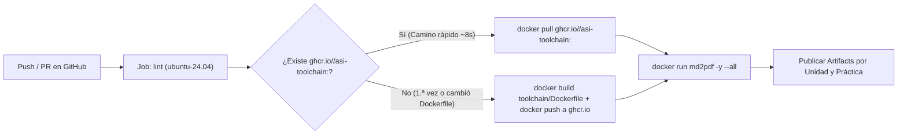

# Spec 05 — Imagen Docker Precompilada del Toolchain en GitHub Container Registry (`ghcr.io`)

* **Estado**: Implementada (2026-11-06)
* **Fecha**: 2026-11-06
* **Alcance**: Creación de `toolchain/Dockerfile` con Pandoc, TeX Live (`LuaLaTeX`) y el caché de fuentes de `luaotfload` precalentado, e integración con GitHub Container Registry (`ghcr.io`) en `.github/workflows/editorial-ci.yml` para eliminar la instalación de paquetes con `apt-get` en cada ejecución de CI/CD.

---

## 1. Diagnóstico del Problema Actual (`AS-IS`)

En la implementación actual de `.github/workflows/editorial-ci.yml`, el paso **«Instalar Pandoc, LuaLaTeX y fuentes del toolchain»** ejecuta `sudo apt-get update && sudo apt-get install` desde cero en cada *push* o *Pull Request*. Esto presenta tres problemas operativos graves:

1. **Estrangulamiento (*throttling*) y cuelgues en mirrors de Ubuntu/Azure**:
   * Los runners `ubuntu-24.04` descargan aproximadamente 450 MB de paquetes (`texlive-latex-extra`, `texlive-pictures`, `texlive-latex-recommended`, `texlive-luatex`, `texlive-fonts-recommended`, `pandoc`) desde `azure.archive.ubuntu.com`. Cuando un nodo espejo limita el ancho de banda o cuelga una conexión HTTP, el paso de instalación puede demorar desde varios minutos hasta más de una hora.
2. **Sobrecarga de E/S en disco (`dpkg`) y triggers de `tex-common`**:
   * En cada ejecución, `dpkg` desempaqueta ~30.000 archivos individuales de TeX Live realizando `fsync()` y luego dispara `mktexlsr`, `updmap-sys`, `fmtutil-sys --all` (`Building format(s) --all`) y `needrestart`.
3. **Regeneración repetida de la base de datos de `luaotfload`**:
   * En el primer documento compilado de cada corrida, `lualatex` debe escanear todas las fuentes del sistema y compilar desde cero los archivos `.luc` de tablas OpenType (`luatex-cache/generic/fonts/otl/`).

---

## 2. Arquitectura Propuesta (`TO-BE`)

Siguiendo el **Principio 3 de `GEMINI.md` (Autocontención del Toolchain)**, se encapsula el entorno de compilación en una imagen Docker declarada en `toolchain/Dockerfile` y publicada automáticamente en **GitHub Container Registry (`ghcr.io/<owner>/asi-toolchain`)**.

### 2.1. `toolchain/Dockerfile`

Se crea `toolchain/Dockerfile` basado en `ubuntu:24.04` con las siguientes optimizaciones:

1. **Instalación resiliente y sin `fsync`**:
   * Configura `DEBIAN_FRONTEND=noninteractive`, `NEEDRESTART_MODE=l`, `Dpkg::Options::="--force-unsafe-io"`, `Acquire::ForceIPv4=true`, `Acquire::Retries=5` y `Acquire::http::Timeout=20`.
   * Instala únicamente los paquetes requeridos por el toolchain editorial: `pandoc`, `texlive-luatex`, `texlive-latex-recommended`, `texlive-latex-extra`, `texlive-fonts-recommended`, `texlive-lang-spanish`, `lmodern`, `fonts-noto-color-emoji`, `fonts-dejavu-core`, `perl` y `ca-certificates`, limpiando `/var/lib/apt/lists/*` al finalizar.
2. **Precalentamiento global del caché de `luaotfload` (`TEXMFVAR` / `TEXMFCACHE`)**:
   * Define `ENV TEXMFVAR=/var/cache/texmf-var TEXMFCACHE=/var/cache/texmf-var`. Al fijar estas variables fuera de `$HOME`, el caché de `lualatex` queda disponible para cualquier usuario (`--user "$(id -u):$(id -g)"`) sin importar el valor de `$HOME` en tiempo de ejecución.
   * Durante el `docker build`, copia temporalmente `toolchain/pandoc` en `/workspace/toolchain/pandoc`, ejecuta `luaotfload-tool --update --force` y compila un documento Markdown de prueba con todas las variantes (`Regular`, `Italic`, `Bold`, `BoldItalic`) de `Libertinus Serif`, `Inter` y `JetBrains Mono`, fórmulas matemáticas (`Latin Modern Math`), símbolos (`DejaVu Sans`) y emojis (`Noto Color Emoji`).
   * De este modo, tanto `luaotfload-names.luc.gz` como los ~21 MB de bytecode OpenType (`luatex-cache/generic/fonts/otl/*.luc`) quedan precompilados dentro de la imagen con permisos `a+rwX`.

### 2.2. Integración en `.github/workflows/editorial-ci.yml`

En el job `build`:

1. **Permisos del workflow**:
   * Se añade `packages: write` junto a `contents: write` en el bloque `permissions:` para permitir la publicación automática de la imagen en `ghcr.io` usando el `GITHUB_TOKEN` nativo del repositorio (sin requerir secretos adicionales).
2. **Etiquetado determinista por hash (`TAG_HASH`)**:
   * Se calcula el hash SHA-256 de `toolchain/Dockerfile` y de todos los archivos de `toolchain/pandoc/` (primeros 12 caracteres).
   * El paso intenta hacer `docker pull ghcr.io/<owner>/asi-toolchain:<TAG_HASH>`:
     * **Si la imagen ya existe en `ghcr.io`** (caso habitual en el 99 % de los commits de apuntes): se descarga en pocos segundos sin ejecutar `apt-get` ni `dpkg`.
     * **Si la imagen no existe aún** (primera ejecución tras este cambio o cuando se modifique `toolchain/Dockerfile` o `toolchain/pandoc/`): construye la imagen con `docker build -f toolchain/Dockerfile toolchain` y, si no es un Pull Request externo, la publica en `ghcr.io/<owner>/asi-toolchain:<TAG_HASH>` y `:latest`.
3. **Compilación aislada con `docker run`**:
   * Se ejecuta `./toolchain/bin/md2pdf -y --all` dentro del contenedor montando el repositorio en `/workspace` (`-v "$PWD:/workspace" -w /workspace`) con el UID/GID del runner (`--user "$(id -u):$(id -g)"`), generando los archivos directamente en `build/` listos para los pasos posteriores de `actions/upload-artifact@v7`.

---

## 3. Impacto y Beneficios

* **Reducción del tiempo de preparación del entorno**: de varios minutos (o más de una hora ante degradación de mirrors de Azure) a **~8–15 segundos** (`docker pull`).
* **Eliminación del tiempo de arranque de `luaotfload`**: la compilación del primer PDF ya no demora en generar la base de datos de fuentes ni las tablas `.luc`.
* **Portabilidad local**: cualquier colaborador puede construir o descargar la imagen `ghcr.io/gez-schegtel/asi-toolchain:latest` para compilar los apuntes en su máquina sin instalar TeX Live en su sistema anfitrión.
