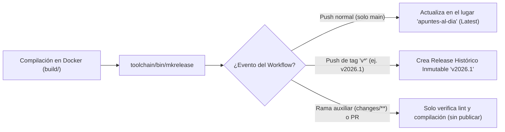

# Spec 06 — Publicación Continua en Release Principal (`apuntes-al-dia`) y Snapshots Históricos (`v*`)

* **Estado**: Implementada (2026-11-06 — Un único Release principal actualizable en el lugar + soporte de Releases históricos inmutables `v*`)

* **Fecha**: 2026-11-06

* **Alcance**: Reemplazo de *GitHub Actions Artifacts* y de múltiples releases sueltos por un **único Release principal continuo (`apuntes-al-dia`, marcado como `Latest`)** actualizado atómicamente en el lugar mediante `toolchain/bin/mkrelease`, acompañado de **Releases históricos inmutables** al publicar tags de versión `v*`.

---

## 1. Diagnóstico del Problema (`AS-IS`)

1. **Fricción de *Actions Artifacts***: Descargar desde la pestaña *Actions* requiere múltiples clics, obliga a iniciar sesión en GitHub, comprime todo forzosamente en `.zip` y caduca a los 30 días.

2. **Riesgos de tener múltiples Releases móviles por unidad**:

   * Borrar y recrear 5–8 Releases en cada commit (`gh release delete` + `create`) introduce ventanas donde un fallo de red deja una unidad caída (`404`), ensucia la lista de tags de Git y envía múltiples notificaciones por correo a los seguidores (*Watchers*) del repositorio.

   * Por otro lado, crear un Release nuevo por cada commit sin borrar el anterior llenaría la página de `/releases` con decenas de copias repetidas.

---

## 2. Arquitectura Implementada (`TO-BE`)

Se implementa una estrategia **dual (Rolling Release + Snapshots Históricos)** gestionada por el script autocontenido [`toolchain/bin/mkrelease`](../../toolchain/bin/mkrelease):

### 2.1. Un Único Release Principal Continuo (`tag: apuntes-al-dia` / `/releases/latest`)

En cada push a la rama principal (`main`):

1. **Actualización en el lugar sin caída de enlaces (`--clobber`)**:

   * Si el Release `apuntes-al-dia` ya existe, **no se elimina**: se actualiza el puntero del tag al commit actual, se suben y sobrescriben los archivos con `gh release upload --clobber`, se purgan únicamente los assets que hayan quedado obsoletos (si algún documento cambió de nombre) y se actualiza el cuerpo Markdown con `gh release edit --latest=true`.

   * Así, la URL fija **`/releases/latest`** nunca devuelve `404` durante una compilación ni genera spam de notificaciones.

2. **Organización interna por Unidad y Trabajo Práctico**:

   * El cuerpo del Release presenta un **índice ordenado por Unidad** con tablas y enlaces de descarga directa en **1 clic** tanto al paquete `.zip` completo de cada módulo (`Programa-Oficial-2026.zip`, `Unidad-0-Completa.zip`, `Unidad-I-Completa.zip`, `Unidad-III-Completa.zip`, `Unidad-VI-Completa.zip`, `TPI-Parte-1-Alineamiento.zip`, `TPI-Parte-2-DVP.zip`) como a cada archivo `.pdf` y `.epub` individual.

   * Al preparar los archivos individuales para GitHub Releases, `mkrelease` translitera tildes y espacios a nombres ASCII limpios (ej. `Unidad-III_-_Subsistema-de-Aplicacion.pdf`) para evitar que GitHub reemplace caracteres acentuados por puntos (`Aplicaci.n.pdf`), mientras que dentro de cada `.zip` se conservan los nombres originales completos con tildes y espacios.

### 2.2. Resguardo de Versiones Anteriores: Releases Históricos Inmutables (`tags: v*`)

* Las fuentes históricas (`.md` e imágenes) están siempre resguardadas en el historial de commits de Git.

* Además, cuando el equipo desee congelar una versión histórica de los PDFs/EPUBs compilados (por ejemplo al cierre de un parcial o fin de cursada: `git tag v2026-parcial1 && git push origin v2026-parcial1`), el workflow detecta el prefijo `v*` y publica un **Release Histórico Inmutable** (`📚 Snapshot Histórico — v2026-parcial1`, con `--latest=false`) que **jamás es borrado ni sobrescrito** por los commits posteriores, manteniendo siempre arriba a `apuntes-al-dia` como `Latest`.

### 2.3. Limpieza de *Actions Artifacts* y de `README.md`

* En `push` y `workflow_dispatch` no se suben *Artifacts* redundantes en la pestaña *Actions* (solo se suben como vista previa temporal de 3 días en Pull Requests).

* El `README.md` apunta directamente a `/releases/latest` y a los paquetes `.zip` de cada unidad mediante la ruta permanente `/releases/latest/download/<Unidad>.zip`.

---

### 2.4. Refinamiento de Trazabilidad Temporal (Estampado Dinámico de Fecha en Título y Encabezado)

* **Diagnóstico**: La API REST de GitHub mantiene inmutable el campo `published_at` original cuando un Release existente se actualiza en el lugar mediante `gh release edit`. Como consecuencia, la interfaz web de GitHub mostraba un indicador temporal relativo estático basado en la fecha de creación del contenedor inicial (ej. *"last week"*), lo que podía suscitar dudas respecto a si los apuntes y trabajos prácticos descargables correspondían a la última compilación.

* **Decisión de diseño (Opción B descartada — Anti-patrón de Draft)**: Se descartó deliberadamente forzar la actualización de `published_at` alternando la release entre `draft: true` y `draft: false`. Pasar una release a borrador la vuelve privada temporalmente; un fallo de red o tiempo de espera en GitHub Actions dejaría la release en borrador, rompiendo el enlace permanente `/releases/latest` con un error `404 Not Found` para estudiantes y visitantes anónimos.

* **Solución arquitectónica adoptada**:

  1. **Estampado dinámico en el título principal**: [`toolchain/bin/mkrelease`](../../toolchain/bin/mkrelease) obtiene la fecha del commit compilado o del día (`%d/%m/%Y`) y la incorpora de forma visible en el título del Release:
     `TITULO="📚 Apuntes y Guías Prácticas — Última Versión (${FECHA_ACTUAL})"`

  2. **Trazabilidad en el cuerpo Markdown**: La primera línea del índice declara explícitamente la fecha de actualización y el hash del commit:
     `> ✅ **Versión actualizada automáticamente:** ${FECHA_ACTUAL} (commit \`${SHA:0:7}\`).`

  3. **Disponibilidad 24/7 y cero regresiones**: La release permanece permanentemente pública, sin parpadeos ni ventanas de error, garantizando máxima claridad visual a cualquier usuario que ingrese al repositorio.

---

### 2.5. Restricción de Publicación Exclusiva a `main` (y Tags Históricos `v*`)

* **Diagnóstico**: El workflow [`.github/workflows/editorial-ci.yml`](../../.github/workflows/editorial-ci.yml) se dispara tanto en `main` como en ramas auxiliares (`changes/**`, `master`) para validar cambios antes del merge, pero la condición `if: github.event_name != 'pull_request'` permitía que un `push` en `changes/**` publicara sobre el Release continuo `apuntes-al-dia` (y sobre el tag `:latest` de GHCR).

* **Regla aplicada**:

  * Las ramas auxiliares (`changes/**`, `master`, y cualquier Pull Request) ejecutan íntegramente `lint` y la compilación de verificación con `md2pdf --all` dentro de Docker, pero **no publican Releases** ni empujan imágenes a GHCR.

  * La publicación en GitHub Releases (`apuntes-al-dia` o snapshots `v*`) y el push de la imagen Docker a GHCR quedan estrictamente restringidos a eventos que no sean `pull_request` sobre `refs/heads/main` o tags `refs/tags/v*`, y siempre condicionados a que `lint` y la compilación finalicen con éxito.

